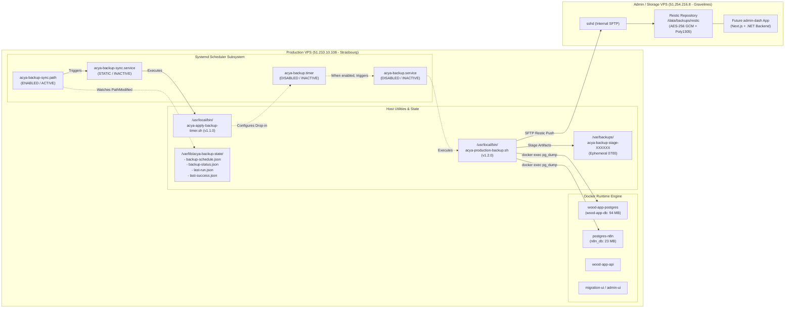
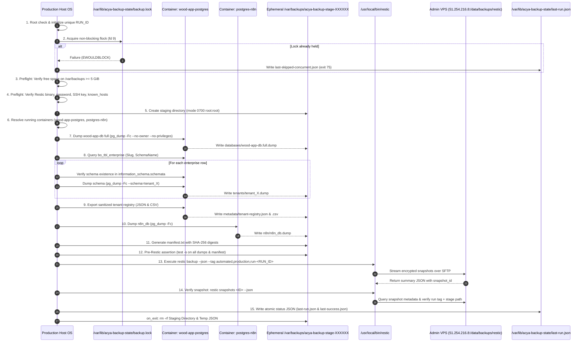
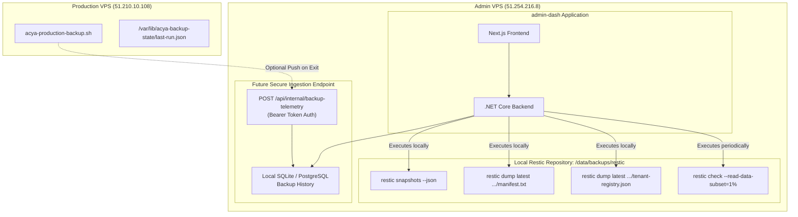
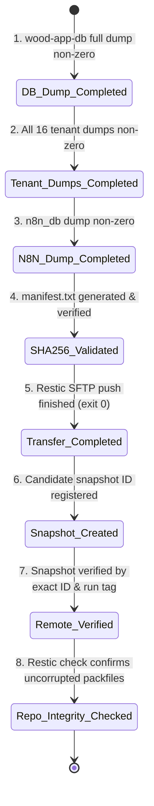

# ACYA — Production VPS: Complementary Backup Infrastructure Investigation

**Document Classification:** Read-Only Technical Audit & Architecture Reference  
**Target Environment:** Production VPS (`51.210.10.108`) & Admin / Storage VPS (`51.254.216.8`)  
**Target Project:** `admin-dash` Architecture & Integration  
**Audit Local Time:** November 1, 2026, 17:53 UTC  
**Audit Authority:** Antigravity (Advanced Agentic Pair Programming)  
**Safety Status:** Strictly Read-Only (Zero modifications, zero service/timer activations, zero secret leaks)  

---

## 1. Executive Summary

This audit constitutes an exhaustive, read-only technical investigation of the ACYA production backup infrastructure on the Production VPS (`51.210.10.108`) in preparation for the local design and implementation of the `admin-dash` monitoring and administration platform (to be hosted on the Admin / Storage VPS `51.254.216.8`).

### Key Audit Findings

| Investigation Area | Current Production Status | Audit Assessment |
| :--- | :--- | :--- |
| **Backup Script Version** | `/usr/local/bin/acya-production-backup.sh` (v1.2.0) | **Hardened**: Includes `flock` concurrency guard, 5 GiB staging preflight, per-run unique UUID/tagging, Restic exit code 3 tracking, and atomic status reporting. |
| **Host Scheduler** | `acya-backup.timer` & `acya-backup.service` | **INTENTIONALLY DISABLED & INACTIVE**: The systemd timer is stopped and disabled. No automated cron or timer runs backup jobs. |
| **State Synchronizer** | `acya-backup-sync.path` (Active) & `acya-apply-backup-timer.sh` (v1.1.0) | **Functional**: Listens for writes to `/var/lib/acya-backup-state/backup-schedule.json` to dynamically generate and synchronize systemd drop-ins. |
| **Registered Tenants** | 16 Enterprises in `public.bo_tbl_enterprise` | **100% Schema Alignment**: Exactly 16 `tenant_*` schemas exist in `wood-app-db`. Zero orphan schemas, zero missing schemas. |
| **Tenant Coverage in Backups** | Dynamic discovery of all 16 tenants | **Inclusive**: Script queries ALL enterprises regardless of `IsActive` or `Status` (Active, Trial, Suspended, Expired are all dumped). |
| **Latest Repository Snapshot** | Snapshot `36a26b4e` (October 13, 2026, 10:52:27 UTC) | **Divergence**: Contains 13 tenants. 3 tenants (`inky-pinky`, `oxylab`, `sotubois`) were registered after this snapshot and currently have no offsite backup. |
| **Transfer Subsystem** | Direct Restic SFTP (`sftp:backup@51.254.216.8:/data/backups/restic`) | **Integrated**: No intermediate rsync/sftp shell scripts. Restic communicates directly over SSH using an Ed25519 identity key. |
| **Staging Lifecycle** | `/var/backups/acya-backup-stage-XXXXXX` | **Strictly Ephemeral**: Created with mode `0700` (root:root) and immediately destroyed upon script exit via an unconditional `trap on_exit` handler. |
| **Manifest & Integrity** | `manifest.txt` with SHA-256 digests | **Asymmetric Validation**: Staging script hashes files into `manifest.txt` and asserts non-zero file sizes (`test -s`), but does not run `sha256sum -c` prior to upload. Restic handles block-level SHA-256 integrity. |
| **Decoupled Dashboard Readiness** | Admin VPS local repository access | **High**: `admin-dash` on the Admin VPS can read snapshots, manifests, and tenant metadata directly from `/data/backups/restic` without touching the Production API. |

---

## 2. Existing Backup Architecture

ACYA utilizes a two-node, zero-trust infrastructure architecture separating production ERP workloads from monitoring, administration, and backup storage.



### 2.1 Hardware, Network & OS Topology
- **Production Host:** `vps-1d2bffb5` (`51.210.10.108`), Ubuntu 24.04 LTS (x86_64).
  - Storage: 96 GB root filesystem (`/dev/sda1`), 65 GB available (33% used).
  - Docker Container Engine: Docker CE 27.x.
- **Storage & Monitoring Host:** `vps-b92b4ae6` (`51.254.216.8`), Ubuntu 24.04 LTS (x86_64).
  - Dedicated Backup Volume: `/data/backups/restic` (100 GB dedicated volume).
  - Inbound Access: SSH port 22 restricted; `backup` user configured with `ForceCommand internal-sftp`.

### 2.2 Systemd Unit Configuration & Status

| Unit Name | File Location | Enabled State | Live State | Function |
| :--- | :--- | :--- | :--- | :--- |
| `acya-backup.timer` | `/etc/systemd/system/acya-backup.timer` | **disabled** | **inactive (dead)** | Fires daily backup. Overridden by drop-in `10-schedule.conf`. |
| `acya-backup.service` | `/etc/systemd/system/acya-backup.service` | **disabled** | **inactive (dead)** | Executes `/usr/local/bin/acya-production-backup.sh` under root hardening. |
| `acya-backup-sync.path` | `/etc/systemd/system/acya-backup-sync.path` | **enabled** | **active (waiting)** | Inotify watcher on `/var/lib/acya-backup-state/backup-schedule.json`. |
| `acya-backup-sync.service`| `/etc/systemd/system/acya-backup-sync.service` | **static** | **inactive (dead)** | Executes `/usr/local/bin/acya-apply-backup-timer.sh` when triggered by `.path`. |

Drop-in status (`/etc/systemd/system/acya-backup.timer.d/10-schedule.conf`):
```ini
[Timer]
OnCalendar=
OnCalendar=*-*-* 01:00:00 UTC
```
*Note:* The drop-in is pre-configured to `01:00:00 UTC` (corresponding to `02:00 Africa/Tunis`), but remains dormant because `acya-backup.timer` is disabled.

---

## 3. Exact Backup Execution Flow

The production backup script `/usr/local/bin/acya-production-backup.sh` (Version 1.2.0) executes through 15 discrete, sequential phases under strict error-trapping (`set -euo pipefail` and `umask 077`).



### Detailed Pipeline Stages

#### Stage 1: Initialization & Privilege Check
- Asserts effective user ID is `0` (`root`).
- Configures signal traps: `HUP` (exit 129), `INT` (exit 130), `TERM` (exit 143), and unconditional `EXIT` (`on_exit`).
- Generates a cryptographically random, per-run identifier:  
  `RUN_ID="$(date -u +%Y%m%dT%H%M%SZ)-${_uuid%%-*}"` (e.g., `20261013T105218Z-182443d4`).
- Defines tag: `RUN_TAG="run-${RUN_ID}"`.

#### Stage 2: Concurrency Guard (`flock`)
- Opens file descriptor 9 to `/var/lib/acya-backup-state/backup.lock` with mode `0600`.
- Attempts `flock -n 9`. If another instance holds the lock:
  - Writes status to `/var/lib/acya-backup-state/last-skipped-concurrent.json` (to avoid clobbering `last-run.json`).
  - Terminates immediately with exit code `75`.
- Writes status `"outcome": "running"` to `last-run.json`.

#### Stage 3: Storage Preflight
- Determines filesystem free bytes via `stat -f` on `/var/backups`.
- Asserts available bytes $\ge$ `MIN_FREE_BYTES` (default 5,368,709,120 bytes / 5 GiB).
- If space is deficient: sets `ERROR_CATEGORY="insufficient_space"`, exits with code `73`.

#### Stage 4: Restic Prerequisites Preflight
- Checks executable permission on `/usr/local/bin/restic`.
- Asserts non-zero presence of:
  - `/etc/acya-backup/.restic_password`
  - `/etc/acya-backup/acya_backup_ed25519`
  - `/etc/acya-backup/known_hosts`
- Assembles strict SSH arguments:
  `-i /etc/acya-backup/acya_backup_ed25519 -o IdentitiesOnly=yes -o UserKnownHostsFile=/etc/acya-backup/known_hosts -o StrictHostKeyChecking=yes`

#### Stage 5: Transient Staging Directory Setup
- Executes `mktemp -d /var/backups/acya-backup-stage-XXXXXX`.
- Hardens directory: `chmod 0700` and `chown root:root`.
- Creates subdirectories: `databases/`, `tenants/`, `n8n/`, `metadata/`.

#### Stage 6: Production Container Discovery
- Queries Docker for running containers:
  - `POSTGRES_CONTAINER`: filter `name=wood-app-postgres`.
  - `N8N_POSTGRES_CONTAINER`: filter `name=postgres-n8n`.
- If either is not actively running, halts immediately with error.

#### Stage 7: Master Full Database Dump
- Executes inside the container:
  ```bash
  docker exec "${POSTGRES_CONTAINER}" pg_dump -U postgres -d wood-app-db \
    -Fc --no-owner --no-privileges > "${STAGE}/databases/wood-app-db.full.dump"
  ```
- Dumps all schemas (including `public`, registry tables, and all tenant schemas).

#### Stage 8: Dynamic Tenant Schema Discovery & Per-Tenant Dumps
- Discovers registered tenants:
  ```bash
  SELECT "Slug", "SchemaName" FROM public.bo_tbl_enterprise ORDER BY "Id";
  ```
- **Inclusion Filter:** None. All rows are selected regardless of `IsActive`, `Status`, or `Plan`.
- For each row:
  - Verifies presence in `information_schema.schemata`.
  - **Critical Failure Mode:** If the schema does not exist in PostgreSQL, the script logs an error and halts the entire backup!
  - Dumps individual tenant schema:
    ```bash
    docker exec "${POSTGRES_CONTAINER}" pg_dump -U postgres -d wood-app-db \
      -Fc --schema="${schema}" --no-owner --no-privileges > "${STAGE}/tenants/${schema}.dump"
    ```

#### Stage 9: Sanitized Metadata Export
- Dumps tenant registry table in JSON format:
  ```sql
  SELECT json_agg(t) FROM (
    SELECT "Id", "Slug", "SchemaName", "IsActive", "Status", "Plan", "CreatedAt", "ActivatedAt" 
    FROM public.bo_tbl_enterprise ORDER BY "Id"
  ) t;
  ```
  Written to `${STAGE}/metadata/tenant-registry.json`.
- Dumps tenant registry in CSV format: written to `${STAGE}/metadata/tenant-registry.csv`.

#### Stage 10: n8n Database Dump
- Executes logical custom dump from the secondary PostgreSQL engine:
  ```bash
  docker exec "${N8N_POSTGRES_CONTAINER}" pg_dump -U n8n_user -d n8n_db \
    -Fc --no-owner --no-privileges > "${STAGE}/n8n/n8n_db.dump"
  ```

#### Stage 11: Manifest Generation
- Assembles `${STAGE}/metadata/manifest.txt` (permissions `0600`).
- Writes environmental headers (Timestamp, Versions, Run ID, Container names, Tenant list).
- Calculates SHA-256 hashes for all staged files:
  ```bash
  find "${STAGE}" -type f -not -name "manifest.txt" -exec sha256sum {} +
  ```

#### Stage 12: Staging Validation Assertions
- Verifies non-zero size (`test -s`) for:
  - `wood-app-db.full.dump`
  - Every tenant dump `${schema}.dump`
  - `n8n_db.dump`
  - `tenant-registry.json`, `tenant-registry.csv`, `manifest.txt`
- Asserts canonical host filesystem directories exist:
  - `/home/ubuntu/acya-app/storage/private/mobile`
  - `/var/lib/docker/volumes/n8n_data/_data`
  - `docker-compose.yml`, `docker-compose.n8n.yml`, `.env`, `.env.n8n`
  - `/etc/nginx`, `/etc/letsencrypt`
- Calculates `STAGING_BYTES` using `du -sb`.

#### Stage 13: Restic Repository Execution
- Creates an out-of-stage temporary file: `${STAGING_PARENT}/acya-backup-json-XXXXXX`.
- Invokes Restic with JSON progress streaming:
  ```bash
  RESTIC_PROGRESS_FPS=0.0166 /usr/local/bin/restic \
    -r "sftp:backup@51.254.216.8:/data/backups/restic" \
    -o "sftp.args=${SFTP_ARGS}" \
    --password-file "/etc/acya-backup/.restic_password" \
    backup \
    --json \
    --tag automated \
    --tag production \
    --tag "${RUN_TAG}" \
    "${STAGE}" \
    /home/ubuntu/acya-app/storage/private/mobile \
    /var/lib/docker/volumes/n8n_data/_data \
    /home/ubuntu/acya-app/docker-compose.yml \
    /home/ubuntu/acya-app/docker-compose.n8n.yml \
    /home/ubuntu/acya-app/.env \
    /home/ubuntu/acya-app/.env.n8n \
    /etc/nginx \
    /etc/letsencrypt > "${RESTIC_JSON}" 9>&-
  ```
- Evaluates exit code:
  - Code `0`: Complete success.
  - Code `3`: Incomplete snapshot (some files could not be read, but snapshot created).
  - Other codes: Fatal failure.

#### Stage 14: Post-Backup Verification
- Parses exact candidate snapshot ID from Restic summary JSON.
- Queries Restic repository: `restic snapshots "${CANDIDATE_ID}" --json`.
- Validates that:
  - Snapshot ID matches.
  - Snapshot tags contain `${RUN_TAG}`.
  - Snapshot paths contain `${STAGE}`.
- If verification passes and exit code was 3: flags `OUTCOME="partial"` and `ERROR_CATEGORY="restic_incomplete_snapshot"`.
- If verification passes and exit code was 0: flags `OUTCOME="success"`.

#### Stage 15: Status Reporting & Ephemeral Cleanup (`on_exit`)
- Computes execution duration.
- Writes `/var/lib/acya-backup-state/last-run.json` atomically via rename.
- If and only if `OUTCOME == "success"`, writes `/var/lib/acya-backup-state/last-success.json`.
- Cleans up: `rm -rf -- "${STAGE}"` and `rm -f -- "${RESTIC_JSON}"`.
- Releases file descriptor 9 (`flock`).

---

## 4. Tenant Coverage Analysis

A live inspection of `public.bo_tbl_enterprise` was correlated against PostgreSQL catalog schemas in `information_schema.schemata`.

### 4.1 Master Registry vs Live Catalog Audit

| Id | Slug | Schema Name | IsActive | Status | Plan | Registered Date (UTC) | Schema in PostgreSQL |
| :---: | :--- | :--- | :---: | :--- | :--- | :--- | :---: |
| 16 | `piqbit` | `tenant_piqbit` | **true** | Trial | Trial | 2026-06-25 22:19:27 | **Present** |
| 22 | `wellness-medical` | `tenant_wellness_medical` | **false** | Suspended | Trial | 2026-06-27 12:44:27 | **Present** |
| 24 | `fleur-de-printemps` | `tenant_fleur_de_printemps` | **false** | Expired | Trial | 2026-06-28 17:25:29 | **Present** |
| 25 | `mansour-construction` | `tenant_mansour_construction` | **true** | Trial | Trial | 2026-06-28 19:19:39 | **Present** |
| 32 | `stramica` | `tenant_stramica` | **false** | Suspended | Trial | 2026-07-02 13:58:52 | **Present** |
| 34 | `oise-btp` | `tenant_oise_btp` | **false** | Expired | Trial | 2026-07-06 19:55:12 | **Present** |
| 35 | `ttv` | `tenant_ttv` | **true** | Trial | Trial | 2026-07-11 20:28:11 | **Present** |
| 36 | `tucobois` | `tenant_tucobois` | **false** | Expired | Trial | 2026-07-18 18:43:39 | **Present** |
| 37 | `sheg` | `tenant_sheg` | **false** | Expired | Trial | 2026-07-25 07:51:05 | **Present** |
| 38 | `socofeb` | `tenant_socofeb` | **true** | Active | Pro | 2026-08-05 08:44:39 | **Present** |
| 39 | `socobois` | `tenant_socobois` | **true** | Trial | Trial | 2026-08-05 12:37:24 | **Present** |
| 45 | `rs-auto-service` | `tenant_rs_auto_service` | **true** | Trial | Trial | 2026-10-09 09:42:34 | **Present** |
| 46 | `zaiemtex` | `tenant_zaiemtex` | **true** | Trial | Trial | 2026-10-11 18:08:15 | **Present** |
| 47 | `inky-pinky` | `tenant_inky_pinky` | **true** | Trial | Trial | 2026-10-13 11:51:06 | **Present** |
| 48 | `oxylab` | `tenant_oxylab` | **true** | Trial | Trial | 2026-10-15 16:45:06 | **Present** |
| 49 | `sotubois` | `tenant_sotubois` | **true** | Trial | Trial | 2026-10-30 07:39:23 | **Present** |

### 4.2 Coverage Findings & Discrepancies
1. **Total Registered Enterprises:** 16 records.
2. **Total Tenant Schemas in Catalog:** Exactly 16 `tenant_*` schemas.
3. **Orphan Schemas:** **0**. There are no database schemas prefixed with `tenant_` that lack an enterprise record.
4. **Missing Schemas:** **0**. Every registered enterprise has a provisioned PostgreSQL schema.
5. **System Schema Exclusion:** `information_schema`, `pg_catalog`, and `pg_toast` are properly excluded from per-tenant dumps. The master relational schema `public` is backed up in the full database dump `wood-app-db.full.dump`.
6. **Inactive / Suspended / Expired Status Handling:**
   - Active / Trial (`IsActive = true`): 10 enterprises.
   - Suspended / Expired (`IsActive = false`): 6 enterprises.
   - **Script Behavior:** The backup script iterates through ALL 16 enterprises without filtering on `IsActive` or `Status`. All 16 schemas are dumped.
7. **Snapshot Divergence (Critical Timeline Finding):**
   - The latest offsite Restic snapshot (`36a26b4e`) was committed on **October 13, 2026 at 10:52:27 UTC**.
   - At that timestamp, exactly 13 tenants existed.
   - 3 tenants were registered subsequent to that snapshot:
     - `inky-pinky`: Created October 13, 11:51:06 UTC (59 minutes after the backup).
     - `oxylab`: Created October 15, 16:45:06 UTC.
     - `sotubois`: Created October 30, 07:39:23 UTC.
   - **Conclusion:** If a disaster occurred right now, these 3 tenants would have **zero offsite backup recovery point** because the scheduler is disabled.

---

## 5. Backup Artifacts and Manifest Structure

### 5.1 Staging Directory Hierarchy
During execution, artifacts are temporarily organized under `/var/backups/acya-backup-stage-XXXXXX/`:

```text
/var/backups/acya-backup-stage-XXXXXX/
├── databases/
│   └── wood-app-db.full.dump         (Custom pg_dump format: compressed, relational DDL & data)
├── tenants/
│   ├── tenant_piqbit.dump
│   ├── tenant_wellness_medical.dump
│   ├── tenant_fleur_de_printemps.dump
│   ├── tenant_mansour_construction.dump
│   ├── tenant_stramica.dump
│   ├── tenant_oise_btp.dump
│   ├── tenant_ttv.dump
│   ├── tenant_tucobois.dump
│   ├── tenant_sheg.dump
│   ├── tenant_socofeb.dump
│   ├── tenant_socobois.dump
│   ├── tenant_rs_auto_service.dump
│   ├── tenant_zaiemtex.dump
│   ├── tenant_inky_pinky.dump        (in future runs)
│   ├── tenant_oxylab.dump            (in future runs)
│   └── tenant_sotubois.dump          (in future runs)
├── n8n/
│   └── n8n_db.dump                   (Custom pg_dump format of n8n automation database)
└── metadata/
    ├── tenant-registry.json          (JSON export of bo_tbl_enterprise)
    ├── tenant-registry.csv           (CSV export of bo_tbl_enterprise)
    └── manifest.txt                  (Cryptographic manifest & staging inventory)
```

### 5.2 Sanitized Manifest Structure (`manifest.txt`)
Extracted from snapshot `36a26b4e`:

```text
============================================================
ACYA AUTOMATED PRODUCTION BACKUP MANIFEST
============================================================
Timestamp: 2026-10-13 10:52:26 UTC
Script Version: 1.2.0
Run ID: 20261013T105218Z-182443d4
Hostname: vps-1d2bffb5
Host IP: 51.210.10.108
PostgreSQL Container: 8cdff3364501_wood-app-postgres
PostgreSQL Version: postgres (PostgreSQL) 15.18
Restic Version: restic 0.19.1 compiled with go1.26.4 on linux/amd64
Database Name: wood-app-db
Tenant Count: 13
Tenant Schemas: tenant_piqbit tenant_wellness_medical tenant_fleur_de_printemps tenant_mansour_construction tenant_stramica tenant_oise_btp tenant_ttv tenant_tucobois tenant_sheg tenant_socofeb tenant_socobois tenant_rs_auto_service tenant_zaiemtex

------------------------------------------------------------
GENERATED STAGING ARTIFACTS AND CHECKSUMS
------------------------------------------------------------
91e09a8ff4a9ea22256e527128eda8e7fa8c8f43c91daeb64ef41ebfc89ae6f1  /var/backups/acya-backup-stage-wBiNgj/databases/wood-app-db.full.dump
c452a3e2139692a6ff639adeb2e5fbbb388b3b0c5554144483a6241db5aaf68b  /var/backups/acya-backup-stage-wBiNgj/n8n/n8n_db.dump
e424bc0d47e205b6f93b5ce441bff152547eaf902398cb6a908d88698b053562  /var/backups/acya-backup-stage-wBiNgj/tenants/tenant_piqbit.dump
[... checksums for all tenant dumps ...]
6809f1012a52697be8f05fddd8cfdb93d5af3f616c918a0fb3c8003a4279ce10  /var/backups/acya-backup-stage-wBiNgj/metadata/tenant-registry.json
7b74ee58fa60f2498a99b80d59d5e5a92465912ff4dd4b1a42eeea6838ddd26a  /var/backups/acya-backup-stage-wBiNgj/metadata/tenant-registry.csv
============================================================
END OF MANIFEST
============================================================
```

### 5.3 Sanitized Tenant Registry Export (`tenant-registry.json`)
Extracted from snapshot `36a26b4e`:
```json
[
  {"Id":16,"Slug":"piqbit","SchemaName":"tenant_piqbit","IsActive":true,"Status":"Trial","Plan":"Trial","CreatedAt":"2026-06-25T22:19:27.252817+00:00","ActivatedAt":"2026-10-01T22:39:33.66379+00:00"},
  {"Id":22,"Slug":"wellness-medical","SchemaName":"tenant_wellness_medical","IsActive":false,"Status":"Suspended","Plan":"Trial","CreatedAt":"2026-06-27T12:44:27.12674+00:00","ActivatedAt":"2026-09-02T21:16:28.953391+00:00"},
  {"Id":38,"Slug":"socofeb","SchemaName":"tenant_socofeb","IsActive":true,"Status":"Active","Plan":"Pro","CreatedAt":"2026-08-05T08:44:39.829997+00:00","ActivatedAt":"2026-08-29T10:11:35.293961+00:00"}
]
```

### 5.4 Hash & Validation Analysis
- **Hashing Algorithm:** Standard SHA-256 (`sha256sum`).
- **Validation Gap:** `acya-production-backup.sh` computes the SHA-256 hashes and saves them to `manifest.txt`. However, **it does not execute a verification step (`sha256sum -c`) before calling Restic**. It only tests that files exist and have non-zero size (`test -s`).
- **Transport Integrity:** Restic internally computes cryptographic hashes of every data chunk and verifies them before committing index files.

---

## 6. Transfer Mechanism

### 6.1 Architecture & Invocation
- **Subsystem:** Integrated SFTP client inside Restic binary (`/usr/local/bin/restic`).
- **Target URL:** `sftp:backup@51.254.216.8:/data/backups/restic`.
- **Identity & Authentication:**
  - Dedicated private key: `/etc/acya-backup/acya_backup_ed25519` (permissions `0600`).
  - Known hosts verification: `/etc/acya-backup/known_hosts` (strict host key checking enforced).
  - Dedicated password file: `/etc/acya-backup/.restic_password` (permissions `0600`).
- **Zero Separate Transfer Scripts:** There are no standalone `rsync`, `scp`, or `lftp` scripts. Restic directly streams data blocks to the remote SFTP endpoint.

### 6.2 Transport Characteristics & Error Handling
- **Atomicity:** Restic writes content-addressed blob files (`/data/backups/restic/data/xx/`) and only commits the snapshot pointer (`/data/backups/restic/snapshots/<id>`) when all data blocks have been verified on the remote end.
- **Incomplete Transfers:**
  - If network connectivity drops mid-transfer, Restic exits with an error.
  - If files are altered or unreadable during crawl, Restic exits with code `3` (incomplete snapshot).
  - The script specifically detects code `3`, logs a warning, flags outcome as `partial`, and records it in `last-run.json`. It **does not update `last-success.json`**.
- **Retries:** The script implements **no automated network retry loop**. A network glitch causes the script to abort immediately and clean up the staging area.

---

## 7. Restic Integration

### 7.1 Backup Scope & Inclusions
Each backup invocation creates **one unified point-in-time snapshot** encompassing:
1. The ephemeral staging directory: `/var/backups/acya-backup-stage-XXXXXX` (all database dumps and metadata).
2. Canonical host application assets:
   - `/home/ubuntu/acya-app/storage/private/mobile` (APK distribution builds).
   - `/var/lib/docker/volumes/n8n_data/_data` (n8n workflows and configurations).
   - `/home/ubuntu/acya-app/docker-compose.yml` & `docker-compose.n8n.yml`.
   - `/home/ubuntu/acya-app/.env` & `.env.n8n`.
   - `/etc/nginx` (reverse proxy configs and routing).
   - `/etc/letsencrypt` (SSL/TLS certificates and private keys).

### 7.2 Tags & Metadata
- **Tags assigned to each snapshot:**
  - `automated`
  - `production`
  - `run-YYYYMMDDTHHMMSSZ-xxxxxxxx` (e.g., `run-20261013T105218Z-182443d4`).
- **Snapshot Metadata:** Includes host name (`vps-1d2bffb5`), user (`root`), timestamp, and root path list.
- **Post-Backup Verification:** Step 14 queries the remote repository for the exact candidate snapshot ID and asserts that the `run-*` tag and stage path match.
- **Integrity Check Gap:** The script does NOT execute `restic check` after backup.

### 7.3 Repository Snapshot History (Verified Live)

| Snapshot ID | Timestamp (UTC) | Tags | Size | Included Files Count |
| :--- | :--- | :--- | :--- | :--- |
| `5a78f673` | 2026-10-05 07:57:56 | `initial`, `phase-3c-2b` | 120.801 MiB | Base initial backup |
| `bbb68d5d` | 2026-10-05 12:05:50 | `automated`, `production` | 232.911 MiB | Full test run |
| `1fbd94a9` | 2026-10-05 12:29:47 | `automated`, `production` | 120.229 MiB | Automated run |
| `f93ac4c4` | 2026-10-11 10:58:47 | `automated`, `production` | 123.862 MiB | Weekly manual run |
| `36a26b4e` | 2026-10-13 10:52:27 | `automated`, `production`, `run-20261013T105218Z-182443d4` | 122.714 MiB | Script v1.2.0 verification |

---

## 8. State Files and Logs

All status reporting on the Production VPS is centralized under `/var/lib/acya-backup-state/` (mode `0755 root:root`).

### 8.1 State File Inventory

| Path | Purpose | Format | Permissions | Update Frequency | Authoritative For |
| :--- | :--- | :--- | :---: | :--- | :--- |
| `/var/lib/acya-backup-state/backup-schedule.json` | Desired timer schedule configured by admin | JSON | `0644` (root) | On schedule modification | User-facing schedule intent |
| `/var/lib/acya-backup-state/backup-status.json` | Synchronized live systemd timer state | JSON | `0644` (root) | Triggered by sync service | Systemd timer activation status |
| `/var/lib/acya-backup-state/last-run.json` | Execution telemetry of most recent run | JSON | `0644` (root) | At completion/failure of every run | Most recent attempt outcome |
| `/var/lib/acya-backup-state/last-success.json` | Telemetry of the latest verified successful run | JSON | `0644` (root) | Only on outcome `success` | Latest verified recovery point |
| `/var/lib/acya-backup-state/last-skipped-concurrent.json`| Telemetry of any overlapping run rejected by `flock` | JSON | `0644` (root) | When lock acquisition fails | Concurrency conflicts |
| `/var/lib/acya-backup-state/backup.lock` | Mutex file for `flock -n 9` | Binary/Empty | `0600` (root) | Held during script execution | Concurrency guard |

### 8.2 Live State File Inspection

#### `backup-schedule.json`:
```json
{
  "enabled": false,
  "frequency": "daily",
  "time": "02:00",
  "timezone": "Africa/Tunis",
  "updatedAt": "2026-10-05T13:45:00Z",
  "updatedBy": "phase16c-init"
}
```

#### `backup-status.json`:
```json
{
  "syncStatus": "synced",
  "syncTimeUtc": "2026-10-05T13:47:38Z",
  "enabled": false,
  "frequency": "daily",
  "time": "02:00",
  "timezone": "Africa/Tunis",
  "utcTime": "01:00",
  "systemdOnCalendar": "*-*-* 01:00:00 UTC",
  "timerState": "disabled",
  "timerActive": false,
  "serviceActive": false,
  "error": null
}
```

#### `last-run.json` & `last-success.json`:
```json
{
  "schemaVersion": 1,
  "scriptVersion": "1.2.0",
  "runId": "20261013T105218Z-182443d4",
  "runTag": "run-20261013T105218Z-182443d4",
  "startedAt": "2026-10-13T10:52:18Z",
  "finishedAt": "2026-10-13T10:52:32Z",
  "durationSec": 14,
  "outcome": "success",
  "exitCode": 0,
  "snapshotId": "36a26b4e5f749dc3e9e6746d6d4be27dac2676f26599ac6446cdd160a3216e6a",
  "repository": "sftp:backup@51.254.216.8:/data/backups/restic",
  "stagingBytes": 10831155,
  "minFreeBytes": 5368709120,
  "freeBytesBefore": 67025395712,
  "freeBytesAfter": 67025362944,
  "errorCategory": null
}
```

### 8.3 Reliability Assessment
- **Sanitization:** All status fields are filtered by `json_str` and `json_num` (no raw string interpolation of shell variables).
- **Atomicity:** Written via `mktemp` in the same directory, followed by atomic `mv`. A consumer will never read a half-written file.
- **Consumer Pitfall:** If `admin-dash` inspects only `last-success.json`, it might falsely report a healthy status based on an old run (e.g. 3 weeks ago). **The dashboard must compare `last-run.json` against `last-success.json` and compute elapsed time since `finishedAt`.**

---

## 9. Security Assessment

### 9.1 Filesystem Permissions Audit

```text
/usr/local/bin/acya-production-backup.sh    -> -rwxr-x---  (0750)  root:root
/usr/local/bin/acya-apply-backup-timer.sh    -> -rwxr-x---  (0750)  root:root
/etc/acya-backup/                           -> drwx------  (0700)  root:root
/etc/acya-backup/.restic_password           -> -rw-------  (0600)  root:root
/etc/acya-backup/acya_backup_ed25519        -> -rw-------  (0600)  root:root
/etc/acya-backup/acya_backup_ed25519.pub    -> -rw-r--r--  (0644)  root:root
/etc/acya-backup/known_hosts                -> -rw-------  (0600)  root:root
/var/lib/acya-backup-state/                 -> drwxr-xr-x  (0755)  root:root
/var/lib/acya-backup-state/*.json           -> -rw-r--r--  (0644)  root:root
/var/lib/acya-backup-state/backup.lock      -> -rw-------  (0600)  root:root
/var/backups/acya-backup-stage-*            -> drwx------  (0700)  root:root
```

### 9.2 Secrets Handling & Exposure Analysis
1. **Host Logs & Journald:** No database credentials or Restic passwords are passed as command-line arguments.
   - Database operations use `docker exec` connecting as `postgres` or `n8n_user` over container-local socket/trust.
   - Restic password is read via `--password-file /etc/acya-backup/.restic_password`.
   - Status JSON files contain zero credentials.
2. **Sensitive Data in Backup Archives:**
   - Database dumps contain all customer records, tenant invoices, and hashed credentials.
   - Filesystem backups include `.env` (JWT secrets, SMTP keys, Mailgun tokens) and `/etc/letsencrypt` (private SSL keys).
   - **Mitigation:** Restic provides military-grade client-side encryption (AES-256 GCM + Poly1305 authentication). The remote backup server stores only encrypted blocks; the remote storage administrator cannot read the data without `.restic_password`.
3. **Container Isolation:**
   - None of the production web containers (`admin-elance-back`, `admin-elance-front`, `wood-app-api`, `migration-ui`) mount `/var/lib/acya-backup-state` or `/etc/acya-backup`.

### 9.3 Operational Risks
1. **Unregistered Tenant Failure Trap:** If an enterprise record is created in `public.bo_tbl_enterprise` before its schema is created in PostgreSQL, Stage 8 aborts the script. **This halts all database backups for all tenants until resolved.**
2. **Prolonged Scheduler Deactivation:** The scheduler has been disabled since October 13, 2026. Data written during the last 19 days is currently vulnerable to single-node VPS loss.
3. **Staging Space Exhaustion:** Staging requires 5 GiB free space. With 65 GiB currently available, space is adequate, but a sudden accumulation of Docker images could trigger preflight failure (code `73`).

---

## 10. Dashboard Integration Recommendations (`admin-dash`)

### 10.1 Architecture Principles
The future `admin-dash` will run on the Admin VPS (`51.254.216.8`) using Docker Compose (Next.js frontend + .NET 8 backend).



### 10.2 Recommended Source of Truth Matrix

| Dashboard Data Requirement | Primary Source | Implementation Mechanism | Justification |
| :--- | :--- | :--- | :--- |
| **Available Snapshots List** | Local Restic Repo (Admin VPS) | `restic snapshots --json` | Authoritative for what actually exists offsite. Zero network dependency on Production VPS. |
| **Tenant Coverage per Snapshot** | Local Restic Snapshot (Admin VPS) | `restic dump <id> .../tenant-registry.json` | Instantly retrieves exact tenant metadata (slugs, plans, active flags) archived with that snapshot. |
| **Backup File Integrity** | Local Restic Snapshot (Admin VPS) | `restic dump <id> .../manifest.txt` | Exposes original SHA-256 hashes for all database dumps. |
| **Repository Health / Corruption** | Local Restic Repo (Admin VPS) | `restic check --read-data-subset=1%` | Verifies blob cryptographic integrity on disk without touching production. |
| **Real-time Run Telemetry (Failures/Locks)** | Production Status Push to Admin VPS | Lightweight HTTP POST from `on_exit` to `admin-dash` backend | Allows dashboard to alert immediately if a dump fails or space preflight aborts before Restic is invoked. |
| **Host Scheduler Status** | Production Status Push or Read-Only SSH poll | Transferred `backup-status.json` | Shows whether `acya-backup.timer` is enabled or disabled. |

### 10.3 Multi-Stage Backup Health State Machine
`admin-dash` should never display a simplistic "Backup OK" green badge based solely on file existence. It must track the lifecycle through an 8-stage verification pipeline:



#### State Definitions for `admin-dash`:

| Pipeline Stage | Success Criteria | Failure Indication in Dashboard |
| :--- | :--- | :--- |
| **1. DB Dump Completed** | `wood-app-db.full.dump` $> 0$ bytes | "Master DB dump failed (Container stopped or disk full)" |
| **2. Tenant Dumps Completed** | All schemas dumped without exception | "Tenant schema dump failed (Schema missing or locked)" |
| **3. n8n Dump Completed** | `n8n_db.dump` $> 0$ bytes | "Automation engine DB dump failed" |
| **4. SHA-256 Validated** | All dump digests present in manifest | "Checksum generation failure" |
| **5. Transfer Completed** | Restic process terminates with code `0` | "SFTP network timeout or SSH key rejection" |
| **6. Snapshot Created** | Snapshot summary contains valid hex ID | "Snapshot commit failure" |
| **7. Remote Verified** | Remote lookup matches ID, tag, and path | "Snapshot metadata mismatch (Partial snapshot code 3)" |
| **8. Repository Integrity** | `restic check` passes without blob errors | "Repository corruption detected (Bitrot or storage fault)" |

---

## 11. Unresolved Questions & Documented Unknowns

In accordance with strict read-only safety rules, the following items remain unverified and should be addressed during subsequent design phases:

1. **Admin VPS SSH Authorized Keys:** We did not SSH into `51.254.216.8` to inspect `/home/backup/.ssh/authorized_keys` or confirm whether `rclone` or other storage drivers are installed on the Admin VPS.
2. **Retention & Pruning Policy:** While the production script creates snapshots, no automated `restic forget --prune` policy exists in `acya-production-backup.sh`. It is unknown whether a prune cron job runs directly on the Admin VPS or if snapshots accumulate indefinitely.
3. **Bandwidth & Rate Limiting:** Restic runs without `--limit-upload`. The exact network throughput impact on live ERP traffic during peak daily hours has not been benchmarked.
4. **Behavior on Partial Enterprise Creation:** If the Backoffice app registers an enterprise in `bo_tbl_enterprise` while schema migration is pending, the backup script will crash. The Backoffice provisioning workflow must be checked to confirm whether schema creation is executed in the same atomic transaction or asynchronously.

---

## 12. Final Findings and Next Steps

### Summary of Audit Facts vs Assumptions

| Aspect | Status | Finding |
| :--- | :---: | :--- |
| **Scheduler Status** | Verified Fact | `acya-backup.timer` is disabled and inactive. No backups have run since Oct 13, 2026. |
| **Script Integrity** | Verified Fact | `/usr/local/bin/acya-production-backup.sh` is Version 1.2.0, hardened with flock, preflight, and snapshot verification. |
| **Tenant Registry** | Verified Fact | Exactly 16 enterprises and 16 schemas exist. No orphan or missing schemas exist. |
| **Snapshot Divergence** | Verified Fact | Latest snapshot `36a26b4e` contains 13 tenants. Tenants 47, 48, and 49 are not backed up. |
| **Transport Method** | Verified Fact | Direct Restic SFTP to `51.254.216.8:/data/backups/restic`. No intermediate scripts. |
| **Production Safety** | Verified Fact | Production configurations, containers, databases, and systemd units were untouched during this audit. |

### Recommended Next Steps for `admin-dash` Development

1. **Local Development Setup:**
   - Develop `admin-dash` locally first using Docker Compose (`Next.js 16` + `.NET 8`).
   - Mock the Restic CLI and repository using local test snapshots to test dashboard rendering and tenant parsing.
2. **Implement Admin VPS Local Repository Reader:**
   - Build a .NET service that executes read-only Restic commands (`snapshots`, `dump`, `stats`) against `/data/backups/restic`.
   - Parse `metadata/tenant-registry.json` directly from snapshots to render historical tenant backup badges.
3. **Implement Telemetry Ingestion API:**
   - Expose a secure, token-authenticated endpoint `POST /api/telemetry/backup-run` on `admin-dash`.
   - Update `write_status()` in the production script (when ready for deployment) to POST `last-run.json` to this endpoint upon job completion.
4. **Address Unregistered Tenant Trap:**
   - In a future update to `acya-production-backup.sh`, add graceful handling if a schema does not yet exist (e.g. skip with a logged warning rather than failing the entire master backup).
5. **Re-enabling the Scheduler:**
   - Keep the scheduler disabled during `admin-dash` development.
   - Once `admin-dash` is validated, enable `acya-backup.timer` via the documented procedure in `acya-apply-backup-timer.sh`.

