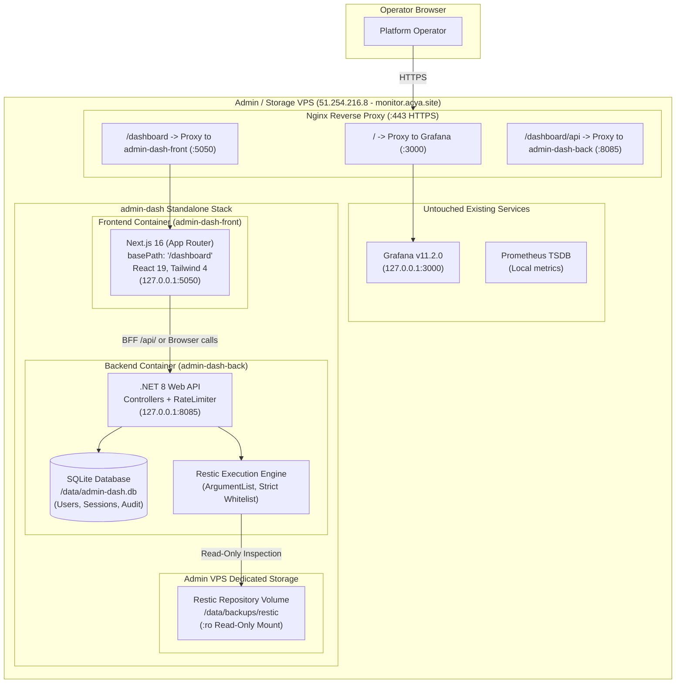
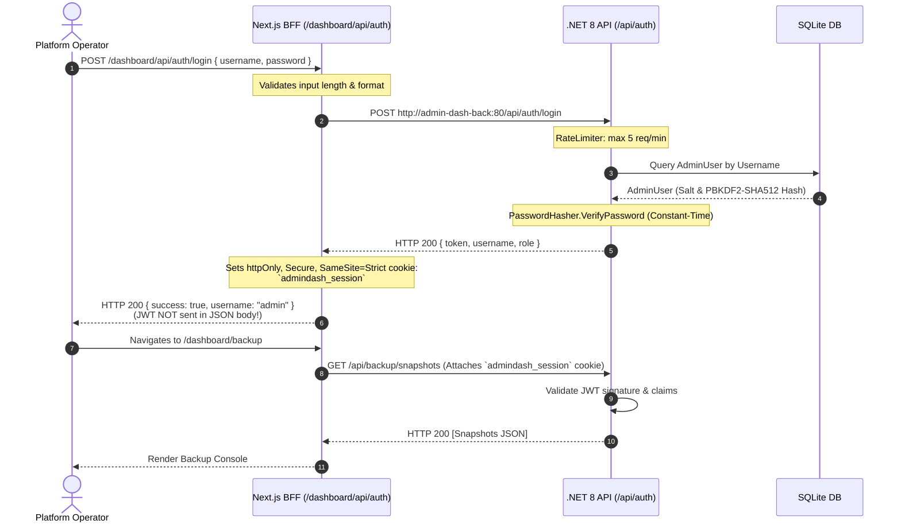

# ACYA — Admin-Dash Architecture & Existing Conventions Inspection

**Document Classification:** Architecture Investigation & Technical Decision Record  
**Target System:** `admin-dash` (Standalone Infrastructure & Backup Administration Platform)  
**Reference Codebase:** `bo-acya-app` (`admin-elance-back` & `admin-elance-front`)  
**Host Target:** Admin / Monitoring VPS (`51.254.216.8`) at `monitor.acya.site`  
**Investigation Authority:** Antigravity (Advanced Agentic Pair Programming)  
**Safety Status:** Strictly Read-Only (Zero modifications to existing applications or production infrastructure)  

---

## 1. Executive Summary

This document details the architectural inspection of the existing Backoffice platform (`bo-acya-app`), conducted to establish sound engineering conventions, extract reusable design patterns, avoid historical pitfalls, and define the complete blueprint for the upcoming `admin-dash` project.

`admin-dash` is conceived as an isolated, high-security infrastructure administration portal hosted on the Admin VPS (`51.254.216.8`) under the domain `monitor.acya.site`. It provides operational visibility and management over automated Restic backups, snapshot lifecycles, and host health, completely decoupled from the ACYA Production ERP API (`wood-app-api`) and its database.

### Key Inspection Highlights

| Domain | Existing `bo-acya-app` Convention | Verdict for `admin-dash` |
| :--- | :--- | :--- |
| **Frontend Framework** | Next.js 16.4.3 (App Router) + React 19.2.4 + TypeScript 5 | **Adopt**: Fast, modern, matching developer tooling. |
| **Styling & UI** | Tailwind CSS v4 + Lucide Icons + Handcrafted Zinc/Emerald Cyber Dark Theme | **Adopt**: Reuse identical design tokens and aesthetic consistency. |
| **Frontend Auth Flow** | Next.js Route Handlers as BFF + `httpOnly` cookie (`admin_session_token`) | **Adopt & Harden**: Adopt BFF pattern; eliminate dual storage in `localStorage`. |
| **Backend Framework** | ASP.NET Core Web API on .NET 8 (`net8.0`) | **Adopt**: Robust, type-safe, proven in `admin-elance-back`. |
| **Backend Architecture** | 4-Tier Clean Architecture (API, Core, Infrastructure, Common) | **Adopt**: Reusable solution structure, DTO separation, and interfaces. |
| **Database Engine** | PostgreSQL 15 connecting to shared `wood-app-db` (`public` schema) | **Replace with SQLite**: Admin VPS does not need a heavy PostgreSQL engine. |
| **Password Security** | PBKDF2 with SHA-512, 100,000 iterations, 16-byte salt, constant-time compare | **Adopt**: Port `PasswordHasher.cs` directly. |
| **API Rate Limiting** | ASP.NET Core 8 Rate Limiter (5 requests/min on auth) | **Adopt**: Essential defense against brute-force attacks on the admin portal. |
| **Restic Integration** | Legacy `pg_dump` via basic string concatenation | **Reject**: Replace with dedicated `IResticService` using `ArgumentList` array allowlist. |
| **Docker Networking** | Public binding on `0.0.0.0` (`5002:3000`, `8082:80`) | **Reject**: Enforce loopback binding (`127.0.0.1`) and internal Docker network only. |
| **Reverse Proxy / Path** | Root domain routing (`admin.acya.site/`) | **Subpath Routing**: Use `basePath: '/dashboard'` to co-exist safely with Grafana (`/`). |

---

## 2. Existing Repository Structure

The `bo-acya-app` repository provides administrative and SaaS onboarding functions for the ACYA ERP suite. It is divided into two distinct sub-projects:

```text
bo-acya-app/
├── AGENTS.md                                # Platform guidelines for AI agents
├── admin-elance-back/                       # SuperAdmin Backend (.NET 8 Web API)
│   ├── Dockerfile                           # Multi-stage SDK 8.0 -> ASP.NET 8.0 runtime
│   ├── .dockerignore
│   ├── ms.admin.api.acya.sln                # Visual Studio 2022 Solution
│   ├── db/
│   │   ├── master/v0.01/001_create_master_registry.sql
│   │   └── seed_natural_wood.sql.template
│   ├── src/
│   │   ├── ms.admin.api.acya/               # API Web Host, Controllers, Schedulers
│   │   │   ├── Controllers/                 # Auth, Backup, Enterprise, Health, Monitoring...
│   │   │   ├── Services/                    # TokenService, PasswordHasher, BackupService...
│   │   │   ├── Program.cs                   # Middleware, JWT, RateLimiting, DI, DbInitializer
│   │   │   ├── appsettings.json
│   │   │   └── ms.admin.api.acya.csproj     # net8.0, JwtBearer, Swagger, EF Design
│   │   ├── ms.admin.api.acya.core/          # Entities, DTOs, Interface Contracts
│   │   │   ├── Entities/                    # SuperAdminUser, MasterEnterprise, BackupJob...
│   │   │   ├── DTOs/                        # LoginRequest, AuthResponse, BackupSettings...
│   │   │   ├── Interfaces/                  # IEnterpriseRepository, IBackupSettingsService...
│   │   │   └── ms.admin.api.acya.core.csproj
│   │   ├── ms.admin.api.acya.infrastructure/# Master DB Access, EF Core Configurations
│   │   │   ├── MasterDbContext.cs           # EF Core Context for public schema
│   │   │   ├── DbInitializer.cs             # Raw SQL DDL bootstrapping & admin seeding
│   │   │   ├── Configurations/              # Fluent API mapping classes
│   │   │   ├── Repositories/                # EnterpriseRepository
│   │   │   ├── Services/                    # TenantProvisioningService, BackupSettingsService...
│   │   │   └── ms.admin.api.acya.infrastructure.csproj # Npgsql.EntityFrameworkCore.PostgreSQL
│   │   └── ms.admin.api.acya.common/        # Shared Utilities, Enums, Validators
│   │       ├── SchemaSanitizer.cs           # Regex database identifier sanitizer
│   │       ├── Enums/                       # TenantStatus, TenantPlan
│   │       └── ms.admin.api.acya.common.csproj
│   └── tests/
│       └── ms.admin.api.acya.tests/         # xUnit, Moq, EF Core InMemory unit tests
└── admin-elance-front/                      # SuperAdmin Frontend (Next.js 16 + React 19)
    ├── Dockerfile                           # Multi-stage Node 20 Alpine builder & runner
    ├── package.json                         # Next 16.4.3, React 19.2.4, Tailwind 4, Lucide
    ├── tsconfig.json                        # Bundler resolution, strict mode, paths @/*
    ├── next.config.ts                       # Minimal Next.js configuration
    ├── postcss.config.mjs
    ├── public/                              # Vector icons and logos
    └── src/
        ├── app/                             # Next.js App Router
        │   ├── layout.tsx                   # Dark theme wrapper, font definitions (Outfit/Space Grotesk)
        │   ├── globals.css                  # Tailwind 4 @theme, Zinc/Emerald tokens, glassmorphism
        │   ├── page.tsx                     # Dashboard home overview
        │   ├── login/page.tsx               # Dedicated login screen with animated vector logo
        │   ├── monitoring/page.tsx          # Real-time tenant health, DB size, connections
        │   ├── enterprises/page.tsx         # Enterprise registry & provisioning trigger
        │   ├── settings/page.tsx            # System parameters & operator credentials
        │   ├── audit-logs/page.tsx          # Audit history viewer
        │   └── api/                         # Route Handlers (BFF pattern)
        │       ├── auth/login/route.ts      # Auth proxy + httpOnly cookie setting
        │       ├── auth/session/route.ts    # Session verification probe
        │       ├── auth/logout/route.ts     # Cookie termination
        │       └── mobile/...               # Firebase and APK build management proxies
        ├── components/
        │   ├── AdminLayout.tsx              # Route protection gate, header bar, sidebar shell
        │   └── Sidebar.tsx                  # Collapsible navigation menu, credentials modal
        ├── lib/
        │   ├── apiClient.ts                 # Fetch wrapper with Bearer token & 401 handling
        │   └── mobileBackend.ts
        └── types/
            └── mobile.ts
```

---

## 3. Frontend Architecture Inspection

The frontend client in `bo-acya-app/admin-elance-front` was thoroughly inspected across all configuration and source files.

### 3.1 Technology Stack & Core Versions `[VERIFIED FACT]`
* **Next.js Version:** `16.4.3` (`bo-acya-app/admin-elance-front/package.json`)
* **React Version:** `19.2.4` and `react-dom: 19.2.4`
* **TypeScript Version:** `^5` (compiled with `"strict": true`, `"moduleResolution": "bundler"`, `"target": "ES2017"`)
* **Router Paradigm:** **App Router** (`src/app/` hierarchy with `layout.tsx`, `page.tsx`, and `route.ts` handlers).
* **Icons:** `lucide-react: ^1.11.0`

### 3.2 Component and Layout Architecture `[VERIFIED FACT]`
1. **Root Layout (`src/app/layout.tsx`):**
   - Applies global dark mode permanently via `<html lang="en" className="dark">`.
   - Imports Google Fonts using `next/font/google`: `Outfit` (sans font variable `--font-outfit`) and `Space_Grotesk` (monospace font variable `--font-space-grotesk`).
   - Wraps the application inside `<AdminLayout>{children}</AdminLayout>`.
2. **Client Shell (`src/components/AdminLayout.tsx`):**
   - Uses `"use client"`.
   - Evaluates authentication status on every route transition using a probe to `/api/auth/session` with a fallback check against `localStorage.getItem("token")`.
   - Excludes `/login` from auth redirects.
   - Provides a responsive top header displaying real-time system status indicators ("System Status: Online") and a Logout action.
   - Embeds a collapsible `<Sidebar />` on the left.
   - Wraps main content in a scrollable container with a subtle CSS grid background:
     `bg-[linear-gradient(to_right,#80808012_1px,transparent_1px),linear-gradient(to_bottom,#80808012_1px,transparent_1px)] bg-[size:24px_24px]`.
3. **Collapsible Navigation (`src/components/Sidebar.tsx`):**
   - Toggles between expanded width (`w-64`) and compact icon-only mode (`w-16`).
   - Persists collapsed state in `localStorage` (`sidebar_collapsed`).
   - Provides an embedded credential modal (`isPasswordOpen`) allowing the operator to update their username and password directly from the sidebar.

### 3.3 Styling System & Visual Design `[VERIFIED FACT]`
* **Tailwind CSS v4:** Configured via `@tailwindcss/postcss: ^4` and `@import "tailwindcss";` in `src/app/globals.css`.
* **Design Palette & Theme Tokens:** Defined in `@theme` block in `globals.css`:
  - Background: `#09090b` (Zinc 950)
  - Card/Surfaces: `#18181b` (Zinc 900)
  - Secondary/Borders: `#27272a` (Zinc 800)
  - Primary Accent: `#10b981` (Emerald 500)
  - Destructive: `#ef4444` (Red 500)
  - Text Muted: `#a1a1aa` (Zinc 400)
* **Visual Effects:**
  - Glassmorphic panels (`.glass-panel`): `rgba(24, 24, 27, 0.6)` with `backdrop-filter: blur(12px)` and subtle `1px solid rgba(255, 255, 255, 0.05)`.
  - Gradient typography (`.text-gradient`): Emerald to Cyan/Blue gradient fill.
  - Tabular numeric alignment: `.font-mono { font-variant-numeric: tabular-nums; }`.

### 3.4 Data Fetching & API Communication Strategy `[VERIFIED FACT]`
The application uses a hybrid dual-channel communication model:
1. **Backend-For-Frontend (BFF) Route Handlers:**
   - Routes located in `src/app/api/auth/*` and `src/app/api/mobile/*`.
   - Internal Docker network communication: Route handlers execute on Node.js and proxy requests directly to the .NET backend using `process.env.BACKEND_INTERNAL_URL || "http://admin-api:80/api/"`.
   - Fallback mechanism: If the internal container request fails, handlers fall back to `process.env.NEXT_PUBLIC_API_URL`.
2. **Client-Side Data Fetching:**
   - Plain `fetch` requests inside `useEffect` or button event handlers.
   - Client helper `apiFetch()` in `src/lib/apiClient.ts` intercepts requests, prepends `NEXT_PUBLIC_API_URL`, attaches `Authorization: Bearer <token>` from `localStorage`, and intercepts HTTP `401` to clear credentials and redirect to `/login`.
   - **No heavy state libraries**: Unlike `elance-app.ui` (which uses TanStack Query v5 and Zustand), `admin-elance-front` uses zero third-party state libraries—pure React `useState` and native promises.

---

## 4. Backend Architecture Inspection

The backend in `bo-acya-app/admin-elance-back` was inspected across its solution architecture, controllers, services, database contexts, and security configuration.

### 4.1 Technology Stack & Target Framework `[VERIFIED FACT]`
* **Target Framework:** .NET 8 (`net8.0`) across all 4 source projects and test projects (`ms.admin.api.acya.csproj`, `ms.admin.api.acya.core.csproj`, etc.).
* **SDK:** `Microsoft.NET.Sdk.Web` (host) and `Microsoft.NET.Sdk` (class libraries).
* **Web Architecture:** Traditional ASP.NET Core Controllers inheriting from `ControllerBase`. Minimal APIs are not used.
* **OpenAPI / Swagger:** `Swashbuckle.AspNetCore` v6.6.2 and `Microsoft.AspNetCore.OpenApi` v8.0.10.

### 4.2 Dependency Injection & Service Layer `[VERIFIED FACT]`
Services are configured in `Program.cs` using Microsoft DI:
* **Database Context:** `builder.Services.AddDbContext<MasterDbContext>(...)` scoped to PostgreSQL.
* **Domain Services:** Scoped lifetime (`TokenService`, `TenantProvisioningService`, `BackupService`, `BackupSettingsService`, `EmailService`, `SupportTicketAdminService`).
* **Repositories:** Scoped lifetime (`IEnterpriseRepository -> EnterpriseRepository`).
* **Background Tasks:** Hosted service `builder.Services.AddHostedService<SaaSLifecycleScheduler>()` executing background lifecycle and trial evaluations.

### 4.3 Database Access & Entity Framework Core `[VERIFIED FACT]`
* **Provider:** PostgreSQL via `Npgsql.EntityFrameworkCore.PostgreSQL` v8.0.10.
* **Schema Scope:** Master schema only (`public`). Unlike the core ERP (`wood-app.api`) which switches schemas dynamically per tenant (`tenant_{slug}`), `admin-elance-back` targets `public` exclusively.
* **Schema Initialization:** Implemented in `DbInitializer.Initialize(context)`. It executes raw idempotent SQL statements (`CREATE TABLE IF NOT EXISTS`, `ALTER TABLE ... ADD COLUMN IF NOT EXISTS`) to provision master tables (`bo_tbl_enterprise`, `bo_tbl_super_admin_users`, `bo_tbl_backup_jobs`, etc.) without relying on EF Core EF Migrations assembly tracking.

### 4.4 Existing Backup Implementation (`BackupService.cs` & `BackupController.cs`) `[VERIFIED FACT]`
The current `bo-acya-app` includes an embryonic backup implementation:
1. `BackupController.cs` exposes:
   - `GET api/admin/backup/jobs/{tenantId}`
   - `POST api/admin/backup/{tenantId}` (enqueues a pending backup job)
   - `POST api/admin/backup/restore/{jobId}` (enqueues a restore job)
   - `GET api/admin/backup/download/{jobId}` (streams `.dump` file to client)
2. `BackupService.cs` executes CLI commands using .NET `System.Diagnostics.Process`:
   - Executes `pg_dump` and `pg_restore` directly.
   - Constructs command strings with string interpolation:
     `Arguments = $"-h {host} -p {port} -U {username} -d {database} -n \"{schemaName}\" -F c -b -v -f \"{fullPath}\""`.
   - Passes credentials via `startInfo.EnvironmentVariables["PGPASSWORD"] = password;`.
   - Uses `SchemaSanitizer.IsValidIdentifier(schemaName)` to prevent SQL/argument injection on schema names.
   - Enforces path confinement: checks `fullPath.StartsWith("/app/backups", StringComparison.OrdinalIgnoreCase)` to prevent directory traversal.

---

## 5. Authentication and Security

### 5.1 Password Hashing Architecture `[VERIFIED FACT]`
The password hashing engine in `ms.admin.api.acya/Services/PasswordHasher.cs` implements an enterprise-grade PBKDF2 scheme:
* **Algorithm:** PBKDF2 with `HMAC-SHA512` (`HashAlgorithmName.SHA512`).
* **Work Factor:** `100,000` iterations.
* **Salt Size:** `16` bytes (128 bits) generated via cryptographically secure random number generator (`RandomNumberGenerator.GetBytes(16)`).
* **Derived Key Size:** `64` bytes (512 bits).
* **Serialization Format:**
  `PBKDF2$SHA512${Iterations}${Base64Salt}${Base64Hash}`
* **Verification:** Uses `CryptographicOperations.FixedTimeEquals` to prevent side-channel timing attacks.
* **Automatic Upgrading:** If a legacy administrator logs in whose password hash does not begin with `PBKDF2$`, `AuthController.cs` verifies the password and immediately re-hashes and persists it in PBKDF2 format.

### 5.2 Token & Session Management `[VERIFIED FACT]`
* **JWT Signing:** `TokenService.cs` signs tokens using `HMAC-SHA512` (`SecurityAlgorithms.HmacSha512Signature`) with a dedicated administrative secret (`JwtSettings:Secret` / `JWT_SECRET_ADMIN`).
* **Claims:**
  - `sub`: User ID
  - `unique_name`: Username
  - `ClaimTypes.Role`: `"SUPER_ADMIN"`
* **Dual Ingestion in ASP.NET Core:** Configured in `Program.cs` via `JwtBearerEvents.OnMessageReceived`:
  ```csharp
  OnMessageReceived = context =>
  {
      if (string.IsNullOrEmpty(context.Token) && 
          context.Request.Cookies.TryGetValue("admin_session_token", out var cookieToken))
      {
          context.Token = cookieToken;
      }
      return Task.CompletedTask;
  }
  ```
  The backend accepts the JWT either from the `Authorization: Bearer` HTTP header OR from the `admin_session_token` cookie.
* **BFF Cookie Configuration:** In `src/app/api/auth/login/route.ts`:
  - `httpOnly: true` (inaccessible to browser JavaScript, mitigating XSS).
  - `secure: true` in production (enforces HTTPS).
  - `sameSite: "strict"` (mitigating CSRF).
  - `path: "/"`, `maxAge: 86400` (24 hours).

### 5.3 Rate Limiting & Origin Security `[VERIFIED FACT]`
* **Rate Limiting:** `Program.cs` registers ASP.NET Core Rate Limiting:
  ```csharp
  builder.Services.AddRateLimiter(options =>
  {
      options.RejectionStatusCode = StatusCodes.Status429TooManyRequests;
      options.AddFixedWindowLimiter("AuthLimiter", opt =>
      {
          opt.PermitLimit = 5;
          opt.Window = TimeSpan.FromMinutes(1);
          opt.QueueLimit = 0;
      });
  });
  ```
  `[EnableRateLimiting("AuthLimiter")]` is applied to `AuthController.Login`, strictly throttling brute-force attempts to 5 requests per minute.
* **CORS Policy:** Restricts origins to an explicit semicolon-separated whitelist loaded from `AllowedOrigins` (`https://admin.acya.site`, `http://localhost:3000`, etc.) with `AllowCredentials()`.

---

## 6. Docker and Deployment Inspection

### 6.1 Dockerfile Implementation `[VERIFIED FACT]`

#### Backend Dockerfile (`bo-acya-app/admin-elance-back/Dockerfile`)
```dockerfile
FROM mcr.microsoft.com/dotnet/sdk:8.0 AS build
WORKDIR /app
COPY src/ms.admin.api.acya/ms.admin.api.acya.csproj src/ms.admin.api.acya/
COPY src/ms.admin.api.acya.core/ms.admin.api.acya.core.csproj src/ms.admin.api.acya.core/
COPY src/ms.admin.api.acya.infrastructure/ms.admin.api.acya.infrastructure.csproj src/ms.admin.api.acya.infrastructure/
COPY src/ms.admin.api.acya.common/ms.admin.api.acya.common.csproj src/ms.admin.api.acya.common/
RUN dotnet restore src/ms.admin.api.acya/ms.admin.api.acya.csproj
COPY . .
RUN dotnet publish src/ms.admin.api.acya/ms.admin.api.acya.csproj -c Release -o /out

FROM mcr.microsoft.com/dotnet/aspnet:8.0 AS runtime
WORKDIR /app
RUN apt-get update && apt-get install -y postgresql-client && rm -rf /var/lib/apt/lists/*
COPY --from=build /out .
COPY db/ /app/db/
EXPOSE 80
ENTRYPOINT ["dotnet", "ms.admin.api.acya.dll"]
```
* **Pros:** Clean multi-stage build, dependencies copied first for layer caching.
* **Cons for admin-dash:** Installs `postgresql-client` which is unnecessary for Restic administration.

#### Frontend Dockerfile (`bo-acya-app/admin-elance-front/Dockerfile`)
```dockerfile
FROM node:20-alpine AS builder
WORKDIR /app
COPY package.json package-lock.json* ./
RUN npm install
COPY . .
ARG NEXT_PUBLIC_API_URL
ENV NEXT_PUBLIC_API_URL=$NEXT_PUBLIC_API_URL
RUN npm run build

FROM node:20-alpine AS runner
WORKDIR /app
ENV NODE_ENV production
COPY --from=builder /app/public ./public
COPY --from=builder /app/.next ./.next
COPY --from=builder /app/node_modules ./node_modules
COPY --from=builder /app/package.json ./package.json
EXPOSE 3000
CMD ["npm", "start"]
```
* **Pros:** Lightweight Alpine image, copies build output.
* **Optimization Opportunity:** Next.js `output: 'standalone'` is not currently enabled in `next.config.ts`. Using `output: 'standalone'` reduces container image size from ~300 MB down to ~60 MB by eliminating full `node_modules` copying in runner.

### 6.2 Docker Compose Orchestration `[VERIFIED FACT]`
In `docker-compose.yml`:
* `admin-api`: Exposes port `8082:80`, joins `wood-app-network`, connects to `Host=postgres;Port=5432;Database=wood-app-db`.
* `admin-ui`: Exposes port `5002:3000`, joins `wood-app-network`.
* Environment variable configuration:
  - `BACKEND_INTERNAL_URL=http://admin-api:80/api/` (for SSR / route handlers).
  - `NEXT_PUBLIC_API_URL=https://admin.acya.site/api/` (for browser-side client calls).
* Environment variables are mapped via `.env` interpolation (e.g. `JWT_SECRET_ADMIN`, `POSTGRES_PASSWORD`).

---

## 7. Reusable Patterns Suitable for Admin-Dash

The following patterns from `bo-acya-app` are well-engineered and directly reusable for `admin-dash`:

1. **PBKDF2-SHA512 Password Verification (`PasswordHasher.cs`):**
   - High work factor (100,000 rounds), constant-time string comparison, no external NuGet dependencies. Can be ported directly into `admin-dash/back`.
2. **Next.js Backend-For-Frontend (BFF) Route Handlers:**
   - Server-side Next.js route handlers (`src/app/api/.../route.ts`) acting as an intermediary to the backend API.
   - Prevents exposing backend internal URLs and credentials to the client browser.
3. **Dual JWT Recognition (Cookie + Bearer Header):**
   - Using `JwtBearerEvents.OnMessageReceived` allows requests originating from SSR/browser to authenticate via `httpOnly` cookies, while external or programmatic API calls can authenticate via `Authorization: Bearer <token>`.
4. **ASP.NET Core Rate Limiting Middleware:**
   - Protecting the authentication endpoint against automated brute-force attacks using native fixed-window rate limiting.
5. **Modern Datacenter Cyber Theme (Tailwind 4 & CSS Variables):**
   - The dark palette (Zinc 950 `#09090b`, Zinc 900 `#18181b`, Emerald 500 `#10b981`), monospace tabular numeric styling, and glassmorphic card styling (`glass-panel`) provide an ideal aesthetic for an infrastructure and backup monitoring tool.
6. **Self-Contained Client Shell (`AdminLayout.tsx` & `Sidebar.tsx`):**
   - Collapsible sidebar, integrated operator credentials modal, active route highlighting, and smooth CSS transitions.
7. **Clean Architecture Backend Project Structure:**
   - Separation into `Api` (web host), `Core` (models, interfaces), `Infrastructure` (data access, external processes), and `Common` (utilities).

---

## 8. Patterns We Should Avoid

The inspection identified several architectural decisions and conventions in `bo-acya-app` that are **inappropriate or hazardous** for `admin-dash`:

1. **Dual Storage of Authentication Tokens in `localStorage` `[CRITICAL SECURITY]`:**
   - *Issue in `admin-elance-front`:* Upon successful login, the frontend receives the JWT in the response body and stores it in `localStorage.setItem("token", data.token)` (`src/app/login/page.tsx#L33`), while simultaneously setting an `httpOnly` cookie.
   - *Risk:* Any Cross-Site Scripting (XSS) vulnerability can read `localStorage` and exfiltrate the administrator JWT.
   - *Decision for `admin-dash`:* Use **pure `httpOnly` cookies**. The JWT must never be written to `localStorage` or exposed to client-side scripts.
2. **Publishing Docker Ports to Public Interfaces (`0.0.0.0`) `[HIGH SECURITY RISK]`:**
   - *Issue in `docker-compose.yml`:* Ports `5002:3000` and `8082:80` are published to all network interfaces. Docker modifies iptables directly, bypassing UFW and exposing the backoffice API and UI directly to the public internet without passing through Nginx rate limiting or TLS.
   - *Decision for `admin-dash`:* Bind all ports strictly to localhost (`127.0.0.1:5050:3000`, `127.0.0.1:8085:80`) or eliminate host port publishing altogether, keeping frontend-to-backend traffic strictly inside Docker bridge networks.
3. **CLI Command Construction via String Concatenation `[SECURITY RISK]`:**
   - *Issue in `BackupService.cs`:* Process arguments are built via interpolated strings: `Arguments = $"-h {host} ... -f \"{fullPath}\""`.
   - *Risk:* Shell injection or argument injection if unvalidated input reaches the argument builder.
   - *Decision for `admin-dash`:* Use `ProcessStartInfo.ArgumentList` (.NET 8 collection). Each argument is passed as an isolated array element without shell parsing, completely eliminating argument injection.
4. **Coupling to Production PostgreSQL Database `[ARCHITECTURE GAP]`:**
   - *Issue in `bo-acya-app`:* The backoffice connects directly to the production database `wood-app-db`.
   - *Decision for `admin-dash`:* `admin-dash` runs on the Admin VPS (`51.254.216.8`) and must **never connect to the production PostgreSQL database**. It must remain completely independent of production ERP availability.
5. **Hardcoded Default Administrator Credentials in Initializer `[SECURITY RISK]`:**
   - *Issue in `DbInitializer.cs`:* Automatically inserts `admin` / `adminpassword` if not found in the database.
   - *Decision for `admin-dash`:* Initial credentials must be supplied via secure environment variables (`INITIAL_ADMIN_PASSWORD`) or a one-time setup CLI command, with forced password rotation upon first login.
6. **Excessively Long Token Expiration Without Revocation `[SECURITY RISK]`:**
   - *Issue in `TokenService.cs`:* Tokens are issued with a 24-hour expiration (`1440` minutes) and cannot be revoked server-side before expiration.
   - *Decision for `admin-dash`:* Use a shorter token lifetime (e.g. 60 minutes) with sliding session renewal or token versioning (`TokenVersion` claim).

---

## 9. Recommended Admin-Dash Architecture

`admin-dash` is an operational dashboard dedicated to monitoring system health, disk utilization, and Restic backup snapshots on the Admin VPS (`51.254.216.8`).



### Architectural Principles:
1. **Zero Production Impact:** Does not connect to or depend on the production server (`51.210.10.108`) or its PostgreSQL instance.
2. **Grafana Non-Interference:** Grafana continues running at `/` without modifications. `admin-dash` lives strictly under `/dashboard`.
3. **Repository Immutability:** `admin-dash` mounts `/data/backups/restic` **read-only** (`:ro`), ensuring it cannot corrupt, prune, or delete backup data.
4. **Minimal Resource Footprint:** SQLite eliminates the RAM and CPU overhead of running a dedicated database daemon on the monitoring VPS.

---

## 10. Proposed Folder Structure

```text
admin-dash/
├── docker-compose.yml                       # Docker orchestration for Admin VPS
├── .env.example                             # Template documenting all required secrets
├── README.md                                # Setup, build, and deployment instructions
├── nginx/
│   └── monitor.acya.site.conf.snippet       # Verified Nginx location configuration block
├── front/                                   # Next.js 16 Web Application
│   ├── Dockerfile                           # Multi-stage with output: 'standalone'
│   ├── .dockerignore
│   ├── package.json                         # Next 16.4, React 19, Tailwind 4, Lucide
│   ├── next.config.ts                       # basePath: '/dashboard', standalone output
│   ├── tsconfig.json
│   ├── postcss.config.mjs
│   ├── public/
│   │   └── favicon.ico
│   └── src/
│       ├── app/
│       │   ├── layout.tsx                   # Dark theme, Outfit/Space Grotesk fonts
│       │   ├── globals.css                  # Reused Zinc/Emerald design tokens
│       │   ├── page.tsx                     # Redirects to /dashboard/home or /dashboard/login
│       │   ├── login/
│       │   │   └── page.tsx                 # Login view
│       │   ├── home/
│       │   │   └── page.tsx                 # Overview: VPS health, snapshot overview, alerts
│       │   ├── backup/
│       │   │   └── page.tsx                 # Backup details: snapshot browser, tenant filter, manifest inspector
│       │   └── api/                         # BFF Route Handlers
│       │       └── auth/
│       │           ├── login/route.ts       # Sets httpOnly cookie
│       │           ├── session/route.ts     # Validates session
│       │           └── logout/route.ts      # Clears cookie
│       ├── components/
│       │   ├── DashboardLayout.tsx          # Shell wrapper with auth check and header
│       │   ├── Sidebar.tsx                  # Collapsible navigation: Home, Backup, Grafana link
│       │   ├── SnapshotTable.tsx            # Table displaying Restic snapshots with search & filter
│       │   ├── SnapshotDetailModal.tsx      # Manifest viewer for selected snapshot
│       │   └── SystemHealthCard.tsx         # Host CPU/RAM/Disk stats card
│       ├── lib/
│       │   └── api.ts                       # Fetch wrapper communicating via cookies
│       └── types/
│           ├── snapshot.ts                  # TypeScript interfaces matching restic JSON output
│           └── auth.ts
└── back/                                    # .NET 8 Web API
    ├── Dockerfile                           # Multi-stage .NET 8 SDK -> Runtime + restic binary
    ├── .dockerignore
    ├── AdminDash.sln
    └── src/
        ├── AdminDash.Api/                   # Web Host & Controllers
        │   ├── Controllers/
        │   │   ├── AuthController.cs        # Login, logout, credential change
        │   │   ├── BackupController.cs      # Snapshots, snapshot details, repository stats
        │   │   └── SystemController.cs      # Host storage, uptime, service status
        │   ├── Program.cs                   # JWT, RateLimiting, SQLite setup, DI
        │   ├── appsettings.json
        │   └── AdminDash.Api.csproj
        ├── AdminDash.Core/                  # Domain Entities, DTOs, Interfaces
        │   ├── Entities/
        │   │   ├── AdminUser.cs             # Local admin credentials
        │   │   └── AuditLog.cs              # Action logs
        │   ├── DTOs/
        │   │   ├── ResticSnapshotDto.cs     # Mapped from restic snapshots --json
        │   │   ├── ResticStatsDto.cs        # Mapped from restic stats --json
        │   │   └── AuthDtos.cs
        │   ├── Interfaces/
        │   │   ├── IResticService.cs        # Contract for executing restic commands
        │   │   └── IAuthService.cs
        │   └── AdminDash.Core.csproj
        ├── AdminDash.Infrastructure/        # SQLite Persistence & Restic CLI Execution
        │   ├── Data/
        │   │   ├── AdminDashDbContext.cs    # EF Core SQLite Context
        │   │   └── DbInitializer.cs         # SQLite schema initialization
        │   ├── Services/
        │   │   ├── ResticService.cs         # Process execution with ArgumentList & whitelist
        │   │   ├── PasswordHasher.cs        # Ported from bo-acya-app (PBKDF2-SHA512)
        │   │   └── TokenService.cs          # Ported JWT token generation
        │   └── AdminDash.Infrastructure.csproj # Microsoft.EntityFrameworkCore.Sqlite
        └── AdminDash.Tests/                 # Unit & service integration tests
```

---

## 11. Proposed Authentication Model

To guarantee higher security than an ordinary web app, `admin-dash` will use a **hardened BFF authentication model**:



### Security Guardrails:
1. **Cookie-Only Session (`admindash_session`):**
   - Flags: `HttpOnly = true`, `Secure = true`, `SameSite = SameSiteMode.Strict`, `Path = "/dashboard"`.
   - Never stored in `localStorage` or `sessionStorage`.
2. **Password Verification:**
   - PBKDF2 with SHA-512, 100,000 iterations, 16-byte cryptographically secure salt.
3. **Session Lifetime:**
   - 60 minutes sliding expiration.
4. **Brute Force Protection:**
   - Native ASP.NET Core RateLimiter: 5 attempts per IP per minute.
5. **No Default Plaintext Passwords:**
   - The initial password is supplied via environment variable `INITIAL_ADMIN_PASSWORD` on container first boot and hashed immediately.

---

## 12. Proposed Backend API Structure

Controllers will inherit from `ControllerBase` and be routed under `api/[controller]`:

### 12.1 `AuthController` (`api/auth`)
* `POST api/auth/login`: Authenticates username and password against SQLite. Protected by rate limiting.
* `POST api/auth/logout`: Invalidates session.
* `GET api/auth/me`: Returns identity of the authenticated operator.
* `POST api/auth/change-password`: Updates password with PBKDF2 hashing (requires current password).

### 12.2 `BackupController` (`api/backup`)
* `GET api/backup/snapshots`: Returns JSON array of all Restic snapshots.
  - Supports query filters: `?tenant={slug}&from={date}&to={date}`.
* `GET api/backup/snapshots/{snapshotId}`: Returns detailed metadata for a specific snapshot (manifest file list, tenant count, database size).
* `GET api/backup/snapshots/{snapshotId}/manifest`: Returns parsed `manifest.txt` including SHA-256 digests and file sizes.
* `GET api/backup/stats`: Returns repository summary stats (`restic stats --mode raw-data --json`): total deduplicated size, total blob count.
* `GET api/backup/health`: Verifies repository unlock state and integrity summary.

### 12.3 `SystemController` (`api/system`)
* `GET api/system/storage`: Returns disk capacity and free space on the dedicated `/data` partition.
* `GET api/system/status`: Returns container uptime and host metrics.

---

## 13. Proposed Database Model

### Is PostgreSQL Justified? `[EVALUATION]`
**NO.** Running a dedicated PostgreSQL container or connecting to the remote production PostgreSQL database is unjustified and contrary to security best practices:
* Running PostgreSQL locally on the Admin VPS consumes 150–250 MB of RAM continuously for a database that only holds a few user records.
* Connecting over the internet to the Production VPS PostgreSQL violates trust boundaries and couples the admin tool's uptime to the production database.

### Recommended Provider: SQLite `[RECOMMENDATION]`
Using **SQLite** via `Microsoft.EntityFrameworkCore.Sqlite` is the optimal choice:
* **Zero Engine Overhead:** Runs in-process inside the .NET runtime; consumes 0 MB of extra RAM.
* **Zero Network Exposure:** No open database port (no port 5432).
* **Instant Portability:** The database is a single file on disk (e.g. `/data/admin-dash.db`), effortlessly backed up or migrated.
* **ACID Compliant:** Completely reliable for storing user records, sessions, and audit entries.

### Persistence Strategy: What to Store in SQLite vs Retrieve from Restic

| Data Category | Persistence Location | Justification |
| :--- | :--- | :--- |
| **Admin User Accounts** | SQLite (`tbl_admin_users`) | Needs secure persistence of PBKDF2 password hashes and roles. |
| **Audit Log Entries** | SQLite (`tbl_audit_logs`) | Records who logged in and what actions were performed in `admin-dash`. |
| **System Settings** | SQLite (`tbl_settings`) | Alert email addresses, notification webhooks, display preferences. |
| **Restic Snapshots** | **Direct Restic Query (Live)** | **Single Source of Truth**: Restic is queried dynamically via CLI. Never duplicate snapshot state in a database to avoid synchronization lag. |
| **Snapshot Manifests** | **Direct Restic Query (Live)** | File lists and SHA-256 digests are extracted on-demand from Restic or memory-cached for 5 minutes. |
| **Repository Disk Usage** | **Host Disk Query (Live)** | Queried directly via `System.IO.DriveInfo.GetDrives()`. |

---

## 14. Restic Integration Design

The Restic integration will execute strictly within the backend container under a hardened execution harness.

```mermaid
flowchart TD
    API["BackupController\n(Authorized Admin Request)"]
    Service["ResticService.cs\n(Execution Engine)"]
    Validator["Input Sanitizer\n(Regex / Whitelist)"]
    Process["System.Diagnostics.Process\nArgumentList (No Shell)"]
    Repo[("Restic Repository Volume\n/data/backups/restic\n(:ro Read-Only)")]

    API -->|GetSnapshotsAsync| Service
    Service --> Validator
    Validator -->|Snapshot ID: ^[a-f0-9]{8,64}$| Process
    Process -->|Executes 'restic' CLI| Repo
    Repo -->|JSON Output stdout| Process
    Process -->|Parsed DTOs| API
```

### 14.1 Execution Rules & Guardrails `[RECOMMENDATION]`
1. **Backend-Only Execution:** The frontend never executes CLI commands.
2. **Direct Process Execution (No Shell):**
   - `UseShellExecute = false`
   - `CreateNoWindow = true`
   - Never invoke `/bin/sh -c` or `bash -c`.
   - Arguments must be added one-by-one to `ProcessStartInfo.ArgumentList`.
3. **Whitelisted Subcommands Only:**
   Only the following subcommands are implemented in `ResticService`:
   - `restic snapshots --json`
   - `restic stats --json`
   - `restic check --read-data-subset=1G`
   - `restic ls <snapshot-id> --json`
   - `restic dump <snapshot-id> manifest.txt`
4. **Strict Argument Validation:**
   - Snapshot IDs must match regex `^[a-f0-9]{8,64}$`. Any other characters trigger an immediate `ArgumentException`.
   - Tenant tags must match regex `^[a-z0-9_-]{3,50}$`.
5. **Read-Only Repository Mount:**
   - In `docker-compose.yml`, the Restic repository volume is mounted with the `:ro` flag:
     `volumes: - /data/backups/restic:/repo:ro`
   - This provides kernel-level enforcement: even if an attacker or software bug attempted to execute `restic forget --prune`, the Linux kernel would reject the write operation with `Read-only file system`.
6. **Credential Isolation:**
   - `RESTIC_PASSWORD` and `RESTIC_REPOSITORY=/repo` are injected into the container via environment variables.
   - Credentials are never logged, echoed in stdout, or returned in API responses.

---

## 15. Nginx Routing Recommendations

The Admin VPS (`51.254.216.8`) serves `monitor.acya.site` with Grafana currently listening on the root path `/`.

### 15.1 Routing Requirements
* `/` → Existing Grafana (must remain untouched).
* `/dashboard` → New `admin-dash` login.
* `/dashboard/home` → Dashboard overview.
* `/dashboard/backup` → Backup management console.

### 15.2 Next.js `basePath` Configuration `[RECOMMENDATION]`
To eliminate any path collision with Grafana assets, Next.js must be configured with `basePath: '/dashboard'` in `next.config.ts`:

```typescript
// front/next.config.ts
import type { NextConfig } from "next";

const nextConfig: NextConfig = {
  basePath: '/dashboard',
  output: 'standalone',
  trailingSlash: false,
};

export default nextConfig;
```
With this setting:
- Next.js serves its pages from `/dashboard`, `/dashboard/login`, `/dashboard/home`, etc.
- All internal asset bundles are automatically requested at `/dashboard/_next/static/*`.
- **Zero overlap** with Grafana's `/public/*`, `/api/*`, or `/avatar/*` paths.

### 15.3 Recommended Nginx Configuration Snippet `[RECOMMENDATION]`
Add the following blocks to the existing `server` block in `/etc/nginx/sites-available/monitor.acya.site` on the Admin VPS:

```nginx
# ==============================================================================
# EXISTING GRAFANA CONFIGURATION (REMAINS UNTOUCHED)
# ==============================================================================
location / {
    proxy_pass http://127.0.0.1:3000; # Existing Grafana port
    proxy_set_header Host $host;
    proxy_set_header X-Real-IP $remote_addr;
    proxy_set_header X-Forwarded-For $proxy_add_x_forwarded_for;
    proxy_set_header X-Forwarded-Proto $scheme;

    # WebSocket support for Grafana Live
    proxy_http_version 1.1;
    proxy_set_header Upgrade $http_upgrade;
    proxy_set_header Connection "upgrade";
}

# ==============================================================================
# NEW ADMIN-DASH APPLICATION CONFIGURATION
# ==============================================================================
# 1. Frontend Web Client (Next.js with basePath: /dashboard)
location /dashboard {
    proxy_pass http://127.0.0.1:5050;
    proxy_http_version 1.1;
    proxy_set_header Upgrade $http_upgrade;
    proxy_set_header Connection "upgrade";
    proxy_set_header Host $host;
    proxy_set_header X-Real-IP $remote_addr;
    proxy_set_header X-Forwarded-For $proxy_add_x_forwarded_for;
    proxy_set_header X-Forwarded-Proto $scheme;
    proxy_read_timeout 90;
}

# 2. Backend Direct API Proxy (or routed via Next.js BFF)
location /dashboard/api/ {
    proxy_pass http://127.0.0.1:8085/api/;
    proxy_http_version 1.1;
    proxy_set_header Host $host;
    proxy_set_header X-Real-IP $remote_addr;
    proxy_set_header X-Forwarded-For $proxy_add_x_forwarded_for;
    proxy_set_header X-Forwarded-Proto $scheme;
    proxy_read_timeout 120;
}
```

### Safety Validation:
- Grafana's `/` catch-all location continues to capture all requests that do not begin with `/dashboard`.
- Nginx matches the most specific prefix location (`/dashboard`), ensuring clean separation.
- `127.0.0.1:5050` and `127.0.0.1:8085` are loopback-only, preventing direct internet exposure.

---

## 16. Risks and Open Questions

| Risk / Question | Impact | Classification | Mitigation Strategy |
| :--- | :--- | :--- | :--- |
| **Restic Repository Lock Contention** | Backup push fails if `admin-dash` holds an exclusive lock. | `[ASSUMPTION]` | `admin-dash` runs Restic in `--read-only` mode or mounts the repository read-only (`:ro`). Read-only operations in Restic do not create repository locks. |
| **Manifest Parsing Performance** | Large snapshots could cause latency if `manifest.txt` is read repeatedly. | `[ASSUMPTION]` | Implement an in-memory sliding cache (`IMemoryCache`) in the .NET backend for parsed snapshot manifests (5-minute TTL). |
| **Nginx WebSocket Support for Next.js** | Next.js HMR or fast refresh could fail if WebSockets are not forwarded. | `[RECOMMENDATION]` | Ensure `Upgrade` and `Connection "upgrade"` headers are explicitly configured in the `/dashboard` location block. |
| **Restic Binary Availability in Container** | Backend container must have `restic` installed in its runtime image. | `[RECOMMENDATION]` | Include `RUN apt-get update && apt-get install -y restic` in `back/Dockerfile`. |
| **Production Backup Script Divergence** | Production script creates snapshots with specific tags and manifest paths. | `[VERIFIED FACT]` | Audit confirmed that `acya-production-backup.sh` (v1.2.0) attaches tag `--tag "backup-$(date +%Y-%m-%d-%H%M%S)"` and stages `manifest.txt`. `admin-dash` can parse these tags reliably. |

---

## 17. Final Recommendations

1. **Proceed with the Decoupled Architecture:**
   - Build `admin-dash` as a completely standalone repository with `front/`, `back/`, and root `docker-compose.yml`.
   - Do not import or reference `wood-app.api` or production database contexts.
2. **Adopt .NET 8 + SQLite for Backend:**
   - Use standard ASP.NET Core Controllers and Clean Architecture.
   - Use SQLite for zero-overhead local credential and audit storage.
3. **Adopt Next.js 16 + React 19 + Tailwind 4 for Frontend:**
   - Configure `basePath: '/dashboard'` in `next.config.ts`.
   - Reuse the Zinc/Emerald dark datacenter theme from `bo-acya-app`.
4. **Implement Read-Only Restic Access:**
   - Mount `/data/backups/restic` as `:ro`.
   - Execute commands via `ProcessStartInfo.ArgumentList` with strict parameter validation.
5. **Secure Local Development First:**
   - Develop and test the full stack locally with mock or test Restic repositories before staging deployment to Admin VPS (`51.254.216.8`).
6. **Enforce Loopback Port Binding:**
   - Ensure all container published ports in `docker-compose.yml` are explicitly bound to `127.0.0.1` (`127.0.0.1:5050:3000`, `127.0.0.1:8085:80`).

