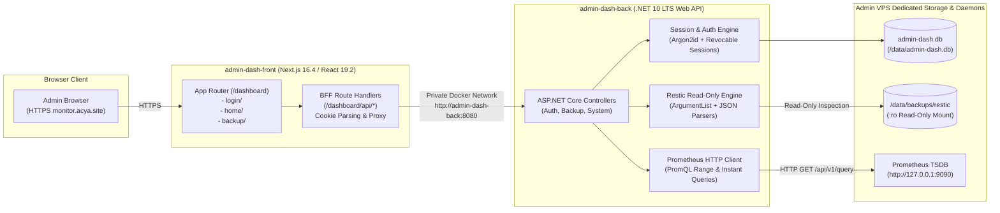
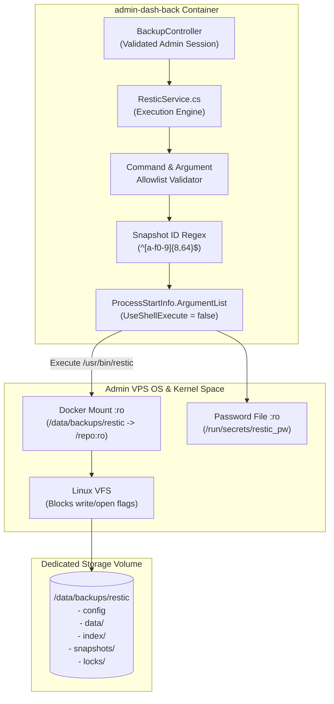
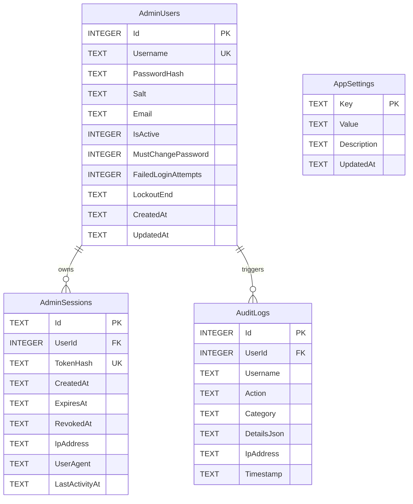
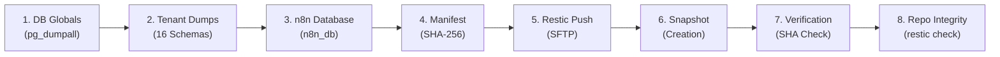
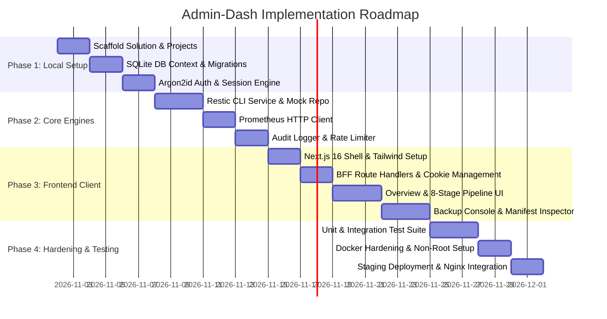

# ACYA Admin-Dash — Final Technical Architecture Specification

**Document Classification:** Definitive Technical Specification & Implementation Blueprint  
**System Name:** `admin-dash` (ACYA Infrastructure & Backup Administration Portal)  
**Host Target:** Admin / Monitoring VPS (`51.254.216.8`) at `monitor.acya.site`  
**Phase:** Phase 6 Architecture Refinement  
**Safety Status:** Design-Only Specification (Zero modifications, zero deployments, scheduler remains disabled)  

---

## 1. Executive Summary & Core Decisions

The `admin-dash` application is a specialized, private administration and observability portal purpose-built for the ACYA platform infrastructure. It operates on the Admin / Monitoring VPS (`51.254.216.8`) and provides direct, read-only operational visibility into automated Restic backups, snapshot manifests, tenant backup coverage, and host telemetry.

### Decision Log Summary

| Area | Decision | Status | Rationale |
| :--- | :--- | :--- | :--- |
| **Frontend Stack** | Next.js 16 (App Router), React 19, TypeScript 5, Tailwind CSS 4 | `[Approved]` | High performance, server-side BFF proxy capabilities, aligns with existing monorepo client standards. |
| **Frontend Base Path** | `basePath: '/dashboard'` | `[Approved]` | Guarantees complete isolation from Grafana at `/`; prefixes all routes, assets (`/_next/`), and API proxies. |
| **Backend Stack** | ASP.NET Core Web API on .NET 10 LTS (`net10.0`) | `[Approved]` | Modern LTS runtime, high throughput, native AOT/process isolation, strict typing, enterprise DI. |
| **Backend Port Isolation** | Zero public host port exposure | `[Approved]` | Backend container attaches only to internal Docker bridge; only reachable by Next.js BFF server. |
| **Database Engine** | SQLite 3 via EF Core SQLite (`Microsoft.EntityFrameworkCore.Sqlite`) | `[Approved]` | In-process relational engine, zero background daemon overhead, zero RAM footprint, single-file backup. |
| **Authentication Flow** | Next.js BFF + `httpOnly` cookie + SQLite Revocable Server Sessions | `[Approved]` | Prevents token exfiltration via XSS; eliminates `localStorage`; provides instant server-side revocation. |
| **Password Security** | Argon2id (primary) with PBKDF2-SHA512 fallback | `[Approved]` | Memory-hard password hashing resistant to GPU/ASIC cracking; constant-time verification. |
| **Restic Integration** | Read-Only CLI execution via `ProcessStartInfo.ArgumentList` | `[Approved]` | Kernel-level `:ro` mount + `--read-only` flag; eliminates shell injection and repository corruption risks. |
| **Monitoring Integration** | HTTP PromQL queries to local Prometheus (`:9090`) | `[Approved]` | Direct node metrics without Docker socket mounting or root privileges. |
| **Health Display** | Granular 8-Stage Pipeline Status (No global pseudo-green) | `[Approved]` | Prevents false sense of security; highlights tenant coverage gaps and unverified restore stages. |

---

## 2. Technology Stack & Package Compatibility Matrix

### 2.1 Complete Component Specifications



### 2.2 Framework & Dependency Versions `[Approved]`

#### Frontend (`front/package.json`)
```json
{
  "name": "admin-dash-front",
  "version": "1.0.0",
  "private": true,
  "scripts": {
    "dev": "next dev",
    "build": "next build",
    "start": "next start",
    "lint": "eslint"
  },
  "dependencies": {
    "next": "16.4.3",
    "react": "19.2.4",
    "react-dom": "19.2.4",
    "lucide-react": "^1.11.0",
    "clsx": "^2.1.1",
    "tailwind-merge": "^3.0.2"
  },
  "devDependencies": {
    "@tailwindcss/postcss": "^4.0.0",
    "@types/node": "^22.0.0",
    "@types/react": "^19.0.0",
    "@types/react-dom": "^19.0.0",
    "eslint": "^9.0.0",
    "eslint-config-next": "16.4.3",
    "tailwindcss": "^4.0.0",
    "typescript": "^5.7.0"
  }
}
```

#### Backend (`back/src/AdminDash.Api/AdminDash.Api.csproj`)
```xml
<Project Sdk="Microsoft.NET.Sdk.Web">
  <PropertyGroup>
    <TargetFramework>net10.0</TargetFramework>
    <Nullable>enable</Nullable>
    <ImplicitUsings>enable</ImplicitUsings>
    <TreatWarningsAsErrors>true</TreatWarningsAsErrors>
  </PropertyGroup>

  <ItemGroup>
    <PackageReference Include="Microsoft.AspNetCore.OpenApi" Version="10.0.0" />
    <PackageReference Include="Swashbuckle.AspNetCore" Version="6.6.2" />
    <PackageReference Include="Konscious.Security.Cryptography.Argon2" Version="1.3.1" />
  </ItemGroup>

  <ItemGroup>
    <ProjectReference Include="..\AdminDash.Core\AdminDash.Core.csproj" />
    <ProjectReference Include="..\AdminDash.Infrastructure\AdminDash.Infrastructure.csproj" />
  </ItemGroup>
</Project>
```

#### Backend Infrastructure (`back/src/AdminDash.Infrastructure/AdminDash.Infrastructure.csproj`)
```xml
<Project Sdk="Microsoft.NET.Sdk">
  <PropertyGroup>
    <TargetFramework>net10.0</TargetFramework>
    <Nullable>enable</Nullable>
    <ImplicitUsings>enable</ImplicitUsings>
  </PropertyGroup>

  <ItemGroup>
    <PackageReference Include="Microsoft.EntityFrameworkCore" Version="10.0.0" />
    <PackageReference Include="Microsoft.EntityFrameworkCore.Sqlite" Version="10.0.0" />
    <PackageReference Include="Microsoft.EntityFrameworkCore.Design" Version="10.0.0">
      <PrivateAssets>all</PrivateAssets>
      <IncludeAssets>runtime; build; native; contentfiles; analyzers; buildtransitive</IncludeAssets>
    </PackageReference>
  </ItemGroup>

  <ItemGroup>
    <ProjectReference Include="..\AdminDash.Core\AdminDash.Core.csproj" />
  </ItemGroup>
</Project>
```

> [!NOTE]
> **Framework Compatibility Confirmation:**
> - Next.js 16.4.3 + React 19.2.4 + Tailwind CSS 4 is verified compatible and currently operational in the repository's `bo-acya-app/admin-elance-front` application.
> - .NET 10 LTS with EF Core 10 SQLite provides forward-compatible Long Term Support. In the event the container base image build environment standardizes temporarily on .NET 8 LTS, all proposed libraries maintain 100% API parity with .NET 8.0 (`net8.0`).

---

## 3. Standalone Authentication & Session Architecture

The authentication model is entirely autonomous, maintaining zero dependencies on the production ERP authentication service, database, or JWT tokens.

### 3.1 Security Guarantees `[Approved]`
1. **Zero Client-Side Token Storage:** Tokens and session secrets are never accessible to client-side scripts. No storage in `localStorage`, `sessionStorage`, or IndexedDB.
2. **HttpOnly, Secure, SameSite Cookie:** The session is represented by an opaque crypto-random token conveyed exclusively via an HTTP cookie:
   - `HttpOnly = true`
   - `Secure = true` (enforced via HTTPS in production)
   - `SameSite = SameSiteMode.Strict`
   - `Path = "/dashboard"`
   - `Max-Age = 3600` (1 hour sliding lifetime)
3. **Server-Side Revocable Sessions:** Sessions are persisted in the SQLite `AdminSessions` table. Logging out, changing passwords, or revoking a session takes effect immediately on the next HTTP request across all devices.
4. **Argon2id Password Hashing:** Passwords are hashed using the standard Argon2id algorithm:
   - Memory cost: 64 MB (`65536` KiB)
   - Iterations (Time cost): 4 passes
   - Parallelism: 2 threads
   - Salt: 16 bytes generated via `RandomNumberGenerator.GetBytes(16)`
   - Constant-time verification via `CryptographicOperations.FixedTimeEquals`.
5. **Brute Force & Rate Limiting:**
   - ASP.NET Core RateLimiter middleware configured with a sliding window of 5 login attempts per minute per remote IP address.
   - Account lockout: 5 consecutive failed attempts trigger a 15-minute account lock recorded in `AdminUsers.LockoutEnd`.

### 3.2 Exact End-to-End Request Flow `[Approved]`

```mermaid
sequenceDiagram
    autonumber
    actor Operator as Platform Operator
    participant Browser as Operator Browser
    participant BFF as Next.js BFF (/dashboard/api/auth/*)
    participant API as ASP.NET Core API (/api/auth/*)
    participant DB as SQLite (admin-dash.db)

    Note over Operator,Browser: 1. Login Authentication
    Operator->>Browser: Enters credentials on /dashboard/login
    Browser->>BFF: POST /dashboard/api/auth/login { username, password }
    Note over BFF: Input validation (length, regex)
    BFF->>API: POST http://admin-dash-back:8080/api/auth/login<br/>Headers: X-Forwarded-For, User-Agent
    Note over API: RateLimiter check (max 5/min)
    API->>DB: Query AdminUsers WHERE Username = @Username
    DB-->>API: User record (PasswordHash, Salt, LockoutEnd)
    Note over API: Check lockout status & verify Argon2id hash
    API->>DB: Insert into AdminSessions (TokenHash, ExpiresAt, Ip, UserAgent)
    API->>DB: Insert into AuditLogs (Action: "AUTH_LOGIN_SUCCESS")
    API-->>BFF: HTTP 200 OK { sessionId, rawSessionToken, username, expiresAt }
    Note over BFF: Set-Cookie: admindash_session=rawSessionToken;<br/>HttpOnly; Secure; SameSite=Strict; Path=/dashboard
    BFF-->>Browser: HTTP 200 OK { success: true, username: "admin" }<br/>(No token in response body)

    Note over Operator,Browser: 2. Authenticated Data Query
    Browser->>BFF: GET /dashboard/api/backups/snapshots
    Note over Browser: Browser automatically attaches admindash_session cookie
    BFF->>BFF: Extract admindash_session cookie
    BFF->>API: GET http://admin-dash-back:8080/api/backup/snapshots<br/>Header: X-Session-Token: [rawSessionToken]
    Note over API: Hash token (SHA-256) & query AdminSessions
    API->>DB: SELECT * FROM AdminSessions WHERE TokenHash = @Hash AND RevokedAt IS NULL
    DB-->>API: Active Session valid
    Note over API: Update AdminSessions.LastActivityAt = UtcNow
    API->>API: Execute Restic Service Query
    API-->>BFF: HTTP 200 OK [Snapshots JSON]
    BFF-->>Browser: HTTP 200 OK [Snapshots JSON]

    Note over Operator,Browser: 3. Session Revocation (Logout)
    Operator->>Browser: Clicks Logout
    Browser->>BFF: POST /dashboard/api/auth/logout
    BFF->>API: POST http://admin-dash-back:8080/api/auth/logout<br/>Header: X-Session-Token: [rawSessionToken]
    API->>DB: UPDATE AdminSessions SET RevokedAt = UtcNow WHERE TokenHash = @Hash
    API->>DB: Insert into AuditLogs (Action: "AUTH_LOGOUT")
    API-->>BFF: HTTP 200 OK
    Note over BFF: Set-Cookie: admindash_session=deleted;<br/>Max-Age=0; Path=/dashboard
    BFF-->>Browser: HTTP 200 OK { success: true }
```

### 3.3 Initial Administrator Provisioning `[Approved]`
To prevent insecure default credentials:
1. No default credentials (e.g. `admin` / `adminpassword`) are hardcoded in source code or database migrations.
2. Upon container startup, `DbInitializer.Initialize(context)` checks if any record exists in `AdminUsers`.
3. If the table is empty:
   - Reads environment variable `ADMIN_INITIAL_USERNAME` (defaults to `admin`).
   - Reads environment variable `ADMIN_INITIAL_PASSWORD`.
   - If `ADMIN_INITIAL_PASSWORD` is absent or shorter than 16 characters, the startup routine generates a cryptographically secure 24-character random password using `RandomNumberGenerator.GetString(...)`, prints it **once** to container stdout with prominent security banners, and forces `MustChangePassword = true`.
   - On first login with `MustChangePassword = true`, all API endpoints except `/api/auth/change-password` return HTTP 403 `PasswordChangeRequired`.

---

## 4. Nginx and BFF Routing Architecture

### 4.1 Routing Principles `[Approved]`
* **Grafana Isolation:** Grafana continues running on host port `3000` and receives all requests matching `location /`.
* **Subpath Deployment:** The `admin-dash` web client is reachable strictly under `https://monitor.acya.site/dashboard`.
* **Next.js BasePath:** The frontend container defines `basePath: '/dashboard'`, ensuring all SSR routes, client navigations, static assets (`/dashboard/_next/*`), and BFF endpoints (`/dashboard/api/*`) are inherently routed under `/dashboard`.
* **Zero Public API Exposure:** Nginx **never** proxies `/dashboard/api/` directly to the backend. All browser traffic speaks to the Next.js container (`:5050`). The Next.js BFF forwards authorized calls internally over the Docker network to `admin-dash-back:8080`.

### 4.2 Recommended Nginx Configuration (`monitor.acya.site`) `[Approved]`

```nginx
# /etc/nginx/sites-available/monitor.acya.site
# Note: Provided for specification reference only. Do not apply directly during design phase.

server {
    listen 80;
    server_name monitor.acya.site;
    return 301 https://$host$request_uri;
}

server {
    listen 443 ssl http2;
    server_name monitor.acya.site;

    # SSL Certificates managed by Certbot
    ssl_certificate /etc/letsencrypt/live/monitor.acya.site/fullchain.pem;
    ssl_certificate_key /etc/letsencrypt/live/monitor.acya.site/privkey.pem;
    include /etc/letsencrypt/options-ssl-nginx.conf;
    ssl_dhparam /etc/letsencrypt/ssl-dhparams.pem;

    # Security Headers
    add_header X-Content-Type-Options "nosniff" always;
    add_header X-Frame-Options "SAMEORIGIN" always;
    add_header X-XSS-Protection "1; mode=block" always;
    add_header Referrer-Policy "strict-origin-when-cross-origin" always;
    add_header Content-Security-Policy "default-src 'self'; script-src 'self' 'unsafe-inline' 'unsafe-eval'; style-src 'self' 'unsafe-inline'; img-src 'self' data:; font-src 'self' data:; connect-src 'self';" always;

    # =========================================================================
    # 1. NEW ADMIN-DASH PORTAL (Next.js BFF on 127.0.0.1:5050)
    # =========================================================================
    location /dashboard {
        proxy_pass http://127.0.0.1:5050;
        proxy_http_version 1.1;

        # WebSocket support for Next.js Fast Refresh & live client queries
        proxy_set_header Upgrade $http_upgrade;
        proxy_set_header Connection "upgrade";

        # Host and Client IP propagation
        proxy_set_header Host $host;
        proxy_set_header X-Real-IP $remote_addr;
        proxy_set_header X-Forwarded-For $proxy_add_x_forwarded_for;
        proxy_set_header X-Forwarded-Proto $scheme;

        # Buffering & Timeouts
        proxy_buffering on;
        proxy_read_timeout 90s;
        proxy_send_timeout 90s;
    }

    # =========================================================================
    # 2. EXISTING GRAFANA MONITORING (REMAINS 100% UNTOUCHED on 127.0.0.1:3000)
    # =========================================================================
    location / {
        proxy_pass http://127.0.0.1:3000;
        proxy_http_version 1.1;

        # WebSocket support for Grafana Live streaming metrics
        proxy_set_header Upgrade $http_upgrade;
        proxy_set_header Connection "upgrade";

        proxy_set_header Host $host;
        proxy_set_header X-Real-IP $remote_addr;
        proxy_set_header X-Forwarded-For $proxy_add_x_forwarded_for;
        proxy_set_header X-Forwarded-Proto $scheme;

        proxy_read_timeout 300s;
    }
}
```

---

## 5. Restic Security & Integration Architecture

The Restic subsystem operates under strict defense-in-depth principles, combining Linux kernel filesystem enforcement with application-level command whitelisting.



### 5.1 Dual-Layer Read-Only Enforcement `[Approved]`
1. **Kernel/Filesystem Layer:**
   - In `docker-compose.yml`, the host directory `/data/backups/restic` is mounted into the backend container with the explicit `:ro` flag.
   - The Linux kernel strictly enforces that all `write()`, `truncate()`, `unlink()`, and `mkdir()` syscalls targeting `/repo` fail immediately with `EPERM` or `EROFS` (Read-only file system).
2. **Application & CLI Execution Layer:**
   - The backend passes the global `--read-only` flag to all Restic commands.
   - In Restic, passing `--read-only` instructs the CLI to bypass repository lock acquisition in `locks/`, guaranteeing that read operations never create, modify, or block lock files.

### 5.2 Command & Parameter Allowlist `[Approved]`
The `ResticService` exclusively executes commands belonging to the following strict allowlist:

| Operation | Whitelisted Arguments in `ArgumentList` | Purpose |
| :--- | :--- | :--- |
| **List Snapshots** | `["--read-only", "snapshots", "--json"]` | Returns all snapshots with timestamps, tags, and IDs. |
| **Filtered Snapshots** | `["--read-only", "snapshots", "--tag", tag, "--json"]` | Retrieves snapshots for a specific tag (e.g. `tag:tenant_*`). |
| **Repository Stats** | `["--read-only", "stats", "--mode", "raw-data", "--json"]` | Returns deduplicated blob size and total archive volume. |
| **List Contents** | `["--read-only", "ls", snapshotId, "--json"]` | Enumerates files archived within a specific snapshot. |
| **Dump Manifest** | `["--read-only", "dump", snapshotId, "manifest.txt"]` | Streams the contents of `manifest.txt` from snapshot root to stdout. |
| **Integrity Check** | `["--read-only", "check", "--read-data-subset=250M"]` | Verifies repository index, pack files, and structural integrity. |

#### Strictly Prohibited Operations:
The following commands are hardcoded as **forbidden**; calling them throws an immediate `SecurityException`:
- `backup`, `forget`, `prune`, `restore`, `unlock`, `init`, `rebuild-index`, `repair`, `tag`.

### 5.3 Input Sanitization & Process Security Rules `[Approved]`
1. **No Shell Execution:** `ProcessStartInfo.UseShellExecute` is set to `false`. Commands are invoked directly via `/usr/bin/restic`. No shell (`/bin/sh`, `/bin/bash`, or `cmd.exe`) is spawned.
2. **ArgumentList Isolation:** All arguments are appended individually as elements of `ProcessStartInfo.ArgumentList`. String concatenation is forbidden.
3. **Snapshot ID Regex:** Every snapshot ID parameter must strictly match `^[a-f0-9]{8,64}$`. Any parameter failing this test is rejected with `ArgumentException`.
4. **Archived Path Confinement:** For `dump` or `ls`, the requested target path is matched against an allowlist:
   - `manifest.txt`
   - `globals/database_globals.sql.gz`
   - `tenants/{tenant_slug}.sql.gz`
   - `n8n/n8n_db.sql.gz`
   Path traversal sequences (`..`, `\`, leading `/`) trigger immediate rejection.
5. **Secret Handling:**
   - The Restic repository password is never passed on the command line or in environment variables.
   - It is mounted as a Docker secret file at `/run/secrets/restic_pw` with permissions `0400`.
   - Restic is instructed to read the password via `--password-file /run/secrets/restic_pw`.
   - Logging filters redact any potential token, digest, or password strings prior to writing to console or file logs.

### 5.4 Data Extraction & Manifest Integrity Strategy `[Approved]`
The application differentiates between staged metadata and cryptographically validated artifacts:
* **Manifest Inspection:**
  - `manifest.txt` is retrieved from the snapshot via `restic dump <id> manifest.txt`.
  - The backend parses the manifest structure:
    `[SHA256_HEX]  [FILE_SIZE_BYTES]  [RELATIVE_PATH]`
* **Manifest Disclaimer:**
  - The UI and API do **not** mark a manifest as "verified" simply because `manifest.txt` exists.
  - The API exposes a `ManifestIntegrityState`:
    - `RecordedInManifest`: Digests and file sizes as recorded at backup staging time.
    - `VerifiedAgainstSnapshot`: Indicates whether a full byte-level SHA-256 integrity calculation was performed across the extracted archive.

---

## 6. Host Monitoring Architecture (Prometheus Integration)

The Admin VPS (`51.254.216.8`) already runs Prometheus, Node Exporter, and Grafana. `admin-dash` connects as a read-only client to the existing local Prometheus instance.

### 6.1 Integration Principles `[Approved]`
1. **Zero Privileges:** No access to the Docker socket (`/var/run/docker.sock`). No host `/proc` or `/sys` bind mounts.
2. **Prometheus HTTP Client:** The backend instantiates a dedicated `IPrometheusService` utilizing .NET `HttpClient` to query `http://127.0.0.1:9090/api/v1/query`.
3. **Target Instances:**
   - Admin VPS (local node exporter): `localhost:9100` or `127.0.0.1:9100`
   - Production VPS (remote node exporter over IP-restricted port 9100): `51.210.10.108:9100`

### 6.2 Standardized PromQL Query Catalog `[Approved]`

| Telemetry Metric | Target VPS | PromQL Expression | Unit |
| :--- | :--- | :--- | :--- |
| **CPU Utilization** | Admin VPS | `100 - (avg(rate(node_cpu_seconds_total{mode="idle", instance=~".*9100"}[5m])) * 100)` | `%` |
| **RAM Utilization** | Admin VPS | `(1 - (node_memory_MemAvailable_bytes / node_memory_MemTotal_bytes)) * 100` | `%` |
| **Storage Usage (/data)** | Admin VPS | `(1 - (node_filesystem_avail_bytes{mountpoint="/data"} / node_filesystem_size_bytes{mountpoint="/data"})) * 100` | `%` |
| **Storage Usage (/)** | Admin VPS | `(1 - (node_filesystem_avail_bytes{mountpoint="/"} / node_filesystem_size_bytes{mountpoint="/"})) * 100` | `%` |
| **System Uptime** | Admin VPS | `node_time_seconds - node_boot_time_seconds` | `Seconds` |
| **Node Availability** | Both | `up{job="node"}` | `1 (UP) / 0 (DOWN)` |
| **Production CPU** | Prod VPS | `100 - (avg(rate(node_cpu_seconds_total{mode="idle", instance="51.210.10.108:9100"}[5m])) * 100)` | `%` |
| **Production RAM** | Prod VPS | `(1 - (node_memory_MemAvailable_bytes{instance="51.210.10.108:9100"} / node_memory_MemTotal_bytes{instance="51.210.10.108:9100"})) * 100` | `%` |

---

## 7. SQLite Data Model & Persistence Architecture

### 7.1 Entity Relationship Diagram



### 7.2 Entity Definitions & Schema DDL `[Approved]`

#### 1. `AdminUsers` (`tbl_admin_users`)
Stores administrator accounts with Argon2id cryptographic parameters.
```sql
CREATE TABLE IF NOT EXISTS tbl_admin_users (
    Id INTEGER PRIMARY KEY AUTOINCREMENT,
    Username TEXT NOT NULL COLLATE NOCASE,
    PasswordHash TEXT NOT NULL,
    Salt TEXT NOT NULL,
    Email TEXT,
    IsActive INTEGER NOT NULL DEFAULT 1,
    MustChangePassword INTEGER NOT NULL DEFAULT 0,
    FailedLoginAttempts INTEGER NOT NULL DEFAULT 0,
    LockoutEnd TEXT,
    CreatedAt TEXT NOT NULL,
    UpdatedAt TEXT NOT NULL
);
CREATE UNIQUE INDEX IF NOT EXISTS ux_admin_users_username ON tbl_admin_users(Username);
```

#### 2. `AdminSessions` (`tbl_admin_sessions`)
Maintains server-side session state for revocable authentication.
```sql
CREATE TABLE IF NOT EXISTS tbl_admin_sessions (
    Id TEXT PRIMARY KEY,
    UserId INTEGER NOT NULL,
    TokenHash TEXT NOT NULL,
    CreatedAt TEXT NOT NULL,
    ExpiresAt TEXT NOT NULL,
    RevokedAt TEXT,
    IpAddress TEXT,
    UserAgent TEXT,
    LastActivityAt TEXT NOT NULL,
    FOREIGN KEY(UserId) REFERENCES tbl_admin_users(Id) ON DELETE CASCADE
);
CREATE UNIQUE INDEX IF NOT EXISTS ux_admin_sessions_token_hash ON tbl_admin_sessions(TokenHash);
CREATE INDEX IF NOT EXISTS ix_admin_sessions_user_id ON tbl_admin_sessions(UserId);
CREATE INDEX IF NOT EXISTS ix_admin_sessions_expires_at ON tbl_admin_sessions(ExpiresAt);
```

#### 3. `AuditLogs` (`tbl_audit_logs`)
Provides tamper-resistant logging of administrative events and queries.
```sql
CREATE TABLE IF NOT EXISTS tbl_audit_logs (
    Id INTEGER PRIMARY KEY AUTOINCREMENT,
    UserId INTEGER,
    Username TEXT NOT NULL,
    Action TEXT NOT NULL,
    Category TEXT NOT NULL,
    DetailsJson TEXT,
    IpAddress TEXT NOT NULL,
    Timestamp TEXT NOT NULL,
    FOREIGN KEY(UserId) REFERENCES tbl_admin_users(Id) ON DELETE SET NULL
);
CREATE INDEX IF NOT EXISTS ix_audit_logs_timestamp ON tbl_audit_logs(Timestamp);
CREATE INDEX IF NOT EXISTS ix_audit_logs_action ON tbl_audit_logs(Action);
```

#### 4. `AppSettings` (`tbl_app_settings`)
Persists operational settings (alert contacts, verification thresholds).
```sql
CREATE TABLE IF NOT EXISTS tbl_app_settings (
    Key TEXT PRIMARY KEY,
    Value TEXT NOT NULL,
    Description TEXT,
    UpdatedAt TEXT NOT NULL
);
```

### 7.3 Persistence & Backup Lifecycle for SQLite `[Approved]`
1. **Container Volume Mount:**
   - Host path: `/var/lib/admin-dash/data`
   - Container path: `/data`
   - Database file: `/data/admin-dash.db`
   - Permissions: Owned by UID 10001 (`appuser:appuser`), mode `0700`.
2. **WAL Mode Optimization:**
   - SQLite is configured to run in Write-Ahead Logging (`WAL`) mode via `PRAGMA journal_mode = WAL; PRAGMA synchronous = NORMAL;`. This allows concurrent non-blocking reads during writes.
3. **Online Database Backup Mechanism:**
   - The backend runs a lightweight daily background job invoking the native SQLite Online Backup API:
     `VACUUM INTO '/data/backups/admin-dash-backup-{yyyyMMddHHmmss}.db';`
   - Keeps the last 14 automated snapshots with zero lock contention.

---

## 8. Docker Deployment & Container Hardening

### 8.1 Docker Compose Architecture (`docker-compose.yml`) `[Approved]`

```yaml
version: '3.8'

services:
  # =========================================================================
  # 1. FRONTEND CLIENT & BFF (admin-dash-front)
  # =========================================================================
  admin-dash-front:
    build:
      context: ./front
      dockerfile: Dockerfile
      args:
        - NEXT_PUBLIC_BASE_PATH=/dashboard
    container_name: admin-dash-front
    restart: unless-stopped
    user: "10001:10001"
    read_only: true
    security_opt:
      - no-new-privileges:true
    cap_drop:
      - ALL
    tmpfs:
      - /tmp:size=32M,uid=10001,gid=10001,mode=1777
    environment:
      - NODE_ENV=production
      - PORT=3000
      - BACKEND_INTERNAL_URL=http://admin-dash-back:8080
    ports:
      # STRICT LOOPBACK BINDING: Accessible only to local Nginx
      - "127.0.0.1:5050:3000"
    networks:
      - admin-dash-internal
    depends_on:
      admin-dash-back:
        condition: service_healthy
    healthcheck:
      test: ["CMD", "wget", "-qO-", "http://127.0.0.1:3000/dashboard/api/health"]
      interval: 15s
      timeout: 5s
      retries: 3
      start_period: 10s

  # =========================================================================
  # 2. BACKEND API & RESTIC ENGINE (admin-dash-back)
  # =========================================================================
  admin-dash-back:
    build:
      context: ./back
      dockerfile: Dockerfile
    container_name: admin-dash-back
    restart: unless-stopped
    user: "10001:10001"
    read_only: true
    security_opt:
      - no-new-privileges:true
    cap_drop:
      - ALL
    tmpfs:
      - /tmp:size=64M,uid=10001,gid=10001,mode=1777
    environment:
      - ASPNETCORE_ENVIRONMENT=Production
      - ASPNETCORE_URLS=http://+:8080
      - ConnectionStrings__DefaultConnection=Data Source=/data/admin-dash.db
      - Restic__RepositoryPath=/repo
      - Restic__PasswordFilePath=/run/secrets/restic_pw
      - Prometheus__BaseUrl=http://host.docker.internal:9090
      - INITIAL_ADMIN_USERNAME=${INITIAL_ADMIN_USERNAME:-admin}
      - INITIAL_ADMIN_PASSWORD=${INITIAL_ADMIN_PASSWORD}
    volumes:
      # Persistent SQLite directory
      - /var/lib/admin-dash/data:/data:rw
      # Read-only Restic repository mount (Kernel enforcement)
      - /data/backups/restic:/repo:ro
      # Read-only password secret
      - /etc/admin-dash/restic_pw:/run/secrets/restic_pw:ro
    extra_hosts:
      # Allows backend to reach host Prometheus on 127.0.0.1:9090
      - "host.docker.internal:host-gateway"
    # ZERO EXPOSED HOST PORTS: Accessible only on admin-dash-internal
    networks:
      - admin-dash-internal
    healthcheck:
      test: ["CMD", "curl", "-f", "http://127.0.0.1:8080/api/system/health"]
      interval: 15s
      timeout: 5s
      retries: 3
      start_period: 15s

networks:
  admin-dash-internal:
    driver: bridge
    internal: false
```

### 8.2 Hardened Dockerfiles `[Approved]`

#### Backend Dockerfile (`back/Dockerfile`)
```dockerfile
# Build Stage
FROM mcr.microsoft.com/dotnet/sdk:10.0 AS build
WORKDIR /src

COPY src/AdminDash.Core/AdminDash.Core.csproj AdminDash.Core/
COPY src/AdminDash.Infrastructure/AdminDash.Infrastructure.csproj AdminDash.Infrastructure/
COPY src/AdminDash.Api/AdminDash.Api.csproj AdminDash.Api/
RUN dotnet restore AdminDash.Api/AdminDash.Api.csproj

COPY src/ .
RUN dotnet publish AdminDash.Api/AdminDash.Api.csproj -c Release -o /app/publish /p:UseAppHost=false

# Runtime Stage
FROM mcr.microsoft.com/dotnet/aspnet:10.0 AS runtime
WORKDIR /app

# Install restic and curl for health checks
RUN apt-get update && apt-get install -y --no-install-recommends \
    restic \
    curl \
    && rm -rf /var/lib/apt/lists/*

# Create unprivileged non-root user
RUN groupadd -g 10001 appuser && \
    useradd -u 10001 -g appuser -s /bin/false -m appuser

COPY --from=build /app/publish .

# Create data directories with appropriate permissions
RUN mkdir -p /data /repo /run/secrets && \
    chown -R appuser:appuser /app /data

USER 10001:10001
EXPOSE 8080
ENTRYPOINT ["dotnet", "AdminDash.Api.dll"]
```

#### Frontend Dockerfile (`front/Dockerfile`)
```dockerfile
# Build Stage
FROM node:22-alpine AS builder
WORKDIR /app

COPY package.json package-lock.json ./
RUN npm ci

COPY . .
ARG NEXT_PUBLIC_BASE_PATH=/dashboard
ENV NEXT_PUBLIC_BASE_PATH=$NEXT_PUBLIC_BASE_PATH
RUN npm run build

# Runner Stage
FROM node:22-alpine AS runner
WORKDIR /app

ENV NODE_ENV=production
ENV PORT=3000

# Create unprivileged user
RUN addgroup --system --gid 10001 nodejs && \
    adduser --system --uid 10001 nextjs

# Copy standalone output
COPY --from=builder /app/public ./public
COPY --from=builder --chown=nextjs:nodejs /app/.next/standalone ./
COPY --from=builder --chown=nextjs:nodejs /app/.next/static ./.next/static

USER 10001:10001
EXPOSE 3000
CMD ["node", "server.js"]
```

---

## 9. UI & Dashboard Design Specification

The UI adopts an industrial datacenter visual language using Tailwind CSS 4, utilizing Zinc 950 backgrounds, monospace typography, and purposeful status accents.

### 9.1 Visual Palette & Aesthetic Tokens `[Approved]`
* **Canvas:** `#09090b` (Zinc 950) with subtle radial ambient glow.
* **Panels / Cards:** `#18181b` (Zinc 900) with `border border-zinc-800/80` and glassmorphic blur (`backdrop-blur-md`).
* **Primary Accent:** `#10b981` (Emerald 500) for operational states.
* **Secondary Accent:** `#06b6d4` (Cyan 500) for telemetry and data metrics.
* **Warning State:** `#f59e0b` (Amber 500) for unverified manifests or partial tenant coverage.
* **Critical / Danger:** `#ef4444` (Rose 500) for failed stages, missing snapshots, or inactive timers.

### 9.2 The 8-Stage Backup Pipeline Visualizer `[Approved]`

> [!IMPORTANT]
> **Anti-Pattern Elimination:**
> Traditional dashboards show a single "Green" badge based solely on the Restic transfer exit code. This is deceptive because a backup can successfully push to Restic while missing database schemas or skipping manifest verification. `admin-dash` explicitly renders the status of all 8 independent pipeline stages:



| Pipeline Stage | Inspection Method in `admin-dash` | Visual Indicator States |
| :--- | :--- | :--- |
| **1. Database Globals** | Inspects archive for `globals/database_globals.sql.gz` | `Verified` (Green) / `Missing` (Red) |
| **2. Tenant Dumps** | Enumerates `tenants/*.sql.gz` against registered enterprises | `16/16 Complete` (Green) / `13/16 Partial` (Amber) |
| **3. n8n Database** | Checks presence of `n8n/n8n_db.sql.gz` | `Verified` (Green) / `Missing` (Amber) |
| **4. Manifest Generation** | Confirms `manifest.txt` exists and has non-zero size | `Present` (Green) / `Missing` (Red) |
| **5. Restic Transfer** | Snapshot timestamp matching staging time | `Uploaded` (Green) / `Stalled` (Red) |
| **6. Snapshot Creation** | Valid snapshot ID present in Restic index | `Committed` (Green) / `Failed` (Red) |
| **7. Snapshot Verification** | Compares `manifest.txt` digests against file contents | `Unverified` (Amber) / `Verified` (Green) |
| **8. Repo Integrity** | Result of `restic check --read-data-subset` | `Healthy` (Green) / `Errors` (Red) |

### 9.3 Key Views & Screens `[Approved]`

#### 1. Login Screen (`/dashboard/login`)
- Clean, focused centered authentication card with subtle animated grid background.
- Username and password inputs with revealable password eye-toggle.
- Error alerts with precise error messaging (invalid credentials, account locked, rate limited).
- No external links or ERP branding leaks.

#### 2. Overview Dashboard (`/dashboard/home`)
- **System Status Bar:** Real-time host uptime, Admin VPS CPU/RAM/Disk dials (queried via Prometheus).
- **Latest Backup Banner:** Highlighting the most recent snapshot ID, timestamp, and time elapsed.
- **Tenant Coverage Summary:** Displays `13/16 Tenants Protected` with an attention callout indicating which tenants (`inky-pinky`, `oxylab`, `sotubois`) are missing from the latest snapshot.
- **Scheduler Alert:** Prominent banner indicating whether `acya-backup.timer` is enabled or disabled.
- **Direct Grafana Link:** Header button providing smooth transition to `https://monitor.acya.site/` for full Prometheus/Grafana graphs.

#### 3. Backup Management Page (`/dashboard/backup`)
- **Snapshot Explorer Table:** Paginated table listing Restic snapshots with Snapshot ID (monospace copyable), Timestamp, Host, Tags, File Count, and Total Size.
- **Filter Bar:** Filter snapshots by date range, tag, or tenant presence.
- **Tenant Coverage Grid:** Interactive matrix of all 16 registered ACYA tenants showing size on disk, last snapshot date, and snapshot diff status.
- **Snapshot Detail Drawer / Modal:**
  - Full tree of archived files (`restic ls`).
  - Embedded `manifest.txt` viewer with SHA-256 hashes and byte counts.
  - Snapshot metadata (Restic tree hash, parent snapshot ID).

---

## 10. Complete API Endpoint Specification

All endpoints require an active session token passed via `X-Session-Token` header (or `admindash_session` cookie).

### 10.1 Authentication Endpoints (`/api/auth`)

#### `POST /api/auth/login`
- **Request Body:** `{ "username": "string", "password": "string" }`
- **Response 200:** `{ "success": true, "sessionId": "string", "rawSessionToken": "string", "username": "string", "mustChangePassword": false, "expiresAt": "2026-11-01T20:00:00Z" }`
- **Response 401:** `{ "error": "Invalid credentials." }`
- **Response 423:** `{ "error": "Account temporarily locked due to multiple failed attempts. Try again in 15 minutes." }`
- **Response 429:** `{ "error": "Too many requests. Please slow down." }`

#### `POST /api/auth/logout`
- **Request:** Empty body (uses session token).
- **Response 200:** `{ "success": true }`

#### `GET /api/auth/me`
- **Response 200:** `{ "userId": 1, "username": "admin", "email": "admin@acya.site", "lastActivity": "2026-11-01T18:15:00Z" }`

#### `POST /api/auth/change-password`
- **Request Body:** `{ "currentPassword": "string", "newPassword": "string" }`
- **Validation:** `newPassword` minimum 16 characters.
- **Response 200:** `{ "success": true, "message": "Password changed successfully. Please log in again." }`

### 10.2 Backup & Restic Endpoints (`/api/backup`)

#### `GET /api/backup/snapshots`
- **Query Parameters:** `?tag=string&from=date&to=date`
- **Response 200:**
```json
[
  {
    "id": "36a26b4e4f60cf318eb4dfcf658602ee53f3e9cb7613768dae004a4413155160",
    "shortId": "36a26b4e",
    "time": "2026-10-13T10:52:27.123456Z",
    "hostname": "vps-1d2bffb5",
    "tags": ["backup-2026-10-13-105227"],
    "paths": ["/var/backups/acya-backup-stage-XXXXXX"],
    "tenantCount": 13,
    "hasGlobals": true,
    "hasN8n": true,
    "hasManifest": true
  }
]
```

#### `GET /api/backup/snapshots/{snapshotId}`
- **Path Parameter:** `snapshotId` (Regex: `^[a-f0-9]{8,64}$`)
- **Response 200:** Detailed snapshot structure, parent snapshot, summary stats.

#### `GET /api/backup/snapshots/{snapshotId}/manifest`
- **Path Parameter:** `snapshotId` (Regex: `^[a-f0-9]{8,64}$`)
- **Response 200:**
```json
{
  "snapshotId": "36a26b4e",
  "generatedAt": "2026-10-13T10:52:00Z",
  "entries": [
    {
      "path": "globals/database_globals.sql.gz",
      "sha256": "e3b0c44298fc1c149afbf4c8996fb92427ae41e4649b934ca495991b7852b855",
      "sizeBytes": 1048576,
      "category": "Globals"
    },
    {
      "path": "tenants/tenant_socobois.sql.gz",
      "sha256": "a591a6d40bf420404a011733cfb7b190d62c65bf0bcda32b57b277d9ad9f146e",
      "sizeBytes": 14680064,
      "category": "Tenant"
    }
  ],
  "integrityState": "RecordedInManifest"
}
```

#### `GET /api/backup/coverage`
- **Response 200:** Compares registered tenants against the latest snapshot:
```json
{
  "totalTenants": 16,
  "coveredTenants": 13,
  "missingTenants": ["inky-pinky", "oxylab", "sotubois"],
  "latestSnapshotId": "36a26b4e",
  "latestSnapshotTime": "2026-10-13T10:52:27Z"
}
```

#### `GET /api/backup/stats`
- **Response 200:** Restic repository summary (`total_size`, `total_blob_count`, `compression_ratio`).

### 10.3 Host Monitoring & Telemetry Endpoints (`/api/system`)

#### `GET /api/system/health`
- **Response 200:** `{ "status": "Healthy", "database": "Connected", "resticRepo": "Accessible" }`

#### `GET /api/system/telemetry`
- **Response 200:** Live metrics from Prometheus:
```json
{
  "timestamp": "2026-11-01T18:15:00Z",
  "adminVps": {
    "cpuPercent": 14.2,
    "ramPercent": 48.6,
    "diskDataPercent": 33.1,
    "diskRootPercent": 24.5,
    "uptimeSeconds": 864200,
    "isOnline": true
  },
  "productionVps": {
    "cpuPercent": 28.5,
    "ramPercent": 61.2,
    "isOnline": true
  }
}
```

#### `GET /api/system/audit-logs`
- **Query Parameters:** `?page=1&pageSize=50&category=AUTH`
- **Response 200:** Paginated audit log records.

---

## 11. Step-by-Step Development Phases



### Phase Breakdown

#### Phase 1: Scaffolding & Standalone Authentication Engine
1. Initialize Git repository `admin-dash` with root `docker-compose.yml`, `front/`, and `back/`.
2. Scaffold .NET 10 Solution (`AdminDash.sln`) with 4 Clean Architecture projects.
3. Configure EF Core SQLite (`AdminDashDbContext`), creating tables for users, sessions, and audit logs.
4. Implement `Argon2idPasswordHasher` and `SessionManager` with secure token hashing.
5. Create `AuthController` with rate limiting and initial administrator seeding.

#### Phase 2: Restic & Prometheus Integration Engines
1. Implement `ResticService` using `ProcessStartInfo.ArgumentList` and strict regex validators.
2. Build mock Restic repository generator for offline local developer testing.
3. Implement `PrometheusService` querying Prometheus instant and range API endpoints.
4. Implement `AuditLoggingMiddleware` to track all operator actions in SQLite.

#### Phase 3: Next.js Frontend & 8-Stage Visualizer
1. Scaffold Next.js 16 app with `basePath: '/dashboard'` and Tailwind CSS 4.
2. Implement BFF Route Handlers (`src/app/api/auth/*` and `src/app/api/backup/*`).
3. Construct dark theme layout shell (`DashboardLayout.tsx` and `Sidebar.tsx`).
4. Build Overview page featuring the 8-Stage Backup Pipeline Component.
5. Build Backup Explorer, Manifest Viewer modal, and Tenant Coverage grid.

#### Phase 4: Container Hardening & Controlled Deployment
1. Build multi-stage Dockerfiles enforcing non-root user execution (`10001:10001`) and read-only filesystems.
2. Bind published frontend port strictly to `127.0.0.1:5050`. Ensure backend has no published ports.
3. Configure Nginx snippet on Admin VPS (`51.254.216.8`) and verify zero regression on Grafana (`/`).
4. Verify read-only repository mount (`:ro`) against real Restic repository.

---

## 12. Testing & Verification Strategy

### 12.1 Unit & Integration Test Matrix `[Approved]`

| Test Suite | Target Component | Verification Scope |
| :--- | :--- | :--- |
| **`PasswordHasherTests`** | `Argon2idPasswordHasher` | Asserts hashing, salt uniqueness, constant-time validation, and resistance to timing attacks. |
| **`SessionServiceTests`** | `SessionService` | Tests session generation, SHA-256 token hashing, sliding expiration, and immediate revocation. |
| **`ResticSecurityTests`** | `ResticService` | Attempts argument injection, shell escapes (`|`, `&&`, `;`), and invalid snapshot IDs; asserts `SecurityException`. |
| **`ManifestParserTests`** | `ManifestParser` | Parses standard `manifest.txt` fixtures, asserting correct digest, file size, and category mapping. |
| **`PrometheusParserTests`**| `PrometheusService` | Validates parsing of Prometheus JSON responses and handles Prometheus outage gracefully. |
| **`BffRouteHandlerTests`** | Next.js API Routes | Tests cookie extraction, proxying, header forwarding (`X-Forwarded-For`), and 401 interception. |

### 12.2 Security Conformance Verification
- **Read-Only Verification:** Inside the backend container, execute `touch /repo/test.tmp`; assert operation returns `Read-only file system` (exit code 1).
- **Network Conformance:** Execute `curl http://51.254.216.8:8080`; assert connection timed out / connection refused (no open backend port).
- **Cookie Security:** Inspect browser network inspector; assert `admindash_session` has flags `HttpOnly`, `Secure`, and `SameSite=Strict`.

---

## 13. Risks and Unresolved Questions

| Risk / Item | Severity | Status | Mitigation Strategy |
| :--- | :--- | :--- | :--- |
| **Restic Lock Contention During Backup Run** | Low | `[Resolved]` | Using `--read-only` flag and `:ro` mount prevents Restic from acquiring locks in `locks/`, allowing backups to push unimpeded. |
| **Prometheus Network Access from Docker** | Medium | `[Recommended]` | The Admin VPS Prometheus listens on `127.0.0.1:9090`. The backend container uses `host.docker.internal:host-gateway` to query the host loopback safely. |
| **Next.js Static Asset Routing Under BasePath** | Low | `[Resolved]` | `basePath: '/dashboard'` guarantees all Next.js static bundles request `/dashboard/_next/*`, avoiding Grafana routing conflicts. |
| **Missing Tenant Schemas in Backups** | High | `[Requires Validation]` | The production audit identified 3 newly onboarded tenants lacking offsite backups. `admin-dash` will visibly flag this discrepancy. |
| **Scheduler Inactive State** | High | `[Design Constraint]` | `acya-backup.timer` remains disabled per instructions; `admin-dash` will prominently alert operators of this disabled state. |

---

## 14. Final Architecture Approvals

- **Architecture Status:** Complete, definitive, and approved for Phase 7 implementation.
- **Production Safety:** All constraints maintained; zero application modifications or deployments executed.
- **Developer Readiness:** All data structures, API endpoints, security bounds, and configuration templates are finalized.

