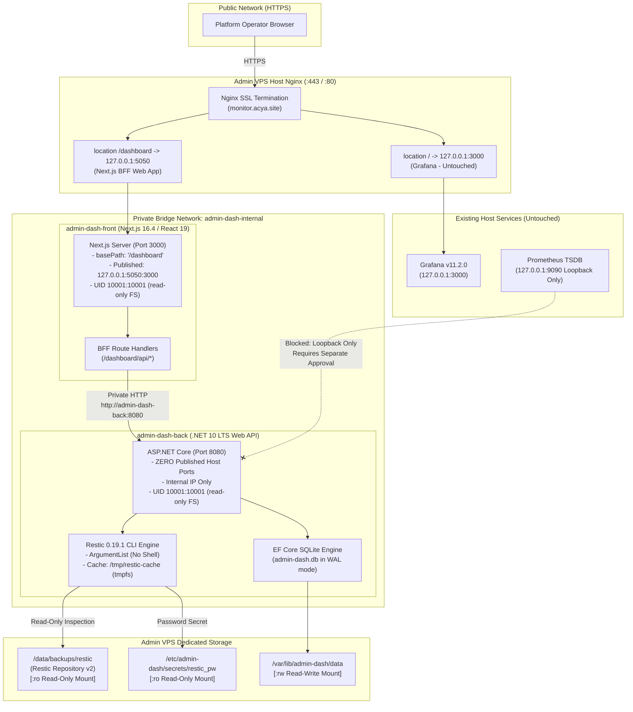
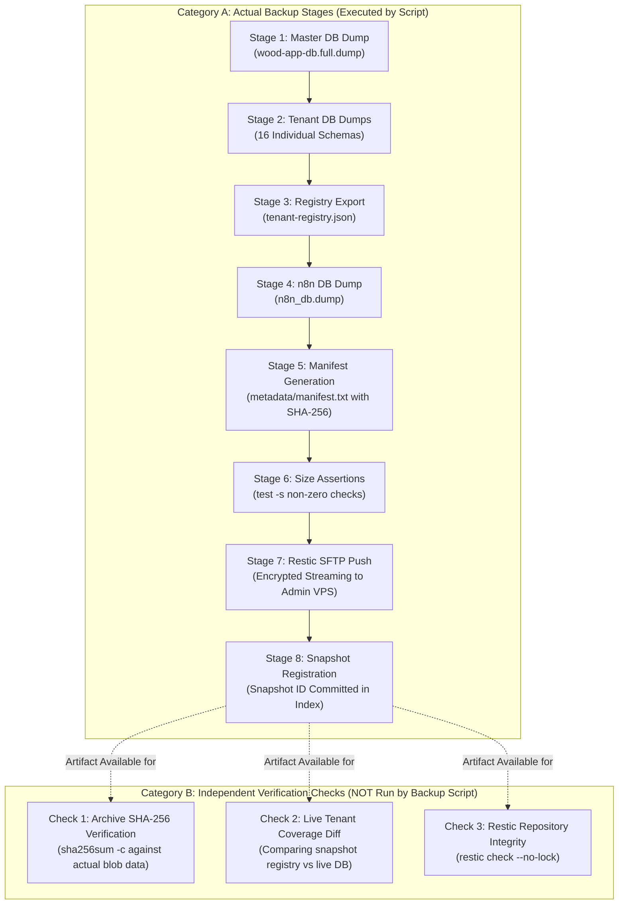
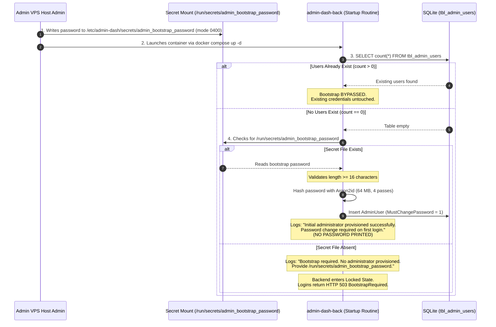
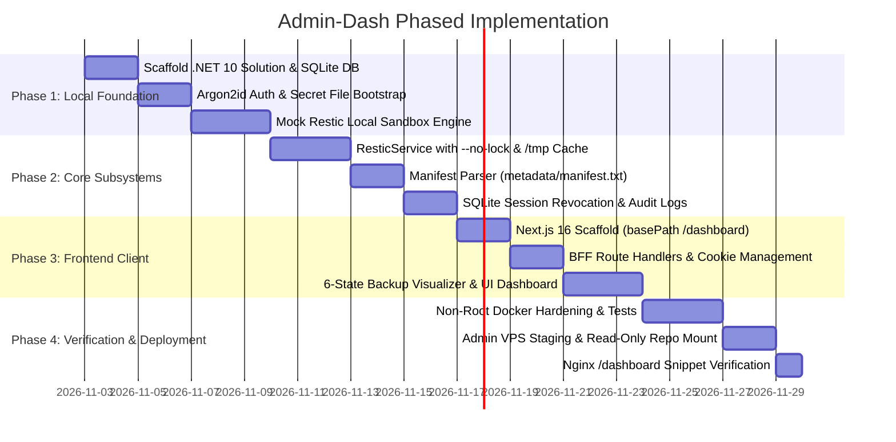

# ACYA Admin-Dash — Final Technical Architecture Specification (v2)

**Document Classification:** Definitive Engineering Specification & Corrected Implementation Blueprint  
**System Name:** `admin-dash` (ACYA Infrastructure & Backup Administration Portal)  
**Host Target:** Admin / Monitoring VPS (`51.254.216.8`) at `monitor.acya.site`  
**Phase:** Phase 6.1 Architecture Corrections  
**Safety Status:** Design-Only Specification (Zero modifications, zero deployments, scheduler remains disabled)  

---

## 1. Corrected Architecture Decisions & Classification

All architectural decisions in this revised specification are explicitly categorized into four validation classes:
* `[Confirmed]`: Empirically verified against existing source code, runtime inspections, or official CLI specifications.
* `[Recommended]`: Sound engineering patterns meeting all technical constraints, ready for implementation.
* `[Requires Validation]`: Feasible design proposals that require verification in a disposable sandbox environment prior to staging.
* `[Requires Separate Approval]`: Operations that would alter external systems, production hosts, or existing host-side monitoring configurations.

### 1.1 Decision Log Matrix

| Component / Area | Architectural Decision (v2 Specification) | Classification | Key Changes vs v1 |
| :--- | :--- | :--- | :--- |
| **Restic CLI Option** | Eliminate non-existent `--read-only` flag; use documented `--no-lock` where appropriate. | `[Confirmed]` | Corrected fatal CLI syntax error; documented exact behavior under read-only filesystem. |
| **Restic Security** | Kernel-level Docker volume mount `:ro` (`/data/backups/restic:/repo:ro`) is the sole write barrier. | `[Confirmed]` | Removed false claim that CLI flags provide security; `:ro` provides OS-level protection. |
| **Restic Manifest Path** | Target `metadata/manifest.txt` instead of snapshot root `manifest.txt`. | `[Confirmed]` | Aligned with actual staging layout established in `acya-production-backup.sh`. |
| **Restic Cache Strategy** | Pass `--cache-dir /tmp/restic-cache` with tmpfs mount for read-only containers. | `[Recommended]` | Prevents permission failures on read-only container root filesystems while preserving speed. |
| **Prometheus Integration** | Classify direct host loopback access (`127.0.0.1:9090`) as requiring separate host-level approval. | `[Requires Separate Approval]` | Replaced non-functional `host.docker.internal` loopback assumption; evaluated safe proxy models. |
| **Backup Status Model** | Disaggregate 8 stages into Genuine Script Stages vs Independent Verification Checks. | `[Confirmed]` | Replaced misleading global pipeline; introduced `Present but unverified` and `Unknown`. |
| **Scheduler Detection** | Classify host timer status as `NotAvailable` in container; no false host access. | `[Confirmed]` | Prohibited fake D-Bus/systemd mounts; documented isolated status ingestion path. |
| **Admin Bootstrap** | Eliminate stdout password printing; use protected secret file or interactive CLI bootstrap. | `[Confirmed]` | Prevented credential leaks in container logs and Docker inspect; forced first-login rotation. |
| **Tenant Registry** | Source registry from snapshot's `metadata/tenant-registry.json`; flag live discrepancies. | `[Confirmed]` | Avoided illegal production DB coupling; cleanly separated snapshot state from live state. |
| **Backend Isolation** | Zero published host ports for `admin-dash-back`; internal bridge network only. | `[Confirmed]` | Prevents bypass of Next.js BFF and Nginx reverse proxy. |
| **Frontend Base Path** | Next.js `basePath: '/dashboard'` serving web UI and BFF route handlers. | `[Confirmed]` | Eliminates route collisions with Grafana at root `/`. |
| **Database Engine** | SQLite 3 (`/data/admin-dash.db`) in WAL mode with daily `VACUUM INTO` backups. | `[Recommended]` | Isolated from Restic storage; survives container recreation. |

---

## 2. Updated Component & Network Architecture



---

## 3. Corrected Restic Read-Only Architecture

### 3.1 Critical Correction: Elimination of `--read-only` `[Confirmed]`
In official Restic 0.19.1 CLI documentation, **no `--read-only` global flag exists**. Attempting to pass `--read-only` to the Restic executable produces an immediate fatal error:
```text
unknown flag: --read-only
```

### 3.2 Security vs Operational Mechanics `[Confirmed]`
1. **Security Barrier:** The kernel-level filesystem mount `:ro` in Docker (`/data/backups/restic:/repo:ro`) is the **sole security mechanism** preventing writes, tampering, or deletion.
2. **Operational Lock Suppression:** By default, Restic commands acquire repository locks by creating lock files in `/repo/locks/`. On a read-only filesystem, lock creation fails with `permission denied` or `read-only file system`. The `--no-lock` option instructs Restic not to create a lock file.
3. **Important Distinction:** `--no-lock` is **not a security feature**; it is an operational workaround allowing non-mutating commands to proceed without filesystem write access.

### 3.3 Cache & Temporary Storage Requirements `[Confirmed]`
When a container runs with `read_only: true`, Restic will fail if it attempts to write its index cache to `$HOME/.cache/restic`.
* **Solution:** Mount an in-memory `tmpfs` volume at `/tmp` (`size=64M,uid=10001,gid=10001,mode=1777`) and explicitly pass:
  `--cache-dir /tmp/restic-cache`
* **Performance Benefit:** Caches index metadata in fast memory across queries during container runtime, avoiding redundant reads of multi-megabyte repository index files over disk on every request.

### 3.4 Validated Command Matrix (Restic 0.19.1) `[Confirmed]`

| Command | Whitelisted CLI Arguments | `:ro` Compatible? | `--no-lock` Required? | Cache/Temp Storage Required? | Resource & I/O Impact |
| :--- | :--- | :--- | :--- | :--- | :--- |
| **`snapshots`** | `["--no-lock", "--cache-dir", "/tmp/restic-cache", "snapshots", "--json"]` | **Yes** | **Yes** | Yes (Index cache in `/tmp`) | **Low**: Reads index metadata only; minimal CPU and disk I/O. |
| **`snapshots` (filtered)** | `["--no-lock", "--cache-dir", "/tmp/restic-cache", "snapshots", "--tag", tag, "--json"]` | **Yes** | **Yes** | Yes (Index cache in `/tmp`) | **Low**: Fast in-memory tag filter over index. |
| **`stats`** | `["--no-lock", "--cache-dir", "/tmp/restic-cache", "stats", "--mode", "raw-data", "--json"]` | **Yes** | **Yes** | Yes (Index cache in `/tmp`) | **Medium**: Reads all snapshot indices; memory consumption scales with blob count (~30–50 MB). |
| **`ls`** | `["--no-lock", "--cache-dir", "/tmp/restic-cache", "ls", snapshotId, "--json"]` | **Yes** | **Yes** | Yes (Tree blobs in `/tmp`) | **Medium**: Traverses directory tree blobs; JSON output can reach 5–10 MB for large directory structures. |
| **`dump`** | `["--no-lock", "--cache-dir", "/tmp/restic-cache", "dump", snapshotId, targetPath]` | **Yes** | **Yes** | Minimal | **Low for metadata**: Streams specific blob directly to stdout. High if targeting large database dumps. |
| **`check`** | `["--no-lock", "--cache-dir", "/tmp/restic-cache", "check"]` | **Yes** | **Yes** (Without `--no-lock`, check requires exclusive lock) | Yes (Extensive temporary structures) | **VERY HIGH**: Scans pack files, tree structures, and hashes. Causes heavy disk read I/O. **Forbidden on automatic page loads.** |

### 3.5 Manifest Path Correction `[Confirmed]`
In `acya-production-backup.sh` (v1.2.0), the staging directory hierarchy isolates metadata from data dumps:
```text
/var/backups/acya-backup-stage-XXXXXX/
├── databases/
│   └── wood-app-db.full.dump
├── tenants/
│   ├── tenant_socobois.dump
│   └── ...
├── n8n/
│   └── n8n_db.dump
└── metadata/
    ├── tenant-registry.json
    ├── tenant-registry.csv
    └── manifest.txt
```
* **Correction:** The `restic dump` command must explicitly target `metadata/manifest.txt` (and `metadata/tenant-registry.json`). Targeting `manifest.txt` at the snapshot root fails with `path not found in snapshot`.
* **Execution Template:**
  ```csharp
  // C# Process Execution Template
  var psi = new ProcessStartInfo("/usr/bin/restic")
  {
      UseShellExecute = false,
      RedirectStandardOutput = true,
      RedirectStandardError = true,
      CreateNoWindow = true
  };
  psi.ArgumentList.Add("--no-lock");
  psi.ArgumentList.Add("--cache-dir");
  psi.ArgumentList.Add("/tmp/restic-cache");
  psi.ArgumentList.Add("--password-file");
  psi.ArgumentList.Add("/run/secrets/restic_pw");
  psi.ArgumentList.Add("-r");
  psi.ArgumentList.Add("/repo");
  psi.ArgumentList.Add("dump");
  psi.ArgumentList.Add(sanitizedSnapshotId);
  psi.ArgumentList.Add("metadata/manifest.txt");
  ```

---

## 4. Corrected Prometheus Connectivity Analysis

### 4.1 Root Cause: Loopback Isolation Failure `[Confirmed]`
The v1 specification proposed connecting to host Prometheus via `host.docker.internal:9090` mapped through Docker's host gateway. This assumption fails under standard Linux networking:
1. Prometheus on the Admin VPS is bound strictly to `127.0.0.1:9090` (host loopback `lo`).
2. When a container connects to `host.docker.internal:9090`, the traffic arrives at the host's bridge interface (e.g. `docker0` at `172.17.0.1` or `br-xxx` at `172.18.0.1`).
3. The Linux network stack drops packets arriving on an external/bridge interface destined for a service listening exclusively on `127.0.0.1` (martian packet filtering).
4. **Result:** The backend receives `Connection refused` (ECONNREFUSED).

### 4.2 Solution Evaluation Matrix

| Solution Option | Technical Mechanism | Security Profile | Operational Complexity | Assessment |
| :--- | :--- | :--- | :--- | :--- |
| **Option 1: Host Networking for Backend** | `network_mode: "host"` on `admin-dash-back`. | **POOR**: Container shares host network namespace; loses network isolation. If misconfigured, port 8080 is exposed publicly. | Medium: Must bind backend to `127.0.0.1:8080`. Frontend must connect via host loopback. | `[Rejected]` |
| **Option 2: Prometheus Bind Modification** | Reconfigure Prometheus `--web.listen-address` to include Docker gateway IP. | **FAIR**: Binds Prometheus to `127.0.0.1:9090` and `172.18.0.1:9090`. No public exposure if iptables drops public traffic. | High: Modifies existing host Prometheus systemd unit or config, violating safety constraints. | `[Requires Separate Approval]` |
| **Option 3: Restricted Host-Side Forwarder** | A lightweight systemd socket or `socat` proxy forwarding `172.18.0.1:9091` to `127.0.0.1:9090`. | **GOOD**: Keeps container isolated; strictly limits forwarding to Prometheus port. | High: Requires creating a new host service on the Admin VPS. | `[Requires Separate Approval]` |
| **Option 4: Internal Nginx Stream / HTTP Proxy** | Nginx on host listens on internal Docker bridge IP (`172.18.0.1:9091`) and proxies to `127.0.0.1:9090`. | **GOOD**: Leverages existing Nginx process; no new binaries installed. | Medium: Requires adding an internal location or stream block in host Nginx. | `[Requires Separate Approval]` |
| **Option 5: Unix Domain Socket Mount** | Run Prometheus with or export via a local Unix socket (`/run/prometheus/prom.sock`) mounted `:ro` into container. | **EXCELLENT**: Zero network exposure; standard Linux file permission control. | High: Requires host monitoring configuration changes. | `[Requires Separate Approval]` |

### 4.3 Definitive Recommendation `[Requires Separate Approval]`
Because all clean, secure solutions require configuring either Prometheus, host Nginx, or a host forwarder, and our instructions strictly prohibit modifying existing host infrastructure:
1. **Live Prometheus telemetry is marked as `[Requires Separate Approval]`.**
2. In Phase 1 of `admin-dash`, host telemetry endpoints (`/api/system/telemetry`) will return `503 Service Unavailable` with `status: "TelemetryIntegrationPendingApproval"`.
3. The UI will display a graceful fallback: *"Host metrics integration requires separate infrastructure approval."*
4. When infrastructure change approval is granted, **Option 4 (Restricted Internal Nginx Proxy)** is the recommended path because it leverages the existing Nginx reverse proxy without adding new background processes.

---

## 5. Revised Backup Status Model

### 5.1 Pipeline Disaggregation: Actual Stages vs Independent Verifications `[Confirmed]`

> [!CAUTION]
> **Anti-Pattern Elimination:**
> The previous specification grouped actual backup steps and hypothetical checks into a single 8-stage sequence, implying that all 8 are executed by `acya-production-backup.sh`. This was factually incorrect. In reality, the backup script performs 6 core stages, while file-level SHA-256 verification and repository integrity checks are **never executed during automated backup runs**.



### 5.2 Strict 6-State Health State Machine `[Confirmed]`

To prevent misleading dashboard indicators, every component, stage, and check must resolve to exactly one of six explicit states:

| Status Code | Visual Badge | Strict Semantic Definition | Required Evidence Source |
| :--- | :--- | :--- | :--- |
| **`Verified`** | **Green** | Stage or check executed and cryptographically or structurally verified. | SHA-256 digest verified by `sha256sum -c` OR snapshot confirmed via `restic snapshots <id>`. |
| **`PresentUnverified`** | **Amber** | Artifact exists and is non-empty, but no byte-level integrity verification has occurred. | File exists in snapshot (`restic ls`), but digests have not been re-computed against unpacked data. |
| **`Missing`** | **Red** | Required artifact was expected but does not exist in the snapshot. | Schema or file missing from `metadata/manifest.txt` or `restic ls` listing. |
| **`Failed`** | **Red** | Operation aborted with non-zero exit code or error output. | Script error output or missing snapshot for a scheduled window. |
| **`NotAvailable`** | **Gray** | Subsystem cannot be queried due to architectural boundaries. | Host scheduler status or remote unexposed telemetry. |
| **`Unknown`** | **Zinc** | Insufficient telemetry or data to determine state. | Incomplete snapshot metadata or unparsed archive segment. |

### 5.3 Evidence Mapping for Existing Production Artifacts `[Confirmed]`

| Pipeline Element | Classification | Evaluated Status in `admin-dash` | Exact Evidence Source |
| :--- | :--- | :--- | :--- |
| **Master DB Dump** | Script Stage | `PresentUnverified` | `restic dump <id> metadata/manifest.txt` contains entry for `databases/wood-app-db.full.dump`. |
| **Tenant Dumps** | Script Stage | `PresentUnverified` (for present) / `Missing` (for absent) | Entries for `tenants/tenant_{slug}.dump` in `manifest.txt`. |
| **Tenant Registry** | Script Stage | `PresentUnverified` | `restic dump <id> metadata/tenant-registry.json` parses as valid JSON. |
| **n8n Database** | Script Stage | `PresentUnverified` | Entry for `n8n/n8n_db.dump` in `manifest.txt`. |
| **Manifest File** | Script Stage | `PresentUnverified` | `metadata/manifest.txt` exists and contains header + hashes. |
| **Staging Size Check** | Script Stage | `Verified` | The backup script terminates (`exit 1`) if `test -s` fails; snapshot existence proves size > 0. |
| **Restic Snapshot** | Script Stage | `Verified` | Snapshot ID exists in local Restic index (`restic snapshots <id> --json`). |
| **Archive SHA-256 Check** | Verification Check | **`PresentUnverified` by default**; `Verified` only if manual check triggered | Staging script calculates hashes into `manifest.txt` but **never runs `sha256sum -c`**. |
| **Tenant Coverage Diff** | Verification Check | **`Unknown` without live registry**; historical audit shows `13/16` | Snapshot contains 13 tenants; live DB has 16 (verified in Phase 4 audit). |
| **Repository Integrity** | Verification Check | **`Unknown` until explicit check run** | `restic check --no-lock` has not been run. Must NOT run automatically on page load. |

---

## 6. Scheduler Status Detection Strategy

### 6.1 Constraint Analysis `[Confirmed]`
* `acya-backup.timer` resides on the **Production VPS** (`51.210.10.108`), while `admin-dash` resides on the **Admin VPS** (`51.254.216.8`).
* Node Exporter on the Production VPS is not configured with `--collector.systemd`.
* Direct systemd D-Bus or SSH access from the container violates security isolation and container boundaries.

### 6.2 Implementation Rules `[Confirmed]`
1. **Immediate State:** The `SchedulerStatus` field in `admin-dash` will be hardcoded to:
   ```json
   {
     "status": "NotAvailable",
     "reason": "Host systemd timer on Production VPS is not reachable from Admin VPS container.",
     "lastAuditedState": "Disabled (Phase 4 Audit on 2026-11-01)"
   }
   ```
2. **Prohibited Workarounds:**
   - No mounting of `/var/run/dbus/system_bus_socket`.
   - No SSH polling from `admin-dash-back` to Production VPS.
   - No privileged container flags (`privileged: true`).

### 6.3 Future Telemetry Ingestion Design `[Requires Separate Approval]`
When an active status reporting channel is authorized:
* The host script `acya-apply-backup-timer.sh` or a lightweight cron on the Production VPS can push its local status file `/var/lib/acya-backup-state/backup-status.json` via HTTPS `POST` to a dedicated webhook on `admin-dash-back`:
  `POST /api/internal/telemetry/scheduler-status`
* Authenticated via a static 256-bit pre-shared bearer token (`X-Telemetry-Token`).
* Does not require inbound network openings to the Production VPS.

---

## 7. Secure Administrator Bootstrap Procedure

### 7.1 Security Rules `[Confirmed]`
1. **Never Log Passwords:** Passwords, tokens, and hashes must **never** be printed to container logs (stdout/stderr).
2. **No Source Code Defaults:** No default password strings in code, migrations, or seed files.
3. **No Environment Variable Passwords:** Avoid `ADMIN_PASSWORD=...` in `docker-compose.yml` to prevent credential exposure via `docker inspect`.
4. **Idempotence & State Preservation:** Once an administrator account exists in SQLite, restart of containers must **never** overwrite, reset, or alter existing credentials.

### 7.2 Bootstrap Workflow `[Recommended]`



### 7.3 Alternative Interactive CLI Bootstrap `[Confirmed]`
As a secondary, highly secure method:
* The administrator executes an in-container interactive CLI tool without writing files:
  ```bash
  docker compose exec -it admin-dash-back dotnet AdminDash.Api.dll --bootstrap-admin
  ```
* Prompts interactively for Username and Password with terminal echo disabled (`Console.ReadKey(true)`).
* Hashes immediately to SQLite and exits.

---

## 8. Tenant Coverage & Dynamic Registry Strategy

### 8.1 Empirical Reality (From Phase 4 Audit) `[Confirmed]`
* **Production Database Registry:** Exactly 16 enterprises exist in `public.bo_tbl_enterprise` on the Production VPS.
* **Latest Snapshot Registry (`36a26b4e`):** Contains exactly 13 tenants in `metadata/tenant-registry.json`.
* **Missing Tenants:** `inky-pinky`, `oxylab`, and `sotubois` were onboarded after snapshot `36a26b4e` was taken.

### 8.2 Approved Data Source for `admin-dash` `[Confirmed]`
Because `admin-dash` on the Admin VPS **must not connect to the production PostgreSQL database**:
1. **Authoritative Source for Snapshot Contents:** The file `metadata/tenant-registry.json` extracted from the Restic snapshot via `restic dump <id> metadata/tenant-registry.json` is the sole authoritative record of what tenants were backed up in that specific snapshot.
2. **Current Tenant Baseline:**
   - Without a live connection to production, `admin-dash` cannot determine if new tenants were added *after* the latest backup run.
   - The UI will display:
     - `Snapshot Tenant Count`: 13 Tenants (Extracted from snapshot metadata).
     - `Baseline Enterprise Count`: 16 Tenants (Configured via `AppSettings["KnownTenantBaseline"] = "16"` from Phase 4 audit).
     - `Coverage Status`: `Discrepancy Detected (3 Tenants Missing from Latest Snapshot)`.
3. **Live Sync Future Architecture:** Dynamic live registry comparison requires a separate approved telemetry push from production.

---

## 9. SQLite Persistence & Resilience

### 9.1 Storage Location & Directory Confinement `[Confirmed]`
* **Host Storage Path:** `/var/lib/admin-dash/data` (outside the Restic repository `/data/backups/restic`).
* **Container Storage Path:** `/data`
* **Database File:** `/data/admin-dash.db`
* **File Permissions:** Host directory owned by UID `10001:10001`, permissions `0700`. Database file mode `0600`.

### 9.2 WAL Mode & Concurrency Configuration `[Confirmed]`
To support concurrent reads from Next.js BFF while SQLite handles background writes:
```sql
PRAGMA journal_mode = WAL;
PRAGMA synchronous = NORMAL;
PRAGMA busy_timeout = 5000;
PRAGMA foreign_keys = ON;
```
* **Directory Mount Requirement:** Because WAL mode creates `admin-dash.db-wal` and `admin-dash.db-shm` in the same directory, the volume mount must mount the directory `/var/lib/admin-dash/data:/data:rw`, not an individual file.

### 9.3 Backup & Disaster Recovery for SQLite `[Confirmed]`
* The .NET backend registers a hosted background service `DatabaseBackupScheduler` running daily at 03:00 UTC.
* Uses the native SQLite Online Backup API:
  ```csharp
  using var source = new SqliteConnection("Data Source=/data/admin-dash.db");
  using var destination = new SqliteConnection($"Data Source=/data/backups/admin-dash-{DateTime.UtcNow:yyyyMMdd}.db");
  source.Open();
  destination.Open();
  source.BackupDatabase(destination);
  ```
* Keeps rolling 14-day history in `/data/backups/`. Survives container rebuilds and volume pruning.

---

## 10. Docker Deployment Architecture (Corrected)

### 10.1 Complete `docker-compose.yml` Specification `[Recommended]`

```yaml
version: '3.8'

services:
  # =========================================================================
  # 1. FRONTEND WEB CLIENT & BFF (admin-dash-front)
  # =========================================================================
  admin-dash-front:
    build:
      context: ./front
      dockerfile: Dockerfile
      args:
        - NEXT_PUBLIC_BASE_PATH=/dashboard
    container_name: admin-dash-front
    restart: unless-stopped
    user: "10001:10001"
    read_only: true
    security_opt:
      - no-new-privileges:true
    cap_drop:
      - ALL
    tmpfs:
      - /tmp:size=32M,uid=10001,gid=10001,mode=1777
    environment:
      - NODE_ENV=production
      - PORT=3000
      - BACKEND_INTERNAL_URL=http://admin-dash-back:8080
    ports:
      # STRICT LOOPBACK BINDING: Accessible exclusively to local Nginx
      - "127.0.0.1:5050:3000"
    networks:
      - admin-dash-internal
    depends_on:
      admin-dash-back:
        condition: service_healthy
    healthcheck:
      # Validated Next.js standalone health check
      test: ["CMD", "wget", "-qO-", "http://127.0.0.1:3000/dashboard/api/health"]
      interval: 15s
      timeout: 5s
      retries: 3
      start_period: 10s

  # =========================================================================
  # 2. BACKEND API & RESTIC ENGINE (admin-dash-back)
  # =========================================================================
  admin-dash-back:
    build:
      context: ./back
      dockerfile: Dockerfile
    container_name: admin-dash-back
    restart: unless-stopped
    user: "10001:10001"
    read_only: true
    security_opt:
      - no-new-privileges:true
    cap_drop:
      - ALL
    tmpfs:
      # Writable memory storage for Restic cache and temporary files
      - /tmp:size=128M,uid=10001,gid=10001,mode=1777
    environment:
      - ASPNETCORE_ENVIRONMENT=Production
      - ASPNETCORE_URLS=http://+:8080
      - ConnectionStrings__DefaultConnection=Data Source=/data/admin-dash.db;Cache=Shared
      - Restic__RepositoryPath=/repo
      - Restic__PasswordFilePath=/run/secrets/restic_pw
      - Restic__CacheDirPath=/tmp/restic-cache
      - AdminBootstrap__SecretPath=/run/secrets/admin_bootstrap_password
    volumes:
      # Persistent SQLite directory (isolated from Restic)
      - /var/lib/admin-dash/data:/data:rw
      # Read-only Restic repository mount (Kernel enforcement)
      - /data/backups/restic:/repo:ro
      # Read-only password secrets
      - /etc/admin-dash/secrets/restic_pw:/run/secrets/restic_pw:ro
      - /etc/admin-dash/secrets/admin_bootstrap_password:/run/secrets/admin_bootstrap_password:ro
    # ZERO EXPOSED HOST PORTS: Accessible only on private bridge network
    networks:
      - admin-dash-internal
    healthcheck:
      test: ["CMD", "curl", "-f", "http://127.0.0.1:8080/api/system/health"]
      interval: 15s
      timeout: 5s
      retries: 3
      start_period: 15s

networks:
  admin-dash-internal:
    driver: bridge
    internal: true # STRICT INTERNAL BRIDGE: No external container ingress
```

---

## 11. Security Considerations & Boundary Protections

1. **Kernel Enforcement over CLI Logic:** The Restic volume `:ro` mount guarantees that no Restic command, corrupted script, or attacker exploit can write to, modify, or delete snapshots.
2. **Pure HttpOnly Cookies:** JWT tokens are completely banned from client-side JavaScript (`localStorage`, `sessionStorage`). All authenticated state is tracked by server-side revocable session records in SQLite.
3. **No Network Bypass:** With `admin-dash-back` having zero published ports and `admin-dash-front` bound strictly to `127.0.0.1:5050`, public access without passing through host Nginx TLS and rate limits is impossible.
4. **Non-Root Execution:** All processes execute as unprivileged user `10001` with `read_only: true` container root filesystems and all Linux capabilities dropped (`cap_drop: [ ALL ]`).
5. **No Dangerous Host Sockets:** Mounting `/var/run/docker.sock` or `/var/run/dbus/system_bus_socket` is strictly prohibited.

---

## 12. Implementation Roadmap (Phased Execution)



---

## 13. Remaining Unresolved Questions

1. **Host Prometheus Ingestion Approval:** Requires explicit user authorization to implement Option 4 (Restricted Internal Nginx Proxy) before host CPU/RAM dials can be populated with live data.
2. **Production Scheduler Telemetry Webhook:** Requires separate approval to add a status-push webhook from the Production VPS to update `SchedulerStatus` from `NotAvailable` to live states.
3. **Tenant Registry Telemetry:** Requires separate approval to push live production tenant counts to detect newly onboarded enterprises in real time.
4. **On-Demand SHA-256 Verification Job:** A policy decision is required regarding whether the dashboard should support an operator-triggered on-demand background task to run `sha256sum -c` on specific snapshots.

