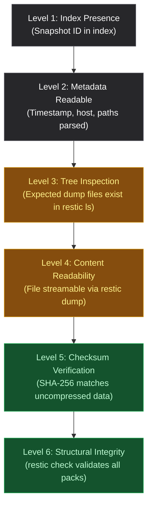
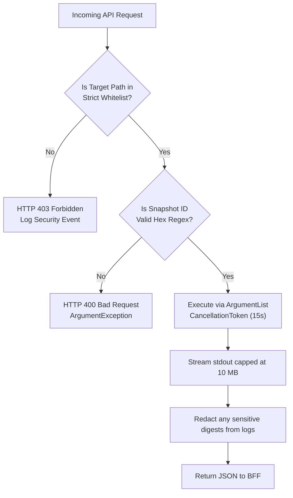

# ACYA Admin-Dash — Final Technical Architecture Specification (v3)

**Document Classification:** Definitive Engineering Specification & Targeted Corrections (Phase 6.2)  
**System Name:** `admin-dash` (ACYA Infrastructure & Backup Administration Portal)  
**Host Target:** Admin / Monitoring VPS (`51.254.216.8`) at `monitor.acya.site`  
**Supersedes:** `ADMIN_DASH_FINAL_TECHNICAL_SPECIFICATION_v2.md` (Preserved intact)  
**Safety Status:** Design-Only Specification (Zero modifications, zero deployments, scheduler remains disabled)  

---

## 1. Revision Summary & Updated Decision Matrix

This specification (v3) provides targeted technical and security corrections to the v2 architecture following independent review. Sound architectural foundations from v2 (Next.js 16 App Router with `basePath: '/dashboard'`, .NET 10 LTS Web API, SQLite persistence in WAL mode, loopback-only frontend exposure, and zero published backend ports) are strictly preserved.

### 1.1 Updated Architectural Decision Matrix

| Area | Decision (v3 Specification) | Classification | Revision Justification |
| :--- | :--- | :--- | :--- |
| **Restic Staging Path** | Dynamically resolve staging directory prefix from snapshot paths metadata; do not hardcode root. | `[Requires Validation]` | Static analysis revealed `${STAGE}` is `/var/backups/acya-backup-stage-XXXXXX/`; path varies per run. |
| **Restic Single Snapshot Query** | Query snapshot index list and filter in-memory; do not use `restic snapshots <id>` as single-item query. | `[Confirmed]` | Aligns with supported Restic 0.19.1 CLI options and avoids command parsing ambiguities. |
| **Restic Concurrency Policy** | Command-specific locking and execution policy; prohibit `restic check` during active backups. | `[Recommended]` | Read-only mount does not prevent concurrent writes from Production VPS; `--no-lock` does not guarantee consistency. |
| **Pipeline Reconciliation** | Reconcile dashboard presentation with the actual 15-stage production backup execution script. | `[Confirmed]` | Accurately maps the 15 operational script stages to dashboard categories without inventing stages. |
| **Secret File Access** | Mount secrets with group ownership `root:10001` (mode `0440`) or Compose secret UID mapping. | `[Requires Validation]` | Ensures non-root UID 10001 can read secret files without world-readable permissions. |
| **Backend Read Privilege** | Enforce strict allowlist on Restic targets; block database dumps, environment files, and TLS keys. | `[Confirmed]` | Read-only mount prevents modification but not data disclosure; backend must not be an arbitrary decrypter. |
| **SQLite Disaster Recovery** | Explicitly distinguish local crash recovery (`VACUUM INTO`) from off-host disaster recovery. | `[Confirmed]` | Local backups protect against DB corruption but not Admin VPS hardware loss; off-host recovery requires approval. |
| **Tenant Terminology** | Report 13 snapshot tenants vs 16 historical baseline; classify live counts as `Unknown`. | `[Confirmed]` | Distinguishes historical audit data from live production reality without illegal DB connections. |
| **Container Health Probes** | Zero-dependency Node.js inline fetch for frontend; verify `curl` inclusion in .NET runtime image. | `[Requires Validation]` | Eliminates unverified binary assumptions on Alpine and Debian-slim container images. |

---

## 2. Correction A — Restic Archive Path Resolution

### 2.1 Static Script Analysis & Path Hierarchy `[Confirmed]`
Static inspection of `/usr/local/bin/acya-production-backup.sh` (v1.2.0) reveals how the backup source is assembled and passed to Restic:
```bash
# Stage 5: Transient Staging Directory
STAGE="$(mktemp -d /var/backups/acya-backup-stage-XXXXXX)"

# Stage 13: Restic Execution
/usr/local/bin/restic backup \
  "${STAGE}" \
  /home/ubuntu/acya-app/storage/private/mobile \
  /var/lib/docker/volumes/n8n_data/_data \
  /home/ubuntu/acya-app/docker-compose.yml \
  ...
```

1. **Absolute Path Packaging:** Restic archives absolute paths starting from the root filesystem (`/`).
2. **Ephemeral Directory Randomization:** Because `mktemp -d` is used, the staging directory name changes on **every single execution** (e.g. `/var/backups/acya-backup-stage-wBiNgj/`, `/var/backups/acya-backup-stage-2pL9qB/`).
3. **Internal Hierarchy:** Inside that random directory, the backup script constructs:
   - `metadata/manifest.txt`
   - `metadata/tenant-registry.json`
   - `databases/wood-app-db.full.dump`
   - `tenants/{schema}.dump`
   - `n8n/n8n_db.dump`

### 2.2 Path Resolution Mechanism `[Requires Validation]`
Because Restic's `dump` command does not accept wildcards, the backend cannot issue `restic dump <id> metadata/manifest.txt` or `restic dump <id> */manifest.txt`.
* **Resolution Strategy:**
  1. Retrieve snapshot metadata via `restic snapshots --no-lock --json`.
  2. Inspect the snapshot's `"paths"` array. Locate the element matching prefix:
     `^/var/backups/acya-backup-stage-[A-Za-z0-9]+$`
  3. Strip the leading slash (as Restic snapshot trees represent paths relative to snapshot root):
     `var/backups/acya-backup-stage-XXXXXX/metadata/manifest.txt`
  4. Pass the fully resolved relative path to `restic dump`.
* **Validation Requirement:**
  > [!IMPORTANT]
  > Final confirmation of archive path formatting (whether Restic requires `var/...` or `/var/...` for `dump`) must occur in a disposable local test repository before implementing the manifest parser. No commands may be run against the real repository.

---

## 3. Correction B — Restic Command Syntax & Evidence Semantics

### 3.1 Corrected CLI Query Pattern `[Confirmed]`
The v2 specification incorrectly suggested querying individual snapshots via `restic snapshots <id>`. In standard Restic usage, filtering by ID on the command line is inconsistent across versions.
* **Approved Pattern:** Execute `restic snapshots --no-lock --json` to retrieve the repository snapshot catalog, and perform exact ID matching (`snapshot.Id == queryId` or `snapshot.ShortId == queryId`) in-memory within the .NET backend.
* **Alternative Pattern:** Use `restic cat --no-lock snapshot <id>` to retrieve the JSON metadata of a specific snapshot directly to stdout.

### 3.2 Six Evidence Levels & Strict Health Model `[Confirmed]`
A snapshot existing in the repository index is **not** evidence of data integrity. The health state model strictly ties status badges to verified evidence:



| Health State | Strict Evidence Requirement | What It Specifically Proves |
| :--- | :--- | :--- |
| **`Verified`** | Level 5 (SHA-256 match) OR Level 6 (Restic check pass) executed. | Cryptographic or byte-level data validity has been empirically proven. |
| **`PresentUnverified`** | Level 1, 2, or 3 confirmed, but Level 5 has NOT been executed. | The snapshot or file exists and is readable, but contents are unverified against SHA-256. |
| **`Missing`** | Expected artifact is absent from snapshot tree (`restic ls`) or manifest. | Data that should have been backed up was skipped or failed during staging. |
| **`Failed`** | Execution aborted with non-zero exit code or explicit script error. | Operational failure during dump or transfer. |
| **`NotAvailable`** | Architectural boundary prevents telemetry observation. | Host systemd status or remote host-local states. |
| **`Unknown`** | Telemetry missing or live production comparison unavailable. | Live tenant registry count or uninspected snapshot segments. |

---

## 4. Correction C — Restic Concurrency & Locking Policy

### 4.1 Concurrency Reality: Multi-Host Contention `[Confirmed]`
* Mounting `/data/backups/restic` as `:ro` on the Admin VPS prevents `admin-dash` from modifying the disk.
* **Crucial Insight:** It does **not** prevent the Production VPS (`51.210.10.108`) from writing new data, index files, or snapshots over SFTP concurrently.
* `--no-lock` bypasses lock acquisition; it does **not** protect against reading an index or pack file that is currently being written or pruned by the Production VPS.

### 4.2 Command-Specific Concurrency Matrix `[Recommended]`

| Restic Command | `:ro` Compatible? | `--no-lock` Required? | Behavior During Active Backup | Policy During Production Backup | Resource / Bandwidth Impact |
| :--- | :--- | :--- | :--- | :--- | :--- |
| **`snapshots`** | **Yes** | **Yes** | Safe. Reads `/repo/snapshots/`. Newly committing snapshots might be omitted until complete. | **Permitted**. Low risk of transient error. | **Low**: Reads small snapshot files only. |
| **`ls`** | **Yes** | **Yes** | Safe for existing snapshots. Referenced tree blobs of committed snapshots are immutable. | **Permitted**. Reads immutable tree objects. | **Medium**: Memory scales with file count. |
| **`dump`** | **Yes** | **Yes** | Safe for existing snapshots. Data blobs of committed snapshots are immutable. | **Permitted**. Streams existing blobs. | **Low for metadata** (capped at 10 MB). |
| **`stats`** | **Yes** | **Yes** | Risky. Scans all index files. If an index file is being written concurrently, stats may report index mismatch. | **Discouraged**. Recommend short in-memory caching. | **Medium/High**: Reads entire repository index. |
| **`check` (structural)** | **Yes** | **Yes** | **DANGEROUS**. Detects uncommitted pack files or temporary indices and flags **FALSE CORRUPTION**. | **STRICTLY PROHIBITED** during active backups. | **High**: Scans all repository index structures. |
| **`check --read-data`** | **Yes** | **Yes** | **FATAL I/O CONTENTION**. Saturates storage disk reading tens of gigabytes, stalling SFTP backup transfers. | **STRICTLY PROHIBITED** on dashboard loads. Requires operator maintenance window. | **EXTREME**: Reads 100% of raw pack files. |

> [!CAUTION]
> **Locking Policy Rule:**
> Repository integrity checks (`restic check`) must never run automatically on page load or during scheduled backup windows. Any `check` implementation must be an on-demand, rate-limited operator maintenance task with active backup mutual exclusion.

---

## 5. Correction D — Backup Pipeline Reconciliation

### 5.1 Reconciliation: 15 Script Stages to Dashboard Categories `[Confirmed]`
The actual production backup script executes **15 distinct operational stages**. The dashboard does not alter this sequence; it aggregates them into logical operator presentation panels while honoring telemetry boundaries.

| Actual Script Stage | Operation | Artifact / Production Evidence | Dashboard Representation | Verification Limitation |
| :---: | :--- | :--- | :--- | :--- |
| **1** | User privilege & trap configuration | Script process state (UID 0) | Host Environment | `NotAvailable` (Internal host execution) |
| **2** | Concurrency guard (`flock -n`) | `/var/lib/acya-backup-state/backup.lock` | Execution Lock | `NotAvailable` (Production host-local) |
| **3** | Storage preflight ($\ge$ 5 GiB) | `stat -f /var/backups` check | Preflight Checks | `NotAvailable` (Production host-local) |
| **4** | Restic SSH key & binary check | `/etc/acya-backup/` prerequisites | Preflight Checks | `NotAvailable` (Production host-local) |
| **5** | Ephemeral staging directory setup | `/var/backups/acya-backup-stage-XXXXXX` | Staging Setup | `NotAvailable` (Destroyed on exit) |
| **6** | Docker container discovery | `docker inspect wood-app-postgres` | Container Discovery | `NotAvailable` (Production Docker daemon) |
| **7** | Master DB full dump (`pg_dump -Fc`) | `databases/wood-app-db.full.dump` | Master Database Dump | `PresentUnverified` (Evidence in snapshot) |
| **8** | Dynamic per-tenant dumps (16 schemas)| `tenants/tenant_{slug}.dump` | Tenant Database Dumps | `PresentUnverified` (for present) / `Missing` |
| **9** | Tenant registry export (JSON/CSV) | `metadata/tenant-registry.json` | Tenant Registry Export | `PresentUnverified` (Parsed from snapshot) |
| **10**| n8n database dump (`pg_dump -Fc`) | `n8n/n8n_db.dump` | Automation DB Dump | `PresentUnverified` (Evidence in snapshot) |
| **11**| Manifest generation (`sha256sum`) | `metadata/manifest.txt` | Manifest Generation | `PresentUnverified` (Hashes generated) |
| **12**| Size assertions (`test -s`) | Script assertion logic | Staging Verification | `Verified` (Snapshot existence proves size > 0) |
| **13**| Restic SFTP push (`restic backup`) | SFTP upload to `51.254.216.8` | Offsite Transfer | `Verified` (Snapshot committed in index) |
| **14**| Snapshot confirmation (`restic snapshots`)| Index verification on production | Remote Confirmation | `Verified` (Matched by candidate ID and tag) |
| **15**| Status write & staging cleanup | `last-run.json` & directory purge | Host Status Reporting | `NotAvailable` (Production host-local) |

---

## 6. Correction E — Secret-File Ownership & Permissions

### 6.1 Permission Conflict & Corrected Model `[Requires Validation]`
The backend container runs as unprivileged user `appuser` (`UID 10001 / GID 10001`). If host secret files are owned by `root:root` with mode `0400`, the container will fail to start with `EACCES (Permission denied)`.

#### Host-Side Configuration (`/etc/admin-dash/secrets/`)
```bash
# On Admin VPS Host
mkdir -p /etc/admin-dash/secrets
chmod 0750 /etc/admin-dash/secrets

# Option A: Direct Group Ownership (Standard Bind Mount)
chown root:10001 /etc/admin-dash/secrets/restic_pw
chmod 0440 /etc/admin-dash/secrets/restic_pw

chown root:10001 /etc/admin-dash/secrets/admin_bootstrap_password
chmod 0440 /etc/admin-dash/secrets/admin_bootstrap_password
```

#### Docker Compose Configuration
```yaml
services:
  admin-dash-back:
    user: "10001:10001"
    volumes:
      - /etc/admin-dash/secrets/restic_pw:/run/secrets/restic_pw:ro
      - /etc/admin-dash/secrets/admin_bootstrap_password:/run/secrets/admin_bootstrap_password:ro
```
* **Security Assertion:** Mode `0440` with `root:10001` allows only root (on host) and GID 10001 (in container) to read the secret. It is **never world-readable** (`others: 0`).
* **Failure Handling:**
  - If `/run/secrets/restic_pw` is missing or unreadable: backend startup halts immediately with exit code 1 and a sanitized error: `Fatal: Restic secret is missing or inaccessible.`
  - If `/run/secrets/admin_bootstrap_password` is missing when `AdminUsers` count is 0: backend enters `BootstrapRequired` state, returning HTTP 503 on login attempts without crashing and without fallback passwords.
  - If `AdminUsers` count > 0: bootstrap secret is ignored entirely; existing credentials remain immutable.

---

## 7. Correction F — Strengthened Restic Backend Access Controls

### 7.1 Sensitive Privilege Acknowledgment `[Confirmed]`
Access to `/data/backups/restic` and the repository password gives `admin-dash-back` decryption capabilities over production database records, n8n credentials, environment files, and TLS keys. A read-only mount **does not prevent unauthorized disclosure**.

### 7.2 Strict Enforcement Rules in `ResticService.cs` `[Confirmed]`



1. **No Arbitrary Command Invocation:** The API exposes fixed controller actions (`GetSnapshots`, `GetManifest`, `GetStats`). No endpoint accepts raw CLI command strings.
2. **Strict Metadata Allowlist:** The `dump` operation is hardcoded to accept only:
   - `${stagePath}/metadata/manifest.txt`
   - `${stagePath}/metadata/tenant-registry.json`
   - `${stagePath}/metadata/tenant-registry.csv`
   Attempts to access `databases/*`, `tenants/*`, `n8n/*`, `home/*`, or `etc/*` throw an immediate `SecurityException`.
3. **Execution Timeout & Output Caps:**
   - Command timeouts enforced via `CancellationTokenSource`: 15s for `snapshots`/`dump`, 60s for `stats`.
   - Output buffer capped at 10 MB. Exceeding 10 MB aborts process execution, preventing memory exhaustion.
4. **Log Sanitization:** Application logs record process start and exit codes only. Output streams containing data blobs are never echoed to console or persistent logs.

---

## 8. Correction G — SQLite Local Recovery vs Disaster Recovery

### 8.1 Local Crash Recovery (`[Confirmed]`)
* **Mechanism:** The backend runs a daily `VACUUM INTO '/data/backups/admin-dash-backup-{yyyyMMdd}.db'` in-process SQLite job.
* **Scope:** Protects against local database corruption, bad application state, or software regressions on the Admin VPS.
* **Storage Location:** `/var/lib/admin-dash/data/backups/` on the Admin VPS.

### 8.2 Off-Host Disaster Recovery (`[Requires Separate Approval]`)
* **Scope:** Protection against total destruction, loss, or hardware failure of the Admin VPS (`51.254.216.8`).
* **Rule:** The `admin-dash` SQLite database **must not** be pushed into the production Restic repository without a separate technical and security review.
* **Status:** True off-host disaster recovery for `admin-dash` is deferred and classified as `[Requires Separate Approval]`.

---

## 9. Correction H — Historical Tenant Coverage Terminology

### 9.1 Terminology Standardization `[Confirmed]`
To eliminate false assumptions about live production state:

| Dashboard Metric | Display Value | Data Source | Semantic Meaning |
| :--- | :--- | :--- | :--- |
| **`SnapshotTenantCount`** | `13 Tenants` | Snapshot `metadata/tenant-registry.json` | Verified number of tenant schemas archived in that specific snapshot. |
| **`HistoricalAuditedBaseline`** | `16 Enterprises` | Phase 4 Audit Reference (`2026-11-01`) | Total enterprises existing in PostgreSQL at audit time. |
| **`HistoricalSnapshotGap`** | `3 Tenants Absent` | Computed (`16 - 13`) | Specific enterprises (`inky-pinky`, `oxylab`, `sotubois`) registered after snapshot. |
| **`CurrentLiveEnterpriseCount`**| **`Unknown`** | None (No production DB connection) | Live count cannot be known without a production telemetry channel. |
| **`CurrentLiveBackupCoverage`** | **`Unknown`** | None | Real-time coverage cannot be confirmed without a production connection. |

---

## 10. Correction I — Docker Health-Check Verification

### 10.1 Zero-Dependency Container Probes `[Requires Validation]`
To prevent failures caused by missing CLI utilities in container base images:

#### Frontend Probe (`admin-dash-front`)
Instead of relying on `wget` in Alpine, use an inline Node.js script:
```yaml
healthcheck:
  test: ["CMD", "node", "-e", "fetch('http://127.0.0.1:3000/dashboard/api/health').then(r => process.exit(r.ok ? 0 : 1)).catch(() => process.exit(1))"]
  interval: 15s
  timeout: 5s
  retries: 3
  start_period: 10s
```
* **Advantages:** Uses Node's native `fetch` (Node 22); requires zero external binaries; functions cleanly on a `read_only: true` filesystem.

#### Backend Probe (`admin-dash-back`)
Ensure `curl` is installed explicitly during the runtime build stage, or use a lightweight .NET health probe:
```dockerfile
# In back/Dockerfile runtime stage
RUN apt-get update && apt-get install -y --no-install-recommends curl restic && rm -rf /var/lib/apt/lists/*
```
```yaml
healthcheck:
  test: ["CMD", "curl", "-f", "http://127.0.0.1:8080/api/system/health"]
  interval: 15s
  timeout: 5s
  retries: 3
  start_period: 15s
```
* **Validation Requirement:** Both health probes must be tested in local staging to verify unauthenticated HTTP 200 responses under non-root permissions.

---

## 11. Preserved Architectural Decisions

The following foundational decisions remain active, approved, and preserved from v2:
1. **Routing:** Grafana remains untouched at `/`. `admin-dash` runs exclusively under `/dashboard`.
2. **BFF Security:** Next.js BFF acts as internal proxy; .NET backend publishes zero host ports.
3. **Cookie Sessions:** Pure HttpOnly, Secure, SameSite=Strict cookies with SQLite session revocation.
4. **Argon2id Hashing:** 64 MB memory cost, 4 iterations, 2 threads, 16-byte random salt.
5. **Scheduler Guard:** `acya-backup.timer` remains strictly disabled.
6. **Network Isolation:** Backend exists exclusively on internal Docker bridge network (`admin-dash-internal`).
7. **No Privileged Sockets:** Zero access to Docker socket (`docker.sock`) or D-Bus socket.

---

## 12. Remaining Validation Requirements Prior to Implementation

1. **Archive Path Structure Validation:** Verify the relative path syntax (`var/...` vs `/var/...`) of `metadata/manifest.txt` inside a disposable Restic repository snapshot.
2. **Secret File Permissions Validation:** Verify host UID/GID file mapping (`root:10001`, mode `0440`) in local Docker Compose.
3. **Health Probe Execution:** Validate that the Node.js inline fetch probe and backend curl probe succeed under `read_only: true` container filesystems.
4. **Prometheus Access Approval:** Formal decision required on Option 4 (Restricted Internal Nginx Proxy) before scheduling live telemetry implementation.
5. **Scheduler Push Webhook Approval:** Formal decision required before implementing production-to-admin status reporting.

