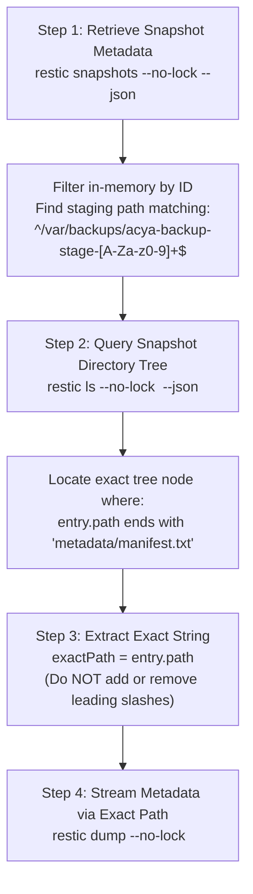
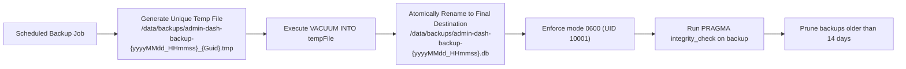

# ACYA Admin-Dash — Final Technical Architecture Specification (v3.1)

**Document Classification:** Definitive Engineering Specification & Final Consistency Corrections (Phase 6.3)  
**System Name:** `admin-dash` (ACYA Infrastructure & Backup Administration Portal)  
**Host Target:** Admin / Monitoring VPS (`51.254.216.8`) at `monitor.acya.site`  
**Supersedes:** `ADMIN_DASH_FINAL_TECHNICAL_SPECIFICATION_v3.md` (Preserved intact)  
**Safety Status:** Design-Only Specification (Zero modifications, zero deployments, scheduler remains disabled)  

---

## 1. Revision Summary & Updated Decision Matrix

This specification (v3.1) resolves remaining technical inconsistencies and security boundary contradictions identified during final review. Foundational architecture decisions from v2 and v3 (Next.js 16 App Router with `basePath: '/dashboard'`, .NET 10 LTS Web API, SQLite persistence in WAL mode, loopback-only frontend exposure, zero published backend ports, and strictly read-only volume mounting) are preserved intact.

### 1.1 Updated Architectural Decision Matrix

| Area | Decision (v3.1 Specification) | Classification | Revision Justification |
| :--- | :--- | :--- | :--- |
| **Restic Path Resolution** | Use `snapshot.paths` to find staging directory, query exact path via `restic ls`, pass exact output to `restic dump` without stripping slashes. | `[Requires Validation]` | Corrects false assumption of relative paths; eliminates blind slash stripping. |
| **Evidence & Health Model** | Separate operational success, index presence, artifact presence, readability, SHA-256 match, and repository integrity into distinct evidence levels. | `[Confirmed]` | Resolves contradiction where script stages were marked `Verified` using weak index presence. |
| **SHA-256 Security Boundary** | Keep database/tenant dumps strictly inaccessible via API; classify full dump SHA-256 verification as `NotAvailable`. | `[Confirmed]` | Preserves metadata-only security boundary without exposing raw database payloads. |
| **Pipeline Telemetry Boundary**| Stages 1–6, 12, 14, 15 classified as `NotAvailable`; Stage 13 classified as `PresentUnverified` (Index Presence). | `[Confirmed]` | Eliminates false assumptions that Admin VPS can observe Production VPS local script assertions. |
| **Restic Concurrency Policy** | Document multi-host concurrency risks; classify command behaviors as `[Requires Validation]`; mandate mutual exclusion for `check`. | `[Recommended]` | Clarifies that `--no-lock` does not prevent reading inconsistent state during concurrent SFTP writes. |
| **Restic Binary Pinning** | Explicitly download and verify Restic 0.19.1 release binary and SHA-256 checksum; do not rely on distribution package repos. | `[Confirmed]` | Guarantees exact binary compatibility across Debian-slim and Alpine container environments. |
| **Frontend Health Check** | Use clean, unescaped native Node.js inline fetch probe for standalone container healthchecks. | `[Requires Validation]` | Eliminates syntax/quoting fragility and binary dependencies on BusyBox/Alpine. |
| **SQLite Backup Idempotence** | Use unique timestamped temporary files with atomic rename and `PRAGMA integrity_check` verification. | `[Recommended]` | Prevents SQLite `VACUUM INTO` collisions when multiple backups execute on the same date. |

---

## 2. Correction A — Restic Path Resolution

### 2.1 The Staging Path Problem `[Confirmed]`
Static analysis of `/usr/local/bin/acya-production-backup.sh` (v1.2.0) demonstrates that the staging root is created via `mktemp -d /var/backups/acya-backup-stage-XXXXXX`. Consequently:
1. The staging directory name contains a randomized suffix that changes on every backup execution.
2. `snapshot.paths` in Restic metadata contains the arguments passed to `restic backup` (e.g. `["/var/backups/acya-backup-stage-wBiNgj", "/home/ubuntu/...", ...]`).
3. **Critical Insight:** `snapshot.paths` defines *what was backed up*, but does not guarantee the exact string representation expected by `restic dump`. In Restic snapshot trees, paths may be indexed with or without a leading slash depending on CLI invocation parameters and working directory. Automatically stripping the leading slash (`var/...`) is error-prone and can cause `dump` to fail with `path not found`.

### 2.2 Validated Two-Step Path Discovery Algorithm `[Requires Validation]`
To guarantee deterministic retrieval without hardcoding or guesswork:



```csharp
// C# Implementation Template in ResticService.cs
public async Task<string> ResolveManifestPathAsync(string snapshotId, CancellationToken ct)
{
    // Step 1: Enumerate tree nodes for snapshot
    var lsEntries = await ExecuteLsAsync(snapshotId, ct);
    
    // Step 2: Locate the exact path ending in metadata/manifest.txt
    var manifestEntry = lsEntries.FirstOrDefault(e => 
        e.Path.EndsWith("metadata/manifest.txt", StringComparison.OrdinalIgnoreCase) &&
        e.Path.Contains("acya-backup-stage-"));
        
    if (manifestEntry == null)
    {
        throw new FileNotFoundException($"Manifest file not found in snapshot tree for {snapshotId}.");
    }

    // Step 3: Return exact path string without arbitrary modification
    return manifestEntry.Path;
}
```
* **Validation Rule:** Final validation of path string formatting must occur in a disposable local test repository. Zero commands may be executed against the real repository.

---

## 3. Correction B — Evidence Model & Health State Consistency

### 3.1 Seven Distinct Evidence Levels `[Confirmed]`
A snapshot's existence in the repository index is merely evidence of an index commit; it does not prove data integrity. The evidence model separates operational, structural, and cryptographic validation into seven rigorous tiers:

| Evidence Tier | Description | Source of Evidence | Scope of Proof |
| :---: | :--- | :--- | :--- |
| **Level 1** | **Operational Success** | Exit code 0 from backup script / `last-run.json` | Script executed without unhandled errors on Production VPS. |
| **Level 2** | **Index Presence** | Snapshot ID appears in `restic snapshots` | Restic committed a snapshot header to `/repo/snapshots/`. |
| **Level 3** | **Artifact Presence** | File path appears in `restic ls` tree output | The named file was included in the archived snapshot tree. |
| **Level 4** | **Content Readability** | File streamable to stdout via `restic dump` | Referenced data blobs can be decrypted and reassembled. |
| **Level 5** | **SHA-256 Digest Verification**| Recomputed SHA-256 matches manifest entry | Byte-level integrity proven **for that specific checked file**. |
| **Level 6** | **Repository Structural Integrity**| `restic check --no-lock` exits 0 | Repository index, pack headers, and tree objects are valid. |
| **Level 7** | **Full Repository Data Verification**| `restic check --no-lock --read-data` exits 0| 100% of repository pack file payloads are uncorrupted. |

### 3.2 Health State Semantics & Strict Evidence Rules `[Confirmed]`

> [!IMPORTANT]
> **Strict Semantic Boundary:**
> - `Verified` must **never** be assigned without Level 5 (for files) or Level 6/7 (for repository structures).
> - Level 6 structural integrity does **not** grant `Verified` status to individual database dumps.
> - Level 2 index presence only warrants `PresentUnverified`.

* **`Verified` (Green):** Assigned strictly when Level 5 SHA-256 recomputation matches the manifest, or Level 6/7 repository check passes.
* **`PresentUnverified` (Amber):** Assigned when Level 2 (Index Presence) or Level 3 (Artifact Presence) is confirmed, but Level 5 checksum verification has not occurred.
* **`Missing` (Red):** Assigned when an expected artifact is absent from `restic ls` tree output or manifest inventory.
* **`Failed` (Red):** Assigned when a process aborts with a non-zero exit code or explicit failure message.
* **`NotAvailable` (Gray):** Assigned when telemetry is unobservable due to architectural boundaries (e.g. host-local stages on Production VPS).
* **`Unknown` (Zinc):** Assigned when live comparison data is absent (e.g. live tenant count vs snapshot count).

---

## 4. Correction C — Resolving the SHA-256 Security Contradiction

### 4.1 The Security vs Verification Contradiction `[Confirmed]`
1. **The Conflict:** In v3, the manifest parser extracts SHA-256 hashes for `databases/wood-app-db.full.dump`, `tenants/*.dump`, and `n8n/*.dump`. However, the backend security policy strictly prohibits dumping database dumps via the API to prevent unauthorized data disclosure.
2. **Resolution:** **Do not weaken the security allowlist.**
   - In `admin-dash`, database dumps, tenant schemas, environment files, and TLS keys remain **strictly inaccessible** via API endpoints.
   - The dashboard API does not provide endpoints to stream or download database dumps.
   - Consequently, byte-level SHA-256 verification of database dumps cannot be performed on-demand via the dashboard API.
   - For all database and tenant dump files, the UI and API explicitly report:
     - `StagingDigest`: The SHA-256 hash recorded in `manifest.txt`.
     - `ContentStatus`: `PresentUnverified` (Presence confirmed via `restic ls`).
     - `VerificationStatus`: `NotAvailable (Direct payload access restricted by security policy)`.

### 4.2 Future Internal Hash-Only Worker `[Requires Separate Approval]`
If automated background verification of database dumps is required in the future:
* It must run as an internal backend worker that reads blobs, computes SHA-256 in memory, and immediately discards the payload.
* It must return a boolean verification flag (`isVerified: true/false`), **never exposing backup contents to API responses**.
* This worker requires a separate security and operational review due to CPU and disk I/O impact. It is deferred from the current phase.

---

## 5. Correction D — Pipeline Telemetry & Production Script Reconciliation

### 5.1 Reconciled 15-Stage Pipeline Mapping `[Confirmed]`

| Stage # | Operational Script Stage | Production Evidence | Dashboard Representation | Assigned Status | Verification Limitation |
| :---: | :--- | :--- | :--- | :---: | :--- |
| **1** | Privilege & signal trap setup | Host process state (UID 0) | Host Initialization | `NotAvailable` | Production host-local. |
| **2** | Concurrency guard (`flock -n`) | `backup.lock` on host | Concurrency Lock | `NotAvailable` | Production host-local. |
| **3** | Storage preflight ($\ge$ 5 GiB) | `stat -f /var/backups` | Storage Preflight | `NotAvailable` | Production host-local. |
| **4** | Restic prerequisites preflight | `/etc/acya-backup/` keys | SSH/Binary Preflight | `NotAvailable` | Production host-local. |
| **5** | Ephemeral staging setup | `/var/backups/acya-backup-stage-*` | Staging Setup | `NotAvailable` | Ephemeral; destroyed on exit. |
| **6** | Container discovery | Docker engine state | Container Discovery | `NotAvailable` | Production Docker engine. |
| **7** | Master DB full dump (`pg_dump`) | `databases/wood-app-db.full.dump` | Master Database Dump | `PresentUnverified` | Present in tree; dump restricted. |
| **8** | Per-tenant dumps (16 schemas) | `tenants/tenant_{slug}.dump` | Tenant Database Dumps | `PresentUnverified` / `Missing` | Present in tree; dump restricted. |
| **9** | Tenant registry export (JSON) | `metadata/tenant-registry.json` | Tenant Registry Export | `Verified` (if parsed) | Payload readable via allowlist. |
| **10**| n8n database dump (`pg_dump`) | `n8n/n8n_db.dump` | Automation DB Dump | `PresentUnverified` | Present in tree; dump restricted. |
| **11**| Manifest generation (`sha256sum`)| `metadata/manifest.txt` | Manifest Generation | `Verified` (if parsed) | Payload readable via allowlist. |
| **12**| Staging assertions (`test -s`) | Local bash `test -s` logic | Staging Size Assertions | `NotAvailable` | Cannot infer from snapshot. |
| **13**| Restic SFTP push (`restic backup`)| SFTP snapshot commit | Repository Commit | `PresentUnverified` | Proves index presence (Level 2). |
| **14**| Post-backup confirmation | Host verification routine | Remote Confirmation | `NotAvailable` | Production host-local. |
| **15**| Status reporting & staging purge | `last-run.json` & directory purge | Host Status Reporting | `NotAvailable` | Production host-local. |

> [!CAUTION]
> **Restic Exit Code 3 Awareness:**
> In Restic, exit code 3 indicates an incomplete snapshot (some files could not be read, but a snapshot was committed). Therefore, a snapshot existing in the index (Stage 13) does **not** prove all staging files were successfully archived. It confirms Level 2 (Index Presence) only.

---

## 6. Correction E — Concurrency & Locking Policy

### 6.1 Multi-Host Consistency Risks `[Confirmed]`
The Admin VPS mounts `/data/backups/restic` as `:ro`. This prevents `admin-dash` from modifying repository files, but **does not prevent the Production VPS from writing concurrently over SFTP**.
* `--no-lock` bypasses repository lock creation in `/repo/locks/`.
* If a production backup is pushing data while `admin-dash` executes commands, `--no-lock` does **not** guarantee consistency.

### 6.2 Refined Concurrency Matrix `[Recommended]`

| Command | `:ro` Compatible? | `--no-lock` Required? | Behavior During Active SFTP Backup | Concurrency Policy | Status Classification |
| :--- | :---: | :---: | :--- | :--- | :---: |
| **`snapshots`** | **Yes** | **Yes** | Reads `/repo/snapshots/`. Committed snapshots remain valid. In-progress snapshots omitted. | **Permitted**. Low risk. | `[Requires Validation]` |
| **`ls`** | **Yes** | **Yes** | Reads tree blobs for a specific committed snapshot ID. Tree blobs of committed snapshots are immutable. | **Permitted**. Safe for committed snapshots. | `[Requires Validation]` |
| **`dump`** | **Yes** | **Yes** | Reads data blobs for a specific committed snapshot. Existing blobs are immutable unless pruned. | **Permitted**. Metadata paths only. | `[Requires Validation]` |
| **`stats`** | **Yes** | **Yes** | Scans all index files. If an index file is being written concurrently, stats may report index mismatch. | **Discouraged**. In-memory caching advised. | `[Requires Validation]` |
| **`check` (structural)**| **Yes** | **Yes** | **DANGEROUS**. Detects uncommitted pack files or temporary indices and flags **FALSE CORRUPTION**. | **STRICTLY PROHIBITED** during backups. | `[Confirmed]` |
| **`check --read-data`** | **Yes** | **Yes** | **FATAL I/O CONTENTION**. Saturates storage disk reading tens of gigabytes, stalling SFTP backup transfers. | **STRICTLY PROHIBITED** on dashboard loads. | `[Confirmed]` |

### 6.3 Future Maintenance Awareness & Pruning `[Confirmed]`
* If `restic prune` or `restic forget --prune` is executed on the Production VPS, Restic repacks data files and deletes unreferenced blobs.
* During prune operations, reading existing snapshots with `--no-lock` can result in transient `blob not found` errors.
* **Unreferenced Pack Files:** Interrupted backups or partial commits leave unreferenced pack files in `/repo/data/`. A structural `restic check` will report unreferenced pack files; these represent harmless debris, **not data corruption of committed snapshots**.
* **Integrity Check Rule:** Any execution of `restic check` must require mutual exclusion with backup schedules and an approved maintenance window.

---

## 7. Correction F — Docker Health Checks & Binary Pinning

### 7.1 Corrected Frontend Health Probe `[Requires Validation]`
In `docker-compose.yml`, the frontend health probe uses an unescaped, clean array syntax:
```yaml
healthcheck:
  test:
    - CMD
    - node
    - -e
    - "fetch('http://127.0.0.1:3000/dashboard/api/health').then(r => process.exit(r.ok ? 0 : 1)).catch(() => process.exit(1))"
  interval: 15s
  timeout: 5s
  retries: 3
  start_period: 10s
```
* Uses native Node.js 22 `fetch`; requires zero external binaries; compatible with `read_only: true` filesystems.

### 7.2 Backend Runtime Base Image & Restic Binary Pinning `[Confirmed]`
Official Microsoft images (`mcr.microsoft.com/dotnet/aspnet:10.0` or `8.0`) are Debian-based slim distributions (`bookworm-slim`). Default Debian package repositories contain outdated Restic versions (v0.14 or v0.16).
* **Strict Pinning Requirement:** The Dockerfile must download and verify the official Restic 0.19.1 binary:

```dockerfile
# Runtime Stage in back/Dockerfile
FROM mcr.microsoft.com/dotnet/aspnet:10.0 AS runtime
WORKDIR /app

# Pin Restic to exact version 0.19.1 with SHA-256 verification
ARG RESTIC_VERSION=0.19.1
ARG RESTIC_SHA256=20d4142678d0d95ec11a4759def1b73fd9190abc9ca19e4b62d067c0b387e639

RUN apt-get update && apt-get install -y --no-install-recommends \
    curl \
    bzip2 \
    ca-certificates \
    && curl -sSL -o /tmp/restic.bz2 "https://github.com/restic/restic/releases/download/v${RESTIC_VERSION}/restic_${RESTIC_VERSION}_linux_amd64.bz2" \
    && echo "${RESTIC_SHA256}  /tmp/restic.bz2" | sha256sum -c - \
    && bunzip2 /tmp/restic.bz2 \
    && mv /tmp/restic /usr/local/bin/restic \
    && chmod 0755 /usr/local/bin/restic \
    && apt-get purge -y bzip2 \
    && apt-get autoremove -y \
    && rm -rf /var/lib/apt/lists/*
```
* **Backend Health Check:**
```yaml
healthcheck:
  test: ["CMD", "curl", "-f", "http://127.0.0.1:8080/api/system/health"]
  interval: 15s
  timeout: 5s
  retries: 3
  start_period: 15s
```

---

## 8. Correction G — SQLite Backup Lifecycle & Idempotence

### 8.1 Safe Idempotent Local Backup Workflow `[Recommended]`
SQLite's `VACUUM INTO` command throws an error (`destination database already exists`) if the target filename exists. If the backup job runs multiple times on the same date, a static date filename will fail.



```csharp
// C# Implementation in DatabaseBackupScheduler.cs
public async Task ExecuteBackupAsync(CancellationToken ct)
{
    var backupDir = "/data/backups";
    Directory.CreateDirectory(backupDir);
    
    var timestamp = DateTime.UtcNow.ToString("yyyyMMdd_HHmmss");
    var tempPath = Path.Combine(backupDir, $"admin-dash-backup-{timestamp}_{Guid.NewGuid():N}.tmp");
    var finalPath = Path.Combine(backupDir, $"admin-dash-backup-{timestamp}.db");

    // 1. Perform online backup into temporary file
    using (var connection = new SqliteConnection(_connectionString))
    {
        await connection.OpenAsync(ct);
        using var cmd = connection.CreateCommand();
        cmd.CommandText = $"VACUUM INTO '{tempPath}';";
        await cmd.ExecuteNonQueryAsync(ct);
    }

    // 2. Atomically publish to final destination
    File.Move(tempPath, finalPath);

    // 3. Verify backup file integrity
    using (var backupConn = new SqliteConnection($"Data Source={finalPath};Mode=ReadOnly;"))
    {
        await backupConn.OpenAsync(ct);
        using var checkCmd = backupConn.CreateCommand();
        checkCmd.CommandText = "PRAGMA integrity_check;";
        var result = (string?)await checkCmd.ExecuteScalarAsync(ct);
        if (result != "ok")
        {
            throw new InvalidOperationException($"Backup integrity check failed: {result}");
        }
    }

    // 4. Prune backups older than 14 days
    var cutoff = DateTime.UtcNow.AddDays(-14);
    foreach (var file in Directory.GetFiles(backupDir, "admin-dash-backup-*.db"))
    {
        if (File.GetCreationTimeUtc(file) < cutoff)
        {
            File.Delete(file);
        }
    }
}
```

### 8.2 Disaster Recovery Boundary `[Confirmed]`
* Local backups protect against SQLite corruption, bad application state, or software regressions on the Admin VPS.
* Off-host disaster recovery (protecting against Admin VPS hardware destruction) is **deferred** and classified as `[Requires Separate Approval]`.
* Local SQLite backups **must not** be pushed into the production Restic repository without a separate security and architecture approval.

---

## 9. Historical Tenant Coverage Terminology

To eliminate false assumptions regarding live production state:

| Dashboard Metric | Display Value | Data Source | Strict Semantic Definition |
| :--- | :--- | :--- | :--- |
| **`SnapshotTenantCount`** | `13 Tenants` | Snapshot `metadata/tenant-registry.json` | Verified number of tenant schemas archived in that specific snapshot. |
| **`HistoricalAuditedBaseline`** | `16 Enterprises` | Phase 4 Audit Reference (`2026-11-01`) | Total enterprises existing in PostgreSQL at audit time. |
| **`HistoricalSnapshotGap`** | `3 Tenants Absent` | Computed (`16 - 13`) | Specific enterprises (`inky-pinky`, `oxylab`, `sotubois`) registered after snapshot. |
| **`CurrentLiveEnterpriseCount`**| **`Unknown`** | None (No production DB connection) | Live count cannot be known without a production telemetry channel. |
| **`CurrentLiveBackupCoverage`** | **`Unknown`** | None | Real-time coverage cannot be confirmed without a production connection. |

---

## 10. Remaining Validation Requirements Prior to Implementation

1. **Path Formatting in Disposable Repo:** Confirm in a disposable local test repository that Restic 0.19.1 `dump` accepts the exact path string returned by `restic ls` without syntax errors.
2. **Secret File Permissions:** Validate host file ownership `root:10001` with mode `0440` in a local Docker Compose test environment.
3. **Health Probe Execution:** Validate that the Node.js inline fetch probe and backend curl probe succeed under `read_only: true` container filesystems.
4. **Prometheus Access Approval:** Formal decision required on Option 4 (Restricted Internal Nginx Proxy on the Admin VPS) before scheduling live telemetry implementation.
5. **Scheduler Push Webhook Approval:** Formal decision required before implementing production-to-admin status reporting.

