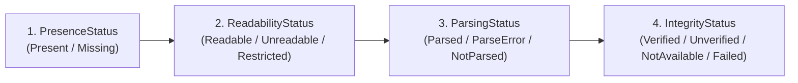
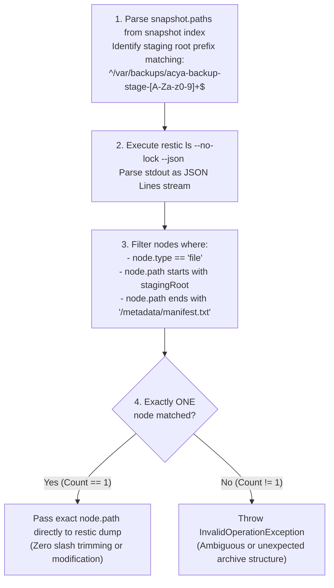
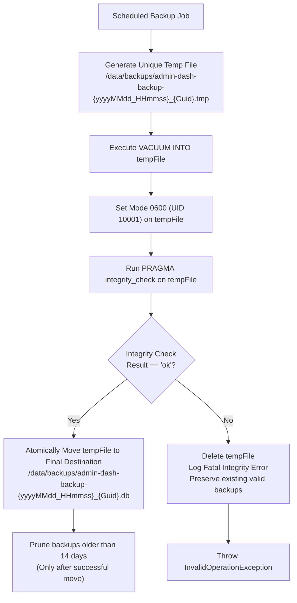

# ACYA Admin-Dash — Final Technical Architecture Specification (v3.2)

**Document Classification:** Definitive Engineering Specification & Final Consistency Addendum (Phase 6.4)  
**System Name:** `admin-dash` (ACYA Infrastructure & Backup Administration Portal)  
**Host Target:** Admin / Monitoring VPS (`51.254.216.8`) at `monitor.acya.site`  
**Supersedes:** `ADMIN_DASH_FINAL_TECHNICAL_SPECIFICATION_v3_1.md` (Preserved intact)  
**Safety Status:** Design-Only Specification (Zero modifications, zero deployments, scheduler remains disabled)  

---

## 1. Revision Summary & Updated Decision Matrix

This specification (v3.2) provides targeted consistency refinements addressing evidence semantics, strict JSON Lines path parsing, concurrency terminology, and transactional SQLite backup publication. All core architecture decisions from v2, v3, and v3.1 (Next.js 16 App Router with `basePath: '/dashboard'`, .NET 10 LTS Web API, SQLite persistence in WAL mode, loopback-only frontend exposure, zero published backend ports, and strictly read-only volume mounting) are preserved intact.

### 1.1 Updated Architectural Decision Matrix

| Area | Decision (v3.2 Specification) | Classification | Revision Justification |
| :--- | :--- | :--- | :--- |
| **Evidence Semantics** | Disaggregate status into 4 distinct properties: `PresenceStatus`, `ReadabilityStatus`, `ParsingStatus`, and `IntegrityStatus`. | `[Confirmed]` | Corrects false assignment of `Verified` to parsed metadata; reserves `Verified` strictly for actual integrity verification. |
| **Strict Path Resolution** | Parse `restic ls --json` as JSON Lines (JSONL); match exact staging root prefix; require exactly one file node of type `file`. | `[Requires Validation]` | Eliminates path ambiguity; passes exact unaltered path to `dump` without modifying slashes. |
| **Concurrency Refinement** | Characterize `check --read-data` as an expensive full repository read with high storage and I/O impact; require mutual exclusion. | `[Recommended]` | Replaces exaggerated "fatal" terminology while maintaining strict prohibition during active backups. |
| **SQLite Backup Lifecycle** | Unique temporary file, permissions `0600` and `PRAGMA integrity_check` before atomic move; delete temp file on failure. | `[Recommended]` | Prevents SQLite `VACUUM INTO` collisions on same-second executions; guarantees publication of valid backups only. |
| **Backend Read Privilege** | Enforce strict allowlist on Restic targets; block database dumps, environment files, and TLS keys. | `[Confirmed]` | Read-only mount prevents modification but not data disclosure; backend must not be an arbitrary decrypter. |
| **Tenant Terminology** | Report 13 snapshot tenants vs 16 historical baseline; classify live counts as `Unknown`. | `[Confirmed]` | Distinguishes historical audit data from live production reality without illegal DB connections. |
| **Container Health Probes** | Zero-dependency Node.js inline fetch for frontend; pin Restic 0.19.1 binary with verified SHA-256. | `[Requires Validation]` | Eliminates unverified binary assumptions on Alpine and Debian-slim container images. |

---

## 2. Correction A — Disaggregated Evidence & Health Semantics

### 2.1 The Semantic Correction `[Confirmed]`
In previous revisions, successfully parsing a valid JSON file (`metadata/tenant-registry.json`) or reading a text manifest (`metadata/manifest.txt`) resulted in a `Verified` status badge. This conflated format validity with cryptographic integrity.
* **Semantic Rule:** Parsing a file proves only that its contents match the expected grammar (JSON / text). It does **not** prove that the file was uncorrupted in storage or that its contents reflect authentic production state.
* **Separation of Evidence Properties:** Every archived artifact is evaluated across four orthogonal evidence dimensions:



1. **`PresenceStatus`:** Was the node located in the snapshot tree (`restic ls`)?
   - `Present`: Node exists in index tree.
   - `Missing`: Expected node is absent.
2. **`ReadabilityStatus`:** Can the backend read payload bytes via `restic dump`?
   - `Readable`: Payload streamable via authorized metadata allowlist.
   - `Restricted`: Payload reading blocked by backend security policy (e.g. database dumps).
   - `Unreadable`: Read error or non-zero Restic exit code.
3. **`ParsingStatus`:** Were payload bytes successfully parsed into structured data?
   - `Parsed`: Syntactically and semantically valid JSON or structured manifest.
   - `ParseError`: Payload corrupted or malformed.
   - `NotParsed`: Payload was not parsed (e.g. raw binary database dump).
4. **`IntegrityStatus`:** Has byte-level cryptographic integrity been empirically verified?
   - `Verified`: Recomputed SHA-256 matches manifest, or `restic check` verified pack integrity.
   - `Unverified`: Artifact exists, but no byte-level hash verification was performed.
   - `NotAvailable`: Payload access restricted by security policy; verification cannot be performed.
   - `Failed`: Recomputed hash diverges from recorded manifest hash.

### 2.2 Reconciled 15-Stage Pipeline Mapping `[Confirmed]`

| Stage # | Operational Script Stage | Production Evidence | Presence | Readability | Parsing | Integrity | Telemetry Limitation |
| :---: | :--- | :--- | :---: | :---: | :---: | :---: | :--- |
| **1** | Privilege & signal trap setup | Host process state (UID 0) | - | - | - | `NotAvailable` | Production host-local. |
| **2** | Concurrency guard (`flock -n`) | `backup.lock` on host | - | - | - | `NotAvailable` | Production host-local. |
| **3** | Storage preflight ($\ge$ 5 GiB) | `stat -f /var/backups` | - | - | - | `NotAvailable` | Production host-local. |
| **4** | Restic prerequisites preflight | `/etc/acya-backup/` keys | - | - | - | `NotAvailable` | Production host-local. |
| **5** | Ephemeral staging setup | `/var/backups/acya-backup-stage-*` | - | - | - | `NotAvailable` | Ephemeral; destroyed on exit. |
| **6** | Container discovery | Docker engine state | - | - | - | `NotAvailable` | Production Docker engine. |
| **7** | Master DB full dump (`pg_dump`) | `databases/wood-app-db.full.dump` | `Present` | `Restricted` | `NotParsed` | `NotAvailable` | Policy blocks dump access. |
| **8** | Per-tenant dumps (16 schemas) | `tenants/tenant_{slug}.dump` | `Present` / `Missing` | `Restricted` | `NotParsed` | `NotAvailable` | Policy blocks dump access. |
| **9** | Tenant registry export (JSON) | `metadata/tenant-registry.json` | `Present` | `Readable` | `Parsed` | `Unverified` | Valid JSON; not signed. |
| **10**| n8n database dump (`pg_dump`) | `n8n/n8n_db.dump` | `Present` | `Restricted` | `NotParsed` | `NotAvailable` | Policy blocks dump access. |
| **11**| Manifest generation (`sha256sum`)| `metadata/manifest.txt` | `Present` | `Readable` | `Parsed` | `Unverified` | Valid text; not signed. |
| **12**| Staging assertions (`test -s`) | Local bash `test -s` logic | - | - | - | `NotAvailable` | Cannot observe from snapshot. |
| **13**| Restic SFTP push (`restic backup`)| SFTP snapshot commit | `Present` (Index) | - | - | `Unverified` | Index commit only (Exit 3 risk).|
| **14**| Post-backup confirmation | Host verification routine | - | - | - | `NotAvailable` | Production host-local. |
| **15**| Status reporting & staging purge | `last-run.json` & directory purge | - | - | - | `NotAvailable` | Production host-local. |

> [!IMPORTANT]
> **Repository Integrity vs File Verification:**
> Successfully running a repository-level `restic check --no-lock` verifies that repository pack files, tree objects, and index blobs are structurally intact. It does **not** prove that the database dumps stored inside those packs match the hashes recorded in `manifest.txt`. Repository-level checks must never mark individual file stages as `Verified`.

---

## 3. Correction B — Strict Restic Path Resolution via JSON Lines

### 3.1 JSON Lines Format & Path Ambiguity `[Confirmed]`
When invoked with `--json`, `restic ls` outputs a stream of JSON Lines (`JSONL`):
* Line 1: Snapshot header object (`{"time":"...","tree":"...","paths":["/var/backups/acya-backup-stage-XXXXXX", ...]}`).
* Lines 2+: Node objects (`{"name":"manifest.txt","type":"file","path":"/var/backups/acya-backup-stage-XXXXXX/metadata/manifest.txt","size":...}`).

### 3.2 Strict Path Resolution Algorithm `[Requires Validation]`



```csharp
// C# Implementation Template in ResticPathResolver.cs
public async Task<string> ResolveExactManifestPathAsync(string snapshotId, string stagingRoot, CancellationToken ct)
{
    if (string.IsNullOrWhiteSpace(stagingRoot) || !Regex.IsMatch(stagingRoot, @"^/var/backups/acya-backup-stage-[A-Za-z0-9]+$"))
    {
        throw new ArgumentException($"Invalid staging root format: {stagingRoot}", nameof(stagingRoot));
    }

    var expectedSuffix = "/metadata/manifest.txt";
    var matchedNodes = new List<string>();

    var psi = new ProcessStartInfo("/usr/local/bin/restic")
    {
        UseShellExecute = false,
        RedirectStandardOutput = true,
        RedirectStandardError = true,
        CreateNoWindow = true
    };
    psi.ArgumentList.Add("--no-lock");
    psi.ArgumentList.Add("--cache-dir");
    psi.ArgumentList.Add("/tmp/restic-cache");
    psi.ArgumentList.Add("--password-file");
    psi.ArgumentList.Add("/run/secrets/restic_pw");
    psi.ArgumentList.Add("-r");
    psi.ArgumentList.Add("/repo");
    psi.ArgumentList.Add("ls");
    psi.ArgumentList.Add(snapshotId);
    psi.ArgumentList.Add("--json");

    using var process = Process.Start(psi) ?? throw new InvalidOperationException("Failed to spawn restic ls process.");
    
    string? line;
    while ((line = await process.StandardOutput.ReadLineAsync(ct)) != null)
    {
        if (string.IsNullOrWhiteSpace(line)) continue;
        
        // Skip snapshot header line or non-node lines
        using var doc = JsonDocument.Parse(line);
        var root = doc.RootElement;
        
        if (root.TryGetProperty("type", out var typeProp) && typeProp.GetString() == "file" &&
            root.TryGetProperty("path", out var pathProp))
        {
            var nodePath = pathProp.GetString();
            if (nodePath != null && 
                nodePath.StartsWith(stagingRoot, StringComparison.Ordinal) && 
                nodePath.EndsWith(expectedSuffix, StringComparison.Ordinal))
            {
                matchedNodes.Add(nodePath);
            }
        }
    }

    await process.WaitForExitAsync(ct);

    if (matchedNodes.Count == 0)
    {
        throw new FileNotFoundException($"Manifest not found under identified staging root '{stagingRoot}' in snapshot {snapshotId}.");
    }
    if (matchedNodes.Count > 1)
    {
        throw new InvalidOperationException($"Ambiguous manifest paths detected under staging root in snapshot {snapshotId}. Multiple candidates found.");
    }

    // Return the exact path emitted by Restic without modifying slashes
    return matchedNodes[0];
}
```
* **Validation Rule:** Must be validated in a disposable local test repository before implementation. Zero access to the real repository.

---

## 4. Correction C — Concurrency & Locking Terminology

### 4.1 Multi-Host Consistency Risks `[Confirmed]`
The Admin VPS mounts `/data/backups/restic` as `:ro`. This prevents `admin-dash` from modifying repository files, but **does not prevent the Production VPS from writing concurrently over SFTP**.
* `--no-lock` bypasses repository lock creation in `/repo/locks/`.
* If a production backup is pushing data while `admin-dash` executes commands, `--no-lock` does **not** guarantee consistency.

### 4.2 Refined Concurrency Matrix `[Recommended]`

| Command | `:ro` Compatible? | `--no-lock` Required? | Behavior During Active SFTP Backup | Concurrency Policy | Status Classification |
| :--- | :---: | :---: | :--- | :--- | :---: |
| **`snapshots`** | **Yes** | **Yes** | Reads `/repo/snapshots/`. Committed snapshots remain valid. In-progress snapshots omitted. | **Permitted**. Low risk. | `[Requires Validation]` |
| **`ls`** | **Yes** | **Yes** | Reads tree blobs for a specific committed snapshot ID. Tree blobs of committed snapshots are immutable. | **Permitted**. Safe for committed snapshots. | `[Requires Validation]` |
| **`dump`** | **Yes** | **Yes** | Reads data blobs for a specific committed snapshot. Existing blobs are immutable unless pruned. | **Permitted**. Metadata paths only. | `[Requires Validation]` |
| **`stats`** | **Yes** | **Yes** | Scans all index files. If an index file is being written concurrently, stats may report index mismatch. | **Discouraged**. In-memory caching advised. | `[Requires Validation]` |
| **`check` (structural)**| **Yes** | **Yes** | Detects uncommitted pack files or temporary indices and flags **false corruption**. | **Prohibited** during active backups. | `[Requires Validation]` |
| **`check --read-data`** | **Yes** | **Yes** | Potentially expensive full repository read with significant storage and I/O performance impact. | **Prohibited** during active backups and automatic page loads. | `[Requires Validation]` |

### 4.3 Maintenance & Integrity Operational Guidelines `[Confirmed]`
1. **Unreferenced Pack Files:** Interrupted backups or partial commits leave unreferenced pack files in `/repo/data/`. A structural `restic check` will report unreferenced pack files; these represent harmless debris, **not data corruption of committed snapshots**.
2. **Mutual Exclusion Requirement:** Repository integrity checks (`restic check`) must never run on automatic page loads. They require an approved maintenance window and explicit mutual exclusion against scheduled production backup windows.

---

## 5. Correction D — Robust SQLite Backup Lifecycle

### 5.1 Idempotent & Collision-Proof Local Backup `[Recommended]`
SQLite's `VACUUM INTO` command fails with an exception if the destination file already exists. If multiple backup jobs run within the same second, static or date-only filenames produce unhandled collisions.



```csharp
// C# Implementation Template in DatabaseBackupScheduler.cs
public async Task ExecuteBackupAsync(CancellationToken ct)
{
    var backupDir = "/data/backups";
    Directory.CreateDirectory(backupDir);

    var runId = Guid.NewGuid().ToString("N");
    var timestamp = DateTime.UtcNow.ToString("yyyyMMdd_HHmmss");
    var tempPath = Path.Combine(backupDir, $"admin-dash-backup-{timestamp}_{runId}.tmp");
    var finalPath = Path.Combine(backupDir, $"admin-dash-backup-{timestamp}_{runId}.db");

    bool published = false;
    try
    {
        // 1. Online backup into unique temporary file
        using (var connection = new SqliteConnection(_connectionString))
        {
            await connection.OpenAsync(ct);
            using var cmd = connection.CreateCommand();
            cmd.CommandText = $"VACUUM INTO '{tempPath}';";
            await cmd.ExecuteNonQueryAsync(ct);
        }

        // 2. Set strict permissions (mode 0600) on temporary file before publication
        if (OperatingSystem.IsLinux())
        {
            File.SetUnixFileMode(tempPath, UnixFileMode.UserRead | UnixFileMode.UserWrite);
        }

        // 3. Verify backup file integrity before publication
        using (var backupConn = new SqliteConnection($"Data Source={tempPath};Mode=ReadOnly;"))
        {
            await backupConn.OpenAsync(ct);
            using var checkCmd = backupConn.CreateCommand();
            checkCmd.CommandText = "PRAGMA integrity_check;";
            var result = (string?)await checkCmd.ExecuteScalarAsync(ct);
            if (result != "ok")
            {
                throw new InvalidOperationException($"Backup integrity check failed on temporary file: {result}");
            }
        }

        // 4. Atomically publish verified backup to final destination
        File.Move(tempPath, finalPath);
        published = true;

        // 5. Retention cleanup: prune backups older than 14 days ONLY after successful publication
        var cutoff = DateTime.UtcNow.AddDays(-14);
        foreach (var file in Directory.GetFiles(backupDir, "admin-dash-backup-*.db"))
        {
            if (File.GetCreationTimeUtc(file) < cutoff)
            {
                try { File.Delete(file); } catch { /* log and continue */ }
            }
        }
    }
    finally
    {
        // Clean up unverified or failed temporary file
        if (!published && File.Exists(tempPath))
        {
            try { File.Delete(tempPath); } catch { /* ignore */ }
        }
    }
}
```

---

## 6. Local Validation Requirements Prior to Implementation

The following technical checks must be executed in a disposable local test environment prior to staging:

1. **Path Formatting in Disposable Repo:** Confirm in a disposable local test repository that Restic 0.19.1 `dump` accepts the exact path string returned by `restic ls` without syntax errors.
2. **Secret File Permissions:** Validate host file ownership `root:10001` with mode `0440` in a local Docker Compose test environment.
3. **Container Health Probes:** Validate that the Node.js inline fetch probe and backend curl probe succeed under `read_only: true` container filesystems.
4. **Prometheus Access Approval:** Formal decision required on Option 4 (Restricted Internal Nginx Proxy on the Admin VPS) before scheduling live telemetry implementation.
5. **Scheduler Push Webhook Approval:** Formal decision required before implementing production-to-admin status reporting.

---

## 7. Final Architecture Approvals & Compliance Confirmation

- **Implementation Status:** Architecture specification is finalized and frozen. Zero application source code, Dockerfiles, Compose files, or Nginx configurations have been created or modified.
- **Production Safety:** Real Restic repositories were not accessed. Production databases were not queried. The backup scheduler (`acya-backup.timer`) remains strictly **disabled and inactive**.
- **Specification Preservation:** All previous specification documents (`v2`, `v3`, `v3.1`) remain preserved intact without modification.

