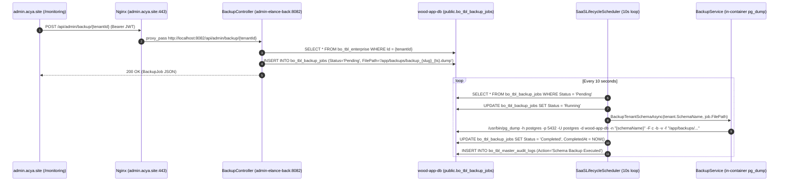

# ACYA — Phase 11C.1.5
## Read-Only Audit: Manual Backup Integration (`admin.acya.site`)

- **Date:** `2026-11-06`
- **Production Host:** `vps-1d2bffb5` (`51.210.10.108`)
- **Administration / Offsite Backup Host:** `vps-b92b4ae6` (`51.254.216.8` — `monitor.acya.site`)
- **Audited Interface:** `https://admin.acya.site/monitoring` (`bo-acya-app/admin-elance-front` $\rightarrow$ `bo-acya-app/admin-elance-back`)
- **New Phase 11B Backup Runner:** `/opt/acya-backup/bin/acya-backup-runner` (`v2.0.0`, telemetry schema `acya.backup.run/v1`)
- **Latest Production Restic Snapshot:** `2071d16434c17e91b18521cd2a6a9bfa47bc3510a3b0fac11f0c16401eb45f59` (`2071d164`, committed `2026-11-06T10:11:37Z`)
- **Audit Mode:** **100% Read-Only** (Zero endpoints called, zero backups triggered, zero database rows modified, zero containers or files changed)

---

## 1. Executive Summary

A read-only source code and production runtime audit was conducted to determine the exact relationship between the **RUN MANUAL BACKUP** button in `admin.acya.site` (`/monitoring`) and the newly deployed **ACYA Phase 11B Backup Runner** (`/opt/acya-backup/`).

### Direct Answers to Core Audit Questions

| Audit Question | Determination | Classification |
| :--- | :--- | :---: |
| **1. Does the button still use the legacy `pg_dump` / `BackupService` implementation?** | **YES.** Clicking `RUN MANUAL BACKUP` sends `POST /api/admin/backup/{tenantId}`, which inserts a `Pending` row into `public.bo_tbl_backup_jobs`. Within $\le 10$ seconds, the background service `SaaSLifecycleScheduler` picks up the row and invokes `BackupService.BackupTenantSchemaAsync`, which spawns a local `pg_dump -Fc` inside the `admin-elance-back` container targeting `/app/backups/backup_{slug}_{timestamp}.dump`. | **Confirmed Implementation & Runtime Evidence** |
| **2. Has it been partially integrated with the new Backup Runner?** | **NO.** Neither `BackupController`, `BackupService`, `SaaSLifecycleScheduler`, nor `monitoring/page.tsx` has any reference to `/opt/acya-backup/`, `acya-backup-runner`, `restic`, or `/opt/acya-backup/state/*.json`. *(A separate `BackupSettingsController` / `BackupSettingsService` exists in the backend codebase for future Phase 16B/16C schedule configuration, but it is not wired to the `RUN MANUAL BACKUP` button or to the host runner.)* | **Confirmed Implementation** |
| **3. Can the Admin container currently invoke the new runner?** | **NO.** The running `admin-elance-back` container is isolated from the host: `/opt/acya-backup`, `/etc/acya-backup`, `/usr/local/bin/restic`, and `/var/run/docker.sock` are **not** mounted into the container, and the runner requires host `root` (`UID 0`), SSH keys (`/etc/acya-backup/acya_backup_ed25519`), the Restic password (`/etc/acya-backup/.restic_password`), and Docker CLI access. | **Runtime Evidence** |
| **4. Is the manual button completely independent of the new Restic architecture?** | **YES — 100% independent.** It writes unencrypted single-schema `.dump` files into the container's ephemeral overlay filesystem (`/app/backups`, which is not even volume-mounted in `docker-compose.yml`) and never touches Restic or the offsite repository on `51.254.216.8`. | **Confirmed Implementation & Runtime Evidence** |

---

## 2. Existing Manual Backup Frontend Flow

### Confirmed Implementation

- **Frontend File & Component:** `bo-acya-app/admin-elance-front/src/app/monitoring/page.tsx` (`MonitoringPage` client component, lines `32–486`).
- **UI Location:** Rendered on `/monitoring` under the **"Database Backups & Archives"** card (lines `364–383`), scoped to the currently selected tenant (`selectedEnt`).
- **Button Element & Handler (lines `371–382`):**
  ```tsx
  <button 
    onClick={handleTriggerBackup}
    disabled={backupSubmitting}
    className="px-4 py-2 bg-primary text-primary-foreground font-semibold rounded-lg ..."
  >
    {backupSubmitting ? <Loader2 className="w-3.5 h-3.5 animate-spin" /> : <Play className="w-3.5 h-3.5" />}
    RUN MANUAL BACKUP
  </button>
  ```
- **Handler Logic (`handleTriggerBackup`, lines `125–145`):**
  - Checks `if (!selectedEnt) return;`.
  - Sets `backupSubmitting = true` and clears `error`.
  - Sends an HTTP request using `fetch(`${apiBase}admin/backup/${selectedEnt.id}`, { method: "POST", headers: getHeaders() })`.
- **API Endpoint & HTTP Method:**
  - **Method:** `POST`
  - **URL:** `https://admin.acya.site/api/admin/backup/{tenantId}` (where `{tenantId}` is `selectedEnt.id`, the primary key in `public.bo_tbl_enterprise`).
- **Request Payload:**
  - **Body:** Empty (`null` / no JSON body). The target tenant is passed solely via the URL route parameter `{tenantId}`.
- **Authentication & Authorization Headers (`getHeaders`, lines `49–55`):**
  - Reads the JWT from `localStorage.getItem("token")`.
  - Sends `"Content-Type": "application/json"` and `"Authorization": "Bearer <token>"`.
- **Response Handling (lines `137–144`):**
  - Checks `if (!res.ok) throw new Error("Failed to queue backup job.");` (does not parse the returned `BackupJob` JSON directly).
  - Immediately calls `fetchStatsAndJobs(selectedEnt.id)`, which issues:
    1. `GET /api/admin/monitoring/{entId}`
    2. `GET /api/admin/backup/jobs/{entId}`
  - Note: Because `POST /api/admin/backup/{tenantId}` only queues a `Pending` row and `SaaSLifecycleScheduler` runs every `10` seconds, the immediate `fetchStatsAndJobs` call typically renders the new job in `Pending` (or `Running`) state until the operator clicks `REFRESH DATA`.
- **Related Actions in the Same Table (lines `445–464`):**
  - For any job with `type === "Backup"` and `status === "Completed"`, the UI renders two additional action buttons:
    - **Download:** `GET /api/admin/backup/download/{jobId}` (`handleDownloadBackup`, lines `174–198`).
    - **Restore:** `POST /api/admin/backup/restore/{jobId}` (`handleTriggerRestore`, lines `147–172`), which prompts via `window.confirm` and queues a destructive `DROP SCHEMA ... CASCADE` + `pg_restore` job.

---

## 3. Existing Backend Implementation

### Confirmed Implementation



1. **Controller (`BackupController.cs`):**
   - Path: `bo-acya-app/admin-elance-back/src/ms.admin.api.acya/Controllers/BackupController.cs`
   - Route: `[Route("api/admin/[controller]")]` $\rightarrow$ `/api/admin/backup`
   - Authorization: `[Authorize(Roles = "SUPER_ADMIN")]` validated using `JWT_SECRET_ADMIN` (`Issuer: acya-bo`, `Audience: acya-bo-ui`), supporting either the `Authorization: Bearer` header or the `admin_session_token` cookie (`Program.cs`, lines `29–59`).
   - Endpoints:
     - `GET api/admin/backup/jobs/{tenantId}` (`GetJobs`, lines `25–34`): Queries `_context.BackupJobs.Where(j => j.TenantId == tenantId).OrderByDescending(j => j.CreatedAt)`.
     - `POST api/admin/backup/{tenantId}` (`RequestBackup`, lines `36–59`): Looks up the tenant in `_context.Enterprises.FindAsync(tenantId)`, constructs `filePath = "/app/backups/backup_{tenant.Slug}_{yyyyMMddHHmmss}.dump"`, inserts a `BackupJob` row with `Type = "Backup"` and `Status = "Pending"`, saves changes, and returns `200 OK`.
     - `POST api/admin/backup/restore/{jobId}` (`RequestRestore`, lines `61–83`): Verifies `sourceJob` is a `Completed` `Backup` job and inserts a new `BackupJob` row with `Type = "Restore"`, `Status = "Pending"`, and `FilePath = sourceJob.FilePath`.
     - `GET api/admin/backup/download/{jobId}` (`DownloadBackup`, lines `85–101`): Checks `System.IO.File.Exists(job.FilePath)` inside the container and returns `File(bytes, "application/octet-stream", ...)`.

2. **Database Entity & Table (`BackupJob.cs` & `BackupJobConfiguration.cs`):**
   - Path: `bo-acya-app/admin-elance-back/src/ms.admin.api.acya.core/Entities/BackupJob.cs`
   - Table: `public.bo_tbl_backup_jobs` in `wood-app-db` (created idempotently on startup by `DbInitializer.Initialize`, lines `106–115`).
   - Columns: `Id` (`BIGSERIAL`), `TenantId` (`BIGINT` FK to `public.bo_tbl_enterprise.Id` with `ON DELETE CASCADE`), `Type` (`VARCHAR(50)`), `Status` (`VARCHAR(50)`), `FilePath` (`VARCHAR(255)`), `CreatedAt` (`TIMESTAMPTZ`), `CompletedAt` (`TIMESTAMPTZ`), `ErrorMessage` (`TEXT`).

3. **Background Scheduler (`SaaSLifecycleScheduler.cs`):**
   - Path: `bo-acya-app/admin-elance-back/src/ms.admin.api.acya/Services/SaaSLifecycleScheduler.cs`
   - Registered in DI (`Program.cs`, line `68`): `builder.Services.AddHostedService<SaaSLifecycleScheduler>();`
   - Poll Loop (lines `30–50`): Runs continuously inside `admin-elance-back` with `await Task.Delay(TimeSpan.FromSeconds(10), stoppingToken)`.
   - Every `10` seconds, calls:
     1. `ProcessTrialExpirationsAsync(dbContext, stoppingToken)`
     2. `ProcessBackupJobsAsync(dbContext, backupService, stoppingToken)`
   - `ProcessBackupJobsAsync` (lines `89–156`) queries all `bo_tbl_backup_jobs` where `Status == "Pending"`, sets `Status = "Running"`, calls `backupService.BackupTenantSchemaAsync(job.Tenant.SchemaName, job.FilePath)` (or `RestoreTenantSchemaAsync`), updates `Status` to `"Completed"` or `"Failed"`, and writes an entry to `public.bo_tbl_master_audit_logs`.

4. **Backup Execution Service (`BackupService.cs`):**
   - Path: `bo-acya-app/admin-elance-back/src/ms.admin.api.acya/Services/BackupService.cs`
   - Registered in DI (`Program.cs`, line `64`): `builder.Services.AddScoped<BackupService>();`
   - `BackupTenantSchemaAsync(string schemaName, string targetFilePath)` (lines `27–81`):
     - Validates `schemaName` via `SchemaSanitizer.IsValidIdentifier(schemaName)` (`^[a-zA-Z0-9_]+$`).
     - Enforces that `Path.GetFullPath(targetFilePath)` starts with `/app/backups`.
     - Creates `/app/backups` inside the container if it does not exist.
     - Parses `ConnectionStrings:MasterConnection` via `NpgsqlConnectionStringBuilder`.
     - Spawns `/usr/bin/pg_dump` (installed via `apt-get install -y postgresql-client` in `bo-acya-app/admin-elance-back/Dockerfile`, line `18`) with arguments:
       ```text
       -h postgres -p 5432 -U postgres -d wood-app-db -n "{schemaName}" -F c -b -v -f "{fullPath}"
       ```
       and `PGPASSWORD` set in the child process environment.
   - `RestoreTenantSchemaAsync(string schemaName, string sourceFilePath)` (lines `83–147`):
     - Executes `DROP SCHEMA IF EXISTS "{schemaName}" CASCADE; CREATE SCHEMA "{schemaName}";` directly against `wood-app-db`, then spawns `pg_restore -h postgres -p 5432 -U postgres -d wood-app-db -v "{fullPath}"`.

5. **Unrelated Schedule Settings Service (`BackupSettingsController.cs` & `BackupSettingsService.cs`):**
   - Path: `bo-acya-app/admin-elance-back/src/ms.admin.api.acya/Controllers/BackupSettingsController.cs` (`api/admin/backup/settings`)
   - Stores `Backup_AutoEnabled`, `Backup_Frequency`, `Backup_ScheduleTime`, `Backup_Timezone` in `public.bo_tbl_platform_settings`.
   - Explicitly hardcoded (`BackupSettingsService.cs`, lines `98, 201, 229–246`) to return `SyncStatus = "deferred_phase16b"` and `"Host systemd timer synchronization is deferred until Phase 16C. Automatic backups remain disabled."` It never invokes Restic or `/opt/acya-backup/`.

---

## 4. Legacy Backup Mechanism Status

### Confirmed Implementation & Runtime Evidence

The legacy `BackupController` $\rightarrow$ `bo_tbl_backup_jobs` $\rightarrow$ `SaaSLifecycleScheduler` $\rightarrow$ `BackupService` (`pg_dump`) workflow is **100% active, registered, and polling every 10 seconds in production**.

- **DI & HostedService Registration:** Confirmed active in `Program.cs` (lines `64, 68`) and verified in the compiled `/app/ms.admin.api.acya.dll` (`2026-10-30 17:30 UTC`) inside container `admin-elance-back`.
- **Live Polling Evidence:** Container logs (`sudo docker logs admin-elance-back`) confirm `SaaS Lifecycle Scheduler Background Service is starting.` followed by continuous EF Core queries against `bo_tbl_backup_jobs` every 10 seconds.
- **Historical Execution Evidence (`public.bo_tbl_master_audit_logs` & `public.bo_tbl_backup_jobs`):**
  - Four historical manual schema backups were executed by this legacy mechanism between June and July 2026:
    1. `Job 1` (`2026-06-25 22:04:01Z`): `/app/backups/backup_tempdelete_20260625220356.dump` (tenant later deleted; `ON DELETE CASCADE` removed `Job 1` from `bo_tbl_backup_jobs`).
    2. `Job 2` (`2026-07-02 20:47:21Z`): `/app/backups/backup_socofeb_20260702204718.dump` (earlier `socofeb` tenant row later deleted).
    3. `Job 3` (`2026-07-04 19:42:59Z`, `TenantId = 24` / `fleur-de-printemps`): `/app/backups/backup_fleur-de-printemps_20260704194253.dump` — **still present in `public.bo_tbl_backup_jobs` with `Status = 'Completed'`**.
    4. `Job 4` (`2026-07-25 06:58:32Z`): `/app/backups/backup_socofeb_20260725065823.dump`.
- **Critical Ephemeral Storage Flaw:**
  - In `docker-compose.yml` (lines `108–137`), `admin-api` (`admin-elance-back`) only mounts `./wood-app.api/db:/app/db:ro`. **It does NOT mount `/app/backups` to any host directory or Docker volume.**
  - Inspecting inside `admin-elance-back` (`ls -la /app/backups`) confirmed: **`NO /app/backups` directory exists** because the container was recreated on `2026-10-30T17:31:28Z`.
  - Consequently, even though `Job 3` (`fleur-de-printemps`) still shows `Status = "Completed"` in `bo_tbl_backup_jobs`, its file `/app/backups/backup_fleur-de-printemps_20260704194253.dump` was wiped when the container was rebuilt. Clicking `Download` or `Restore` on `Job 3` today will return `404 Backup file is missing on disk.` (or fail `FileNotFoundException`).

---

## 5. New Backup Runner Architecture

### Confirmed Implementation (`/opt/acya-backup/` & `scripts/backup-runner/`)

The Phase 11B Backup Runner (`v2.0.0`) is a standalone, modular Python 3.13 system installed on the Production host at `/opt/acya-backup/` (mirrored in workspace at `scripts/backup-runner/`):

| Component | Path | Responsibility |
| :--- | :--- | :--- |
| **Main Runner Entrypoint** | `/opt/acya-backup/bin/acya-backup-runner` | CLI parser (`--config`, `--mode {full,preflight,stage-only,lock-inspect}`, `--trigger`, `--skip-remote`, `--print-telemetry`). |
| **Lock Inspector CLI** | `/opt/acya-backup/bin/acya-backup-lock-inspect` | Read-only lock classifier (`restic list locks --no-lock` + `restic cat lock --no-lock`). |
| **Snapshot Verifier CLI** | `/opt/acya-backup/bin/acya-backup-verify` | Independent read-only verifier (`restic snapshots/ls/dump --no-lock`) for any snapshot or `last-success`. |
| **Configuration Loader** | `/opt/acya-backup/lib/acya_backup/config.py` | Strict JSON schema validator (`configVersion: 1`); enforces absolute paths, regex validation, and `repositoryWritesAuthorized` boolean gate. |
| **12-Stage Pipeline** | `/opt/acya-backup/lib/acya_backup/pipeline.py` | Orchestrates stages `1..12`, non-blocking `flock` concurrency, signal handling (`SIGHUP`/`SIGINT`/`SIGTERM`), ephemeral `0700` staging, and cleanup. |
| **PostgreSQL Module** | `/opt/acya-backup/lib/acya_backup/postgres.py` | Resolves Compose containers by label (`com.docker.compose.project=acya-app`), excludes `acya-restore-test-pg` & `acya-restore-n8n-pg`, runs `pg_dumpall --globals-only --no-role-passwords`, `pg_dump -Fc -Z 6`, and `pg_restore -l` TOC verification. |
| **Manifest & Scope Module** | `/opt/acya-backup/lib/acya_backup/manifest.py` | Validates persistent `data`, `config`, and `secret` sources; enforces that secret files (`firebase-*.json`, `.env*`, `/etc/letsencrypt`) never enter staging or manifests; builds & double-verifies `metadata/manifest.txt` and `metadata/manifest.json` (SHA-256). |
| **Restic & Transport Module** | `/opt/acya-backup/lib/acya_backup/restic.py` | Manages `sftp` (or `rest-ssh-tunnel`), blocks forbidden subcommands (`unlock`, `repair`, `prune`, `forget`, `restore`, `rebuild-index`, `key`, `migrate`), executes `restic backup --json`, and performs post-commit verification. |
| **Telemetry Module** | `/opt/acya-backup/lib/acya_backup/telemetry.py` | Emits `acya.backup.run/v1` JSON records (`current-run.json`, `last-run.json`, `last-success.json`, `last-<mode>.json`, and `logs/telemetry.jsonl`). |
| **Error & Exit Code Contract** | `/opt/acya-backup/lib/acya_backup/errors.py` | Deterministic exit codes: `0` (`SUCCESS`), `1` (`INTERNAL`), `10` (`CONFIG`), `11` (`PREFLIGHT`), `12` (`DISK_SPACE`), `13` (`LOCK_CONFLICT`), `20` (`DATABASE_EXPORT`), `21` (`TENANT_COVERAGE`), `30` (`FILE_SCOPE`), `40` (`MANIFEST`), `50` (`TRANSFER`), `60` (`RESTIC_BACKUP`), `61` (`RESTIC_INCOMPLETE`), `70` (`VERIFICATION`), `75` (`CONCURRENT`), `129/130/143` (signals). |

---

## 6. Single-Tenant Backup Capability

### Confirmed Implementation & Missing Functionality

1. **Does the new Backup Runner currently support single-tenant execution?**
   - **NO (`Missing Functionality`).**
   - `acya-backup-runner` only accepts `--mode {full,preflight,stage-only,lock-inspect}` (`bin/acya-backup-runner`, lines `30–32`). There is no `--tenant <slug>` flag or `--mode single-tenant`.
   - Furthermore, Stage 5 (`pipeline.py`, lines `448–503` and `postgres.py`, lines `154–209`) **strictly enforces global 16/16 tenant coverage**:
     - It queries all rows in `public.bo_tbl_enterprise` (`REGISTRY_SQL`) and all `tenant_*` schemas in `information_schema.schemata` (`TENANT_SCHEMAS_SQL`).
     - It requires `len(registry) >= cfg.min_tenant_count` (`16` in `/opt/acya-backup/config/backup.json`).
     - It requires every registered tenant schema to be dumped in `tenants/tenant_<slug>.dump` **and** present in `wood-app-db.full.dump`, otherwise it aborts with `ExitCode.TENANT_COVERAGE` (`21`).
   - Similarly, Stage 12 (`restic.py`, line `578`) and `acya-backup-verify` (`bin/acya-backup-verify`, lines `108–116`) assert that the committed snapshot contains per-tenant `.dump` files for **100% of registered tenants** (`expected_tenant_count == 16`).

2. **How the new runner currently handles tenant dumps during a full run:**
   - During every `--mode full` run, the runner **already** generates isolated per-tenant custom-format dumps (`tenants/tenant_<slug>.dump` via `pg_dump -U postgres -d wood-app-db -Fc -Z 6 --schema=tenant_<slug>`) for all 16 tenants alongside the full database dumps (`wood-app-db.full.dump`, `app-db-bo.full.dump`, `n8n_db.full.dump`).
   - A full run completes in **`~37.9` seconds** (`12.0s` local dump/staging + `11.5s` SFTP transfer + `6.4s` post-backup verification).

3. **Does a manual invocation interface already exist?**
   - **CLI Only:** Operators with host `root` (`sudo`) access can invoke `/opt/acya-backup/bin/acya-backup-runner` manually from the CLI (when `repositoryWritesAuthorized` is `true` for `--mode full`, or anytime for `--mode preflight` / `--mode stage-only` / `--mode lock-inspect`).
   - **No HTTP/IPC Bridge Exists:** There is no host socket, systemd path/socket unit, or privileged API bridge connecting `admin-elance-back` to `/opt/acya-backup/bin/acya-backup-runner`.

---

## 7. Restic Snapshot Behavior

### Confirmed Implementation & Architectural Analysis

1. **Would a backup using the new runner create a new Restic snapshot?**
   - **YES.** Every invocation of `restic backup` (Stage 11 in `pipeline.py` / `restic.py`) commits a new immutable snapshot object in `/data/backups/restic/snapshots/` on `51.254.216.8`.
   - Because Restic uses content-defined chunking and deduplication, unchanged files (such as the `740 MB` of mobile APK artifacts in `/home/ubuntu/acya-app/storage/private/mobile`) are deduplicated against existing packfiles and are **not** re-uploaded across runs.

2. **Do existing snapshots remain untouched?**
   - **YES.** Restic snapshots are strictly append-only during `restic backup`. Moreover, `FORBIDDEN_SUBCOMMANDS` in `/opt/acya-backup/lib/acya_backup/restic.py` (lines `24–33`) explicitly blocks `unlock`, `repair`, `prune`, `forget`, `restore`, `rebuild-index`, `key`, and `migrate` in code before any subprocess can be spawned. Existing snapshots (`5a78f673`, `bbb68d5d`, `1fbd94a9`, `f93ac4c4`, `36a26b4e`, and `2071d164`) remain 100% untouched.

3. **Why creating a single-tenant-only Restic snapshot in the main repository would conflict with Admin-Dash v3.2:**
   - **Admin-Dash v3.2 Contract (`ADMIN_DASH_FINAL_TECHNICAL_SPECIFICATION_v3_2.md` & `acya-backup-verify`):** Admin-Dash on `monitor.acya.site` resolves the latest snapshot from `/data/backups/restic` and evaluates snapshot health by checking that `metadata/tenant-registry.json` and `metadata/manifest.txt` contain all registered tenants (`16/16`) and all required databases (`wood-app-db`, `app-db-bo`, `n8n_db`).
   - If a single-tenant-only snapshot (containing only 1 tenant dump and omitting the other 15 tenants or full DB dumps) were committed to the same Restic repository, it would become the chronologically `latest` snapshot in the repository and would cause Admin-Dash (and `acya-backup-verify --snapshot latest`) to report **incomplete tenant/database coverage (`1/16`)** unless Admin-Dash were also modified to filter snapshots by scope tags (e.g. `scope-full` vs `scope-tenant`).
   - Conversely, running the full runner (`--mode full`, which takes ~38 seconds and deduplicates unchanged blobs) produces a compliant `16/16` recovery point that includes the requested tenant's individual `.dump` (`tenants/tenant_<slug>.dump`) without breaking the global recovery-point contract.

---

## 8. Current Production Runtime

### Runtime Evidence (Verified Read-Only on `2026-11-06`)

| Runtime Dimension | Observed Production State | Status |
| :--- | :--- | :---: |
| **Production Host** | `vps-1d2bffb5` (`51.210.10.108`) | `VERIFIED` |
| **Running Admin Backend Container** | `admin-elance-back` (`9523c4bc9b10`, image `acya-app-admin-api` / `sha256:9b5036a62b21...`), created & started `2026-10-30T17:31:28Z` (`Up 7 days`), listening on `0.0.0.0:8082->80/tcp` | `VERIFIED` |
| **Running Admin Frontend Container** | `admin-elance-front` (`04adb442d375`, image `acya-app-admin-ui` / `sha256:d80ce71fbcb3...`), created & started `2026-10-30T17:31:28Z` (`Up 7 days`), listening on `0.0.0.0:5002->3000/tcp` | `VERIFIED` |
| **Admin Backend Container Mounts** | Only `/home/ubuntu/acya-app/wood-app.api/db` $\rightarrow$ `/app/db:ro`. **No `/app/backups` mount, no `/opt/acya-backup` mount, no `/etc/acya-backup` mount, no Docker socket.** | `VERIFIED` |
| **Binaries Inside `admin-elance-back`** | `/usr/bin/pg_dump` & `/usr/bin/pg_restore` (`PostgreSQL 15.19 Debian`). **`restic` and `python3` are NOT installed inside the container.** | `VERIFIED` |
| **Active Legacy Scheduler Registration** | `SaaSLifecycleScheduler` is running inside `admin-elance-back` and polling `public.bo_tbl_backup_jobs` every `10` seconds. | `VERIFIED` |
| **Database Table `public.bo_tbl_backup_jobs`** | Contains `1` row: `Id=3`, `TenantId=24` (`fleur-de-printemps`), `Type='Backup'`, `Status='Completed'`, `FilePath='/app/backups/backup_fleur-de-printemps_20260704194253.dump'`, `CreatedAt='2026-07-04 19:42:53+00'`. (`0` `Pending` or `Running` jobs). Even for `Id=3`, the file `/app/backups/...` no longer exists on disk inside the container. | `VERIFIED` |
| **Database Table `public.bo_tbl_platform_settings`** | Contains `0` rows matching `Backup_%` (`BackupSettingsController` has not yet been used to persist custom schedule settings in production). | `VERIFIED` |
| **Host Runner Installation (`/opt/acya-backup/`)** | Installed, owned by `root:root`: `bin/` (`0750`), `config/` (`0750`), `lib/` (`0750`), `logs/` (`0750`), `staging/` (`0700`), `cache/` (`0700`), `state/` (`0755`). Minor CLI refinement in `/opt/acya-backup/bin/acya-backup-runner` allows alphanumeric/dash/underscore `--trigger` labels (`^[A-Za-z0-9][A-Za-z0-9_-]{0,63}$`). | `VERIFIED` |
| **Host Credentials (`/etc/acya-backup/`)** | Directory `0700 root:root`; `.restic_password` (`0600`), `acya_backup_ed25519` (`0600`), `known_hosts` (`0600`). *(No secret contents inspected or exposed.)* | `VERIFIED` |
| **Current Repository Write Gate** | `/opt/acya-backup/config/backup.json` (`0600 root:root`): **`"repositoryWritesAuthorized": false`** | `VERIFIED` |
| **Systemd Service & Timer State** | `acya-backup-runner.service`: `Loaded: loaded (/etc/systemd/system/acya-backup-runner.service; disabled)`, `Active: inactive (dead)`.<br>`acya-backup-runner.timer`: `Loaded: loaded (/etc/systemd/system/acya-backup-runner.timer; disabled)`, `Active: inactive (dead)`. | `VERIFIED` |
| **Latest Runner State (`state/last-success.json`)** | `runId: "20261106T101110Z-d2ae662f"`, `outcome: "success"`, `exitCode: 0`, `snapshotId: "2071d16434c17e91b18521cd2a6a9bfa47bc3510a3b0fac11f0c16401eb45f59"` (`2071d164`), `finishedAt: "2026-11-06T10:11:48Z"`. | `VERIFIED` |
| **Repository Mount Mode on Admin VPS (`51.254.216.8`)** | Production (`51.210.10.108`) accesses the repository exclusively via outbound SFTP (`sftp:backup@51.254.216.8:/data/backups/restic`); there is no local FUSE/NFS mount on Production. On the Administration VPS (`51.254.216.8`), `/data/backups/restic` is mounted read-only (`/repo:ro`) into `admin-dash-back`. | `VERIFIED` |

---

## 9. Manual Button Integration Status

| Layer | Current Component | Integrated with Phase 11B Runner? | Current Behavior if Clicked Today |
| :--- | :--- | :---: | :--- |
| **Frontend UI (`admin-elance-front`)** | `src/app/monitoring/page.tsx` (`handleTriggerBackup`) | **No (`0%`)** | Sends `POST /api/admin/backup/{tenantId}` and polls `GET /api/admin/backup/jobs/{tenantId}`. |
| **Backend API (`admin-elance-back`)** | `BackupController.RequestBackup` | **No (`0%`)** | Inserts a `Pending` row into `public.bo_tbl_backup_jobs` pointing to `/app/backups/backup_{slug}_{ts}.dump`. |
| **Background Worker (`admin-elance-back`)** | `SaaSLifecycleScheduler` + `BackupService` | **No (`0%`)** | Runs `pg_dump -Fc` inside the `admin-elance-back` container into ephemeral container storage (`/app/backups`). |
| **Offsite Restic Repository (`51.254.216.8`)** | `/opt/acya-backup/bin/acya-backup-runner` | **No (`0%`)** | Completely bypassed; no Restic snapshot or telemetry is generated. |

---

## 10. Gaps and Risks

### Confirmed Risks in Current Production State

1. **Illusion of Offsite Protection (High Operational Risk):**
   - An administrator clicking **RUN MANUAL BACKUP** in `admin.acya.site/monitoring` sees `Status: Completed` within 10 seconds and reasonably believes the tenant is backed up.
   - In reality, the dump is written only to `/app/backups/` inside the `admin-elance-back` container's ephemeral overlay layer — **not** encrypted, **not** uploaded to the Gravelines backup server (`51.254.216.8`), and **permanently lost** the next time `admin-elance-back` is recreated (`docker compose up -d --no-deps admin-api`).

2. **Destructive In-Place Restore Button Exposed in UI (Critical Data-Loss Risk):**
   - For any completed legacy backup job, `monitoring/page.tsx` (lines `454–461`) exposes a **Restore** button (`POST /api/admin/backup/restore/{jobId}`).
   - `BackupService.RestoreTenantSchemaAsync` (`BackupService.cs`, line `115`) executes:
     ```sql
     DROP SCHEMA IF EXISTS "{schemaName}" CASCADE; CREATE SCHEMA "{schemaName}";
     ```
     against live production `wood-app-db` before running `pg_restore`!
   - If `pg_restore` fails mid-flight or the dump file is corrupted/incompatible, the live production tenant schema is already dropped (`CASCADE`) without a rollback transaction or pre-restore safety snapshot.

3. **Container-to-Host Privilege & Isolation Boundary (Security Risk if Naively Bridged):**
   - `admin-elance-back` is an internet-facing web API container. Mounting `/var/run/docker.sock`, `/etc/acya-backup/acya_backup_ed25519`, or `/etc/acya-backup/.restic_password` directly into `admin-elance-back` so the container can run `restic` or `acya-backup-runner` directly would violate the Phase 11B security model: any compromise of the web API container would expose the offsite backup repository credentials and root Docker socket.

4. **Single-Tenant vs Global Snapshot Mismatch (Architectural Gap):**
   - The `admin.acya.site/monitoring` UI is designed around **per-tenant** selection (`selectedEnt.id`) and **per-tenant** downloadable `.dump` files (`bo_tbl_backup_jobs`).
   - The Phase 11B Backup Runner (`/opt/acya-backup/`) is designed around **system-wide** atomic snapshots (`wood-app-db` + `app-db-bo` + `n8n_db` + all `16` `tenant_*` schemas + host configs/secrets + mobile APKs) aligned with `monitor.acya.site` (`Admin-Dash v3.2`).
   - Also note a minor discrepancy between `/opt/acya-backup/bin/acya-backup-runner` and `scripts/backup-runner/bin/acya-backup-runner`: during Phase 11C.1, `/opt/acya-backup/bin/acya-backup-runner` was updated to validate `--trigger` via regex `^[A-Za-z0-9][A-Za-z0-9_-]{0,63}$`, whereas `scripts/backup-runner/bin/acya-backup-runner` in the workspace still has `choices=("manual", "systemd-timer", "test")`.

---

## 11. Recommended Integration Architecture

To safely unify or align `admin.acya.site/monitoring` with the Phase 11B Backup Runner without compromising Restic repository credentials or breaking Admin-Dash v3.2 snapshot invariants, two architectural paths should be evaluated:

### Option A (Recommended): Decouple Local Tenant Exports from Offsite Restic Snapshots + Read-Only Telemetry Bridge

Keep **per-tenant on-demand schema export** distinct from **platform-wide offsite Restic backups**, while surfacing real Phase 11B Restic status in `admin.acya.site`:

1. **Mount `/opt/acya-backup/state` Read-Only into `admin-elance-back`:**
   - Add `- /opt/acya-backup/state:/opt/acya-backup/state:ro` to `admin-api` in `docker-compose.yml`.
   - `state/last-success.json` and `state/last-run.json` (`0644`) contain zero secrets and include full per-tenant coverage (`tenants.schemas`, `recoveryPoint.snapshotId`, `timestamp`).
   - Update `BackupSettingsService` and `MonitoringController` / `BackupController` to read `/opt/acya-backup/state/last-success.json` so `admin.acya.site` displays the **verified offsite Restic snapshot ID (`2071d164`), timestamp, and verified tenant coverage** directly in the UI.
2. **If Host-Triggered Offsite Backup from Admin UI Is Desired — Use a Host-Side Systemd Path/Queue Unit (Zero Container Privileges):**
   - Never mount `/etc/acya-backup` or `/var/run/docker.sock` into `admin-elance-back`.
   - Instead, use a restricted host-side trigger queue directory (e.g., `/opt/acya-backup/requests/`) watched by a host `systemd.path` unit (`acya-backup-manual.path` $\rightarrow$ `acya-backup-runner.service`), where `admin-elance-back` can only write a sanitized request JSON (`{"requestedBy": "admin", "requestedAt": "..."}`) and the **host systemd daemon** executes `/opt/acya-backup/bin/acya-backup-runner --mode full --trigger admin-ui` as `root`, enforcing `runner.lock` (`flock`) and rate-limiting.
3. **Disable or Gate Destructive In-Place `RestoreTenantSchemaAsync` (`DROP SCHEMA CASCADE`):**
   - Disable the legacy `POST /api/admin/backup/restore/{jobId}` endpoint in `BackupController` (or gate it behind an explicit maintenance flag) so a single click in `/monitoring` cannot execute `DROP SCHEMA ... CASCADE` on a live production tenant without a verified pre-restore backup.
4. **If Per-Tenant Downloadable `.dump` Exports Remain Needed in `/monitoring`:**
   - Relabel the existing button clearly as **"Export Tenant Schema (.dump)"** (so operators do not confuse a local schema `.dump` export with an offsite Restic backup) and bind-mount a dedicated host directory (`0750`, excluded from Restic or managed with a strict retention TTL) to `/app/backups` so exported `.dump` files survive container restarts.

### Option B (Alternative): Extend `acya-backup-runner` with a Dedicated `--mode tenant-export --tenant <slug>` Mode

If the operator wants the new Python runner (`/opt/acya-backup/`) to handle single-tenant manual backups as well:
- **Do NOT commit single-tenant-only runs to the main Restic repository without updating Admin-Dash v3.2**, because Admin-Dash's `latest` snapshot verifier expects every snapshot in `/data/backups/restic` to contain all `16/16` tenants and all `3` databases.
- Instead, either:
  1. Trigger a full `--mode full --trigger manual-tenant-<slug>` run (~38 seconds total, deduplicated via Restic) which refreshes both the global recovery point and `tenants/tenant_<slug>.dump` in a single compliant snapshot, **OR**
  2. Add a `--mode tenant-export --tenant <slug>` mode to `acya-backup-runner` that uses `PostgresInstance.dump_database` + `archive_toc` (`pg_restore -l`) + SHA-256 manifest generation to produce a verified single-tenant archive without polluting the global Restic snapshot chain.

---

## 12. Required Next Steps

No changes were made during this audit. Prior to enabling automatic backups or modifying the Admin UI, the following controlled phases are recommended:

1. **Sync Workspace `scripts/backup-runner/bin/acya-backup-runner` with `/opt/acya-backup/bin/acya-backup-runner`:**
   - Align the `--trigger` regex validator (`^[A-Za-z0-9][A-Za-z0-9_-]{0,63}$`) in `scripts/backup-runner/bin/acya-backup-runner` so the git workspace matches `/opt/acya-backup/bin/acya-backup-runner` byte-for-byte.
2. **Decide on the Product Semantics of `RUN MANUAL BACKUP` in `admin.acya.site/monitoring`:**
   - Confirm whether `RUN MANUAL BACKUP` should:
     - **(Path 1):** Trigger a full Phase 11B Restic backup (~38s) via a host `systemd.path` queue and display `/opt/acya-backup/state/last-run.json` / `last-success.json` in `admin.acya.site`, or
     - **(Path 2):** Be relabeled as **"Export Tenant Schema (.dump)"** for local schema downloads while adding a dedicated **"Offsite Restic Backup Status"** panel reading `/opt/acya-backup/state/last-success.json`.
3. **Neutralize the Unprotected `DROP SCHEMA CASCADE` Restore Endpoint:**
   - Disable or guard `POST /api/admin/backup/restore/{jobId}` in `BackupController.cs` so live tenant schemas cannot be dropped from the UI without an isolated restore workflow.
4. **Proceed to Phase 11C.2 (Controlled Timer & Write Gate Activation) Only When Authorized:**
   - Keep `repositoryWritesAuthorized: false` and `acya-backup-runner.timer` `disabled` until explicit operator authorization is granted.

