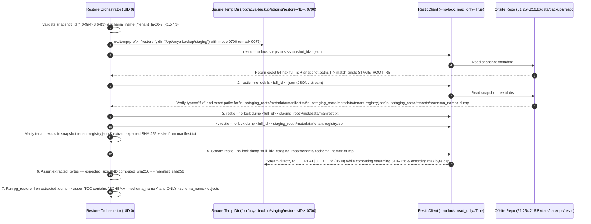
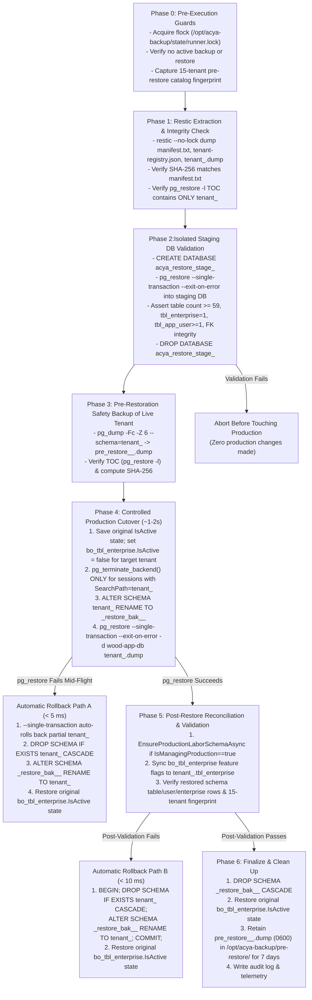

# ACYA — Phase 11C.1.6
## Individual Tenant Restore Feasibility Audit Report

- **Date:** `2026-11-07`
- **Production Host:** `vps-1d2bffb5` (`51.210.10.108`)
- **Administration / Monitoring Host:** `vps-b92b4ae6` (`51.254.216.8` — `monitor.acya.site`)
- **Active Backup Runner:** `/opt/acya-backup/bin/acya-backup-runner` (`v2.0.0`, telemetry schema `acya.backup.run/v1`)
- **Latest Verified Production Snapshot:** `2071d16434c17e91b18521cd2a6a9bfa47bc3510a3b0fac11f0c16401eb45f59` (`2071d164`, committed `2026-11-06T10:11:37.11432449Z`)
- **Audit Classification:** **100% Read-Only Feasibility & Architecture Audit** (Zero Restic commands executed, zero backups triggered, zero `pg_dump` or `pg_restore` executions, zero database modifications, zero source code or production file changes)

---

## 1. Executive Summary

### 1.1 Primary Feasibility Verdict

**YES — FEASIBLE WITH HIGH SAFETY.** ACYA can safely extract a single tenant's custom-format PostgreSQL schema dump (`tenants/tenant_<slug>.dump`) from an existing global Restic snapshot (`2071d164` or any compliant full-system snapshot) and restore **only that single tenant schema** into `wood-app-db` without creating individual-tenant Restic snapshots, without modifying the Restic repository, and without impacting the other 15 tenants or the 3 production databases (`wood-app-db`, `app-db-bo`, `n8n_db`).

### 1.2 Summary of Major Conclusions by Evidence Classification

| Audit Area | Major Conclusion | Evidence Classification |
| :--- | :--- | :--- |
| **Global Snapshot Granularity** | Every Phase 11B full backup snapshot (`2071d164`) already archives **both** `databases/primary/wood-app-db.full.dump` **and** 16 standalone per-tenant custom-format dumps (`tenants/tenant_<slug>.dump`) alongside `metadata/manifest.txt`, `metadata/manifest.json`, and `metadata/tenant-registry.json`. | **Confirmed by source code** (`pipeline.py`, `postgres.py`) & **Confirmed by existing backup evidence** (`last-success.json`, `PHASE_11C_1_FIRST_PRODUCTION_BACKUP_REPORT.md`) |
| **Single-File Restic Extraction** | A single tenant's `.dump` file and the snapshot's `manifest.txt` / `manifest.json` / `tenant-registry.json` can be streamed read-only from a specific snapshot using `restic --no-lock dump <snapshot_id> <exact_snapshot_path>` into a mode-`0700` host temporary directory without acquiring repository locks or modifying the repository. | **Confirmed by source code** (`restic.py` `_dump_node`, `acya-backup-verify`) |
| **Zero Cross-Schema Database Dependencies** | Live catalog inspection of `wood-app-db` (`PostgreSQL 15.18`) confirms **0 cross-schema foreign keys**, **0 cross-schema `pg_depend` edges**, **0 user functions/procedures**, **0 user triggers**, **0 views/materialized views**, and **0 custom enum/domain types** across all 16 `tenant_*` schemas. Every table, sequence, index, and constraint inside `tenant_<slug>` is 100% self-contained within its schema namespace (`pg_namespace.oid`) and owned by `postgres`. | **Confirmed by read-only production inspection** (`pg_constraint`, `pg_depend`, `pg_proc`, `pg_trigger`, `pg_views`, `pg_class`) |
| **Application & Connection Pool Isolation** | `wood-app-api` sets `connBuilder.SearchPath = tenantCtx.SchemaName` per tenant request (`ApplicationServiceExtentions.cs`), which partitions Npgsql connection pools per tenant schema, and caches EF Core models per `(DbContextType, SchemaName)` (`TenantModelCacheKeyFactory.cs`). Furthermore, `TenantMiddleware` and all 3 background workers (`NotificationRetryService`, `AuditCleanupBackgroundService`, `QuoteEmailRecoveryBackgroundService`) gate execution on `public.bo_tbl_enterprise.IsActive`. | **Confirmed by source code** (`ApplicationServiceExtentions.cs`, `TenantMiddleware.cs`, `TenantModelCacheKeyFactory.cs`, background services) |
| **`pg_restore` Schema Remapping Constraint** | PostgreSQL 15 `pg_restore` does **not** support a `--remap-schema` flag, and custom-format dumps (`pg_dump -Fc --schema=tenant_<slug>`) embed `tenant_<slug>` in TOC entries and `setval()` calls. Therefore, restoring into an alternate schema name inside `wood-app-db` via SQL text replacement (`sed`) is unsafe. Instead, pre-cutover validation must run in an **isolated staging database**, followed by a controlled **schema rename cutover** (`ALTER SCHEMA tenant_<slug> RENAME TO _restore_bak_<slug>_<ts>`) and `pg_restore --single-transaction --exit-on-error` into `tenant_<slug>`. | **Confirmed by source code** & **Confirmed by read-only production inspection** (`pg_attrdef` `regclass` inspection) |
| **Legacy Restore Endpoint Hazard** | The existing `POST /api/admin/backup/restore/{jobId}` (`BackupService.RestoreTenantSchemaAsync`) executes `DROP SCHEMA IF EXISTS "{schemaName}" CASCADE; CREATE SCHEMA "{schemaName}";` directly against live `wood-app-db` before running `pg_restore`, with no pre-restore backup, no staging validation, and no rollback on failure. It must be replaced or gated before any production tenant restore is allowed. | **Confirmed by source code** (`BackupController.cs`, `BackupService.cs`) |
| **End-to-End Restore Execution & Timing** | End-to-end execution of the recommended hybrid restore workflow (Restic single-file dump $\rightarrow$ SHA-256 verification $\rightarrow$ isolated staging DB `pg_restore` $\rightarrow$ schema rename swap + `--single-transaction` restore $\rightarrow$ post-restore feature-flag reconciliation) has not yet been executed in production. | **Not yet verified** (Requires separate operator authorization) |

---

## 2. Existing Backup Architecture

### 2.1 End-to-End Topology

- **Confirmed by source code & read-only production inspection:**
  - **Production VPS (`vps-1d2bffb5` / `51.210.10.108`):**
    - Runs the modular Python 3.13 Backup Runner at `/opt/acya-backup/bin/acya-backup-runner` (`v2.0.0`, mirrored in repository at [`scripts/backup-runner/`](file:///home/ubuntu/acya-app/scripts/backup-runner/)).
    - Connects to two production PostgreSQL 15.18 Docker containers resolved strictly by Docker Compose labels (`com.docker.compose.project=acya-app`):
      1. `8cdff3364501_wood-app-postgres` (`service=postgres`): hosts `wood-app-db` (`public` + 16 `tenant_*` schemas) and `app-db-bo`, plus cluster globals (`primary.globals.sql`).
      2. `postgres-n8n` (`service=postgres-n8n`): hosts `n8n_db`, plus cluster globals (`n8n.globals.sql`).
    - Explicitly excludes non-production containers `acya-restore-test-pg` and `acya-restore-n8n-pg` (`guards.excludedContainers` in [`backup.json`](file:///home/ubuntu/acya-app/scripts/backup-runner/config/backup.json#L18-L24)).
    - Pushes client-side encrypted (`AES-256-CTR` + `Poly1305-AES`) Restic snapshots over SFTP (`sftp:backup@51.254.216.8:/data/backups/restic`) using dedicated Ed25519 key `/etc/acya-backup/acya_backup_ed25519` (`0600 root:root`), pinned host key `/etc/acya-backup/known_hosts` (`0600 root:root`), and repository password `/etc/acya-backup/.restic_password` (`0600 root:root`).
  - **Administration / Monitoring VPS (`vps-b92b4ae6` / `51.254.216.8`):**
    - Stores the encrypted Restic repository at `/data/backups/restic` (Repository ID prefix `8a26915761a4`, format version `2`).
    - Exposes `/data/backups/restic` to the `admin-dash-back` container via a kernel-enforced read-only bind mount (`/repo:ro`).
    - `admin-dash-back` inspects snapshots exclusively using `restic --no-lock` (`snapshots`, `ls`, and `dump` restricted by allowlist to `metadata/manifest.txt`, `metadata/tenant-registry.json`, and `metadata/tenant-registry.csv`).

### 2.2 Snapshot Inventory in the Global Repository

- **Confirmed by existing backup evidence ([`PHASE_11A_BACKUP_RECOVERY_SAFETY_PREFLIGHT.md`](file:///home/ubuntu/acya-app/PHASE_11A_BACKUP_RECOVERY_SAFETY_PREFLIGHT.md#L172-L179) & [`PHASE_11C_1_FIRST_PRODUCTION_BACKUP_REPORT.md`](file:///home/ubuntu/acya-app/PHASE_11C_1_FIRST_PRODUCTION_BACKUP_REPORT.md#L191-L201)):**

| # | Short ID | Full Snapshot ID (Prefix) | Timestamp (UTC) | Runner / Generator | Staging Root Path Inside Snapshot | Tenant Dumps Archived | Manifest Format |
| :-: | :---: | :--- | :--- | :--- | :--- | :---: | :--- |
| 1 | `5a78f673` | `5a78f6730f080f40...` | `2026-10-05T07:57:56Z` | Legacy v1 (`restic 0.16.4`) | `/home/ubuntu/acya-backup-stage` | `11` | `manifest.txt` |
| 2 | `bbb68d5d` | `bbb68d5db4953b8b...` | `2026-10-05T12:05:50Z` | Legacy v1 (`restic 0.16.4`) | `/var/backups/acya-backup-stage-d8ORiO` | `11` | `manifest.txt` |
| 3 | `1fbd94a9` | `1fbd94a9328e54a0...` | `2026-10-05T12:29:47Z` | Legacy v1 (`restic 0.16.4`) | `/var/backups/acya-backup-stage-UgTTHX` | `11` | `manifest.txt` |
| 4 | `f93ac4c4` | `f93ac4c400bb35a3...` | `2026-10-11T10:58:47Z` | Legacy v1 (`restic 0.16.4`) | `/var/backups/acya-backup-stage-pZR8g8` | `12` | `manifest.txt` |
| 5 | `36a26b4e` | `36a26b4e5f749dc3...` | `2026-10-13T10:52:27Z` | Legacy v1.2 (`restic 0.16.4`) | `/var/backups/acya-backup-stage-wBiNgj` | `13` | `manifest.txt` |
| **6** | **`2071d164`** | **`2071d16434c17e91...`** | **`2026-11-06T10:11:37Z`** | **Phase 11B v2.0.0 (`restic 0.19.1`)** | **`/opt/acya-backup/staging/stage-20261106T101110Z-d2ae662f-cb88kl37`** | **`16`** | **`manifest.txt` + `manifest.json`** |

---

## 3. Tenant Dump Artifact Structure (Investigation A)

### 3.1 Exact Tenant Dump Filenames and Directory Layout Inside the Snapshot

- **Confirmed by source code ([`pipeline.py`](file:///home/ubuntu/acya-app/scripts/backup-runner/lib/acya_backup/pipeline.py#L371-L479), [`postgres.py`](file:///home/ubuntu/acya-app/scripts/backup-runner/lib/acya_backup/postgres.py#L105-L120), [`manifest.py`](file:///home/ubuntu/acya-app/scripts/backup-runner/lib/acya_backup/manifest.py#L276-L446)) & Confirmed by existing backup evidence (`2071d164`):**

During Stage 4 and Stage 5 of `acya-backup-runner`, an ephemeral directory with mode `0700` is created via `tempfile.mkdtemp(prefix=f"{cfg.staging_prefix}-{self.run_id}-", dir=cfg.staging_parent)`. For snapshot `2071d164`, the exact staging directory archived in the Restic snapshot tree is:

```text
/opt/acya-backup/staging/stage-20261106T101110Z-d2ae662f-cb88kl37/
├── databases/
│   ├── primary/
│   │   ├── wood-app-db.full.dump          (5,966,059 B — full DB including public + 16 tenant_* schemas)
│   │   ├── app-db-bo.full.dump            (833 B — backoffice DB)
│   │   └── primary.globals.sql            (477 B — pg_dumpall --globals-only --no-role-passwords)
│   └── n8n/
│       ├── n8n_db.full.dump               (961,716 B — n8n automation DB)
│       └── n8n.globals.sql                (306 B — pg_dumpall --globals-only --no-role-passwords)
├── tenants/
│   ├── tenant_fleur_de_printemps.dump     (297,943 B)
│   ├── tenant_inky_pinky.dump             (298,179 B)
│   ├── tenant_mansour_construction.dump   (298,412 B)
│   ├── tenant_oise_btp.dump               (297,620 B)
│   ├── tenant_oxylab.dump                 (298,038 B)
│   ├── tenant_piqbit.dump                 (351,696 B)
│   ├── tenant_rs_auto_service.dump        (298,487 B)
│   ├── tenant_sheg.dump                   (298,539 B)
│   ├── tenant_socobois.dump               (327,633 B)
│   ├── tenant_socofeb.dump                (297,759 B)
│   ├── tenant_sotubois.dump               (293,504 B)
│   ├── tenant_stramica.dump               (298,425 B)
│   ├── tenant_ttv.dump                    (297,794 B)
│   ├── tenant_tucobois.dump               (300,326 B)
│   ├── tenant_wellness_medical.dump       (298,476 B)
│   └── tenant_zaiemtex.dump               (297,876 B)
└── metadata/
    ├── tenant-registry.json               (1,188 B — JSON array of public.bo_tbl_enterprise records)
    ├── tenant-registry.csv                (1,105 B — CSV export of public.bo_tbl_enterprise records)
    ├── manifest.txt                       (23 SHA-256 lines + header metadata)
    └── manifest.json                      (acya.backup.manifest/v1 structured JSON manifest)
```

### 3.2 Mapping Rules: Tenant ID $\rightarrow$ Tenant Slug $\rightarrow$ Schema Name $\rightarrow$ Dump Filename

- **Confirmed by source code ([`postgres.py`](file:///home/ubuntu/acya-app/scripts/backup-runner/lib/acya_backup/postgres.py#L10-L21) & [`pipeline.py`](file:///home/ubuntu/acya-app/scripts/backup-runner/lib/acya_backup/pipeline.py#L467-L478)) & Confirmed by read-only production inspection (`public.bo_tbl_enterprise`):**
  1. **Tenant Slug to Schema Name (`expected_schema_for_slug` in `postgres.py`, line 150):**
     $$\text{SchemaName} = \texttt{"tenant\_"} + \text{re.sub}(\texttt{r"[\^{}a-z0-9]+"}, \texttt{"\_"}, \text{slug.lower()}).\text{strip}(\texttt{"\_"})$$
     For example, slug `fleur-de-printemps` maps to schema `tenant_fleur_de_printemps`; slug `socofeb` maps to `tenant_socofeb`.
     - Every schema name is validated against `TENANT_SCHEMA_RE = re.compile(r"^tenant_[a-z0-9_]{1,57}$")` (`postgres.py`, line 10).
     - In live production (`public.bo_tbl_enterprise`) and in snapshot `2071d164` (`slugNamingMismatches: []`), **all 16/16 tenants** satisfy this bijective mapping with zero naming mismatches.
  2. **Schema Name to Dump Filename (`pipeline.py`, line 468):**
     $$\text{Dump Relative Path} = \texttt{tenants/\{schema\_name\}.dump}$$
     Every tenant schema `tenant_<normalized_slug>` maps 1-to-1 to `tenants/tenant_<normalized_slug>.dump`.
  3. **Authoritative Multi-Key Resolution (`metadata/tenant-registry.json`):**
     Each element in `metadata/tenant-registry.json` (generated by `REGISTRY_SQL` in `postgres.py`, lines 13–17) records:
     ```json
     {
       "Id": 38,
       "Slug": "socofeb",
       "SchemaName": "tenant_socofeb",
       "IsActive": true,
       "Status": "Active",
       "Plan": "Pro",
       "CreatedAt": "2026-08-05T08:44:39...",
       "ActivatedAt": "2026-08-29T10:11:35..."
     }
     ```
     This allows unambiguous resolution between `TenantId` (`Id`), `Slug`, `SchemaName`, and `tenants/{SchemaName}.dump`.

### 3.3 Dump Generation Format & TOC Verification

- **Confirmed by source code ([`postgres.py`](file:///home/ubuntu/acya-app/scripts/backup-runner/lib/acya_backup/postgres.py#L105-L144)):**
  - **1 Dump Per Tenant:** Loop `for schema_name in sorted(catalog_schemas):` (`pipeline.py`, line 467) creates exactly one file per tenant schema using `os.open(dest, os.O_WRONLY | os.O_CREAT | os.O_EXCL, 0o600)`.
  - **`pg_dump -Fc` Custom Archive Format:** Generated by:
    ```text
    docker exec <cid> pg_dump -U postgres -d wood-app-db -Fc -Z 6 --schema=tenant_<slug>
    ```
    This produces a PostgreSQL custom-format binary archive (`PGDMP` header, zlib compression level `6`) scoped exclusively to `--schema=tenant_<slug>`.
  - **Pre-Upload TOC Verification:** Immediately after `pg_dump` completes, `PostgresInstance.archive_toc` (`postgres.py`, lines 133–143) runs `docker exec -i <cid> pg_restore -l < tdump_path` and verifies via regex `TOC_SCHEMA_RE` (`^\d+;\s+\d+\s+\d+\s+SCHEMA\s+-\s+(\S+)\s`) that the custom archive's Table of Contents is readable and contains the `SCHEMA - tenant_<slug>` entry.

### 3.4 Manifest Recording & SHA-256 Calculation

- **Confirmed by source code ([`manifest.py`](file:///home/ubuntu/acya-app/scripts/backup-runner/lib/acya_backup/manifest.py#L265-L446)) & Confirmed by existing backup evidence (`2071d164`):**
  1. **SHA-256 Calculation (`sha256_file`, lines 265–273):**
     - Reads each file in `1 MiB` (`1024 * 1024` byte) binary chunks using Python's `hashlib.sha256()` and computes the 64-character lowercase hex digest.
     - Performs a **symmetric verification pass** (`manifest.py`, lines 404–423) that re-reads every staged file from disk after writing `manifest.txt` and `manifest.json` and recomputes its SHA-256 to guarantee zero bitrot before upload.
  2. **`metadata/manifest.txt` Format (lines 343–369):**
     - Contains human-readable header lines (`Timestamp`, `Runner Version`, `Run ID`, `Hostname`, `PostgreSQL Version`, `Restic Version`, `Database Name`, `Tenant Count`, `Tenant Schemas`) followed by `sha256sum`-compatible lines:
       ```text
       <64-hex-sha256>  /opt/acya-backup/staging/stage-<RUN_ID>-<RAND>/tenants/tenant_<slug>.dump
       ```
  3. **`metadata/manifest.json` Format (lines 376–396):**
     - Schema `"acya.backup.manifest/v1"`, containing top-level metadata (`generatedAt`, `runnerVersion`, `runId`, `hostname`, `postgresVersion`, `resticVersion`, `tenantDatabase`, `tenantCount`, `tenantSchemas`) and an `artifacts` array where each entry contains:
       ```json
       {
         "relativePath": "tenants/tenant_socofeb.dump",
         "stagedPath": "/opt/acya-backup/staging/stage-20261106T101110Z-d2ae662f-cb88kl37/tenants/tenant_socofeb.dump",
         "sizeBytes": 297759,
         "sha256": "b722c26b4b92c9dff7a7b271b453af06c6b2520901e992a1bee2daf216c031a2"
       }
       ```
  4. **Sufficiency for Unambiguous Identification and Restoration:**
     - **Confirmed by existing backup evidence:** Combining `metadata/tenant-registry.json` (which maps `Id` $\leftrightarrow$ `Slug` $\leftrightarrow$ `SchemaName`) with `metadata/manifest.json` / `metadata/manifest.txt` (which maps `relativePath: "tenants/{SchemaName}.dump"` $\leftrightarrow$ `stagedPath` $\leftrightarrow$ `sizeBytes` $\leftrightarrow$ `sha256`) and the Restic snapshot metadata (`id`, `time`, `hostname`, `tags`) preserves **100% of the information required** to identify a tenant unambiguously, verify its dump's cryptographic integrity, and restore that tenant schema at any later time.
     - **Historical Snapshot Note (Snapshots `5a78f673`..`36a26b4e`):** The 5 pre-Phase-11B snapshots (Oct 5–13, 2026) contain `metadata/manifest.txt`, `metadata/tenant-registry.json`, and `tenants/tenant_<slug>.dump` under `/var/backups/acya-backup-stage-*` (or `/home/ubuntu/acya-backup-stage`), so `manifest.txt` + `tenant-registry.json` is the universal denominator across all 6 existing snapshots, while `manifest.json` provides structured metadata for all Phase 11B (`v2.0.0+`) snapshots (`2071d164` onward).

---

## 4. Restic Single-Artifact Extraction Feasibility (Investigation B)

*Note: Per strict audit boundaries, zero Restic commands were executed during this investigation. All findings below are derived from source-code inspection of [`restic.py`](file:///home/ubuntu/acya-app/scripts/backup-runner/lib/acya_backup/restic.py), [`acya-backup-verify`](file:///home/ubuntu/acya-app/scripts/backup-runner/bin/acya-backup-verify), and [`ADMIN_DASH_FINAL_TECHNICAL_SPECIFICATION_v3_2.md`](file:///home/ubuntu/acya-app/ADMIN_DASH_FINAL_TECHNICAL_SPECIFICATION_v3_2.md).*

### 4.1 Why `restic dump --no-lock` Is Superior to `restic restore` for Single-Tenant Extraction

- **Confirmed by source code ([`restic.py`](file:///home/ubuntu/acya-app/scripts/backup-runner/lib/acya_backup/restic.py#L24-L43) & lines 604–616):**

| Criterion | `restic --no-lock dump <snapshot_id> <exact_path>` | `restic --no-lock restore <snapshot_id> --target <dir> --include <path>` |
| :--- | :--- | :--- |
| **Repository Modification** | **Zero** (`--no-lock` reads repository index and data blobs without creating lock files). | **Zero** with `--no-lock`, but `restore` is currently in `FORBIDDEN_SUBCOMMANDS` (`restic.py`, line 29). |
| **Allowlist Status in `restic.py`** | **Already permitted** in `ALLOWED_READONLY_SUBCOMMANDS` (`restic.py`, line 41) and implemented in `ResticClient._dump_node()` (lines 604–615). | Blocked by `FORBIDDEN_SUBCOMMANDS`. |
| **Filesystem Extraction Behavior** | Streams raw file bytes of a **single regular file** to `stdout`; caller writes bytes directly to an `O_CREAT \| O_EXCL` file descriptor (`0600`) at a fixed path (`<temp_dir>/tenant.dump`). | Reconstructs the full nested staging path hierarchy (`/opt/acya-backup/staging/stage-.../tenants/tenant_<slug>.dump`) inside `<target>` and applies archived ownership/mode/timestamps/symlinks from the snapshot. |
| **Path Traversal / Symlink Risk** | **Eliminated:** Restic never creates directories, symlinks, or device nodes on the host filesystem; Python writes the byte stream into a single pre-opened regular file descriptor. | Higher risk if `--include` pattern is too broad or if an archive ever contained symlinks. |

### 4.2 Step-by-Step Single-Artifact Extraction Protocol (Read-Only against Repository)

- **Confirmed by source code ([`acya-backup-verify`](file:///home/ubuntu/acya-app/scripts/backup-runner/bin/acya-backup-verify#L30-L92)) & Recommendation:**



1. **Snapshot Identification:**
   - Validate candidate `snapshot_id` against `^[0-9a-f]{8,64}$`.
   - Query `restic -r <repo> ... --no-lock snapshots <snapshot_id> --json`.
   - Require `len(snaps) == 1` (rejects ambiguous short prefixes or nonexistent IDs) and resolve the canonical 64-character `full_id = snaps[0]["id"]`.
   - Identify the single staging root in `snaps[0]["paths"]` matching:
     `^(/opt/acya-backup/staging/stage-[A-Za-z0-9_-]+|/var/backups/acya-backup-stage-[A-Za-z0-9_-]+|/home/ubuntu/acya-backup-stage)$`.
2. **Exact File Path Selection via JSON Lines (`restic ls --no-lock <full_id> --json`):**
   - Stream JSONL output and require **exact single matches** (`node["type"] == "file"`) for:
     - `{staging_root}/metadata/manifest.txt`
     - `{staging_root}/metadata/tenant-registry.json`
     - `{staging_root}/tenants/{schema_name}.dump`
   - Pass the exact `node["path"]` string emitted by `restic ls` to `restic dump` without stripping or altering slashes.
3. **Extraction to a Secure Temporary Directory:**
   - Create an isolated extraction directory under `/opt/acya-backup/staging/` using `tempfile.mkdtemp(prefix=f"restore-{run_id}-", dir="/opt/acya-backup/staging")` with `os.umask(0o077)` and `os.chmod(restore_dir, 0o700)`, owned by `root:root`.
   - Open the destination file using `os.open(dest_path, os.O_WRONLY | os.O_CREAT | os.O_EXCL, 0o600)` so symlinks or pre-existing files can never be overwritten.
4. **Checksum & TOC Verification After Extraction:**
   - Before extracting the dump, parse `manifest.txt` (and `manifest.json` when present in `node` list) to obtain the expected `sha256` digest and `size` (from `restic ls` node metadata).
   - Stream `restic --no-lock dump <full_id> {exact_dump_path}` directly to the opened `0600` file descriptor.
   - Recompute `sha256_file(dest_path)` on disk and assert:
     - `os.path.getsize(dest_path) > 0`
     - `os.path.getsize(dest_path) == ls_node_size`
     - `recomputed_sha256 == expected_manifest_sha256`
   - Run `pg_restore -l < dest_path` and verify that **every** schema-qualified TOC entry in the archive belongs exclusively to `schema_name` (`toc_schemas(toc) == {schema_name}`) and contains no `public` or other `tenant_*` objects.
5. **Cleanup Requirements:**
   - Wrap the entire extraction and restoration lifecycle in a `try ... finally` block (and `SIGHUP`/`SIGINT`/`SIGTERM` signal handlers, identical to `BackupRunner.execute()` in [`pipeline.py`](file:///home/ubuntu/acya-app/scripts/backup-runner/lib/acya_backup/pipeline.py#L156-L225)) that guarantees `shutil.rmtree(restore_dir)` on exit, plus startup sweeping of any abandoned `restore-*` directories in `/opt/acya-backup/staging/`.

---

## 5. PostgreSQL Single-Schema Restoration Feasibility (Investigation C)

### 5.1 Production Database Architecture Inspection

- **Confirmed by read-only production inspection (`psql -X --set=default_transaction_read_only=on` on `8cdff3364501_wood-app-postgres`):**

| Database Property | Verified Production Value | Evidence / Impact on Single-Tenant Restore |
| :--- | :--- | :--- |
| **PostgreSQL Version** | `PostgreSQL 15.18 on x86_64-pc-linux-musl, compiled by gcc (Alpine 15.2.0) 15.2.0, 64-bit` | Client tools (`pg_dump` / `pg_restore`) inside `8cdff3364501_wood-app-postgres` match `15.18` (`admin-elance-back` has `15.19 Debian`). |
| **Databases on Primary Instance** | `wood-app-db` (`UTF8`, owner `postgres`), `app-db-bo` (`UTF8`, owner `postgres`), `postgres` (`UTF8`, owner `postgres`) | All 16 tenant schemas reside inside `wood-app-db`. |
| **Database Roles** | Only `postgres` (`rolsuper=t, rolcreaterole=t, rolcreatedb=t, rolcanlogin=t`) | Zero custom per-tenant PostgreSQL roles exist. All schemas, tables, sequences, and indexes are owned by `postgres`. |
| **Installed Extensions** | `plpgsql 1.0` (in `pg_catalog`) | Zero custom or schema-scoped extensions in `wood-app-db` (no `uuid-ossp`, `pgcrypto`, or `postgis` inside `tenant_*` schemas). |
| **Schema Naming & ACLs** | `public` (`owner=pg_database_owner`) + 16 `tenant_<slug>` schemas (`owner=postgres`, `nspacl=NULL`) | Every tenant schema is owned by `postgres` with default owner privileges. |
| **Objects Per Tenant Schema** | `59–64` tables (`relkind='r'`), `56–61` sequences (`relkind='S'`), `190–222` indexes (`relkind='i'`) | Compact footprint (`293 KB`–`351 KB` compressed `.dump` per tenant). |
| **Functions, Triggers, Views, Custom Types** | **`0` functions/procedures (`pg_proc`), `0` triggers (`pg_trigger`), `0` views (`pg_views`), `0` matviews (`pg_matviews`), `0` custom types/enums (`pg_type`)** | Eliminates PL/pgSQL function body string-literal schema references, trigger side-effects during `pg_restore`, and custom type OID conflicts. |
| **Cross-Schema Foreign Keys** | **`0` rows** in `pg_constraint` (`contype='f'` where `ns1.nspname <> ns2.nspname`) | No table in `tenant_*` references `public` or another `tenant_*`, and no table in `public` references any table inside `tenant_*`. |
| **Cross-Schema `pg_depend` Edges** | **`0` rows** in `pg_depend` linking any `tenant_*` object to `public` or another `tenant_*` schema | Dropping or renaming `tenant_<slug>` cannot cascade to `public` or any other tenant schema. |
| **Sequences & Defaults** | Mix of SQL standard `GENERATED BY DEFAULT AS IDENTITY` (`attidentity='d'`) and `SERIAL` sequences (`nextval('tenant_<slug>."..._seq"'::regclass)`) | Stored as compiled `regclass` OIDs in `pg_attrdef`, and exported in `pg_dump -Fc` as `ALTER SEQUENCE ... OWNED BY` + `SELECT pg_catalog.setval(...)`. |

### 5.2 Shared Tables in `public` Schema vs Tenant Schema Tables

- **Confirmed by read-only production inspection & source code (`MasterDbContext.cs`, `EnterpriseController.cs`):**
  1. **`public.bo_tbl_*` (14 Shared Platform Tables):**
     - `bo_tbl_enterprise` (Master tenant registry: `Id`, `Slug`, `SchemaName`, `IsActive`, `Status`, `Plan`, feature flags `IsSalingWood`, `IsManagingConstructions`, `IsManagingProduction`, branding, etc.)
     - `bo_tbl_tenant_subscriptions`, `bo_tbl_tenant_invoices`, `bo_tbl_tenant_payments` (FK $\rightarrow$ `bo_tbl_enterprise."Id"`)
     - `bo_tbl_mobile_builds`, `bo_tbl_mobile_releases`, `bo_tbl_tenant_firebase_apps` (FK $\rightarrow$ `bo_tbl_enterprise."Slug"`)
     - `bo_tbl_backup_jobs`, `bo_tbl_master_audit_logs`, `bo_tbl_email_logs`, `bo_tbl_email_log_events` (FK $\rightarrow$ `bo_tbl_enterprise."Id"`)
     - `bo_tbl_platform_settings`, `bo_tbl_super_admin_users`, `bo_tbl_enterprise_backup_pre_cleanup`
  2. **Relationship to `tenant_<slug>` During Restoration:**
     - None of the `public.bo_tbl_*` tables have foreign keys into `tenant_<slug>.*`.
     - However, two post-restore synchronization invariants exist between `public.bo_tbl_enterprise` and `tenant_<slug>`:
       - **Invariant 1 (Incremental Module Tables):** Across the 16 tenants, 59 tables are universal, while 5 tables are module/version-dependent (`production_step_workers`, `production_step_work_logs`, `production_other_work_entries` in 7 tenants; `DevicePushTokens` in 5 tenants; `tbl_vehicle_expense` in 14 tenants). If a tenant currently has `IsManagingProduction = true` in `public.bo_tbl_enterprise` and is restored from a snapshot taken before production labor tables were activated, `TenantProvisioningService.EnsureProductionLaborSchemaAsync(schemaName)` (or EF Core `tenantDbContext.Database.Migrate()`) must run after `pg_restore` so the schema matches current application expectations.
       - **Invariant 2 (`tbl_enterprise` Feature Flag Sync):** `wood-app-api` controllers (`ProductionController`, `ChantierController`, `PermissionsController`, `TokenService`) read module flags (`ismanagingconstructions`, `ismanagingproduction`, `issalingwood`) from `tenant_<slug>.tbl_enterprise` (`id = 1`). After restoring `tenant_<slug>` from a historical snapshot, `tenant_<slug>.tbl_enterprise` should be synchronized with the current entitlement flags in `public.bo_tbl_enterprise` (matching the exact `UPDATE {safeSchema}.tbl_enterprise` query in [`EnterpriseController.cs`](file:///home/ubuntu/acya-app/bo-acya-app/admin-elance-back/src/ms.admin.api.acya/Controllers/EnterpriseController.cs#L584-L618)).

### 5.3 Critical Technical Analysis of `pg_restore` and Schema Naming

- **Confirmed by source code & PostgreSQL 15 architecture:**
  - In `acya-backup-runner`, per-tenant dumps are created via:
    `pg_dump -U postgres -d wood-app-db -Fc -Z 6 --schema=tenant_<slug>`
  - Every TOC entry in `tenant_<slug>.dump` explicitly targets schema `tenant_<slug>` (`CREATE SCHEMA tenant_<slug>;`, `SET search_path = tenant_<slug>, pg_catalog;`, `SELECT pg_catalog.setval('tenant_<slug>.tbl_document_id_seq', ...)`).
  - **PostgreSQL `pg_restore` does NOT have a `--remap-schema` flag.** Attempting to rewrite schema names on the fly by piping `pg_restore -f - | sed 's/tenant_x/tenant_x_temp/g' | psql` is **unsafe** because any occurrence of the substring `tenant_x` inside user data (`tbl_document`, `AuditLogs`, `jsonb` columns) would be silently corrupted.
  - **However**, because PostgreSQL namespaces all table, sequence, index, constraint, and composite type objects by **schema OID (`pg_namespace.oid`)** rather than global name (proven empirically by 16 identical `tenant_*` schemas coexisting in `wood-app-db`), executing:
    ```sql
    ALTER SCHEMA tenant_<slug> RENAME TO _restore_bak_<slug>_<timestamp>;
    ```
    immediately frees the name `tenant_<slug>` in `wood-app-db` while keeping 100% of the original schema's tables, sequences (`regclass` OIDs), indexes, and data intact under `_restore_bak_<slug>_<timestamp>`!
  - Then `pg_restore --single-transaction --exit-on-error -U postgres -d wood-app-db tenant_<slug>.dump` restores the archive cleanly into a fresh `tenant_<slug>` schema inside a single atomic transaction (`~0.5 seconds`), without ever modifying the dump binary or running regex replacements on SQL!

### 5.4 Comparative Evaluation of the Three Restoration Strategies

| Evaluation Dimension | Strategy 1: Direct In-Place Restore (`DROP SCHEMA tenant_<slug> CASCADE` + `pg_restore` in `wood-app-db`) | Strategy 2: Temporary/Renamed Schema Swap in `wood-app-db` (`ALTER SCHEMA RENAME` + `pg_restore --single-transaction`) | Strategy 3: Dedicated Staging Database Validation Before Production Cutover |
| :--- | :--- | :--- | :--- |
| **How It Works** | Drops live `tenant_<slug>` immediately in `wood-app-db`, then runs `pg_restore` directly into `wood-app-db` (current `BackupService.RestoreTenantSchemaAsync` behavior). | Renames live `tenant_<slug>` to `_restore_bak_<slug>_<ts>` (preserving it intact in `wood-app-db`), then runs `pg_restore --single-transaction --exit-on-error` to recreate `tenant_<slug>`, validates it, and drops `_restore_bak_<slug>_<ts>` only after validation passes. *(Note: cannot restore into a temp schema name first without renaming `tenant_<slug>` because `pg_restore` lacks `--remap-schema`.)* | First restores `tenant_<slug>.dump` into an isolated staging database (`acya_restore_stage` on disposable container or isolated DB), validates all tables, constraints, and row counts with zero production locks; only after 100% staging pass does it execute the Strategy 2 rename-and-restore cutover in `wood-app-db`. |
| **Advantages** | Simplest implementation (2 commands); no extra disk or schema storage needed during restore. | - Preserves original live schema in-database (`_restore_bak_<slug>_<ts>`) during `pg_restore`.<br>- `--single-transaction` guarantees `pg_restore` is all-or-nothing.<br>- Instant (`< 5 ms`) rollback via `ALTER SCHEMA RENAME` if `pg_restore` or post-validation fails. | - **Maximum safety:** Proves the dump archive is 100% restorable and structurally valid **before** touching live `wood-app-db` or suspending the target tenant.<br>- Zero production lock duration during archive validation.<br>- Combines seamlessly with Strategy 2 for the final cutover. |
| **Risks** | **CRITICAL:** If `pg_restore` fails mid-way (corrupt pack, version mismatch, constraint error), the live schema has already been destroyed by `DROP SCHEMA CASCADE`. | If `tenant_<slug>.dump` has a subtle archive error, `ALTER SCHEMA RENAME` still briefly pauses the target tenant (~0.5–1s) before `--single-transaction` rolls back and renames `_restore_bak` back. Also, temporarily doubles schema object count (+60 tables) in `wood-app-db` until `_restore_bak` is dropped. | Slightly longer total workflow duration (~2–3 seconds extra to create/drop staging DB and run `pg_restore` twice), though target tenant downtime remains `< 2 seconds`. |
| **Required Locks** | `AccessExclusiveLock` on `tenant_<slug>` and all its tables during `DROP SCHEMA CASCADE`, followed by `pg_restore` DDL locks. | `AccessExclusiveLock` on `tenant_<slug>` namespace (`ALTER SCHEMA RENAME` — milliseconds), then transaction-scoped DDL locks only on the newly created `tenant_<slug>` during `pg_restore --single-transaction`. | **Phase A (Staging DB):** Zero locks on `wood-app-db`.<br>**Phase B (Cutover via Strategy 2):** Millisecond `AccessExclusiveLock` on `tenant_<slug>` only. |
| **Downtime Implications** | Target tenant is completely down (and returns SQL `42P01 relation does not exist` errors if not gated) for the entire duration of `DROP` + `pg_restore` + forever if `pg_restore` fails. | Target tenant is gated (`403` / maintenance) for `~1–2 seconds` during rename + `pg_restore --single-transaction` + validation. **0 ms downtime for the other 15 tenants.** | Target tenant stays **100% online** during Restic extraction, SHA-256 check, pre-restore dump, and Staging DB restore/validation; gated for only `~1–2 seconds` during final Strategy 2 cutover. **0 ms downtime for the other 15 tenants.** |
| **Rollback Possibilities** | **None in-database** once `DROP SCHEMA CASCADE` commits; requires manually locating and restoring another backup file from scratch. | **Instant (`< 5 ms`) automatic rollback:** If `pg_restore --single-transaction` fails, transaction aborts automatically and `ALTER SCHEMA _restore_bak_<slug>_<ts> RENAME TO tenant_<slug>` restores the original schema immediately. | **Two-layer rollback:**<br>1. If staging restore fails $\rightarrow$ abort before touching production (`0` impact).<br>2. If production cutover fails $\rightarrow$ instant `ALTER SCHEMA RENAME` rollback + pre-restore `.dump` file on disk. |
| **Risk to Other 15 Tenants** | Low at schema level, but active un-gated requests on target tenant can cause connection errors and noisy logs in `wood-app-api`. | **Zero** (provided backup schema name uses prefix `_restore_bak_` and **not** `tenant_`, so `TENANT_SCHEMAS_SQL` never sees it as an orphan tenant schema). | **Zero.** |

- **Recommendation:** Adopt a **Hybrid Strategy (Strategy 3 Staging Validation $\rightarrow$ Strategy 2 Atomic Rename & Single-Transaction Cutover)**, detailed in Sections 7 and 11.

---

## 6. Tenant Isolation Analysis (Investigation D)

### 6.1 Architectural Proof That Restoring One Tenant Cannot Affect Other Tenants

1. **PostgreSQL Catalog & Ownership Isolation (`Confirmed by read-only production inspection`):**
   - Each tenant resides in its own dedicated PostgreSQL namespace (`tenant_<slug>`).
   - As verified in Section 5.1, `wood-app-db` has **0 cross-schema foreign keys** (`pg_constraint`), **0 cross-schema dependencies** (`pg_depend`), **0 triggers**, **0 functions**, and **0 views**.
   - Every table, sequence, and index in `tenant_<slug>` is owned by `postgres` and linked strictly to `tenant_<slug>`'s `pg_namespace.oid`.
   - Executing `ALTER SCHEMA tenant_<slug> RENAME ...`, `pg_restore --single-transaction --schema=tenant_<slug>`, or `DROP SCHEMA _restore_bak_<slug>_<ts> CASCADE` acquires locks **exclusively** on objects belonging to that single namespace OID and never locks any relation in `public` or the other 15 `tenant_*` schemas.

2. **Database Connection Pool & Search Path Isolation (`Confirmed by source code`):**
   - In [`ApplicationServiceExtentions.cs`](file:///home/ubuntu/acya-app/wood-app.api/src/ms.webapp.api.acya/ms.webapp.api.acya/Extentions/ApplicationServiceExtentions.cs#L155-L163):
     ```csharp
     var connBuilder = new Npgsql.NpgsqlConnectionStringBuilder(tenantCtx.ConnectionString);
     if (!string.IsNullOrEmpty(tenantCtx.SchemaName))
     {
       connBuilder.SearchPath = tenantCtx.SchemaName;
     }
     connectionString = connBuilder.ToString();
     ```
   - Because Npgsql keys its internal connection pools by the exact connection string, and each tenant's connection string includes `Search Path=tenant_<slug>`, **every tenant has a physically separate Npgsql connection pool** inside `wood-app-api`.
   - Furthermore, [`WoodAppContext.cs`](file:///home/ubuntu/acya-app/wood-app.api/src/ms.webapp.api.acya.infrastructure/WoodAppContext.cs#L131-L133) calls `modelBuilder.HasDefaultSchema(SchemaName)` and [`TenantModelCacheKeyFactory.cs`](file:///home/ubuntu/acya-app/wood-app.api/src/ms.webapp.api.acya.infrastructure/TenantModelCacheKeyFactory.cs#L14-L19) keys the EF Core relational model cache by `(context.GetType(), woodContext.SchemaName, designTime)`. Every EF Core query is explicitly schema-qualified (`SELECT ... FROM "tenant_socobois"."tbl_document"`).
   - Terminating PostgreSQL backend connections whose `search_path` or active query targets `tenant_<slug>` (or clearing only `tenant_<slug>`'s pool) does **not** close or invalidate pooled connections belonging to the other 15 tenants.

3. **Request & Background Worker Gating During Restoration (`Confirmed by source code`):**
   - In [`TenantMiddleware.cs`](file:///home/ubuntu/acya-app/wood-app.api/src/ms.webapp.api.acya/ms.webapp.api.acya/Middleware/TenantMiddleware.cs#L105-L111), every incoming HTTP request queries `masterDb.TenantRegistries` (`public.bo_tbl_enterprise`) and immediately rejects the request with `403 Forbidden` before opening a tenant `WoodAppContext` connection if `!tenant.IsActive`.
   - In [`NotificationRetryService.cs`](file:///home/ubuntu/acya-app/wood-app.api/src/ms.webapp.api.acya/ms.webapp.api.acya/Services/NotificationRetryService.cs#L46), [`AuditCleanupBackgroundService.cs`](file:///home/ubuntu/acya-app/wood-app.api/src/ms.webapp.api.acya/ms.webapp.api.acya/Services/AuditCleanupBackgroundService.cs#L40), and [`QuoteEmailRecoveryBackgroundService.cs`](file:///home/ubuntu/acya-app/wood-app.api/src/ms.webapp.api.acya/ms.webapp.api.acya/Services/QuoteEmailRecoveryBackgroundService.cs#L56), all background loops filter by `.Where(t => t.IsActive)`.
   - Therefore, temporarily setting `IsActive = false` (recording the original `IsActive` boolean and `Status` beforehand) for the target tenant during the `~1–2 second` schema cutover window prevents both HTTP requests and background workers in `wood-app-api` from opening any new transactions on `tenant_<slug>`, while all other active tenants continue serving traffic uninterrupted.

### 6.2 Measurable Pre/Post-Restoration Verification Checks for All 15 Unaffected Tenants

- **Recommendation:** Before and immediately after executing any single-tenant restoration, the restore orchestrator must run a read-only SQL fingerprint query across **all 15 unaffected `tenant_*` schemas** and `public.bo_tbl_enterprise` and assert **100% byte-for-byte parity**:

```sql
-- Pre-Restore and Post-Restore Invariant Fingerprint for the 15 Unaffected Tenants
SELECT
  n.nspname AS schema_name,
  n.oid AS schema_oid,
  COUNT(CASE WHEN c.relkind = 'r' THEN 1 END) AS table_count,
  COUNT(CASE WHEN c.relkind = 'S' THEN 1 END) AS seq_count,
  COUNT(CASE WHEN c.relkind = 'i' THEN 1 END) AS index_count,
  COALESCE(SUM(s.n_tup_ins + s.n_tup_upd + s.n_tup_del), 0) AS total_dml_ops,
  SHA256(
    STRING_AGG(
      c.relname || ':' || c.oid::text || ':' || c.relfilenode::text,
      ',' ORDER BY c.relname
    )::bytea
  ) AS catalog_oid_relfilenode_sha256
FROM pg_namespace n
LEFT JOIN pg_class c ON c.relnamespace = n.oid AND c.relkind IN ('r', 'S', 'i')
LEFT JOIN pg_stat_user_tables s ON s.relid = c.oid
WHERE n.nspname LIKE 'tenant\_%'
  AND n.nspname <> :'target_schema'
GROUP BY n.nspname, n.oid
ORDER BY n.nspname;
```

**What this measurable check proves:**
1. **`schema_oid` unchanged:** Proves none of the 15 unaffected schemas were dropped or recreated.
2. **`table_count`, `seq_count`, `index_count` unchanged:** Proves zero DDL changes occurred in any of the 15 unaffected schemas.
3. **`catalog_oid_relfilenode_sha256` identical before and after:** Because every table, sequence, and index in PostgreSQL has an immutable `oid` and physical storage file `relfilenode` (which only changes on `TRUNCATE`, `REINDEX`, `CLUSTER`, `VACUUM FULL`, or `DROP/CREATE`), an identical SHA-256 over `relname:oid:relfilenode` across all 15 unaffected schemas mathematically proves that **zero tables, sequences, or indexes in the 15 unaffected tenants were dropped, truncated, or rewritten during the restore**.

---

## 7. Rollback Strategy (Investigation E)

- **Recommendation (Defense-in-Depth Two-Tier Rollback Architecture):**



### Key Rollback Design Safeguards

1. **Mandatory Pre-Restoration Dump on Disk (`/opt/acya-backup/pre-restore/`):**
   - Before renaming or modifying `tenant_<slug>`, the orchestrator exports the current live schema via `pg_dump -U postgres -d wood-app-db -Fc -Z 6 --schema=tenant_<slug>` to `/opt/acya-backup/pre-restore/pre_restore_{schema_name}_{run_id}.dump` (`0600 root:root`), validates its TOC via `pg_restore -l`, and records its SHA-256 hash.
   - Even after a successful restore, this pre-restore `.dump` file is retained for a configurable rollback window (e.g., 7 days) so the operator can revert to the pre-restore state if a business-level mistake is discovered later.
2. **Non-Colliding In-Database Rollback Schema Name (`_restore_bak_<slug>_<ts>`):**
   - **Critical Naming Rule:** The temporary renamed schema **must never start with `tenant_`** (use `_restore_bak_<slug>_<ts>`).
   - **Why (`Confirmed by source code`):** Both `TENANT_SCHEMAS_SQL` in [`postgres.py`](file:///home/ubuntu/acya-app/scripts/backup-runner/lib/acya_backup/postgres.py#L18-L21) (`WHERE schema_name LIKE 'tenant\_%'`) and the repository's incremental SQL migration loops (`WHERE schema_name LIKE 'tenant_%'`) match the prefix `tenant_`. Using `_restore_bak_` ensures neither `acya-backup-runner` nor migration scripts ever mistake the temporary rollback schema for a live tenant.
3. **Recovery If Restoration Fails Midway (`pg_restore --single-transaction --exit-on-error`):**
   - Running `pg_restore` with `--single-transaction --exit-on-error` wraps `CREATE SCHEMA tenant_<slug>`, all `CREATE TABLE` statements, all `COPY` data loads, all `setval()` calls, and all index/constraint builds inside a single PostgreSQL transaction.
   - If any error occurs midway, PostgreSQL automatically rolls back the transaction, leaving no partial `tenant_<slug>` schema behind. The orchestrator immediately executes `ALTER SCHEMA _restore_bak_<slug>_<ts> RENAME TO tenant_<slug>;` and restores `bo_tbl_enterprise.IsActive`, completing rollback in `< 5 ms`.
4. **Recovery If Post-Restoration Validation Fails:**
   - If `pg_restore` exits `0` but post-restore verification fails (e.g. missing expected table, `tbl_enterprise` missing, or feature-flag migration error), the orchestrator executes inside a single SQL transaction:
     ```sql
     BEGIN;
     DROP SCHEMA IF EXISTS "tenant_<slug>" CASCADE;
     ALTER SCHEMA "_restore_bak_<slug>_<ts>" RENAME TO "tenant_<slug>";
     COMMIT;
     ```
     Because `ALTER SCHEMA ... RENAME` and `DROP SCHEMA` are transactional DDL in PostgreSQL, the swap back to the original schema is completely atomic.

---

## 8. Backup History API Design (Investigation F)

### 8.1 How Admin-Dash (or `admin-elance-back`) Derives Per-Tenant Backup History from Actual Snapshot Evidence

- **Confirmed by source code & existing backup evidence:**
  - Every Restic snapshot in `/data/backups/restic` (`5a78f673`, `bbb68d5d`, `1fbd94a9`, `f93ac4c4`, `36a26b4e`, `2071d164`) contains:
    1. Snapshot index metadata (`restic snapshots --no-lock --json` $\rightarrow$ `id`, `short_id`, `time`, `hostname`, `tags`, `paths`).
    2. Snapshot file tree (`restic ls --no-lock <snapshot_id> --json` $\rightarrow$ exact file presence and byte size for `<staging_root>/tenants/tenant_<slug>.dump`, `<staging_root>/metadata/manifest.txt`, `<staging_root>/metadata/manifest.json`, and `<staging_root>/metadata/tenant-registry.json`).
    3. Allowable metadata payloads (`restic dump --no-lock <snapshot_id> <path>` $\rightarrow$ `metadata/manifest.txt` and `metadata/tenant-registry.json`, which are explicitly permitted by the Admin-Dash v3.2 read allowlist!).
  - **Dynamic Derivation Without Hardcoded Tenant Counts or Fixture Data:**
    - When a new snapshot is discovered by Admin-Dash (or cached in Admin-Dash's SQLite index upon snapshot ingestion), Admin-Dash reads `restic snapshots --no-lock --json`, runs `restic ls --no-lock <id> --json`, and dumps `metadata/tenant-registry.json` and `metadata/manifest.txt`.
    - From those three sources alone—**without dumping any `.dump` file and without hardcoding `16` tenants**—the backend deterministically indexes every tenant present in each snapshot:
      - `tenantId` (`Id` from `tenant-registry.json`, or matched against live `bo_tbl_enterprise.Id` by `Slug`/`SchemaName`)
      - `tenantSlug` (`Slug` from `tenant-registry.json`, or derived from `tenant_<slug>.dump` filename if a historical snapshot predates `tenant-registry.json`)
      - `schemaName` (`SchemaName` from `tenant-registry.json` / `tenants/{schemaName}.dump`)
      - `dumpFilename` (`tenants/{schemaName}.dump`) and exact `stagedPath` in snapshot
      - `dumpSizeBytes` (from `restic ls --json` `size` property on the `tenants/{schemaName}.dump` node)
      - `manifestSha256` (parsed from the matching line `<sha256>  .../{schemaName}.dump` in `metadata/manifest.txt`)
      - Disaggregated evidence status (`PresenceStatus`, `ReadabilityStatus`, `ParsingStatus`, `IntegrityStatus`) per Admin-Dash v3.2 Section 2.1.

### 8.2 Proposed API Endpoint & Response Contract

- **Endpoint:** `GET /api/admin/backups/tenants/{tenantSlugOrId}/history` (in `admin-dash` on `monitor.acya.site`, or exposed to `admin.acya.site` via read-only snapshot index sync)
- **Authorization:** `[Authorize(Roles = "SUPER_ADMIN")]`
- **Sample Response Derived from Real Production Snapshot Evidence (`socofeb` / `inky-pinky`):**

```json
{
  "tenantId": 38,
  "tenantSlug": "socofeb",
  "schemaName": "tenant_socofeb",
  "queriedAt": "2026-11-07T07:10:00Z",
  "totalSnapshotsInRepository": 6,
  "eligibleSnapshotCount": 6,
  "history": [
    {
      "tenantId": 38,
      "tenantSlug": "socofeb",
      "schemaName": "tenant_socofeb",
      "snapshotId": "2071d16434c17e91b18521cd2a6a9bfa47bc3510a3b0fac11f0c16401eb45f59",
      "snapshotShortId": "2071d164",
      "snapshotTimestamp": "2026-11-06T10:11:37.11432449Z",
      "runnerVersion": "2.0.0",
      "snapshotTags": [
        "acya-production",
        "phase-11b",
        "runner-v2",
        "host-vps-1d2bffb5",
        "scope-full",
        "tenants-16",
        "run-20261106T101110Z-d2ae662f",
        "trigger-phase-11c1-first-production-backup"
      ],
      "dumpFilename": "tenants/tenant_socofeb.dump",
      "snapshotArtifactPath": "/opt/acya-backup/staging/stage-20261106T101110Z-d2ae662f-cb88kl37/tenants/tenant_socofeb.dump",
      "dumpSizeBytes": 297759,
      "manifestSha256": "b722c26b4b92c9dff7a7b271b453af06c6b2520901e992a1bee2daf216c031a2",
      "tenantStateAtBackup": {
        "isActive": true,
        "status": "Active",
        "plan": "Pro"
      },
      "evidence": {
        "presenceStatus": "Present",
        "readabilityStatus": "Restricted",
        "parsingStatus": "NotParsed",
        "integrityStatus": "VerifiedInStagingManifest"
      },
      "checksumVerificationStatus": "ManifestRecorded_VerifiedOnExtract",
      "snapshotVerificationStatus": "Verified",
      "restoreEligibility": {
        "isEligible": true,
        "reasonCode": "ELIGIBLE",
        "message": "Dump present in snapshot tree with non-zero size (297,759 B) and matching SHA-256 entry in verified manifest.txt."
      }
    },
    {
      "tenantId": 38,
      "tenantSlug": "socofeb",
      "schemaName": "tenant_socofeb",
      "snapshotId": "36a26b4e5f749dc3...",
      "snapshotShortId": "36a26b4e",
      "snapshotTimestamp": "2026-10-13T10:52:27Z",
      "runnerVersion": "1.2.0",
      "snapshotTags": [
        "automated",
        "production",
        "run-20261013T105218Z-182443d4"
      ],
      "dumpFilename": "tenants/tenant_socofeb.dump",
      "snapshotArtifactPath": "/var/backups/acya-backup-stage-wBiNgj/tenants/tenant_socofeb.dump",
      "dumpSizeBytes": 297759,
      "manifestSha256": "<sha256-from-36a26b4e-manifest>",
      "tenantStateAtBackup": {
        "isActive": true,
        "status": "Active",
        "plan": "Pro"
      },
      "evidence": {
        "presenceStatus": "Present",
        "readabilityStatus": "Restricted",
        "parsingStatus": "NotParsed",
        "integrityStatus": "Unverified"
      },
      "checksumVerificationStatus": "ManifestRecorded_VerifiedOnExtract",
      "snapshotVerificationStatus": "PresentUnverified",
      "restoreEligibility": {
        "isEligible": true,
        "reasonCode": "ELIGIBLE",
        "message": "Dump present in snapshot tree with matching entry in manifest.txt."
      }
    }
  ]
}
```

### 8.3 Deterministic Restore Eligibility Rules (`restoreEligibility.isEligible`)

A snapshot entry for a selected tenant is marked `isEligible = true` **if and only if all 5 conditions hold**:
1. The snapshot exists in `restic snapshots --no-lock --json` and has a valid single staging root path.
2. `restic ls --no-lock <snapshotId> --json` contains a regular file (`type == "file"`) at `{staging_root}/tenants/{schemaName}.dump` with `size > 0`.
3. `{staging_root}/metadata/manifest.txt` is present, readable, and contains a valid 64-hex SHA-256 entry for `{staging_root}/tenants/{schemaName}.dump`.
4. If `{staging_root}/metadata/manifest.json` is present (`v2.0.0+` snapshots), its `sizeBytes` for `tenants/{schemaName}.dump` equals the `restic ls` `size` and its `sha256` equals the `manifest.txt` digest.
5. No active backup or restore operation is currently holding the host execution lock.

*(For example, for tenant `oxylab` created on `2026-10-15`, snapshots `5a78f673` through `36a26b4e` from Oct 5–13 will either be omitted from `oxylab`'s history or returned with `presenceStatus: "Missing"`, `isEligible: false`, `reasonCode: "TENANT_NOT_PRESENT_IN_SNAPSHOT"`, while snapshot `2071d164` from Nov 6 returns `isEligible: true` with `dumpSizeBytes: 298038` and SHA-256 `d0e9da30d557d6438e7159728ebde61b6e22db7fceb8151b77cc25f6c63df89c`.)*

---

## 9. Security and Authorization (Investigation G)

- **Confirmed by source code & Recommendation:**

| Security Control | Mandatory Enforcement Specification |
| :--- | :--- |
| **1. Super Admin Authorization** | Restricted exclusively to `[Authorize(Roles = "SUPER_ADMIN")]` authenticated via `JWT_SECRET_ADMIN` (`HMAC-SHA512`) and rate-limited via ASP.NET Core Rate Limiter. Tenant-level JWTs (`JWT_SECRET_MAIN`) have zero access to admin or restore endpoints. |
| **2. Tenant ID & Schema Validation** | The caller supplies `tenantId` (`long`). The backend looks up the tenant row in `public.bo_tbl_enterprise` (`_context.Enterprises.FindAsync(tenantId)`), derives `expectedSchema = "tenant_" + Normalize(tenant.Slug)`, asserts `tenant.SchemaName == expectedSchema`, and validates `tenant.SchemaName` against both `SchemaSanitizer.IsValidIdentifier()` (`^[a-zA-Z0-9_]+$`) and `TENANT_SCHEMA_RE` (`^tenant_[a-z0-9_]{1,57}$`). User-supplied strings are **never** trusted as schema names. |
| **3. Snapshot ID Validation** | Snapshot ID input is validated strictly against `^[0-9a-f]{8,64}$` before any CLI argument vector is constructed, then resolved via `restic snapshots <id> --no-lock --json` to a single canonical 64-character hex ID (`^[0-9a-f]{64}$`). |
| **4. Multi-Step Restore Confirmation** | Initiating a restore requires a two-step confirmation flow:<br>1. `POST /api/admin/backup/restore/preflight` returns the resolved snapshot timestamp, tenant slug, schema name, dump SHA-256, and a short-lived single-use cryptographic confirmation token (`expiresIn: 300s`).<br>2. `POST /api/admin/backup/restore/execute` requires the `confirmationToken` **plus** an explicit human confirmation string matching `"RESTORE {tenant.Slug} FROM {shortSnapshotId}"`. |
| **5. Immutable Audit Logging** | Every restore preflight, initiation, completion, failure, or rollback writes an immutable record to `public.bo_tbl_master_audit_logs` (`TenantId`, `Action`, `PerformedBy` username + IP, `SnapshotId`, `PreRestoreDumpSha256`, `RestoredDumpSha256`, `DurationMs`, `Outcome`) **and** appends a structured event to `/opt/acya-backup/logs/restore-telemetry.jsonl`. |
| **6. Concurrency Control** | Enforces **two-level mutual exclusion**:<br>1. **Host Level:** Acquires an exclusive non-blocking `flock` on `/opt/acya-backup/state/runner.lock` (shared with `acya-backup-runner`). A restore cannot start while a backup is running, and a scheduled backup cannot start while a restore is running.<br>2. **Database Level:** Acquires a PostgreSQL advisory lock `pg_try_advisory_lock(hashtext('acya_tenant_restore_' || schema_name))`. |
| **7. Prevention of Arbitrary SQL Execution** | - Zero string interpolation of user input into SQL.<br>- `schemaName` is resolved exclusively from `public.bo_tbl_enterprise` after `^tenant_[a-z0-9_]{1,57}$` regex validation and quoted via `SchemaSanitizer.QuoteIdentifier()`.<br>- `pg_restore` is invoked strictly on a TOC-verified custom-format archive (`PGDMP`) whose `toc_schemas(toc)` is proven to equal `{schema_name}` before execution. |
| **8. Prevention of Arbitrary File Extraction** | - The caller cannot pass a file path to extract.<br>- The host runner constructs the expected suffix `/tenants/{schema_name}.dump`, verifies its exact node in `restic ls --no-lock <full_id> --json`, and uses `restic --no-lock dump` streamed into an `O_CREAT \| O_EXCL` file descriptor (`0600`) inside a fresh mode-`0700` directory under `/opt/acya-backup/staging/`.<br>- Protected secret sources (`.env`, `.env.n8n`, `firebase-*.json`, `/etc/letsencrypt`) can never be matched or extracted because the path filter is anchored to `/tenants/tenant_[a-z0-9_]{1,57}\.dump$`. |
| **9. Protection of Restic Credentials & Privilege Boundary** | - **The browser never receives Restic credentials, SSH keys, repository URLs, or raw `.dump` streams.**<br>- Furthermore, `/etc/acya-backup/.restic_password`, `/etc/acya-backup/acya_backup_ed25519`, and `/var/run/docker.sock` must **never** be mounted into the web-facing `admin-elance-back` container.<br>- Instead, `admin-elance-back` communicates with a host-side root runner (`/opt/acya-backup/bin/acya-tenant-restore`) via a restricted host queue directory (watched by a `systemd.path` unit) or a root-owned UNIX domain socket with strict JSON schema validation. |

---

## 10. Risks and Technical Limitations

| # | Risk / Technical Limitation | Severity | Classification | Mitigation |
| :-: | :--- | :---: | :--- | :--- |
| **1** | **Active Legacy `POST /api/admin/backup/restore/{jobId}` Endpoint Drops Schema In-Place (`DROP SCHEMA CASCADE`)** | **CRITICAL** | **Confirmed by source code** (`BackupService.cs`, line 115) | Immediately disable or gate the legacy `RequestRestore` endpoint in `BackupController.cs` so an operator cannot accidentally trigger an unprotected `DROP SCHEMA CASCADE` from `admin.acya.site/monitoring`. |
| **2** | **`pg_restore` Lacks `--remap-schema` in PostgreSQL 15** | **HIGH** | **Confirmed by source code & PostgreSQL 15 inspection** | Do not attempt regex/sed replacement on SQL dumps. Validate the archive first in an isolated staging database (`acya_restore_stage_<run_id>`), then use `ALTER SCHEMA tenant_<slug> RENAME TO _restore_bak_<slug>_<ts>` followed by `pg_restore --single-transaction --exit-on-error` into `tenant_<slug>`. |
| **3** | **Backup Schema Prefix Collision with `TENANT_SCHEMAS_SQL` (`LIKE 'tenant_%'`)** | **HIGH** | **Confirmed by source code** (`postgres.py`, line 19) | Never name a temporary or rollback schema `tenant_<slug>_bak`. Always use a non-`tenant_` prefix such as `_restore_bak_<slug>_<ts>`, and drop it immediately after post-restore verification succeeds. |
| **4** | **Schema Version Drift Between Historical Snapshot and Current Codebase** | **MEDIUM** | **Confirmed by read-only production inspection** (`59` vs `64` tables across tenants) | After `pg_restore` completes, run idempotent module/migration reconciliation (`EnsureProductionLaborSchemaAsync` when `IsManagingProduction == true`, EF Core `Migrate()`, and `tbl_enterprise` feature-flag sync from `public.bo_tbl_enterprise`). |
| **5** | **Active Pooled Connections on Target Tenant Blocking `ALTER SCHEMA RENAME`** | **MEDIUM** | **Confirmed by source code & read-only production inspection** (`pg_stat_activity`) | Gate the target tenant via `bo_tbl_enterprise.IsActive = false` before cutover, then terminate only backend sessions in `pg_stat_activity` whose current query or `search_path` targets `tenant_<slug>`. |
| **6** | **Historical Snapshots (`5a78f673`..`36a26b4e`, Oct 5–13) Omit 3 Newer Tenants (`inky-pinky`, `oxylab`, `sotubois`)** | **LOW** | **Confirmed by existing backup evidence** (`PHASE_11A_BACKUP_RECOVERY_SAFETY_PREFLIGHT.md`) | The Backup History API must dynamically inspect each snapshot's `restic ls` tree and `tenant-registry.json` and mark snapshots where a tenant did not yet exist as `isEligible: false` (`TENANT_NOT_PRESENT_IN_SNAPSHOT`). |
| **7** | **Admin-Dash `ResticPathResolver` Staging Root Regex Alignment** | **LOW** | **Confirmed by source code** (`ADMIN_DASH_FINAL_TECHNICAL_SPECIFICATION_v3_2.md`, line 113) | Ensure Admin-Dash's `ResticPathResolver` accepts both `/opt/acya-backup/staging/stage-[A-Za-z0-9_-]+` (Phase 11B snapshots like `2071d164`) and `/var/backups/acya-backup-stage-[A-Za-z0-9_-]+` (historical snapshots), matching `STAGE_ROOT_RE` in `acya-backup-verify` (line 30). |

---

## 11. Recommended Restoration Architecture

- **Recommendation:** Implement a standalone host CLI module `/opt/acya-backup/bin/acya-tenant-restore` (`lib/acya_backup/restore.py`) that shares the existing `Config`, `TransferSession`, `ResticClient`, `Docker`, `PostgresInstance`, and `runner.lock` (`flock`) infrastructure of `/opt/acya-backup/`:

```mermaid
sequenceDiagram
    autonumber
    participant AdminUI as Super Admin UI
    participant API as Admin Backend (SUPER_ADMIN JWT)
    participant HostRestore as /opt/acya-backup/bin/acya-tenant-restore (Host UID 0)
    participant Restic as Offsite Restic Repo (51.254.216.8, --no-lock)
    participant PG as Primary PostgreSQL (wood-app-db)

    AdminUI->>API: 1. Request Restore (tenantId, snapshotId, confirmationToken, phrase)
    API->>API: Validate SUPER_ADMIN JWT, confirmation token & phrase, resolve tenant.SchemaName from bo_tbl_enterprise
    API->>HostRestore: 2. Enqueue validated restore request via host systemd queue
    HostRestore->>HostRestore: 3. Acquire exclusive flock (/opt/acya-backup/state/runner.lock)
    HostRestore->>PG: 4. Record pre-restore 15-tenant catalog SHA-256 fingerprint
    HostRestore->>Restic: 5. restic --no-lock snapshots & ls -> resolve exact staging_root
    HostRestore->>Restic: 6. restic --no-lock dump manifest.txt, tenant-registry.json, tenants/tenant_<slug>.dump -> /opt/acya-backup/staging/restore-<id>/ (0700)
    HostRestore->>HostRestore: 7. Verify extracted dump SHA-256 == manifest.txt & pg_restore -l TOC == {tenant_<slug>}
    HostRestore->>PG: 8. Create isolated staging DB acya_restore_stage_<id> -> pg_restore --single-transaction -> verify tables/FKs/rows -> Drop staging DB
    HostRestore->>PG: 9. Export live tenant_<slug> -> /opt/acya-backup/pre-restore/pre_restore_tenant_<slug>_<id>.dump (0600) + verify TOC & SHA-256
    HostRestore->>PG: 10. Cutover (~1-2s):\n- Set bo_tbl_enterprise.IsActive=false for target tenant\n- Terminate backend PIDs on tenant_<slug>\n- ALTER SCHEMA tenant_<slug> RENAME TO _restore_bak_<slug>_<id>\n- pg_restore --single-transaction --exit-on-error -d wood-app-db tenant_<slug>.dump
    HostRestore->>PG: 11. Reconcile feature flags & migrations; verify restored tenant_<slug> + assert 15-tenant fingerprint unchanged
    HostRestore->>PG: 12. DROP SCHEMA _restore_bak_<slug>_<id> CASCADE; restore bo_tbl_enterprise.IsActive
    HostRestore->>HostRestore: 13. Purge /opt/acya-backup/staging/restore-<id>, write telemetry & audit log, release flock
```

---

## 12. Implementation Roadmap

All implementation steps below require separate, explicit operator authorization before execution:

1. **Phase 11C.1.7a — Neutralize Unprotected Legacy Restore Endpoint:**
   - Gate or disable `POST /api/admin/backup/restore/{jobId}` in `BackupController.cs` so `BackupService.RestoreTenantSchemaAsync` (`DROP SCHEMA CASCADE`) cannot be triggered against live production without the new safety pipeline.
2. **Phase 11C.1.7b — Implement Host-Side Read-Only Tenant Backup History Indexer (`/opt/acya-backup/bin/acya-backup-history`):**
   - Extend `/opt/acya-backup/` with a read-only CLI (`--no-lock`) that inspects all snapshots in the Restic repository (`snapshots`, `ls`, and `dump` of `manifest.txt` + `tenant-registry.json`) and writes a sanitized, world-readable (`0644`) snapshot-by-tenant catalog `/opt/acya-backup/state/tenant-backup-history.json`.
   - Expose `GET /api/admin/backup/history/{tenantId}` in `admin-elance-back` (and Admin-Dash) reading this verified catalog.
3. **Phase 11C.1.7c — Implement `/opt/acya-backup/bin/acya-tenant-restore` with `--dry-run` (Staging-Only) and `--execute` Modes:**
   - Implement `lib/acya_backup/restore.py` enforcing:
     - `--dry-run`: executes Phases 1–2 (Restic `--no-lock dump`, SHA-256 verification, TOC verification, and full `pg_restore` + validation inside a disposable staging database) with **zero modifications** to `wood-app-db`.
     - `--execute`: executes the full 6-phase workflow (including pre-restore backup, `_restore_bak_` atomic rename, `pg_restore --single-transaction --exit-on-error`, feature-flag reconciliation, and 15-tenant fingerprint verification).
   - Validate in unit tests and against the isolated test container (`acya-restore-test-pg`) before any production authorization.
4. **Phase 11C.1.7d — Admin UI Integration (`admin.acya.site` / `monitor.acya.site`):**
   - Wire the Tenant Backup History table and two-step confirmation dialog (`RESTORE <slug> FROM <shortId>`) to the host restore runner via a restricted systemd path/service queue.

---

## 13. Production Safety Verification (Mandatory Final State)

All mandatory read-only safety invariants were verified at the conclusion of this audit (`2026-11-07T07:10:02Z`):

| # | Mandatory Final State Requirement | Verified Status | Verification Evidence |
| :-: | :--- | :---: | :--- |
| **1** | **No backup was triggered** | **CONFIRMED** | Latest run in `/opt/acya-backup/state/last-success.json` remains `20261106T101110Z-d2ae662f` (`2026-11-06T10:11:48Z`). |
| **2** | **No Restic command was executed** | **CONFIRMED** | Zero `restic` processes invoked during this audit; all snapshot and Restic findings were derived strictly from source code and existing Phase 11A–11C reports/telemetry. |
| **3** | **No PostgreSQL data was modified** | **CONFIRMED** | All catalog inspections used `PGOPTIONS="-c default_transaction_read_only=on"`; zero DDL or DML statements were executed. |
| **4** | **No production files were modified** | **CONFIRMED** | `/opt/acya-backup/config/backup.json` SHA-256 remains `c56483d4fab1c77f6c253634c0047d25888e2a038ece44ba5cbdd07422cfb632` (`0600 root:root`). |
| **5** | **No containers were restarted** | **CONFIRMED** | `docker ps` confirmed uninterrupted uptime across all 9 running containers (`8cdff3364501_wood-app-postgres` & `postgres-n8n` `Up 7 weeks`, `wood-app-api` `Up 8 days`, `admin-elance-back` & `admin-elance-front` `Up 7 days`). |
| **6** | **No systemd timer was enabled** | **CONFIRMED** | `systemctl is-enabled acya-backup-runner.timer` = `disabled`; `systemctl is-active acya-backup-runner.timer` = `inactive`. |
| **7** | **`repositoryWritesAuthorized` remains `false`** | **CONFIRMED** | Verified `"repositoryWritesAuthorized": false` in `/opt/acya-backup/config/backup.json`. |
| **8** | **No source code was modified** | **CONFIRMED** | Zero application, backend, frontend, or backup-runner files were modified (`git diff` is completely empty). |
| **9** | **No commit or push was performed** | **CONFIRMED** | Zero `git add`, `git commit`, or `git push` commands were executed. |

