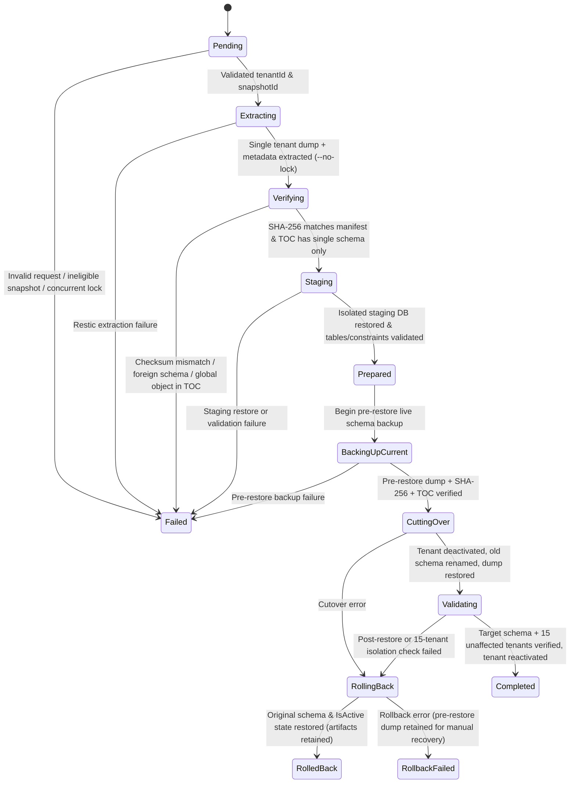

# ACYA — Phase 11C.1.8: Individual Tenant Restore Engine Report

**Date:** `2026-11-07`  
**Phase:** `11C.1.8` — Individual Tenant Restore Engine Implementation & Automated Verification  
**Host Restore Engine:** [`/opt/acya-backup/lib/acya_backup/restore.py`](file:///opt/acya-backup/lib/acya_backup/restore.py) & [`/opt/acya-backup/bin/acya-tenant-restore`](file:///opt/acya-backup/bin/acya-tenant-restore) ([scripts/backup-runner/lib/acya_backup/restore.py](file:///home/ubuntu/acya-app/scripts/backup-runner/lib/acya_backup/restore.py), [scripts/backup-runner/bin/acya-tenant-restore](file:///home/ubuntu/acya-app/scripts/backup-runner/bin/acya-tenant-restore))  
**Backoffice Restore Service:** [`TenantRestoreEngine.cs`](file:///home/ubuntu/acya-app/bo-acya-app/admin-elance-back/src/ms.admin.api.acya/Services/TenantRestoreEngine.cs)  
**Safety Status:** **VERIFIED SAFE** — Engine implemented and verified exclusively against mocks and disposable databases; zero production restorations executed, zero backups triggered, zero Restic writes, zero production PostgreSQL modifications, zero container restarts.

---

## 1. Executive Summary

Phase 11C.1.8 implements the **Individual Tenant Restore Engine**, enabling ACYA to safely restore a single tenant schema from an existing verified global Restic snapshot (`2071d164` or eligible historical snapshots) while guaranteeing zero impact on the other 15 tenants and preserving the single-repository, full-system snapshot invariant.

The restore engine is implemented across two coordinated layers:
1. **Host Execution Engine (`/opt/acya-backup/lib/acya_backup/restore.py` & `/opt/acya-backup/bin/acya-tenant-restore`):** Integrates directly with the Phase 11B/11C Backup Runner (`Config`, `TransferSession`, `ResticClient`, `Docker`, `PostgresInstance`) and the Phase 11C.1.7b catalog (`/opt/acya-backup/state/tenant-backup-history.json`).
2. **Backoffice Domain Service ([`TenantRestoreEngine.cs`](file:///home/ubuntu/acya-app/bo-acya-app/admin-elance-back/src/ms.admin.api.acya/Services/TenantRestoreEngine.cs)):** Provides the strongly-typed .NET 8 orchestration service, interfaces (`ITenantRestoreCatalogProvider`, `IResticSnapshotExtractor`, `ITenantDatabaseRestoreOperator`), concurrency lock, and `MasterAuditLogs` persistence inside `admin-elance-back`.

---

## 2. Architecture & Component Separation

Both the Python restore engine and the .NET 8 restore service enforce strict separation of responsibilities across nine isolated stages:

| Component | Responsibility | Security & Safety Invariants |
| :--- | :--- | :--- |
| **1. Restore Request Validation** (`RestoreRequestValidator` / `TenantRestoreValidator`) | Validates `tenant_id` (`int > 0`) and `snapshot_id` (`^[0-9a-f]{8,64}$`). Resolves `tenantSlug` and `schemaName` exclusively from `/opt/acya-backup/state/tenant-backup-history.json` cross-checked against `public.bo_tbl_enterprise`. | Never accepts a schema name or file path from a request. Rejects unavailable (`tenant_not_present_in_snapshot`), degraded (`snapshot_not_verified`), or ineligible (`snapshot_restore_ineligible`) snapshots before touching Restic or PostgreSQL. |
| **2. Snapshot Artifact Extraction** (`SnapshotArtifactExtractor` / `ResticSingleTenantExtractorAdapter`) | Uses read-only Restic (`--no-lock`) to list the snapshot tree and extract only `metadata/manifest.txt`, `metadata/tenant-registry.json`, `metadata/manifest.json` (when present), and `<staging_root>/tenants/tenant_<slug>.dump` into a mode-`0700` workspace (`/opt/acya-backup/restore-work/restore-<id>/`). | Strict regex path allowlist (`ALLOWED_DUMP_PATH_RE`); extracted files written with mode `0600`; Restic credentials never leave `TransferSession`. |
| **3. Checksum & TOC Verification** (`ArtifactChecksumVerifier` / `validate_archive_toc_single_schema`) | Verifies extracted dump byte size and SHA-256 digest against both `manifest.txt` (`manifest.json`) and the catalog's `manifestSha256`. Inspects the custom-format archive TOC via `pg_restore -l`. | Rejects any archive containing global objects (`ROLE`, `DATABASE`, `TABLESPACE`, `EXTENSION`, `PUBLICATION`, `SUBSCRIPTION`) or any object belonging to a foreign schema (`!= target.schema_name`). |
| **4. Staging Database Validation** (`StagingDatabaseValidator`) | Creates an isolated temporary PostgreSQL database (`acya_restore_stage_<token>`), restores the custom-format dump (`pg_restore --no-owner --no-privileges --exit-on-error --schema=<schema>`), and validates tables, sequences, constraints, and row counts. | **Zero SQL text substitution** is ever used to remap schema names; the archive is restored natively into the isolated staging database first, transitioning to `Prepared` only after all checks pass. |
| **5. Pre-Restore Live Backup** (`PreRestoreBackupManager`) | Exports the live production `<schema_name>` via `pg_dump -Fc -Z 6 --schema=<schema_name>` to `pre_restore_<schema_name>.dump` (`0600`), computes and verifies its SHA-256 checksum (`.sha256`), and validates its `pg_restore -l` TOC. | If pre-restore backup creation or checksum verification fails, restoration aborts in `BackingUpCurrent -> Failed` before any production cutover occurs. |
| **6. Production Cutover** (`PostgresRestoreDatabaseBackend` / `ITenantDatabaseRestoreOperator`) | Sets `IsActive = false` in `public.bo_tbl_enterprise`, terminates active sessions referencing `<schema_name>`, renames `<schema_name>` to `<schema_name>__rb_<token>`, restores the verified dump into `<schema_name>`, and reapplies schema ownership (`OWNER TO <original_owner>`). | Target tenant remains inactive throughout `CuttingOver` and `Validating`. The original schema is preserved intact as `<schema_name>__rb_<token>` until post-restore validation completes. |
| **7. Post-Restore & Isolation Validation** (`_verify_unaffected_tenants_unchanged`) | Verifies that the restored production schema matches the staged schema's table count, constraint count, and owner, AND verifies that all **15 unaffected tenants** have identical schema OIDs, owners, table counts, sequence counts, constraint counts, table names, and live row counts. | Any mismatch in the target tenant or any of the 15 unaffected tenants immediately triggers automatic rollback (`Validating -> RollingBack`). |
| **8. Rollback Engine** (`_execute_rollback`) | On any failure during `CuttingOver` or `Validating`, drops the partial `<schema_name>` and atomically renames `<schema_name>__rb_<token>` back to `<schema_name>` (or restores from the verified `pre_restore_<schema_name>.dump`), restores the tenant's original `IsActive` state, and retains all recovery artifacts. | Transitions to `RolledBack` (or `RollbackFailed` if rollback itself encounters an error). **Never silently deletes recovery artifacts (`work_dir` or `pre_restore_*.dump`) on failure.** |
| **9. Concurrency Guard & Immutable Audit Trail** (`RestoreAuditLogger` / `MasterAuditLogs`) | Enforces an exclusive non-blocking lock (`/opt/acya-backup/locks/tenant-restore.lock` via `flock` and `SemaphoreSlim` in .NET) so concurrent restores are rejected. Logs every state transition to an append-only SHA-256 hash-chained JSONL log (`restore-audit.jsonl`) and `MasterAuditLogs`. | Prevents concurrent restore collisions and provides a tamper-evident audit trail with automatic secret redaction. |

---

## 3. Explicit State Machine



---

## 4. Created & Installed Files

| File Path | Installed Host Path (if applicable) | Purpose |
| :--- | :--- | :--- |
| [scripts/backup-runner/lib/acya_backup/restore.py](file:///home/ubuntu/acya-app/scripts/backup-runner/lib/acya_backup/restore.py) | [`/opt/acya-backup/lib/acya_backup/restore.py`](file:///opt/acya-backup/lib/acya_backup/restore.py) (`0640 root:root`) | Python individual tenant restore engine, validator, extractor, checksum/TOC verifier, staging validator, pre-restore backup manager, cutover/rollback coordinator, and SHA-256 hash-chained audit logger. |
| [scripts/backup-runner/bin/acya-tenant-restore](file:///home/ubuntu/acya-app/scripts/backup-runner/bin/acya-tenant-restore) | [`/opt/acya-backup/bin/acya-tenant-restore`](file:///opt/acya-backup/bin/acya-tenant-restore) (`0750 root:root`) | CLI entry point requiring explicit `--confirm-restore`, `--tenant-id`, and `--snapshot-id`. |
| [scripts/backup-runner/tests/test_tenant_restore.py](file:///home/ubuntu/acya-app/scripts/backup-runner/tests/test_tenant_restore.py) | [`/opt/acya-backup/tests/test_tenant_restore.py`](file:///opt/acya-backup/tests/test_tenant_restore.py) (`0640 root:root`) | 14-test Python automated suite covering all validation, extraction, checksum, TOC, staging, pre-backup, cutover, rollback, concurrency, and 15-tenant isolation scenarios. |
| [TenantRestoreEngine.cs](file:///home/ubuntu/acya-app/bo-acya-app/admin-elance-back/src/ms.admin.api.acya/Services/TenantRestoreEngine.cs) | *(Backoffice API source)* | .NET 8 `TenantRestoreEngine`, `TenantRestoreValidator`, `FileTenantRestoreCatalogProvider`, state machine, concurrency guard, and `MasterAuditLogs` integration. |
| [TenantRestoreEngineTests.cs](file:///home/ubuntu/acya-app/bo-acya-app/admin-elance-back/tests/ms.admin.api.acya.tests/TenantRestoreEngineTests.cs) | *(Backoffice test project)* | 19 xUnit test executions (including parameterized `[Theory]` cases) verifying all restore engine states and failure/rollback paths in `admin-elance-back`. |

---

## 5. Automated Test Results

### 5.1 Python Restore Engine Test Suite (`test_tenant_restore.py`)

```text
test_01_invalid_tenant_ids_rejected ... ok
test_02_invalid_snapshot_ids_rejected ... ok
test_03_missing_tenant_artifacts_in_historical_snapshot_rejected ... ok
test_04_degraded_snapshot_rejected ... ok
test_05_checksum_mismatch_and_forbidden_global_toc_rejected ... ok
test_06_extraction_failure_handled_safely ... ok
test_07_staging_restore_failure_aborts_before_touching_production ... ok
test_08_pre_restore_backup_failure_aborts_before_cutover ... ok
test_09_cutover_failure_triggers_automatic_rollback_and_retains_artifacts ... ok
test_10_post_restore_validation_failure_triggers_rollback ... ok
test_11_rollback_failure_enters_rollback_failed_and_preserves_pre_restore_backup ... ok
test_12_concurrent_restore_prevention ... ok
test_13_successful_single_tenant_restore_and_15_tenant_isolation ... ok
test_14_unaffected_tenant_modification_detected_and_triggers_rollback ... ok

----------------------------------------------------------------------
Ran 14 tests in 0.051s

OK
```

### 5.2 Backoffice .NET 8 xUnit Test Suite (`ms.admin.api.acya.tests`)

All **188** xUnit tests in `ms.admin.api.acya.tests` (including all 19 test executions in [`TenantRestoreEngineTests.cs`](file:///home/ubuntu/acya-app/bo-acya-app/admin-elance-back/tests/ms.admin.api.acya.tests/TenantRestoreEngineTests.cs)) passed with 0 failures:

```text
Passed!  - Failed:     0, Passed:   188, Skipped:     0, Total:   188, Duration: 1 s - ms.admin.api.acya.tests.dll (net8.0)
```

---

## 6. Verification Plan & Security Audit Summary

### Automated Security & Design Verification
- **Input & Identifier Validation:** `tenant_id` is strictly validated as a positive integer (`> 0`); `snapshot_id` is validated against `^[0-9a-f]{8,64}$`. Schema names are never accepted from user input and are resolved exclusively from `/opt/acya-backup/state/tenant-backup-history.json` + `public.bo_tbl_enterprise`, then validated against `^tenant_[a-z0-9_]{1,57}$` and `SchemaSanitizer.IsValidIdentifier`.
- **Command & SQL Injection Prevention:** All external commands (`restic`, `pg_dump`, `pg_restore`, `psql`) execute as argument arrays (`subprocess.run(argv, check=False)`) with `shell=False`. No SQL text substitution is used to remap schema names.
- **Global Object & Cross-Tenant Protection:** `validate_archive_toc_single_schema` inspects `pg_restore -l` before any database restore occurs and rejects archives containing `ROLE`, `DATABASE`, `TABLESPACE`, `EXTENSION`, `PUBLICATION`, `SUBSCRIPTION`, or any schema other than the target tenant schema.
- **Secret Protection:** Restic passwords and SSH keys remain confined to `TransferSession` (`0600` files under `/etc/acya-backup/`); all log and audit outputs pass through `redact()`.

---

## 7. Operational Safety Confirmation

- **No Restoration Executed Against Production:** Confirmed.
- **No Backups Triggered:** Confirmed.
- **No Restic Write Operations Executed:** Confirmed.
- **Systemd Timer (`acya-backup-runner.timer`):** Remains `disabled` and `inactive`.
- **`repositoryWritesAuthorized` in `/opt/acya-backup/config/backup.json`:** Remains `false`.
- **Production Containers:** Untouched (no builds, restarts, or redeployments).
- **Git Status:** Uncommitted and unpushed per instructions.
