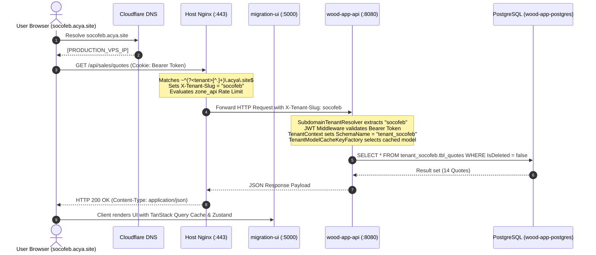
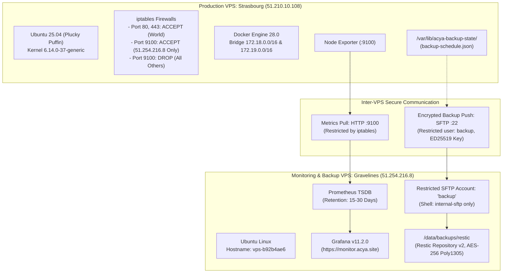
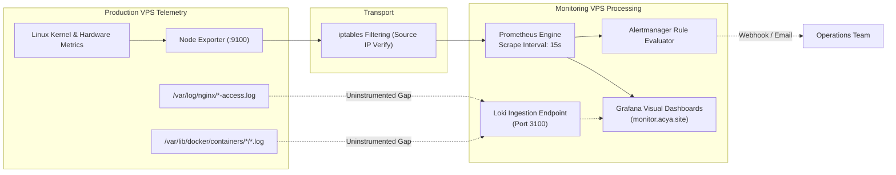
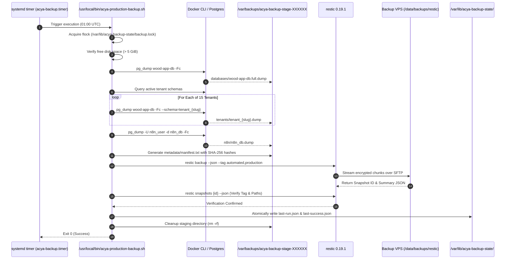
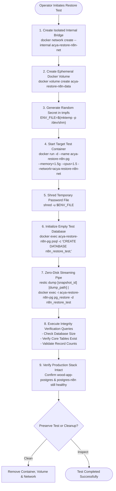
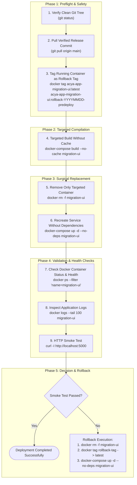

# ACYA — Élancé ERP: Architecture & Data Flows

> **Document Classification:** Engineering Architecture Specification  
> **Status:** Active Reference Implementation  
> **Target Audience:** System Architects, DevOps Engineers, Full-Stack Developers  
> **Scope:** Component Topology, Data Lifecycles, Network Paths, and Interactive Flows  
> **Verification Date:** October 16, 2026  

---

## 1. Complete ACYA Platform Architecture

The ACYA platform consists of a distributed architecture operating across two dedicated cloud instances: the **Production VPS** (`vps-1d2bffb5` in Strasbourg SBG) and the **Monitoring/Backup VPS** (`vps-b92b4ae6` in Gravelines GRA).

```mermaid
graph TB
    subgraph Clients & External Services
        UserBrowser["End Users (Clients / Artisans / Sales)"]
        SuperAdmin["SuperAdmin Platform Operator"]
        MobileApp["Élancé Mobile App (Flutter)"]
        MetaAPI["Meta WhatsApp Business API"]
        MailgunAPI["Mailgun Transactional Email"]
    end

    subgraph "Production VPS: Host Network (Strasbourg SBG)"
        NginxIngress["Nginx 1.28.3 Ingress Controller\n(Ports 80 & 443)\nWildcard SSL: *.acya.site"]
        NodeExp["Prometheus Node Exporter\n(Port 9100 - Restricted to Monitoring VPS)"]
        BackupCron["systemd Backup Timers & Scripts\n(/usr/local/bin/acya-production-backup.sh)"]
    end

    subgraph "Docker Network: acya-app_wood-app-network (172.18.0.0/16)"
        ERPFront["migration-ui (Next.js 16.2 / React 19.2)\nPort 3000 -> Host 5000"]
        AdminFront["admin-elance-front (Next.js 16.2 / React 19.2)\nPort 3000 -> Host 5002"]
        CoreAPI["wood-app-api (ASP.NET Core .NET 7)\nPort 80 -> Host 8080"]
        AdminAPI["admin-elance-back (ASP.NET Core .NET 8)\nPort 80 -> Host 8082"]
        MasterPG["wood-app-postgres (PostgreSQL 15-alpine)\nPort 5432 (Internal Only)\nDB: wood-app-db / app-db-bo"]
        N8NApp["n8n Automation Platform\nPort 5678 -> Host 127.0.0.1:5678"]
    end

    subgraph "Docker Network: acya_n8n_network (172.19.0.0/16)"
        N8NPG["postgres-n8n (PostgreSQL 15-alpine)\nPort 5432 (Internal Only)\nDB: n8n_db"]
    end

    subgraph "Monitoring & Backup VPS (Gravelines GRA)"
        MonitorNginx["Nginx Reverse Proxy\n(monitor.acya.site)"]
        GrafanaUI["Grafana Dashboards (v11.2.0)"]
        PrometheusServer["Prometheus Metric Collector"]
        LokiEngine["Loki Log Aggregator"]
        AlertManagerApp["Alertmanager Notification Service"]
        ResticRepository["Encrypted Restic SFTP Repository\n(/data/backups/restic)"]
    end

    UserBrowser -->|HTTPS *.acya.site| NginxIngress
    MobileApp -->|HTTPS /api/| NginxIngress
    SuperAdmin -->|HTTPS admin.acya.site| NginxIngress
    MetaAPI -->|Inbound Webhook| NginxIngress
    MailgunAPI -->|Inbound Webhook| NginxIngress

    NginxIngress -->|Proxy Pass :5000| ERPFront
    NginxIngress -->|Proxy Pass :5002| AdminFront
    NginxIngress -->|Proxy Pass :8080 (X-Tenant-Slug)| CoreAPI
    NginxIngress -->|Proxy Pass :8082| AdminAPI
    NginxIngress -->|Proxy Pass 127.0.0.1:5678| N8NApp

    CoreAPI -->|TCP 5432 (Multi-Tenant Schemas)| MasterPG
    AdminAPI -->|TCP 5432 (Master Public Schema)| MasterPG
    CoreAPI -->|Internal HTTP :5678| N8NApp
    AdminAPI -->|Internal HTTP :5678| N8NApp
    N8NApp -->|TCP 5432| N8NPG

    BackupCron -->|SFTP / Key Auth| ResticRepository
    PrometheusServer -->|TCP 9100 / Scrape| NodeExp
    GrafanaUI -->|Queries| PrometheusServer
```

### Architecture Narrative `[VERIFIED]`
1. **Multi-Domain Segmentation:** External users access the platform through distinct DNS hostnames:
   - `acya.site` / `www.acya.site`: Public marketing and sales showcase.
   - `{slug}.acya.site`: Tenant-isolated ERP workspaces (e.g., `socofeb.acya.site`).
   - `admin.acya.site`: SuperAdmin control plane.
   - `n8n.acya.site`: Internal webhook receiver and automation designer.
   - `monitor.acya.site`: Operational dashboards (hosted on the secondary VPS).
2. **Network Segregation:**
   - The master database (`wood-app-postgres`) is attached to `acya-app_wood-app-network` with **zero published host ports** `[VERIFIED]`. It cannot be probed from the internet.
   - The automation database (`postgres-n8n`) is attached strictly to `acya_n8n_network`. Application APIs and web clients have no routing capability to it.
   - `n8n` bridges both networks, allowing business APIs to dispatch webhook events internally without exposing n8n's database.

---

## 2. Docker Compose Service & Dependency Topology

```mermaid
graph TD
    subgraph Docker Engine 28.x (Host Level)
        subgraph "wood-app-network (Bridge 172.18.0.0/16)"
            direction TB
            PG["wood-app-postgres\n(postgres:15-alpine)\nHealthcheck: pg_isready"]
            API["wood-app-api\n(acya-app-api:latest)\nHealthcheck: Port 80"]
            AdminBack["admin-elance-back\n(acya-app-admin-api:latest)"]
            MigrationUI["migration-ui\n(acya-app-migration-ui:latest)"]
            AdminFront["admin-elance-front\n(acya-app-admin-ui:latest)"]
            N8N["n8n\n(docker.n8n.io/n8nio/n8n:latest)"]
        end

        subgraph "acya_n8n_network (Bridge 172.19.0.0/16)"
            PGN8N["postgres-n8n\n(postgres:15-alpine)\nHealthcheck: pg_isready"]
        end
    end

    PG -->|Healthy: Start Dependency| API
    PG -->|Healthy: Start Dependency| AdminBack
    API -->|Start Dependency| MigrationUI
    AdminBack -->|Start Dependency| AdminFront
    PGN8N -->|Healthy: Start Dependency| N8N
    N8N -.->|Multi-homed Network Member| API
    N8N -.->|Multi-homed Network Member| AdminBack
```

### Dependency Mechanics `[VERIFIED]`
- **Healthcheck-Driven Initialization:** In `docker-compose.yml`, both `api` and `admin-api` declare `depends_on: postgres: condition: service_healthy`. Docker holds back the start of the .NET Web APIs until PostgreSQL answers `pg_isready -U postgres -d wood-app-db` with success.
- **Frontend Upstream Sequencing:** `migration-ui` depends on `api`, while `admin-ui` depends on `admin-api`.
- **n8n Isolation Stack:** In `docker-compose.n8n.yml`, `n8n` requires `postgres-n8n: condition: service_healthy`.

---

## 3. End-to-End Request Lifecycle

This sequence demonstrates how a tenant user request traverses the network, resolves tenant context, executes database transactions, and returns hydrated UI state.



---

## 4. Production VPS & Monitoring VPS Network Topology



### Trust Boundary Analysis `[VERIFIED]`
1. **Public Surface:**
   - Production VPS exposes **80 (HTTP)**, **443 (HTTPS)**, and SSH **22** to the internet.
   - Ports **5000**, **5002**, **8080**, **8082** are published to `0.0.0.0` by Docker `[VERIFIED]` — *Security Remediation Required*.
2. **Prometheus Scrape Surface:**
   - Port 9100 on `51.210.10.108` is strictly guarded by kernel iptables. Only packets matching source `51.254.216.8` are accepted `[VERIFIED]`.
3. **Backup Transfer Surface:**
   - Production connects out to `51.254.216.8` via SSH/SFTP using a 256-bit Ed25519 private key (`/etc/acya-backup/acya_backup_ed25519`).
   - The receiving account `backup` on the monitoring VPS has no interactive shell privileges (`This service allows sftp connections only.`) `[VERIFIED]`.

---

## 5. Monitoring, Telemetry & Log Ingestion Pipeline



### Current Observability Capabilities & Identified Gaps `[VERIFIED]`
- **Host Infrastructure Metrics:** CPU utilization, memory pressure, disk I/O, network throughput, and filesystem capacity are reliably scraped by Prometheus from Node Exporter `[VERIFIED]`.
- **Application Level Telemetry:** Neither `wood-app-api` nor `admin-elance-back` expose a `/metrics` Prometheus endpoint `[VERIFIED]`. Application error rates and request durations are only visible through Nginx access logs.
- **Log Centralization:** While Loki exists on the monitoring host, production Docker container logs are stored only locally in Docker's `json-file` format. Container logs are not shipped offsite `[UNKNOWN / GAP]`.

---

## 6. Backup & Restic Snapshot Lifecycle



---

## 7. Isolated Database Restoration Workflow

The restoration procedure is strictly non-destructive. It validates backup integrity in RAM and ephemeral containers without touching live services `[VERIFIED]`.



---

## 8. Safe Deployment & Rollback Lifecycle

This diagram illustrates the mandatory zero-downtime, targeted deployment runbook enforced on the ACYA platform `[VERIFIED]`.



### Why Indiscriminate Commands Are Strictly Forbidden `[VERIFIED]`
- **`docker-compose down`:** Drops all 6 running services simultaneously, causing catastrophic platform downtime.
- **`docker-compose down -v`:** **DESTRUCTIVE:** Deletes the named volumes `postgres_n8n` and `n8n_data`, permanently wiping automation history and credentials.
- **`docker-compose up -d --remove-orphans`:** **DESTRUCTIVE:** Docker Compose flags `postgres-n8n` and `n8n` as "orphans" when run from the root directory because they belong to `docker-compose.n8n.yml`. This command would terminate active n8n automation!
- **`docker system prune -a --volumes`:** **DESTRUCTIVE:** Wipes pre-compiled rollback images and unattached Docker volumes.
