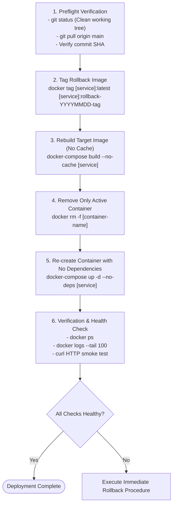

# ACYA — Élancé ERP: Deployment & Operations Runbook

> **Document Classification:** Standard Operating Procedure (SOP)  
> **Status:** Active Production Runbook  
> **Target Audience:** DevOps Engineers, Platform Administrators, On-Call Operators  
> **Enforcement:** Mandatory for all staging and production deployments  
> **Verification Date:** October 16, 2026  

---

## 1. Golden Rules of Production Deployment

All operations on the ACYA production platform must adhere to three non-negotiable principles `[VERIFIED]`:

1. **Targeted Replacement Only:** Never restart or rebuild the entire stack when updating a single component. Only touch the container that changed.
2. **Preserve Rollback State First:** Always tag the active, verified Docker image with a descriptive rollback tag *before* triggering a rebuild.
3. **Never Drop or Down Services:** Commands that stop all containers or purge volumes are strictly forbidden on production servers.

---

## 2. 🚫 Strictly Forbidden Production Commands

The following commands are **strictly prohibited** on the production VPS:

| Forbidden Command | Destruction / Failure Mechanism | Severity |
| :--- | :--- | :--- |
| `docker compose down` | Halts all production services simultaneously, causing immediate, complete downtime. | **CRITICAL** |
| `docker compose down -v` | **DESTRUCTIVE:** Deletes Docker volumes (`postgres_n8n`, `n8n_data`, etc.), permanently erasing data. | **CATASTROPHIC** |
| `docker compose up -d --remove-orphans` | **DESTRUCTIVE:** Kills `postgres-n8n` and `n8n` because Compose considers them orphans from root `docker-compose.yml`. | **CRITICAL** |
| `docker system prune -a` | Erases all cached images and pre-compiled rollback images across all services. | **HIGH** |
| `docker volume prune` | Prompts deletion of unattached database volumes, risking loss of restoration test data. | **CRITICAL** |

---

## 3. Safe Targeted Deployment Workflow

Follow this standardized procedure for deploying any service update.



---

## 4. Component-Specific Deployment Procedures

### 4.1 Frontend Client Deployment (`migration-ui`) `[TESTED]`

```bash
# 1. Navigate to project root
cd /home/ubuntu/acya-app

# 2. Verify git working tree
git status
git log -n 1 --oneline

# 3. Preserve active image as rollback tag
TIMESTAMP=$(date +%Y%m%d_%H%M%S)
sudo docker tag acya-app-migration-ui:latest acya-app-migration-ui:rollback-${TIMESTAMP}

# 4. Compile fresh Next.js production image without cache
sudo docker-compose build --no-cache migration-ui

# 5. Remove only the old UI container
sudo docker rm -f migration-ui 2>/dev/null || true

# 6. Re-create the UI container without touching other services
sudo docker-compose up -d --no-deps migration-ui

# 7. Verify container status and logs
sudo docker ps --filter "name=migration-ui"
sudo docker logs --tail 50 migration-ui

# 8. Smoke test HTTP endpoint
curl -I http://localhost:5000
```

---

### 4.2 Core Business API Deployment (`wood-app-api`) `[TESTED]`

```bash
# 1. Navigate to project root
cd /home/ubuntu/acya-app

# 2. Preserve active image as rollback tag
TIMESTAMP=$(date +%Y%m%d_%H%M%S)
sudo docker tag acya-app-api:latest acya-app-api:rollback-${TIMESTAMP}

# 3. Build .NET Core API image without cache
sudo docker-compose build --no-cache api

# 4. Remove only the old API container
sudo docker rm -f wood-app-api 2>/dev/null || true

# 5. Launch new container with no dependency cascading
sudo docker-compose up -d --no-deps api

# 6. Verify Docker health status (wait 10 seconds for healthcheck)
sleep 10
sudo docker inspect wood-app-api --format 'Status={{.State.Status}} Health={{if .State.Health}}{{.State.Health.Status}}{{else}}none{{end}}'

# 7. Inspect recent logs
sudo docker logs --tail 50 wood-app-api

# 8. Test HTTP endpoint on host port 8080
curl -I http://localhost:8080
```

---

### 4.3 SuperAdmin Suite Deployment (`admin-api` & `admin-ui`) `[TESTED]`

```bash
# --- Admin Backend API ---
sudo docker tag acya-app-admin-api:latest acya-app-admin-api:rollback-$(date +%Y%m%d_%H%M%S)
sudo docker-compose build --no-cache admin-api
sudo docker rm -f admin-elance-back 2>/dev/null || true
sudo docker-compose up -d --no-deps admin-api
curl -I http://localhost:8082

# --- Admin Frontend Portal ---
sudo docker tag acya-app-admin-ui:latest acya-app-admin-ui:rollback-$(date +%Y%m%d_%H%M%S)
sudo docker-compose build --no-cache admin-ui
sudo docker rm -f admin-elance-front 2>/dev/null || true
sudo docker-compose up -d --no-deps admin-ui
curl -I http://localhost:5002
```

---

### 4.4 n8n Automation Engine Deployment `[TESTED]`

```bash
# 1. Navigate to project root
cd /home/ubuntu/acya-app

# 2. Pull latest approved n8n image
sudo docker-compose -f docker-compose.n8n.yml pull n8n

# 3. Recreate n8n container cleanly without touching database
sudo docker-compose -f docker-compose.n8n.yml up -d --no-deps n8n

# 4. Verify logs
sudo docker logs --tail 50 n8n

# 5. Verify local listening port
curl -I http://127.0.0.1:5678
```

---

## 5. Emergency Rollback Playbook

If a deployment fails smoke testing or throws runtime errors, execute immediate rollback:

### Rollback Example: Reverting `migration-ui` `[TESTED]`
```bash
# 1. Identify available rollback tags
sudo docker images acya-app-migration-ui

# 2. Retag desired rollback image to latest
sudo docker tag acya-app-migration-ui:rollback-20261016-pre-branding-fix acya-app-migration-ui:latest

# 3. Remove failing container
sudo docker rm -f migration-ui

# 4. Start service with rollback image
sudo docker-compose up -d --no-deps migration-ui

# 5. Verify restored state
curl -I http://localhost:5000
```

---

## 6. Database Migration Protocol & Guardrails

### 6.1 Authorized Execution Policy `[VERIFIED]`
- **Authority:** Database migrations may only be executed by authorized senior platform operators.
- **Timing:** Multi-tenant migrations must be scheduled during low-traffic windows (recommended: 20:00–22:00 UTC).
- **Mandatory Pre-Migration Snapshot:** A full Restic snapshot must be completed and verified before running any schema migration:
  ```bash
  sudo /usr/local/bin/acya-production-backup.sh
  cat /var/lib/acya-backup-state/last-run.json | grep '"outcome": "success"'
  ```

### 6.2 Multi-Tenant Migration Execution `[VERIFIED]`
When applying a new SQL migration (e.g., `wood-app.api/db/wood/v0.40/01_new_feature.sql`):
```bash
# 1. Inspect SQL script for multi-tenant cursor loop
cat wood-app.api/db/wood/v0.40/01_new_feature.sql | grep -E "information_schema.schemata|tenant_%"

# 2. Execute script via master postgres container
sudo docker exec -i wood-app-postgres psql -U postgres -d wood-app-db < wood-app.api/db/wood/v0.40/01_new_feature.sql

# 3. Verify changes across tenant schemas
sudo docker exec wood-app-postgres psql -U postgres -d wood-app-db -c "
  SELECT table_schema, table_name 
  FROM information_schema.tables 
  WHERE table_name = 'your_new_table' AND table_schema LIKE 'tenant_%';
"

# 4. Update Baseline Migration Script
# Crucial: Synchronize wood-app.api/db/FullDb_Migration/full_migration.sql so newly provisioned tenants receive the update!
```

---

## 7. Host Maintenance & Docker Housekeeping

### 7.1 Safe Docker Pruning `[VERIFIED]`
Do not run aggressive prunes. Use only conservative, targeted commands:
```bash
# Remove dangling build cache without deleting named images
sudo docker builder prune -f

# Remove untagged dangling images only (leaves rollback tags intact)
sudo docker image prune -f

# Check reclaimed disk space
df -h /
```

### 7.2 Nginx Configuration Testing & Reload `[VERIFIED]`
Always validate Nginx configuration syntax prior to reloading:
```bash
# 1. Test configuration syntax
sudo nginx -t

# 2. Graceful reload (zero dropped connections)
sudo systemctl reload nginx

# 3. Check status
sudo systemctl status nginx --no-pager
```

### 7.3 SSL Certificate Maintenance `[VERIFIED]`
Certbot manages certificates automatically via cron. To test renewal in dry-run mode:
```bash
sudo certbot renew --dry-run
```
Certificates are stored at `/etc/letsencrypt/live/acya.site/`.
