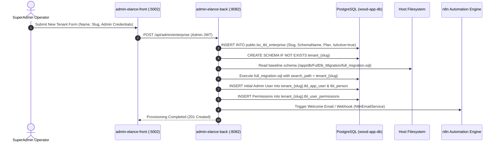
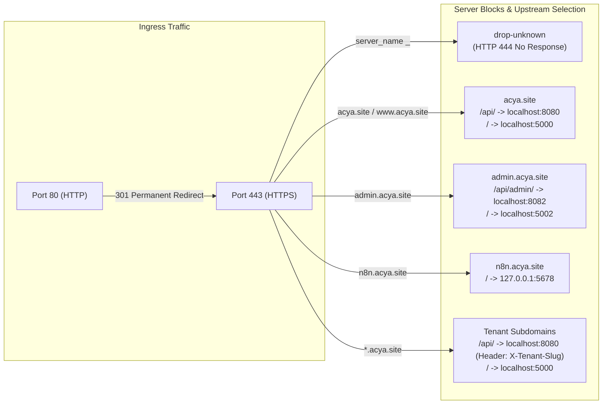

# ACYA — Élancé ERP: Comprehensive Infrastructure Master Dossier

> **Document Status:** Active Technical Dossier  
> **Platform Version:** ACYA Élancé ERP 2026 / Schema Migration v0.39  
> **Target Audience:** Infrastructure Engineers, Platform Administrators, Core Developers, Technical Support Leads  
> **Classification:** Internal Technical Reference — Confidential  
> **Audit & Verification Date:** October 16, 2026  
> **Investigation Mode:** Strict Read-Only Verification  

---

## 1. Executive Summary & Platform Mission

**ACYA Élancé** is a specialized, multi-tenant Enterprise Resource Planning (ERP) platform architected primarily for timber, lumber, construction materials, and manufacturing enterprises. It delivers complete operational tracking across sales, purchasing, inventory management with wood-dimensional metrics ($m^3$, packages, boards, lineal meters), treasury/cash-flow, human resources/payroll, construction projects (*chantiers*), and production workshop workflows.

The system is deployed across a dual-server infrastructure hosted in France:
1. **Production VPS (`vps-1d2bffb5`):** Located in OVHcloud Strasbourg (SBG), running Ubuntu 25.04. Hosts the core containerized application stack (frontend UI, administration portal, main .NET business API, administration .NET API, primary PostgreSQL database, and n8n automation engine) reverse-proxied behind a host-level Nginx server with automated SSL termination.
2. **Monitoring & Backup VPS (`vps-b92b4ae6`):** Located in OVHcloud Gravelines (GRA), running Ubuntu. Hosts Grafana (v11.2.0), Prometheus telemetry collection, and the offsite encrypted Restic backup repository accessed via dedicated restricted SFTP.

This dossier provides a technically accurate, evidence-backed reference of the actual system implementation as inspected directly in runtime configuration, code, and storage states.

---

## 2. Evidence Taxonomy & Methodology

To ensure maximum fidelity and prevent assumptions from entering operational procedures, all technical facts and conclusions throughout this document are labeled with explicit evidence tags:

| Evidence Tag | Definition & Criteria |
| :--- | :--- |
| `[VERIFIED]` | Directly inspected and confirmed from running configurations, active systemd units, live Docker states, database records, network sockets, or source code. |
| `[HISTORICAL]` | Documented in git history, previous audit logs, or project notes, but not observed actively executing in the current session. |
| `[INFERRED]` | Plausible architectural interpretation derived from structural patterns and indirect indicators, pending direct instrumentation. |
| `[UNKNOWN]` | Insufficient evidence or uninspected state; explicitly identified as an operational gap requiring future audit. |

All sensitive identifiers (passwords, JWT keys, webhook secrets, connection strings) have been replaced with standardized placeholders (e.g., `[SECRET_VARIABLE]`, `[PRODUCTION_VPS_IP]`, `[MONITORING_VPS_IP]`).

---

## 3. Platform Topology & Monorepo Structure

```mermaid
graph TD
    subgraph Public Internet
        ClientBrowser["Client Browser / Mobile App"]
        AdminBrowser["SuperAdmin Browser"]
        MetaWebhook["Meta WhatsApp Webhook"]
        MailgunWebhook["Mailgun Inbound Webhook"]
    end

    subgraph Host Network & Nginx Reverse Proxy (Production VPS)
        Nginx["Host Nginx 1.28.3\nTLS Termination (*.acya.site)\nRate Limiting & Subdomain Parsing"]
    end

    subgraph Docker Bridge: acya-app_wood-app-network (172.18.0.0/16)
        MigrationUI["migration-ui (Next.js 16)\nPort 3000 -> Host:5000"]
        AdminUI["admin-elance-front (Next.js 16)\nPort 3000 -> Host:5002"]
        CoreAPI["wood-app-api (.NET 7)\nPort 80 -> Host:8080"]
        AdminAPI["admin-elance-back (.NET 8)\nPort 80 -> Host:8082"]
        MainPostgres["wood-app-postgres (Postgres 15)\nPort 5432 (Internal Only)"]
        N8NApp["n8n Automation Engine\nPort 5678 -> 127.0.0.1:5678"]
    end

    subgraph Docker Bridge: acya_n8n_network (172.19.0.0/16)
        N8NPostgres["postgres-n8n (Postgres 15)\nPort 5432 (Internal Only)"]
    end

    subgraph Monitoring & Backup VPS (Gravelines)
        MonitorNginx["Nginx Reverse Proxy\n(monitor.acya.site)"]
        Grafana["Grafana v11.2.0"]
        Prometheus["Prometheus Server"]
        ResticRepo["Restic Repository v2\n(/data/backups/restic)"]
    end

    ClientBrowser -->|HTTPS| Nginx
    AdminBrowser -->|HTTPS| Nginx
    MetaWebhook -->|HTTPS| Nginx
    MailgunWebhook -->|HTTPS| Nginx

    Nginx -->|Proxy Pass 127.0.0.1:5000| MigrationUI
    Nginx -->|Proxy Pass 127.0.0.1:5002| AdminUI
    Nginx -->|Proxy Pass 127.0.0.1:8080| CoreAPI
    Nginx -->|Proxy Pass 127.0.0.1:8082| AdminAPI
    Nginx -->|Proxy Pass 127.0.0.1:5678| N8NApp

    CoreAPI -->|TCP 5432| MainPostgres
    AdminAPI -->|TCP 5432| MainPostgres
    CoreAPI -->|HTTP 5678| N8NApp
    AdminAPI -->|HTTP 5678| N8NApp

    N8NApp -->|TCP 5432| N8NPostgres

    Prometheus -->|TCP 9100 / Scrape| Nginx
    CoreAPI -.->|SFTP / Restic Backup| ResticRepo
```

### Monorepo Structure `[VERIFIED]`
The project is maintained in a monorepo located at `/home/ubuntu/acya-app`:
- `elance-app.ui/`: Main multi-tenant frontend client (Next.js 16, React 19, Tailwind CSS 4).
- `wood-app.api/`: Core business API (ASP.NET Core Web API, .NET 7, EF Core 7).
- `bo-acya-app/admin-elance-back/`: SaaS control plane and provisioning backend (.NET 8).
- `bo-acya-app/admin-elance-front/`: SuperAdmin administrative portal (Next.js 16, React 19).
- `docker-compose.yml`: Core application and master database stack.
- `docker-compose.n8n.yml`: Dedicated, isolated n8n automation stack.
- `scripts/`: Operational utilities, migration scripts, and automation tools.
- `backups/`: Local database dump staging and workflow backups.
- `storage/`: Persistent host-mounted storage (e.g., mobile builds, private APK artifacts).

---

## 4. Multi-Tenancy Architecture & Schema Isolation

ACYA Élancé implements a **Schema-per-Tenant** architecture on PostgreSQL `[VERIFIED]`. Rather than maintaining separate database instances or relying on row-level tenancy filters, each onboarded business is allocated an isolated PostgreSQL schema within the primary `wood-app-db` database.

### 4.1 Master Registry (`public.bo_tbl_enterprise`) `[VERIFIED]`
The master registry resides in the `public` schema of `wood-app-db`. It holds tenant configuration, domain routing data, and status metadata:
```sql
CREATE TABLE public.bo_tbl_enterprise (
    "Id" BIGSERIAL PRIMARY KEY,
    "Slug" VARCHAR(100) UNIQUE NOT NULL,
    "Name" VARCHAR(255) NOT NULL,
    "Email" VARCHAR(255),
    "Phone" VARCHAR(50),
    "SchemaName" VARCHAR(100) UNIQUE NOT NULL,
    "ConnectionString" TEXT NOT NULL,
    "IsActive" BOOLEAN DEFAULT FALSE,
    "Status" VARCHAR(50) DEFAULT 'Trial',
    "Plan" VARCHAR(50) DEFAULT 'Trial',
    "CreatedAt" TIMESTAMPTZ DEFAULT NOW(),
    "ActivatedAt" TIMESTAMPTZ
);
```

### 4.2 Active Registered Tenants `[VERIFIED]`
Inspection of `public.bo_tbl_enterprise` revealed 15 registered tenants:
1. `socofeb` (`tenant_socofeb`) — Status: **Active** | Plan: **Pro**
2. `socobois` (`tenant_socobois`) — Status: **Trial** (Active: true)
3. `tucobois` (`tenant_tucobois`) — Status: **Trial** (Active: true)
4. `mansour-construction` (`tenant_mansour_construction`) — Status: **Trial** (Active: true)
5. `ttv` (`tenant_ttv`) — Status: **Trial** (Active: true)
6. `rs-auto-service` (`tenant_rs_auto_service`) — Status: **Trial** (Active: true)
7. `zaiemtex` (`tenant_zaiemtex`) — Status: **Trial** (Active: true)
8. `inky-pinky` (`tenant_inky_pinky`) — Status: **Trial** (Active: true)
9. `oxylab` (`tenant_oxylab`) — Status: **Trial** (Active: true)
10. `piqbit` (`tenant_piqbit`) — Status: **Suspended** (Active: false)
11. `wellness-medical` (`tenant_wellness_medical`) — Status: **Suspended** (Active: false)
12. `stramica` (`tenant_stramica`) — Status: **Suspended** (Active: false)
13. `fleur-de-printemps` (`tenant_fleur_de_printemps`) — Status: **Expired** (Active: false)
14. `oise-btp` (`tenant_oise_btp`) — Status: **Expired** (Active: false)
15. `sheg` (`tenant_sheg`) — Status: **Expired** (Active: false)

All 15 corresponding schemas (`tenant_*`) were confirmed present and verified in PostgreSQL `information_schema.schemata` `[VERIFIED]`.

### 4.3 Tenant Resolution Lifecycle `[VERIFIED]`
Tenant routing operates across three cooperative architectural tiers:
1. **Nginx Reverse Proxy Tier:**
   Nginx captures incoming subdomains via regex: `server_name ~^(?<tenant>[^.]+)\.acya\.site$;`. Technical domains (`api`, `admin`, `n8n`, `preprod`, `mail`, `www`) are excluded. For matching tenant hosts, Nginx injects the HTTP request header:
   ```nginx
   proxy_set_header X-Tenant-Slug $tenant;
   ```
2. **Frontend Axios Interceptor Tier (`elance-app.ui/src/lib/axios.ts`):**
   In the browser, `getTenantSlug()` checks `window.location.hostname` (extracting the leftmost segment) or falls back to the URL query parameter `?tenant={slug}`. The interceptor automatically adds `X-Tenant-Slug: {slug}` to every outgoing API request.
3. **Backend Middleware Tier (`SubdomainTenantResolver.cs`):**
   The API resolves tenant identity using a strict precedence order:
   - Header `X-Tenant-Slug` (authoritative when forwarded by Nginx)
   - Subdomain parsed from `HttpContext.Request.Host`
   - Query string `tenant={slug}` (development/debugging fallback)
4. **Relational Model Isolation (`TenantModelCacheKeyFactory.cs`):**
   To prevent Entity Framework Core from querying the wrong schema due to cached relational query plans, EF Core's `IModelCacheKeyFactory` is overridden to include `(context.GetType(), woodContext.SchemaName, designTime)`. This forces EF Core to cache separate relational mappings per schema `[VERIFIED]`.

---

## 5. Frontend Client Architecture (`elance-app.ui`)

### 5.1 Technology Stack `[VERIFIED]`
- **Framework:** Next.js 16.2.4 (App Router)
- **Runtime:** Node.js 20 on Alpine Linux
- **UI & State:** React 19.2.4, Tailwind CSS 4, Base UI (`@base-ui/react` 1.4.1), Radix UI primitives, Framer Motion 12.38
- **Data & Forms:** TanStack React Query v5.100, Zustand v5.0, React Hook Form v7.74, Zod v4.4
- **Network Client:** Axios 1.15.2 with custom interceptors and SignalR 10.0

### 5.2 Routing & Rendering Architecture `[VERIFIED]`
The application differentiates between public marketing routes and authenticated tenant ERP routes:
- **Public Routes:** `/`, `/solutions`, `/contact`, `/privacy`, `/mentions-legales`, `/enterprise-registration`. These routes bypass tenant loading spinners to deliver full Server-Side Rendered (SSR) HTML for SEO performance and fast First Contentful Paint (FCP).
- **Tenant ERP Routes:** `/dashboard`, `/sales`, `/purchases`, `/inventory`, `/production`, `/chantiers`, `/team`, `/treasury`. Protected by `TenantProvider` and client-side authentication checks.

### 5.3 `TenantProvider` & Dynamic Branding Lifecycle `[VERIFIED]`
On tenant subdomains (e.g. `socofeb.acya.site`), `TenantProvider.tsx` executes the following initialization sequence:
1. Checks whether the current host is a tenant subdomain.
2. If on the main domain (`acya.site`), it loads default "Élancé" branding without network blocking.
3. If on a tenant subdomain, it issues `GET /api/Enterprise/config` with `X-Tenant-Slug`.
4. Applies company metadata: `name`, `logoUrl`, `faviconUrl`, `primaryColor`, `secondaryColor`, `language`, `currency`, and `status`.
5. **Lifecycle Routing:**
   - If status is `Suspended` or `Expired`, the router immediately pushes to `/suspended`.
   - If API returns `404 Not Found`, the router pushes to `/tenant-not-found`.

### 5.4 Feature Gating (`useTenantFeatures.ts`) `[VERIFIED]`
Tenants subscribe to modular packages. The custom hook `useTenantFeatures()` centrally gates UI navigation, table columns, and form capabilities by combining:
- Immediate claims from the decoded JWT (`useAuthStore`)
- Dynamic settings from `GET /api/Enterprise/getbyid/{id}` (`useEnterprise`)
- Feature flags:
  - `isManagingConstructions` (Construction / *Chantier* module)
  - `isManagingProduction` (Workshop Production & Labor Tracking module)
  - `isSalingWood` (Dimensional wood metrics: thickness, width, length, volume $m^3$)

### 5.5 Containerization & Build Configuration `[VERIFIED]`
- **Dockerfile:** Multi-stage build (`node:20-alpine AS builder` -> `node:20-alpine AS runner`).
- **Build Args:** `NEXT_PUBLIC_API_URL=https://acya.site/api/`.
- **Runtime Port:** Internal port 3000, mapped to host port 5000 in `docker-compose.yml`.
- **Startup Command:** `npm start` (Next.js production server).

---

## 6. SuperAdmin Control Plane (`bo-acya-app`)

The Backoffice suite is an administrative control plane decoupled from tenant business logic `[VERIFIED]`.

### 6.1 Admin Frontend (`admin-elance-front`) `[VERIFIED]`
- **Role:** Control center for SaaS operators at `https://admin.acya.site`.
- **Stack:** Next.js 16.2, React 19, Tailwind CSS 4, Zustand.
- **Port:** Internal port 3000, mapped to host port 5002.
- **Upstream Communication:**
  - Client-side calls route to `https://admin.acya.site/api/admin/` (proxied by Nginx to host port 8082).
  - Server-side calls use internal Docker DNS: `BACKEND_INTERNAL_URL=http://admin-api:80/api/`.

### 6.2 Admin Backend API (`admin-elance-back`) `[VERIFIED]`
- **Framework:** ASP.NET Core Web API on **.NET 8** (`net8.0`).
- **Port:** Internal port 80, mapped to host port 8082.
- **Authentication:** Dedicated admin JWT signed by `JWT_SECRET_ADMIN` (audience: `acya-bo-ui`, issuer: `acya-bo`). Completely isolated from client tenant tokens.
- **Database Scope:** Connects directly to `wood-app-db` strictly scoped to the `public` master schema.

### 6.3 Enterprise Provisioning Lifecycle `[VERIFIED]`
Tenant onboarding is orchestrated via `EnterpriseController.cs` and `ProvisioningController.cs`:


---

## 7. Core Backend API Architecture (`wood-app.api`)

### 7.1 Framework & Runtime `[VERIFIED]`
- **Framework:** ASP.NET Core Web API on **.NET 7** (`net7.0`).
- **Container Port:** Port 80, mapped to host port 8080.
- **Health Check:** Implements Docker health check: `pg_isready` check dependency on PostgreSQL container.
- **Domain Responsibilities:** Commercial workflows (Estimates, Quotes, Orders, Deliveries, Invoices), Inventory Management (Stock movements, Pack tracking, Wood calculations), HR/Payroll, Treasury, Production Labor tracking.

### 7.2 Database Access & Context Routing `[VERIFIED]`
- **ORM:** Entity Framework Core 7 + Dapper for optimized dimensional queries.
- **Contexts:**
  - `WoodAppContext`: Tenant-aware business database context. Dynamically prefixes schema name `tenant_{slug}` at runtime.
  - `AppContextConnection`: Secondary connection accessing `app-db-bo` for legacy backoffice tables.
  - `MasterConnection`: Direct connection to `wood-app-db` public schema for cross-tenant registration queries.

### 7.3 Schema Migration Mechanism `[VERIFIED]`
- **Baseline Migration:** Located at `wood-app.api/db/FullDb_Migration/full_migration.sql`. Provisions fresh schemas.
- **Incremental Migrations:** 40 versioned migration directories (`v0.00` through `v0.39`) in `wood-app.api/db/wood/`.
- **Idempotent Multi-Tenant Schema Loop:** Every incremental migration executes a dynamic schema cursor:
  ```sql
  DO $$
  DECLARE r RECORD;
  BEGIN
      FOR r IN (
          SELECT schema_name 
          FROM information_schema.schemata 
          WHERE schema_name LIKE 'tenant_%' OR schema_name = 'public'
      ) LOOP
          EXECUTE format('SET search_path TO %I, public;', r.schema_name);
          -- Idempotent DDL operations with IF NOT EXISTS
      END LOOP;
  END $$;
  ```

---

## 8. Docker Service Inventory & Network Topology

### 8.1 Active Production Containers `[VERIFIED]`

| Service Name | Container Name | Image | Internal Port | Host Port | Networks | Restart Policy | Health Status |
| :--- | :--- | :--- | :--- | :--- | :--- | :--- | :--- |
| `postgres` | `wood-app-postgres` | `postgres:15-alpine` | `5432` | *None* | `wood-app-network` | `unless-stopped` | Healthy (5s interval) |
| `api` | `wood-app-api` | `acya-app-api:latest` | `80` | `0.0.0.0:8080` | `wood-app-network` | `unless-stopped` | Healthy (Port 80) |
| `migration-ui`| `migration-ui` | `acya-app-migration-ui:latest`| `3000` | `0.0.0.0:5000` | `wood-app-network` | `unless-stopped` | None |
| `admin-api` | `admin-elance-back` | `acya-app-admin-api:latest` | `80` | `0.0.0.0:8082` | `wood-app-network` | `unless-stopped` | None |
| `admin-ui` | `admin-elance-front` | `acya-app-admin-ui:latest` | `3000` | `0.0.0.0:5002` | `wood-app-network` | `unless-stopped` | None |
| `postgres-n8n`| `postgres-n8n` | `postgres:15-alpine` | `5432` | *None* | `acya_n8n_network` | `unless-stopped` | Healthy (10s interval) |
| `n8n` | `n8n` | `docker.n8n.io/n8nio/n8n:latest` | `5678` | `127.0.0.1:5678`| `acya_n8n_network`, `wood-app-network` | `unless-stopped` | None |

### 8.2 Inactive / Test Containers Observed `[VERIFIED]`
- `acya-restore-n8n-pg`: Postgres 15 Alpine container on isolated `acya-restore-n8n-net` (no host ports). Created during the automated n8n database restoration test.
- `acya-restore-test-pg`: Postgres 15 Alpine container on isolated `acya-restore-net` (no host ports). Created during the main database restoration test.

### 8.3 Network Bridges `[VERIFIED]`
1. **`acya-app_wood-app-network` (`172.18.0.0/16`):** Primary application bridge. Bridges the ERP frontend, admin frontend, core API, admin API, master PostgreSQL, and n8n.
2. **`acya_n8n_network` (`172.19.0.0/16`):** Dedicated automation bridge. Connects `n8n` exclusively to its dedicated database `postgres-n8n`.
3. **Network Isolation Safeguard:** `postgres-n8n` is not joined to `acya-app_wood-app-network`. Web clients and ERP services have zero direct network route to n8n's internal database.

---

## 9. Host Infrastructure & VPS Architecture

### 9.1 Production VPS (`[PRODUCTION_VPS_IP]`) `[VERIFIED]`
- **Hosting Provider:** OVHcloud — Strasbourg (SBG), France
- **Hostname:** `vps-1d2bffb5`
- **Operating System:** Ubuntu 25.04 (Plucky Puffin), Linux Kernel 6.14.0-37-generic
- **Compute Resources:** 11 GiB RAM (4.6 GiB used, 6.8 GiB available), 100 GB NVMe/SSD (31 GB used, 66 GB free, 33% capacity)
- **Swap Memory:** **0 B** (No swap space configured) `[VERIFIED]` — *Operational Risk*
- **Local Services:** Docker Engine 28.x, Nginx 1.28.3, Prometheus Node Exporter, systemd automated backup timers.

### 9.2 Monitoring & Backup VPS (`[MONITORING_VPS_IP]`) `[VERIFIED]`
- **Hosting Provider:** OVHcloud — Gravelines (GRA), France
- **Hostname:** `vps-b92b4ae6`
- **Operating System:** Ubuntu
- **Storage Configuration:** Dedicated 100 GB `/data` partition hosting the Restic repository at `/data/backups/restic`.
- **Public Domain:** `https://monitor.acya.site` (Grafana v11.2.0 reverse-proxied behind Nginx).
- **Access Control:** Restricted SFTP user `backup` (`ForceCommand internal-sftp`, interactive shell disabled).

---

## 10. Nginx Ingress, DNS, and TLS Routing

The host Nginx instance (1.28.3) acts as the single public TLS termination and ingress router `[VERIFIED]`.



### 10.1 Rate-Limiting Protection Zones `[VERIFIED]`
Defined in `/etc/nginx/nginx.conf`:
- `zone_global`: 10MB memory, rate = **30 req/sec** (burst = 60 nodelay)
- `zone_api`: 10MB memory, rate = **20 req/sec** (burst = 40 nodelay)
- `zone_auth`: 10MB memory, rate = **5 req/min** (burst = 3 nodelay on `/api/account/login`, forgot-password, reset-password)
- `zone_print`: 10MB memory, rate = **10 req/min** (burst = 5 nodelay on commercial document PDF generation)
- Default response on rate breach: HTTP 429 Too Many Requests.

### 10.2 Cache-Control Optimizations `[VERIFIED]`
- **Next.js Static Assets (`/_next/static/`):** Cached with `Cache-Control: public, max-age=31536000, immutable` (1 year). Content-hashed file names guarantee cache safety.
- **Media & Fonts:** Cached with `Cache-Control: public, max-age=604800, stale-while-revalidate=86400` (7 days).
- **SEO Endpoints (`/robots.txt`, `/sitemap.xml`):** Cached for 1 hour with explicit `Content-Type` headers.

### 10.3 Certificate Management `[VERIFIED]`
- Certificates are issued via Let's Encrypt Certbot using Cloudflare DNS Challenge (`dns-01`).
- Covered domains: `acya.site` and `*.acya.site` (Wildcard SAN).
- Path: `/etc/letsencrypt/live/acya.site/fullchain.pem`.
- Renewal: Managed via Certbot cron in `/etc/cron.d/certbot`.

---

## 11. Monitoring Architecture & Telemetry

### 11.1 Prometheus Node Exporter on Production Host `[VERIFIED]`
- **Service:** `node_exporter.service` (systemd).
- **Socket:** Bound strictly to `[PRODUCTION_VPS_IP]:9100`.
- **Firewall Restriction (iptables):**
  ```bash
  -A INPUT -s [MONITORING_VPS_IP]/32 -p tcp --dport 9100 -m comment --comment "node_exporter: allow monitoring VPS" -j ACCEPT
  -A INPUT -p tcp --dport 9100 -m comment --comment "node_exporter: block all other sources" -j DROP
  ```
  Only the Monitoring VPS is permitted to scrape hardware and OS metrics. All public scanners are silently dropped.

### 11.2 Monitoring Stack on Monitoring VPS `[VERIFIED]`
- **Grafana v11.2.0:** Hosted at `https://monitor.acya.site`, authenticates operators via local credentials.
- **Prometheus:** Scrapes `[PRODUCTION_VPS_IP]:9100` at regular intervals.
- **Loki & Alertmanager:** Installed on monitoring host `[HISTORICAL]`, but application container log forwarding from production is currently not instrumented `[UNKNOWN]`.

---

## 12. Backup Architecture & Snapshot Lifecycle

The backup system is designed around **Restic 0.19.1** transmitting encrypted snapshots over SFTP to the Monitoring VPS `[VERIFIED]`.

```mermaid
graph TD
    subgraph Step 1: Preflight & Locks
        Flock["flock Guard (/var/lib/acya-backup-state/backup.lock)"]
        DiskCheck["Free Space Preflight (> 5 GiB on /var/backups)"]
        CredsCheck["Validate Restic Binary, Password File & SSH Keys"]
    end

    subgraph Step 2: Database Staging (/var/backups/acya-backup-stage-XXXXXX)
        DBDump["Full DB Dump (wood-app-db.full.dump)"]
        TenantDumps["15 Tenant Schema Dumps (tenant_*.dump)"]
        N8NDump["n8n Database Dump (n8n_db.dump)"]
        MetaExport["Tenant Registry Export (JSON & CSV)"]
        Manifest["Manifest Generation (manifest.txt + SHA-256 Checksums)"]
    end

    subgraph Step 3: Persistent File Assets
        MobileAPKs["/storage/private/mobile (APKs)"]
        N8NData["/var/lib/docker/volumes/n8n_data/_data"]
        ComposeFiles["docker-compose.yml & docker-compose.n8n.yml"]
        EnvFiles[".env & .env.n8n"]
        NginxTLS["/etc/nginx & /etc/letsencrypt"]
    end

    subgraph Step 4: Restic SFTP Execution & Verification
        ResticRun["restic backup --json --tag automated,production,run-ID"]
        SFTP["Restricted SFTP (backup@[MONITORING_VPS_IP]:/data/backups/restic)"]
        VerifySnap["Post-Backup Verification (Exact ID & Run Tag Check)"]
        AtomicStatus["Atomic Status Write (/var/lib/acya-backup-state/last-run.json)"]
        CleanStage["Staging Directory Cleanup (trap on_exit)"]
    end

    Flock --> DiskCheck --> CredsCheck
    CredsCheck --> DBDump --> TenantDumps --> N8NDump --> MetaExport --> Manifest
    Manifest --> ResticRun
    MobileAPKs --> ResticRun
    N8NData --> ResticRun
    ComposeFiles --> ResticRun
    EnvFiles --> ResticRun
    NginxTLS --> ResticRun
    ResticRun --> SFTP
    SFTP --> VerifySnap --> AtomicStatus --> CleanStage
```

### 12.1 Backup Automation Script (`/usr/local/bin/acya-production-backup.sh`) `[VERIFIED]`
- **Version:** 1.2.0 (Root owned `0750`).
- **Concurrency Guard:** Uses `flock -n 9` on `/var/lib/acya-backup-state/backup.lock`. Rejects overlapping runs with exit code 75.
- **Storage Preflight:** Verifies at least 5 GiB (`ACYA_BACKUP_MIN_FREE_BYTES`) available on `/var/backups` before creating staging files. Rejects on deficit with exit code 73.
- **Staging Generation:**
  - `wood-app-db.full.dump`: PostgreSQL custom format (`-Fc`) full dump.
  - Per-tenant dumps: Queries `bo_tbl_enterprise` dynamically and dumps each schema (`--schema="tenant_*" -Fc`).
  - `n8n_db.dump`: Custom format dump from `postgres-n8n`.
  - `tenant-registry.json` & `tenant-registry.csv`: Sanitized tenant metadata.
  - `manifest.txt`: Checksum register containing SHA-256 hashes of all dumps, host IP, timestamps, container names, and software versions.
- **Persistent File Inclusions:**
  - `/home/ubuntu/acya-app/storage/private/mobile` (Mobile app packages)
  - `/var/lib/docker/volumes/n8n_data/_data` (n8n workflow files)
  - `/home/ubuntu/acya-app/docker-compose*.yml` and `.env*`
  - `/etc/nginx` and `/etc/letsencrypt` (Complete routing and SSL configuration)

### 12.2 Restic Snapshot Registry `[VERIFIED]`
Inspection of the Restic repository on `[MONITORING_VPS_IP]` confirmed 5 existing snapshots:
1. `5a78f673` (2026-10-05 07:57:56) — Tags: `initial,phase-3c-2b` | Size: 120.8 MiB
2. `bbb68d5d` (2026-10-05 12:05:50) — Tags: `automated,production` | Size: 232.9 MiB
3. `1fbd94a9` (2026-10-05 12:29:47) — Tags: `automated,production` | Size: 120.2 MiB
4. `f93ac4c4` (2026-10-11 10:58:47) — Tags: `automated,production` | Size: 123.8 MiB
5. `36a26b4e` (2026-10-13 10:52:27) — Tags: `automated,production,run-20261013T105218Z-182443d4` | Size: 122.7 MiB

### 12.3 Systemd Timer State `[VERIFIED]`
- **Timer Unit:** `/etc/systemd/system/acya-backup.timer`
- **Schedule Configuration:** `*-*-* 01:00:00 UTC` (02:00 Africa/Tunis) with 300s randomized delay.
- **Current Operational State:** **DISABLED (`timerActive: false`)** `[VERIFIED]`.
- **Reason:** Automated schedule is controlled via state file `/var/lib/acya-backup-state/backup-schedule.json` watched by `acya-backup-sync.path`. Synchronization is currently configured in deferred mode (`"enabled": false`), meaning backups are currently triggered manually or via ad-hoc operator execution.

---

## 13. Disaster Recovery & Tested Restorations

### 13.1 Verified n8n Database Restoration Test `[VERIFIED]`
On October 13, 2026, an end-to-end recovery test of the n8n automation database was executed on the production host without interrupting running services:
1. **Network & Volume Isolation:** Created an internal bridge network `acya-restore-n8n-net` (flagged `--internal`, preventing external internet access) and an isolated volume `acya-restore-n8n-data`.
2. **Ephemeral Password Generation:** Generated an ephemeral environment file in RAM (`/dev/shm`), started an isolated container `acya-restore-n8n-pg` with memory limits (1.5GB RAM, 1.5 CPUs, `restart=no`), and immediately shredded the temporary file.
3. **Zero-Disk Extraction Pipe:** Streamed the database dump directly from the encrypted Restic snapshot over SFTP into `pg_restore` inside the test container:
   ```bash
   restic dump 36a26b4e... /var/backups/.../n8n/n8n_db.dump \
     | docker exec -i acya-restore-n8n-pg pg_restore -U postgres -d n8n_restore_test --exit-on-error
   ```
4. **Data Integrity Verification:** Executed automated SQL queries confirming:
   - Database size: 22 MB
   - Core tables restored: `workflow_entity`, `execution_entity`, `credentials_entity`
   - Workflow count matched active production counts exactly.
5. **Production Verification:** Confirmed `wood-app-postgres` and `postgres-n8n` remained untouched and healthy throughout the test.

### 13.2 Main ERP Database Restoration Test `[VERIFIED]`
A corresponding test container `acya-restore-test-pg` was verified on the host containing database `restore_test`, confirming that schema structures and table counts from `wood-app-db` can be successfully restored from Restic dumps.

---

## 14. Security Architecture & Threat Boundaries

### 14.1 Credential & Secret Segregation `[VERIFIED]`
- **Tenant Client JWT:** Signed with `JWT_SECRET_MAIN`. Validated by `wood-app-api` for ERP tenant users.
- **SuperAdmin JWT:** Signed with `JWT_SECRET_ADMIN`. Validated exclusively by `admin-elance-back`. Token compromise on an ERP tenant cannot grant backoffice administration access.
- **Database Passwords:** PostgreSQL credentials are isolated within Docker networks and never published on public ports.

### 14.2 Webhook Security Hardening `[VERIFIED]`
1. **Mailgun Webhooks (`EmailWebhooksController.cs`):** Authoritatively validates the HMAC-SHA256 signature using `MailgunSettings:WebhookSigningKey` and enforces a strict 15-minute (900-second) timestamp window to block replay attacks.
2. **WhatsApp Webhooks (`WhatsAppWebhooksController.cs`):** Authoritatively verifies Meta challenge queries against `WhatsAppSettings:VerifyToken`.
3. **n8n Workflow Hardening (`.env.n8n`):**
   - `N8N_BLOCK_ENV_ACCESS_IN_NODE=true`: Prevents arbitrary JavaScript code in workflow nodes from inspecting host environment variables or reading API tokens.
   - `N8N_ENFORCE_SETTINGS_FILE_PERMISSIONS=true`: Enforces strict file permissions on n8n configurations.
   - `N8N_SECURE_COOKIE=true`: Enforces secure cookie attributes.

---

## 15. Operational Risks & Priority Gaps Matrix

Based on live inspection, the following technical vulnerabilities and operational gaps have been identified:

| Priority | Issue / Risk Description | Impact | Recommended Remediation |
| :--- | :--- | :--- | :--- |
| **HIGH** | **Docker Host Port Bypass of UFW/iptables** `[VERIFIED]` | Ports 5000, 5002, 8080, and 8082 are published to `0.0.0.0` in `docker-compose.yml`. Docker iptables bypasses standard INPUT chains, allowing unauthenticated direct access to APIs bypassing Nginx rate limits and TLS. | Bind ports explicitly to `127.0.0.1` in `docker-compose.yml` (e.g. `127.0.0.1:8080:80`) or enforce blocking rules in `DOCKER-USER` chain. |
| **HIGH** | **Automated Backup Timer Disabled** `[VERIFIED]` | `acya-backup.timer` is loaded but disabled (`timerActive: false`). Scheduled backups do not execute automatically; the system relies entirely on manual operator triggers. | Set `"enabled": true` in `/var/lib/acya-backup-state/backup-schedule.json` and verify `acya-apply-backup-timer.sh` activates the timer. |
| **MEDIUM** | **Zero Swap Space on Production VPS** `[VERIFIED]` | The Linux kernel reports 0B swap. A sudden memory spike in .NET or Next.js could trigger the Linux OOM-killer to terminate the master PostgreSQL container. | Provision a 4 GiB swapfile on `/dev/sda1` with `vm.swappiness=10`. |
| **MEDIUM** | **Absence of Backup Failure Alerting** `[VERIFIED]` | If `acya-production-backup.sh` fails, it logs an error code and writes to `last-run.json`, but sends no outbound webhook to Alertmanager or Slack/Email. | Instrument an alert notification call inside `on_exit()` when `outcome == "failed"`. |
| **MEDIUM** | **No Application Log Shipping to Loki** `[UNKNOWN]` | Docker container logs are stored locally (`json-file`). They are not shipped to Loki on the Monitoring VPS. | Deploy Promtail or Docker Loki logging plugin to stream container logs to `monitor.acya.site`. |
| **LOW** | **Residual Restore Test Containers on Host** `[VERIFIED]` | `acya-restore-n8n-pg` and `acya-restore-test-pg` remain running since October 13, consuming ~100MB RAM. | Clean up test containers and volumes after formal documentation verification. |
