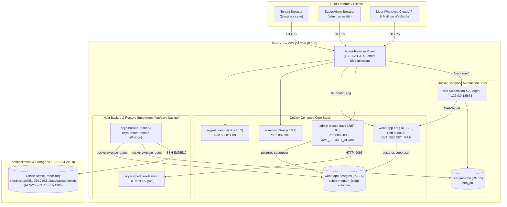

# ACYA Élancé — Comprehensive Security Audit Report (`ACYA_SECURITY_AUDIT_REPORT.md`)

**Document Classification:** Pre-Production Read-Only Security Assessment  
**Target Platform:** ACYA Élancé Multi-Tenant ERP (`elance-app.ui`, `wood-app.api`, `bo-acya-app`, `scripts/backup-runner`, `n8n` integrations, Docker & Nginx infrastructure)  
**Audit Timestamp:** `2026-11-14T06:52:00Z`  
**Audit Mode:** **100% READ-ONLY** — Zero source files modified, zero configurations altered, zero database mutations, zero secret values exposed.

---

## 1. Executive Summary

This report presents a comprehensive, evidence-based security assessment of the **ACYA Élancé** multi-tenant ERP platform prior to official production adoption by enterprise tenants. The investigation traced complete execution paths across the Next.js 16 frontends (`elance-app.ui` and `bo-acya-app/admin-elance-front`), the ASP.NET Core backends (`wood-app.api` on .NET 7 and `bo-acya-app/admin-elance-back` on .NET 8), the PostgreSQL 15 schema-per-tenant architecture, the Restic offsite backup & tenant restore subsystem (`scripts/backup-runner`), the n8n / OpenAI WhatsApp sales agent workflows, and the Docker/Nginx/GitHub Actions infrastructure.

### Overall Readiness Verdict: **NOT READY FOR PRODUCTION ADOPTION (BLOCKED BY P0 CRITICAL FINDINGS)**

While ACYA Élancé demonstrates strong engineering in several newly architected subsystems—most notably the **12-stage Restic backup & 9-stage individual tenant restore engine** (`scripts/backup-runner`), **`TenantMiddleware` JWT-to-slug cross-validation for authenticated requests**, **`TenantModelCacheKeyFactory` EF Core model isolation**, and **`SchemaSanitizer` identifier validation**—the core ERP API (`wood-app.api`) and supporting workflows currently contain **8 CRITICAL** and **12 HIGH** severity vulnerabilities that must be remediated before onboarding live enterprise tenants:

1. **Systemic Missing `[Authorize]` Across 35 of 53 Controllers in `wood-app.api` (`CRIT-01`)**: `BaseApiController` has no `[Authorize]` attribute and `Program.cs` defines no fallback authorization policy. Because `TenantMiddleware` only cross-checks the JWT `tenant_slug` claim *if* `context.User.Identity?.IsAuthenticated == true`, an unauthenticated request supplying `X-Tenant-Slug: <victim>` (or accessing `<victim>.acya.site`) bypasses authentication and tenant ownership checks completely, granting full unauthenticated CRUD access to documents, invoices, payments, bank deposits, caisse movements, catalog articles, stock, payroll, and enterprise settings.
2. **Cross-Tenant Mobile Build, Release & Firebase Takeover via `/api/admin/mobile/*` (`CRIT-02`)**: Hosted inside `wood-app.api` (which validates tenant JWTs signed with `JWT_SECRET_MAIN`), `/api/admin/mobile/*` bypasses `TenantMiddleware` and only checks `RequireRole("SuperAdmin", "Admin")`. Because every tenant's initial administrator is seeded with role `SuperAdmin` (`idrole = 10`), any tenant admin can enumerate users of any other tenant, download other tenants' `google-services.json`, and upload/publish a malicious APK to another tenant's mobile release channel.
3. **Unauthenticated Self-Registration with Arbitrary `SuperAdmin` Role Assignment & Existing `Person` Hijacking (`CRIT-03`)**: `POST /api/Account/register` is `[AllowAnonymous]` and trusts client-supplied `registerDto.person.role` (including `10 = SuperAdmin`) and `registerDto.person.id`, allowing an unauthenticated attacker to create a `SuperAdmin` account in any active tenant or hijack an existing employee's `Person` record.
4. **Live Production & Development Secrets Committed in Git-Tracked Files (`CRIT-04`)**: Tracked repository files (`backups/env.n8n.bak`, `scripts/n8n/socofeb_p2_sales_agent.json`, `test_provisioning.sh`, `wood-app.api/.env.production`) contain live database passwords, `AI_SERVICE_SECRET`, `MAILGUN_WEBHOOK_SIGNING_KEY`, `WHATSAPP_VERIFY_TOKEN`, Brevo SMTP keys, and SuperAdmin credentials.
5. **Stored XSS in SuperAdmin Backoffice via Unvalidated `rneDocumentUrl` (`CRIT-05`)**: Unauthenticated `POST /api/Enterprise/request-registration` stores arbitrary strings in `RneDocumentUrl`. When a SuperAdmin clicks "Voir RNE" in `admin-elance-front`, `window.open().document.write('<iframe src="' + docUrl + '">')` executes arbitrary JavaScript in the `https://admin.acya.site` origin, where the SuperAdmin JWT is stored in `localStorage`.
6. **Unauthenticated TEJ E-Invoicing Endpoint Mutating Singleton Credentials Across Tenants (`CRIT-06`)**: `TejController` lacks `[Authorize]` and overwrites `_config.Username` and `_config.Password` on the process-wide `IOptions<TejConfig>.Value` singleton, leaking one tenant's Ministry of Finance TEJ credentials to concurrent/subsequent requests from other tenants.
7. **Unverified WhatsApp Webhook & Unbounded OpenAI Token Consumption (`CRIT-07`)**: `POST /webhook/socofeb-whatsapp` in n8n does not verify Meta's `X-Hub-Signature-256` HMAC header and invokes `gpt-4o-mini` with no `maxTokens`, no input length cap, and no per-tenant or per-user quotas.
8. **GitHub Actions Shell Command Injection in `workflow_run` Workflows (`CRIT-08`)**: `.github/workflows/discord-notifications.yml` and `merge-notify.yml` interpolate `${{ github.event.workflow_run.head_branch }}`, `${{ github.event.pull_request.title }}`, and `${{ github.event.head_commit.message }}` directly into bash `run:` scripts.

---

## 2. Project Architecture Overview



### Component Inventory

| Layer | Component | Path | Technology | Purpose |
| :--- | :--- | :--- | :--- | :--- |
| **ERP Frontend** | `elance-app.ui` | `/home/ubuntu/acya-app/elance-app.ui/` | Next.js 16.2.0, React 19.2.4, Zustand, TanStack Query v5 | Tenant-facing ERP UI (Sales, Purchases, Stock, Treasury, Chantier, Production, HR) |
| **Core ERP API** | `wood-app.api` | `/home/ubuntu/acya-app/wood-app.api/` | ASP.NET Core Web API (`.NET 7.0`), EF Core 7.0.20, SignalR, QuestPDF, ClosedXML | Multi-tenant business API routing dynamically to `tenant_{slug}` schemas |
| **Backoffice API** | `admin-elance-back` | `/home/ubuntu/acya-app/bo-acya-app/admin-elance-back/` | ASP.NET Core Web API (`.NET 8.0`), EF Core 8.0.10 | SuperAdmin control plane: tenant provisioning, billing, backup/restore, webhooks |
| **Backoffice UI** | `admin-elance-front` | `/home/ubuntu/acya-app/bo-acya-app/admin-elance-front/` | Next.js 16.1.6, React 19.2.3 | SuperAdmin web dashboard |
| **Database** | `wood-app-db` | `/home/ubuntu/acya-app/wood-app.api/db/` | PostgreSQL 15.18 | Master registry in `public` (`bo_tbl_*`) + isolated `tenant_{slug}` schemas (`tbl_*`) |
| **Backup & Restore** | `acya_backup` | `/home/ubuntu/acya-app/scripts/backup-runner/` | Python 3, Restic 0.19.1, systemd | 12-stage encrypted offsite backup & 9-stage individual tenant schema restore |
| **AI & Workflows** | `n8n` | `/home/ubuntu/acya-app/scripts/n8n/` | n8n + OpenAI (`gpt-4o-mini`) | WhatsApp Business AI sales assistant & transactional email dispatch |

---

## 3. Security Posture Summary

### 3.1 Summary Table by Investigation Category

| Category | Implemented | Partial | Missing | Vulnerable | Needs Verification |
| :--- | :---: | :---: | :---: | :---: | :---: |
| **A. Secret Management** | 2 | 1 | 1 | 4 | 0 |
| **B. Multi-Tenant Isolation** | 4 | 2 | 0 | 3 | 0 |
| **C. PostgreSQL Row-Level Security (RLS)** | 0 | 0 | 2 | 0 | 0 |
| **D. Server-Side Validation** | 2 | 2 | 0 | 4 | 0 |
| **E. Authentication & Authorization** | 2 | 2 | 1 | 6 | 0 |
| **F. Rate Limiting** | 0 | 2 | 1 | 2 | 0 |
| **G. Dependency Security** | 0 | 1 | 1 | 2 | 0 |
| **H. Webhook Security** | 1 | 2 | 0 | 1 | 0 |
| **I. AI Security & Financial Protection** | 1 | 0 | 1 | 2 | 0 |
| **J. Backup & Recovery** | 5 | 2 | 1 | 0 | 0 |
| **K. Error Tracking & Logging** | 1 | 2 | 2 | 2 | 0 |
| **L. Deployment & Rollback** | 1 | 2 | 2 | 0 | 0 |
| **M. Additional Security Controls (AppSec & Infra)** | 3 | 3 | 2 | 5 | 0 |
| **TOTAL** | **22** | **19** | **14** | **31** | **0** |

### 3.2 Severity Distribution of Actionable Findings

| Severity | Count | Summary of Finding IDs |
| :--- | :---: | :--- |
| **CRITICAL** | **8** | `CRIT-01`, `CRIT-02`, `CRIT-03`, `CRIT-04`, `CRIT-05`, `CRIT-06`, `CRIT-07`, `CRIT-08` |
| **HIGH** | **12** | `HIGH-01`, `HIGH-02`, `HIGH-03`, `HIGH-04`, `HIGH-05`, `HIGH-06`, `HIGH-07`, `HIGH-08`, `HIGH-09`, `HIGH-10`, `HIGH-11`, `HIGH-12` |
| **MEDIUM** | **13** | `MED-01`, `MED-02`, `MED-03`, `MED-04`, `MED-05`, `MED-06`, `MED-07`, `MED-08`, `MED-09`, `MED-10`, `MED-11`, `MED-12`, `MED-13` |
| **LOW / INFO** | **8** | `LOW-01`, `LOW-02`, `LOW-03`, `LOW-04`, `LOW-05`, `LOW-06`, `LOW-07`, `INFO-01` |

---

## 4. Critical Findings

---

### `CRIT-01` — Systemic Missing `[Authorize]` Across 35 of 53 Controllers in `wood-app.api` & Unauthenticated `TenantMiddleware` Pass-Through

1. **Finding ID:** `CRIT-01`
2. **Security Category:** E. Authentication and Authorization / B. Multi-Tenant Isolation
3. **Severity:** `CRITICAL`
4. **Status:** `VULNERABLE`
5. **Evidence:**
   - `BaseApiController.cs` (lines 5–9) defines no `[Authorize]` attribute:
     ```csharp
     [ApiController]
     [Route("api/[controller]")]
     public class BaseApiController : ControllerBase
     {
     }
     ```
   - `Program.cs` (lines 100–109) registers `app.MapControllers();` without `.RequireAuthorization()`, and `IdentityServiceExtentions.cs` (lines 48–59) defines no `FallbackPolicy`.
   - `TenantMiddleware.cs` (lines 54–73 and 114–124) only cross-checks the JWT `tenant_slug` claim if the user is authenticated (`if (context.User.Identity?.IsAuthenticated == true)`). When an unauthenticated request supplies `X-Tenant-Slug: <slug>` (or `Host: <slug>.acya.site` or `?tenant=<slug>`), `TenantMiddleware` resolves `tenant` from `MasterDbContext.TenantRegistries`, sets `tenantContext.IsEnabled = true` and `tenantContext.SchemaName = tenant.SchemaName` (lines 126–132), and invokes `await _next(context);` (line 135).
   - **35 controllers** in `wood-app.api` lack class-level `[Authorize]` (33 have zero `[Authorize]` on any action; 2 have `[Authorize]` on only a subset of actions):
     - **33 Completely Unauthenticated Controllers:** `AccountingController`, `AdminDashController`, `AdvanceController`, `AnalyticsController`, `ApiHealthController`, `ArticleController`, `AuditController`, `BankController`, `BankDepositController`, `CaisseController`, `CategoryController`, `ChantierController`, `Charts/CounterPartsController`, `CounterPartController`, `DeepSearchController`, `DocumentController`, `ExchangeRateController`, `FirstChildController`, `HoldingTaxController`, `ImportsController`, `InventoryController`, `LeaveController`, `MerchandiseController`, `PaymentsController` (where lines 105–106 explicitly commented out `// var userId = GetCurrentUserId();`), `PayslipController`, `PersonController`, `PricingGridController`, `ProviderController`, `ReportsController`, `SalesSitesController`, `StockController`, `StockMovementController`, `TejController`, `VehicleController`, `VehicleExpenseController`.
     - **3 Partially Unauthenticated Controllers:** `EnterpriseController` (`POST register`, `GET {id}`, `GET getbyid/{id}`, `PUT {id}` lack `[Authorize]`), `AppVariableController` (`POST Add`, `GET {id}`, `GET getall/{nature}`, `PUT {id}`, `POST daily-ceiling`, `GET/PUT impression`, `GET roles` lack `[Authorize]`), `NotificationsController` (`GET unreads`, `PUT {id}/read`, `POST retry-failed`, `DELETE {transferId}` lack `[Authorize]`).
6. **Exact File Paths:**
   - `/home/ubuntu/acya-app/wood-app.api/src/ms.webapp.api.acya/ms.webapp.api.acya/Controllers/BaseApiController.cs` (lines 5–9)
   - `/home/ubuntu/acya-app/wood-app.api/src/ms.webapp.api.acya/ms.webapp.api.acya/Middleware/TenantMiddleware.cs` (lines 50–136)
   - `/home/ubuntu/acya-app/wood-app.api/src/ms.webapp.api.acya/ms.webapp.api.acya/Program.cs` (lines 101–109)
   - `/home/ubuntu/acya-app/wood-app.api/src/ms.webapp.api.acya/ms.webapp.api.acya/Controllers/DocumentController.cs` (line 18)
   - `/home/ubuntu/acya-app/wood-app.api/src/ms.webapp.api.acya/ms.webapp.api.acya/Controllers/PaymentsController.cs` (lines 9, 105–106)
   - `/home/ubuntu/acya-app/wood-app.api/src/ms.webapp.api.acya/ms.webapp.api.acya/Controllers/EnterpriseController.cs` (lines 14, 33, 248, 260, 314)
7. **Relevant Class, Method or Configuration:** `BaseApiController`, `TenantMiddleware.InvokeAsync`, `DocumentController`, `PaymentsController`, `EnterpriseController`, `ArticleController`, `StockController`, `ChantierController`, `ImportsController`.
8. **Explanation of the Risk:** Any external caller on the internet—or a malicious user from Tenant A who simply omits the `Authorization` header and sets `X-Tenant-Slug: tenant-b`—can invoke all 35 unauthenticated controllers against `tenant_b`'s PostgreSQL schema without credentials. Furthermore, `PUT /api/Enterprise/1` (`EnterpriseController.cs:314–351`) allows an unauthenticated attacker to enable paid SaaS modules (`IsManagingConstructions`, `IsManagingProduction`) and overwrite `CustomDomain`, `LogoUrl`, and `PrimaryColor` in `public.bo_tbl_enterprise` (`MasterDbContext.TenantRegistries`).
9. **Potential Business Impact:** Complete unauthenticated read/write compromise of every active tenant's commercial documents, invoices, accounting ledgers, payments, cash registers, stock levels, employee payslips, audit logs, and domain routing configuration.
10. **Recommended Remediation:**
    - Add `[Authorize]` directly to `BaseApiController` AND configure a global `FallbackPolicy` in `IdentityServiceExtentions.AddIdentityServices`:
      ```csharp
      options.FallbackPolicy = new AuthorizationPolicyBuilder()
          .RequireAuthenticatedUser()
          .Build();
      ```
    - Audit all endpoints that genuinely require anonymous access (`AccountController.Login`, `ForgotPassword`, `ResetPassword`, `EnterpriseController.GetConfig`, `GetPublicSettings`, `RequestRegistration`, `MobileReleasesController.Download`) and ensure only those actions carry `[AllowAnonymous]` with strict input validation and rate limiting.
    - Remove or restrict `POST /api/Enterprise/register` and restrict `PUT /api/Enterprise/{id}` to `[Authorize(Policy = "RequireAdminRole")]` without allowing tenant-side mutation of `CustomDomain` or paid subscription flags (`IsManagingConstructions`, `IsManagingProduction`).

---

### `CRIT-02` — Cross-Tenant Mobile Build, Release & Firebase Takeover via `/api/admin/mobile/*` (`JWT_SECRET_MAIN` Role Confusion)

1. **Finding ID:** `CRIT-02`
2. **Security Category:** B. Multi-Tenant Isolation / E. Authentication and Authorization
3. **Severity:** `CRITICAL`
4. **Status:** `VULNERABLE`
5. **Evidence:**
   - `TenantMiddleware.cs` (line 42) bypasses tenant resolution and JWT `tenant_slug` cross-validation for `path.StartsWith("/api/admin/mobile")`.
   - `AdminMobileBuildsController.cs`, `AdminMobileFirebaseController.cs`, and `AdminMobileReleasesController.cs` are hosted inside **`wood-app.api`** (authenticated with `JWT_SECRET_MAIN`, the tenant JWT secret) and guarded by `[Authorize(Policy = "RequireAdminRole")]` (`IdentityServiceExtentions.cs:50`: `policy.RequireRole("SuperAdmin", "Admin")`) or `[AuthorizeAdminOrCiToken]` (`AuthorizeAdminOrCiTokenAttribute.cs:24-25`: `user.IsInRole("Admin") || user.IsInRole("SuperAdmin")`).
   - Every tenant provisioned by `TenantProvisioningService.cs` (line 204) creates its initial tenant user with `idrole = 10` (`Roles.SuperAdmin`).
   - Even `bo-acya-app/admin-elance-front/src/lib/mobileBackend.ts` (lines 58–121) obtains a bearer token for `/api/admin/mobile/*` by calling `/api/admin/enterprise/{tenantId}/impersonate` on a hardcoded list of tenant IDs (`[38, 39, 16, 22, 24]`).
6. **Exact File Paths:**
   - `/home/ubuntu/acya-app/wood-app.api/src/ms.webapp.api.acya/ms.webapp.api.acya/Middleware/TenantMiddleware.cs` (line 42)
   - `/home/ubuntu/acya-app/wood-app.api/src/ms.webapp.api.acya/ms.webapp.api.acya/Extentions/IdentityServiceExtentions.cs` (line 50)
   - `/home/ubuntu/acya-app/wood-app.api/src/ms.webapp.api.acya/ms.webapp.api.acya/Attributes/AuthorizeAdminOrCiTokenAttribute.cs` (lines 24–28, 45–58)
   - `/home/ubuntu/acya-app/wood-app.api/src/ms.webapp.api.acya/ms.webapp.api.acya/Controllers/AdminMobileBuildsController.cs` (lines 20–265)
   - `/home/ubuntu/acya-app/wood-app.api/src/ms.webapp.api.acya/ms.webapp.api.acya/Controllers/AdminMobileReleasesController.cs` (lines 15–110)
   - `/home/ubuntu/acya-app/wood-app.api/src/ms.webapp.api.acya/ms.webapp.api.acya/Controllers/AdminMobileFirebaseController.cs` (lines 16–100)
7. **Relevant Class, Method or Configuration:** `AdminMobileBuildsController`, `AdminMobileReleasesController`, `AdminMobileFirebaseController`, `IdentityServiceExtentions.AddIdentityServices`, `AuthorizeAdminOrCiTokenAttribute`.
8. **Explanation of the Risk:** A tenant `Admin` or `SuperAdmin` from **any** tenant can use their standard tenant JWT to invoke `/api/admin/mobile/*` across all tenants in the platform:
   - `GET /api/admin/mobile/releases/tenants/{tenantId}/users` (`AdminMobileReleasesController.cs:79`) dumps all active users' full names, emails, logins, and roles from any victim tenant's schema (`MobileBuildService.cs:1098–1156`).
   - `GET /api/admin/mobile/builds/{id}/config` (`AdminMobileBuildsController.cs:158`) and `GET /api/admin/mobile/firebase-apps` (`AdminMobileFirebaseController.cs:42`) expose any victim tenant's `google-services.json` and Firebase configuration.
   - `POST /api/admin/mobile/builds/{id}/artifact` (`AdminMobileBuildsController.cs:214`) and `POST /api/admin/mobile/builds/{id}/publish` (`line 249`) allow a tenant admin to upload a malicious APK binary and publish it as another tenant's official mobile app release, then email download links to the victim tenant's employees via `POST /api/admin/mobile/releases/send` (`AdminMobileReleasesController.cs:95`).
9. **Potential Business Impact:** Cross-tenant employee PII disclosure, Firebase credential theft, and cross-tenant mobile APK supply-chain compromise.
10. **Recommended Remediation:**
    - Authenticate `/api/admin/mobile/*` exclusively using a dedicated Backoffice SuperAdmin JWT authentication scheme validated against `JWT_SECRET_ADMIN` (`ValidIssuer = "acya-bo"`, requiring role `SUPER_ADMIN` and no `tenant_slug` claim), never `JWT_SECRET_MAIN`.
    - Restrict `POST /api/admin/mobile/builds/{id}/artifact` and `PATCH /api/admin/mobile/builds/{id}/status` to the CI token or Backoffice `SUPER_ADMIN` scheme, and compare `MobileBuild:CiToken` using `CryptographicOperations.FixedTimeEquals`.
    - Update `bo-acya-app/admin-elance-front/src/lib/mobileBackend.ts` to forward the Backoffice `SUPER_ADMIN` token rather than impersonating a tenant admin.

---

### `CRIT-03` — Unauthenticated Self-Registration with Arbitrary `SuperAdmin` Role Assignment & Existing `Person` Hijacking, Plus Authenticated Vertical Privilege Escalation

1. **Finding ID:** `CRIT-03`
2. **Security Category:** E. Authentication and Authorization
3. **Severity:** `CRITICAL`
4. **Status:** `VULNERABLE`
5. **Evidence:**
   - In `AccountController.cs` (lines 124–231), `[HttpPost("register")]` is marked `[AllowAnonymous]`. Any unauthenticated caller supplying `X-Tenant-Slug` for a tenant that has not reached its user limit (`lines 129–148`) can create an `AppUser`.
   - Lines 174–193 allow the unauthenticated caller to either attach to an existing `Person` by ID and overwrite their role, or create a new `Person` with any role:
     ```csharp
     var existingPerson = await _context.Persons.FindAsync(registerDto.person.id);
     if (existingPerson != null)
     {
       existingPerson.Role = (Roles)registerDto.person.role;
       existingPerson.UpdadatedById = registerDto.person.updatedbyid;
       existingPerson.UpdateDate = DateTime.UtcNow;
       user.Persons = existingPerson;
     }
     else
     {
       var person = new Person(registerDto.person); // sets Role = (Roles)dto.role
       _context.Persons.Add(person);
       user.Persons = person;
     }
     ```
   - Additionally, in `AppUserController.cs` (lines 116–200), `[HttpPut("{id}")]` only has class-level `[Authorize]` (not `[Authorize(Roles = "Admin,SuperAdmin")]`), allowing any regular authenticated employee to update `p.Role = (Roles)dto.person.role` (line 166), `u.Email`, `u.Login`, or `u.IsActive` on their own account or any other user's account in the tenant.
6. **Exact File Paths:**
   - `/home/ubuntu/acya-app/wood-app.api/src/ms.webapp.api.acya/ms.webapp.api.acya/Controllers/Authentication/AccountController.cs` (lines 124–231)
   - `/home/ubuntu/acya-app/wood-app.api/src/ms.webapp.api.acya/ms.webapp.api.acya/Controllers/Authentication/AppUserController.cs` (lines 12, 116–200)
7. **Relevant Class, Method or Configuration:** `AccountController.Register`, `AppUserController.Put`.
8. **Explanation of the Risk:**
   1. Any external attacker can call `POST /api/Account/register` with `X-Tenant-Slug: <target>` and `"role": 10` (`Roles.SuperAdmin`) to mint a valid 5-day `SuperAdmin` JWT for that tenant, or pass `"id": 1` inside `registerDto.person` to hijack the tenant owner's `Person` profile.
   2. Any low-privilege employee inside a tenant can call `PUT /api/AppUser/{id}` to escalate their own role to `SuperAdmin` (`10`) or `Admin` (`20`) and take over other users' accounts.
9. **Potential Business Impact:** Full unauthorized administrative takeover of any tenant workspace with available user seats, plus unrestricted privilege escalation by any standard employee.
10. **Recommended Remediation:**
    - Remove `[AllowAnonymous]` from `POST /api/Account/register` and replace it with `[Authorize(Policy = "RequireAdminRole")]` (tenant user creation must only be performed by an authenticated tenant `Admin`/`SuperAdmin` or by Backoffice provisioning).
    - In `AccountController.Register`, never allow linking a new `AppUser` to an already-linked `Person` without verifying ownership, and validate allowed roles server-side.
    - Add `[Authorize(Policy = "RequireAdminRole")]` to `POST`, `PUT`, and `DELETE` actions in `AppUserController`.

---

### `CRIT-04` — Live Production & Development Credentials Committed in Git-Tracked Repository Files

1. **Finding ID:** `CRIT-04`
2. **Security Category:** A. Secret Management
3. **Severity:** `CRITICAL`
4. **Status:** `VULNERABLE`
5. **Evidence:**
   Inspection of `git ls-files` confirmed that multiple files containing live and historical secrets are tracked in the Git repository (all secret values redacted below):
   - `/home/ubuntu/acya-app/backups/env.n8n.bak` (lines 8, 26, 37, 40) and `/home/ubuntu/acya-app/backups/env.n8n.pre_phase3e.bak` (lines 8, 26, 37): Tracked in Git (`commit d9a3998b44`); contain plaintext `POSTGRES_PASSWORD=<REDACTED>`, `DB_POSTGRESDB_PASSWORD=<REDACTED>`, `WHATSAPP_VERIFY_TOKEN=<REDACTED>`, and `MAILGUN_WEBHOOK_SIGNING_KEY=<REDACTED>` matching active `.env.n8n` and `.env`.
   - `/home/ubuntu/acya-app/scripts/n8n/socofeb_p2_sales_agent.json` (lines 145, 184, 223, 262, 301, 331): Tracked in Git; hardcodes the live 43-character `AI_SERVICE_SECRET` (`"name": "X-AI-Secret", "value": "<REDACTED>"`) generated by `scripts/n8n/build_p2_workflow.py` (lines 4–15).
   - `/home/ubuntu/acya-app/scripts/n8n/socofeb_p1_integration_test.json` (lines 38–41) & `/home/ubuntu/acya-app/scripts/n8n/update_workflow.py` (line 34): Tracked in Git; hardcode `aiSecret`.
   - `/home/ubuntu/acya-app/test_provisioning.sh` (lines 16, 32, 36): Tracked in Git; hardcodes the active 34-character production `POSTGRES_PASSWORD` inside `connectionString`, plus SuperAdmin login credentials and tenant admin password.
   - `/home/ubuntu/acya-app/wood-app.api/.env.development` (lines 12, 26, 39, 50), `/home/ubuntu/acya-app/wood-app.api/.env.production` (lines 13, 29, 42, 53), `/home/ubuntu/acya-app/wood-app.api/.env.example` (lines 14, 41, 52), and `/home/ubuntu/acya-app/wood-app.api/docker-compose.yml` (lines 11, 39, 40, 51, 75): Tracked in Git (`commit e0e312136b`); contain plaintext `POSTGRES_PASSWORD`, 89-char `TOKEN_KEY`, `PGADMIN_PASSWORD`, and a 17-char Brevo `SMTP_PASSWORD`.
   - `/home/ubuntu/acya-app/wood-app.api/src/ms.webapp.api.acya/ms.webapp.api.acya/appsettings.Development.json` (lines 6–10, 20): Tracked in Git; contains database connection strings and 86-char symmetric JWT signing key (`TokenKey` / `JWTSettings:securityKey`).
6. **Exact File Paths:**
   - `/home/ubuntu/acya-app/backups/env.n8n.bak` (lines 8, 26, 37, 40)
   - `/home/ubuntu/acya-app/backups/env.n8n.pre_phase3e.bak` (lines 8, 26, 37)
   - `/home/ubuntu/acya-app/scripts/n8n/socofeb_p2_sales_agent.json` (lines 145, 184, 223, 262, 301, 331)
   - `/home/ubuntu/acya-app/test_provisioning.sh` (lines 16, 32, 36)
   - `/home/ubuntu/acya-app/wood-app.api/.env.production` (lines 13, 29, 42, 53)
   - `/home/ubuntu/acya-app/wood-app.api/.env.development` (lines 12, 26, 39, 50)
   - `/home/ubuntu/acya-app/wood-app.api/.env.example` (lines 14, 41, 52)
   - `/home/ubuntu/acya-app/wood-app.api/src/ms.webapp.api.acya/ms.webapp.api.acya/appsettings.Development.json` (lines 6–10, 20)
7. **Relevant Class, Method or Configuration:** Git-tracked environment backups, n8n workflow exports, shell test scripts, and legacy `.env.*` files.
8. **Explanation of the Risk:** Anyone with read access to the GitHub repository, CI/CD runners, or developer clones can extract live production database passwords (`POSTGRES_PASSWORD`), n8n database passwords, `AI_SERVICE_SECRET`, `MAILGUN_WEBHOOK_SIGNING_KEY`, `WHATSAPP_VERIFY_TOKEN`, and Brevo SMTP keys.
9. **Potential Business Impact:** Direct compromise of production PostgreSQL databases, unauthorized invocation of `/api/ai/*` endpoints across all tenants, forged Mailgun/WhatsApp webhooks, and SMTP relay abuse.
10. **Recommended Remediation:**
    - Immediately **rotate** all exposed credentials (`POSTGRES_PASSWORD`, `DB_POSTGRESDB_PASSWORD`, `AI_SERVICE_SECRET`, `MAILGUN_WEBHOOK_SIGNING_KEY`, `WHATSAPP_VERIFY_TOKEN`, Brevo `SMTP_PASSWORD`, and SuperAdmin password).
    - Note that rotating `POSTGRES_PASSWORD` requires updating the stored `connection_string` column in `public.bo_tbl_enterprise` (or clearing `connection_string` in `bo_tbl_enterprise` so `wood-app.api` always reads `ConnectionStrings:WoodAppContextConnection` from environment variables).
    - Remove the tracked secret files via `git rm --cached` and scrub them from Git history using `git filter-repo`.
    - Add `gitleaks` or `trufflehog` secret scanning to GitHub Actions on every push and pull request.

---

### `CRIT-05` — Stored Cross-Site Scripting (XSS) in SuperAdmin Backoffice via Unvalidated `rneDocumentUrl` (`document.write`)

1. **Finding ID:** `CRIT-05`
2. **Security Category:** M. Additional Security Controls (XSS) / E. Authentication and Authorization
3. **Severity:** `CRITICAL`
4. **Status:** `VULNERABLE`
5. **Evidence:**
   - **Unauthenticated Injection Vector (`wood-app.api`)**: `EnterpriseController.RequestRegistration` (`wood-app.api/src/ms.webapp.api.acya/ms.webapp.api.acya/Controllers/EnterpriseController.cs:120–225`, `[AllowAnonymous]`) accepts `dto.rneDocumentUrl` and saves it directly into `public.bo_tbl_enterprise.rne_document_url` (line 217) and serialized JSON `Notes` (line 218) with **zero validation** of URL scheme, MIME type, or HTML characters.
   - **Partial Bypass in Backoffice (`admin-elance-back`)**: `EnterpriseController.UploadRneDocument` (`bo-acya-app/admin-elance-back/src/ms.admin.api.acya/Controllers/EnterpriseController.cs:1088–1128`) only checks PDF magic bytes *if* `request.RneDocumentUrl.StartsWith("data:application/pdf;base64,")` (line 1103). Any string not starting with that prefix (such as `"><script>...` or `javascript:...`) bypasses the `if` block and is saved to `enterprise.RneDocumentUrl` (line 1128).
   - **DOM Execution Sink (`admin-elance-front`)**:
     - `bo-acya-app/admin-elance-front/src/app/enterprises/page.tsx` (lines 945–948):
       ```tsx
       const win = window.open();
       if (win) {
         win.document.write('<iframe src="' + docUrl + '" frameborder="0" style="border:0; top:0px; left:0px; bottom:0px; right:0px; width:100%; height:100%;" allowfullscreen></iframe>');
       }
       ```
     - `bo-acya-app/admin-elance-front/src/components/ProvisionEnterpriseModal.tsx` (lines 889–894):
       ```tsx
       const win = window.open();
       if (win) {
         win.document.write('<iframe src="' + rneDocumentUrl + '" frameborder="0" style="border:0; width:100%; height:100%;" allowfullscreen></iframe>');
       }
       ```
   - **Token Theft Amplifier**: `bo-acya-app/admin-elance-front/src/app/login/page.tsx` (lines 32–34) stores the 24-hour SuperAdmin JWT in `localStorage.setItem("token", data.token)`.
6. **Exact File Paths:**
   - `/home/ubuntu/acya-app/wood-app.api/src/ms.webapp.api.acya/ms.webapp.api.acya/Controllers/EnterpriseController.cs` (lines 120–225)
   - `/home/ubuntu/acya-app/bo-acya-app/admin-elance-back/src/ms.admin.api.acya/Controllers/EnterpriseController.cs` (lines 567–570, 1088–1128)
   - `/home/ubuntu/acya-app/bo-acya-app/admin-elance-front/src/app/enterprises/page.tsx` (lines 945–948)
   - `/home/ubuntu/acya-app/bo-acya-app/admin-elance-front/src/components/ProvisionEnterpriseModal.tsx` (lines 889–894)
7. **Relevant Class, Method or Configuration:** `EnterpriseController.RequestRegistration`, `EnterpriseController.UploadRneDocument`, `EnterprisesPage`, `ProvisionEnterpriseModal`.
8. **Explanation of the Risk:** An unauthenticated attacker can submit a tenant registration request via `POST /api/Enterprise/request-registration` containing a malicious `rneDocumentUrl` payload (e.g., breaking out of the `src="..."` attribute in `document.write`). When a SuperAdmin reviews the pending registration in `https://admin.acya.site` and clicks "Voir RNE" / "Consulter PDF", `window.open()` creates a same-origin `about:blank` window and executes the attacker's JavaScript in the `https://admin.acya.site` origin, reading `window.opener.localStorage.getItem("token")` and granting full SuperAdmin control over all tenants and backups.
9. **Potential Business Impact:** Complete takeover of the SaaS SuperAdmin Backoffice (`admin.acya.site`) from a single unauthenticated registration request.
10. **Recommended Remediation:**
    - On both backends (`wood-app.api` and `admin-elance-back`), strictly enforce that `rneDocumentUrl` starts with `data:application/pdf;base64,`, cap maximum base64 length, decode the base64 payload, and verify the `%PDF-` (`0x25 0x50 0x44 0x46 0x2D`) magic bytes (rejecting all other inputs with `400 Bad Request`).
    - On `admin-elance-front`, replace `window.open().document.write(...)` with a safe `Blob` (`new Blob([pdfBytes], { type: 'application/pdf' })`) and `URL.createObjectURL(blob)` opened with `noopener,noreferrer`.
    - Stop returning `token` in the JSON body of `bo-acya-app/admin-elance-front/src/app/api/auth/login/route.ts` and remove `localStorage.setItem("token", ...)` so the SuperAdmin JWT resides exclusively in the `httpOnly` cookie.

---

### `CRIT-06` — Unauthenticated `TejController` Mutates Singleton `IOptions<TejConfig>.Value` Credentials Across Tenants

1. **Finding ID:** `CRIT-06`
2. **Security Category:** B. Multi-Tenant Isolation / A. Secret Management
3. **Severity:** `CRITICAL`
4. **Status:** `VULNERABLE`
5. **Evidence:**
   - `TejController.cs` (line 15) inherits from `BaseApiController` and has **no `[Authorize]` attribute**.
   - In `TejController.cs` (lines 23–29), `_config = config.Value;` captures the process-wide singleton `TejConfig` from `IOptions<TejConfig>`.
   - In `POST /api/tej/verify-password` (lines 66–67) and `POST /api/tej/submit-declaration` (lines 101–102), the controller mutates the singleton in memory:
     ```csharp
     _config.Username = dto.Username;
     _config.Password = dto.Password;
     ```
   - When `GET /api/tej/verify-beneficiary/{identifier}` (`TejController.cs:40–54`) calls `TejFacade.CheckBeneficiaryExistsAsync` -> `TejAuthService.GetTokenAsync` (`TejIntegration.cs:544`), `TejAuthService` authenticates using `_config.Username` and `_config.Password` from that same singleton.
   - Additionally, `ApplicationServiceExtentions.cs` (lines 114–118) registers `TejApiClient` with a shared `CookieContainer = new System.Net.CookieContainer()` on the pooled `HttpClientHandler`, and `TejController.cs:111` writes XML files to a shared `"temp"` directory without tenant isolation.
6. **Exact File Paths:**
   - `/home/ubuntu/acya-app/wood-app.api/src/ms.webapp.api.acya/ms.webapp.api.acya/Controllers/tej/TejController.cs` (lines 15, 23–29, 40–139)
   - `/home/ubuntu/acya-app/wood-app.api/src/ms.webapp.api.acya/ms.webapp.api.acya/Services/tej/TejIntegration.cs` (lines 488, 529–600)
   - `/home/ubuntu/acya-app/wood-app.api/src/ms.webapp.api.acya/ms.webapp.api.acya/Extentions/ApplicationServiceExtentions.cs` (lines 103–119)
7. **Relevant Class, Method or Configuration:** `TejController`, `TejAuthService`, `TejApiClient`, `TejFacade`.
8. **Explanation of the Risk:** Because `IOptions<TejConfig>.Value` is a process-wide singleton shared across all HTTP requests and all tenants, when Tenant A submits a TEJ withholding tax declaration or verifies its password, Tenant A's Ministry of Finance TEJ username and password remain in `_config` and are used by subsequent requests from Tenant B (or any unauthenticated caller).
9. **Potential Business Impact:** Cross-tenant fiscal declaration spoofing (submitting tax declarations to the Tunisian TEJ platform under another tenant's fiscal identity) and cross-tenant credential leakage.
10. **Recommended Remediation:**
    - Add `[Authorize]` to `TejController`.
    - Never mutate `IOptions<TejConfig>.Value`. Pass per-request or per-tenant encrypted credentials explicitly as method parameters into `TejFacade` and `TejAuthService`.
    - Disable shared `UseCookies = true` on the pooled `TejApiClient` `HttpClientHandler` and write temporary XML files to tenant-isolated subdirectories or in-memory streams.

---

### `CRIT-07` — Missing `X-Hub-Signature-256` Verification on WhatsApp Production Webhook & Unbounded OpenAI Token Consumption (Denial of Wallet)

1. **Finding ID:** `CRIT-07`
2. **Security Category:** H. Webhook Security / I. AI Security and Financial Protection
3. **Severity:** `CRITICAL`
4. **Status:** `VULNERABLE`
5. **Evidence:**
   - In `/home/ubuntu/acya-app/scripts/n8n/socofeb_p3_whatsapp_agent.json` (`SOCOFEB - P3 WhatsApp Business AI Agent`, lines 6–37), the `POST /webhook/socofeb-whatsapp` handler (`Normalize & Dispatch Request`, lines 24–36) performs **zero verification** of Meta's `X-Hub-Signature-256` (`HMAC-SHA256` over raw request body).
   - Similarly, `POST /webhook/socofeb-p2-test` in `scripts/n8n/socofeb_p2_sales_agent.json` (lines 17–32) requires no authentication.
   - In `socofeb_p3_whatsapp_agent.json` (lines 253–295) and `socofeb_p2_sales_agent.json` (lines 89–113), the OpenAI Chat Model node (`@n8n/n8n-nodes-langchain.lmChatOpenAi`, `gpt-4o-mini`) omits `maxTokens`, the input `msg.text.body` has no maximum length check before being sent to OpenAI, and the LangChain agent has no `maxIterations` cap, no per-tenant quota, no per-user (`customerPhone`) rate limit, and no token/cost tracking.
   - Furthermore, `GET /api/ai/products/{id}/price?customerPhone=...` (`AiSalesController.cs:204–286`) looks up `_counterPartRepository.GetByPhoneNumberAsync(customerPhone)` and returns `CustomerName` and the customer's negotiated `DiscountRate` to any caller spoofing `msg.from` in an unsigned WhatsApp webhook payload, and `POST /api/ai/handoff` (`AiSalesController.cs:442–507`) broadcasts high-priority SignalR notifications without throttling.
6. **Exact File Paths:**
   - `/home/ubuntu/acya-app/scripts/n8n/socofeb_p3_whatsapp_agent.json` (lines 6–37, 253–318, 592)
   - `/home/ubuntu/acya-app/scripts/n8n/socofeb_p2_sales_agent.json` (lines 17–32, 89–113)
   - `/home/ubuntu/acya-app/wood-app.api/src/ms.webapp.api.acya/ms.webapp.api.acya/Controllers/AI/AiSalesController.cs` (lines 27, 204–286, 442–507)
7. **Relevant Class, Method or Configuration:** `socofeb_p3_whatsapp_agent.json` (`Normalize & Dispatch Request`, `OpenAI Chat Model`, `SOCOFEB AI Sales Agent`), `AiSalesController.GetProductPrice`, `AiSalesController.TriggerHandoff`.
8. **Explanation of the Risk:** Any external attacker can send forged HTTP `POST` requests with randomized `wamid` IDs and large prompts to `/webhook/socofeb-whatsapp`, triggering unlimited OpenAI `gpt-4o-mini` completions and multi-step tool calls (Denial of Wallet), enumerating customer names and discount rates by phone number, and flooding tenant staff dashboards with fake AI handoff alerts.
9. **Potential Business Impact:** Unbounded OpenAI API financial charges, customer PII/discount enumeration, and operational disruption of tenant sales teams.
10. **Recommended Remediation:**
    - Enforce mandatory `X-Hub-Signature-256` (`HMAC-SHA256` using Meta `APP_SECRET` over the raw request body with `crypto.timingSafeEqual`) at the entry of `POST /webhook/socofeb-whatsapp`, and disable or protect `socofeb-p2-test`.
    - Configure `maxTokens` (e.g., `500`), input length validation (e.g., `<= 1000` chars), and `maxIterations` (`<= 4`) on the n8n OpenAI agent.
    - Implement per-tenant daily/monthly token budgets and per-phone-number rate limiting in `AiSalesController` / Redis/Postgres before invoking the LLM.

---

### `CRIT-08` — GitHub Actions Shell Command Injection (`CWE-78`) in `workflow_run` and `push` Workflows

1. **Finding ID:** `CRIT-08`
2. **Security Category:** M. Additional Security Controls (GitHub Actions & Supply-Chain Security)
3. **Severity:** `CRITICAL`
4. **Status:** `VULNERABLE`
5. **Evidence:**
   - `/home/ubuntu/acya-app/.github/workflows/discord-notifications.yml` (lines 3–55) triggers on `workflow_run: workflows: ["*"] types: [completed]` and `push: branches: ['**']`, and interpolates untrusted GitHub event properties directly into `run: |` bash scripts:
     ```yaml
     NAME="${{ github.event.workflow_run.name }}"
     BRANCH="${{ github.event.workflow_run.head_branch }}"
     ...
     COMMIT_MSG="${{ github.event.head_commit.message }}"
     ```
   - `/home/ubuntu/acya-app/.github/workflows/merge-notify.yml` (lines 22, 41) interpolates `${{ github.event.pull_request.title }}` and `${{ github.event.head_commit.message }}` directly inside `run: |` bash scripts without `env:` variable binding, and neither workflow restricts `permissions:`.
6. **Exact File Paths:**
   - `/home/ubuntu/acya-app/.github/workflows/discord-notifications.yml` (lines 3–55)
   - `/home/ubuntu/acya-app/.github/workflows/merge-notify.yml` (lines 1–50)
7. **Relevant Class, Method or Configuration:** GitHub Actions workflows `discord-notifications.yml` and `merge-notify.yml`.
8. **Explanation of the Risk:** GitHub Actions evaluates `${{ ... }}` expressions before handing the script to `bash`. A branch name, PR title, or commit message containing `$(...)` or backticks executes arbitrary shell commands on the GitHub runner. Because `workflow_run` executes in the privileged context of the base repository even when triggered by a forked PR, an attacker can exfiltrate repository secrets and write-capable `GITHUB_TOKEN`.
9. **Potential Business Impact:** CI/CD supply-chain compromise, secret exfiltration, and unauthorized repository modification.
10. **Recommended Remediation:**
    - Pass all `${{ github.event.* }}` values exclusively through step `env:` blocks and reference them as quoted shell variables (`"$BRANCH"`, `"$COMMIT_MSG"`) using `jq -n --arg` to construct JSON payloads safely.
    - Add top-level `permissions: contents: read` to all workflows.

---

## 5. High Findings

---

### `HIGH-01` — Client-Supplied Invoice, Tax & Document Totals Trusted Without Server-Side Recalculation

1. **Finding ID:** `HIGH-01`
2. **Security Category:** D. Server-Side Validation
3. **Severity:** `HIGH`
4. **Status:** `VULNERABLE`
5. **Evidence:**
   - In `DocumentController.cs` (`Add` at lines 1025–1028 & 1263–1281, `CreateInvoice` at lines 1668–1672, and `Update` at lines 2137–2140 & 2250–2268), the server directly persists client-supplied monetary totals without recalculating them from quantities, unit prices, discounts, and TVA rates:
     ```csharp
     TotalCostHTNetDoc = Math.Round(dto.total_ht_net_doc, 3, MidpointRounding.AwayFromZero),
     TotalCostNetTTCDoc = Math.Round(dto.total_net_ttc, 3, MidpointRounding.AwayFromZero),
     TotalCostDiscountDoc = Math.Round(dto.total_discount_doc, 3, MidpointRounding.AwayFromZero),
     TotalCostTvaDoc = Math.Round(dto.total_tva_doc, 3, MidpointRounding.AwayFromZero),
     ```
   - Similarly, `HoldingTaxController.cs` (lines 39–113) trusts client-supplied `dto.taxpercentage` and `dto.taxvalue` without bounds or arithmetic checks and posts `TaxValue` directly to `_accountService.AddLedgerEntryAsync`.
6. **Exact File Paths:**
   - `/home/ubuntu/acya-app/wood-app.api/src/ms.webapp.api.acya/ms.webapp.api.acya/Controllers/DocumentController.cs` (lines 922, 1025–1028, 1263–1281, 1377–1425, 1668–1672, 2137–2140, 2250–2268)
   - `/home/ubuntu/acya-app/wood-app.api/src/ms.webapp.api.acya/ms.webapp.api.acya/Controllers/HoldingTaxController.cs` (lines 39–113)
7. **Relevant Class, Method or Configuration:** `DocumentController.Add`, `DocumentController.CreateInvoice`, `DocumentController.Update`, `HoldingTaxController.ApplyToDocument`.
8. **Explanation of the Risk:** A malicious or modified client can submit high-quantity merchandise lines to deduct physical stock while passing `total_net_ttc: 0.01`, bypassing the daily invoice ceiling (`CheckDailyCeilingAsync`, line 922), bypassing order approval workflows (`_approvalService.RequiresApprovalAsync`, line 1421), and corrupting the accounting ledger (`tbl_account_ledger`).
9. **Potential Business Impact:** Inventory theft masked by manipulated invoice totals, bypass of financial approval controls, and corrupted accounting/tax declarations.
10. **Recommended Remediation:** Recalculate all line-level (`CostHT`, `CostDiscountValue`, `CostNetHT`, `TvaValue`, `CostTTC`) and header-level (`TotalCostHTNetDoc`, `TotalCostDiscountDoc`, `TotalCostTvaDoc`, `TotalCostNetTTCDoc`) amounts server-side using authoritative TVA/stamp-tax rates from `tbl_app_variable`, and reject negative quantities, negative unit prices, or discounts outside `[0, 100]`.

---

### `HIGH-02` — Negative Stock Protection Bypass & Negative Quantity Inversion in Documents, Stock Transfers, Caisse & Payroll

1. **Finding ID:** `HIGH-02`
2. **Security Category:** D. Server-Side Validation
3. **Severity:** `HIGH`
4. **Status:** `VULNERABLE`
5. **Evidence:**
   - **Client-Controlled `AllowNegativStock` Override:** In `DocumentController.cs` (lines 1193 and 2228), when processing an existing `Merchandise`, `merchandise.UpdateFromDto(merchDto)` overwrites `merchandise.AllowNegativStock = dto.allownegativstock` (`Merchandise.cs:96`) immediately before `updateStockByMerchandises` runs, bypassing `StockRepository.cs:203`.
   - **Negative Quantities Invert Stock Movements:** Neither `DocumentController`, `StockRepository.UpdateStock` (`StockRepository.cs:194–210`), nor `StockService.UpdateTransferAsync` (`StockService.cs:584–746`) checks `quantity > 0`. Sending a negative `quantity` on a sales delivery note (`TransactionType.Retrieve`) executes `existingStock.Quantity -= (-N)`, artificially inflating physical stock!
   - **Negative Caisse & Bank Deposit Amounts:** `CaisseController.cs` (lines 76–119) and `BankDepositController.cs` (lines 33–123) do not validate `Amount > 0`, allowing negative `SORTIE` movements to increase cash register balances.
   - **Negative Payroll Deductions/Bonuses & Missing Payment Counterpart Check:** `SalaryCalculationService.cs` (lines 13–81) does not reject negative `deductions` (which increase `netSalary`), and `PaymentService.CreateAsync` (`PaymentService.cs:112–205`) does not verify that `document.CounterPartId == createDto.CustomerId`, allowing a payment to mark Counterpart A's invoice as `Billed` while crediting Counterpart B's ledger. Furthermore, `CreateRecouvrementPaymentAsync` (`PaymentService.cs:752–754`) compares `totalPaid >= remainingBalance` after already subtracting `totalPaid` from `remainingBalance`, marking invoices `Billed` at 50% payment.
6. **Exact File Paths:**
   - `/home/ubuntu/acya-app/wood-app.api/src/ms.webapp.api.acya/ms.webapp.api.acya/Controllers/DocumentController.cs` (lines 1193, 2228)
   - `/home/ubuntu/acya-app/wood-app.api/src/ms.webapp.api.acya.infrastructure/Repositories/StockRepository.cs` (lines 194–210)
   - `/home/ubuntu/acya-app/wood-app.api/src/ms.webapp.api.acya/ms.webapp.api.acya/Services/StockService.cs` (lines 584–746)
   - `/home/ubuntu/acya-app/wood-app.api/src/ms.webapp.api.acya/ms.webapp.api.acya/Controllers/CaisseController.cs` (lines 76–119)
   - `/home/ubuntu/acya-app/wood-app.api/src/ms.webapp.api.acya/ms.webapp.api.acya/Services/PaymentService.cs` (lines 112–205, 752–754)
   - `/home/ubuntu/acya-app/wood-app.api/src/ms.webapp.api.acya/ms.webapp.api.acya/Services/SalaryCalculationService.cs` (lines 13–81)
7. **Relevant Class, Method or Configuration:** `DocumentController`, `StockRepository.UpdateStock`, `StockService.UpdateTransferAsync`, `CaisseController.AddMovement`, `PaymentService.CreateAsync`, `PaymentService.CreateRecouvrementPaymentAsync`, `SalaryCalculationService.CalculatePayslip`.
8. **Explanation of the Risk:** Core financial and physical stock invariants rely on frontend Zod validation (`elance-app.ui`) and lack backend C# validation or PostgreSQL `CHECK` constraints.
9. **Potential Business Impact:** Artificial stock creation, negative cash register manipulation, cross-customer ledger corruption, and premature invoice settlement.
10. **Recommended Remediation:** Enforce strict `Quantity > 0` and `Amount > 0` validations across `DocumentController`, `StockRepository`, `StockService`, `CaisseController`, `BankDepositController`, `AdvanceController`, and `SalaryCalculationService`; ignore client-supplied `allownegativstock` on document lines; verify `document.CounterPartId == createDto.CustomerId` in `PaymentService`; and add PostgreSQL `CHECK` constraints (`quantity >= 0`, `amount > 0`) in a new migration and `full_migration.sql`.

---

### `HIGH-03` — Nginx Auth Rate-Limit Regex Bypassed via Case-Sensitivity & `X-Forwarded-For` Spoofing in Application Rate Limiters

1. **Finding ID:** `HIGH-03`
2. **Security Category:** F. Rate Limiting
3. **Severity:** `HIGH`
4. **Status:** `VULNERABLE`
5. **Evidence:**
   - **Case-Sensitive Nginx Regex Bypass:** In `/etc/nginx/sites-available/default` (lines 24 and 247), the strict `5r/m` authentication rate limit (`zone_auth`) uses a case-sensitive regex (`~`):
     ```nginx
     location ~ ^/api/account/(login|forgot-password|reset-password) {
         limit_req zone=zone_auth burst=3 nodelay;
     ```
     However, `elance-app.ui/src/services/auth.service.ts` (lines 27, 77, 82) and attackers can call `/api/Account/login` (with an uppercase `A`), which ASP.NET Core routes identically but which misses the case-sensitive Nginx regex and falls into `location /api/` (`20r/s`, `burst=40` = 1,200 req/min)!
   - **No Application-Level Rate Limiter on Tenant Login or Password Reset Confirmation:** `wood-app.api` has no rate limiter on `POST /api/Account/login` (`AccountController.cs:233`) or `POST /api/Account/reset-password` (`line 440`).
   - **`X-Forwarded-For` Spoofing in Custom Rate Limiters:** `AccountController.ResolveClientIp()` (`AccountController.cs:405–426`) and `WorkspaceRecoveryController.ResolveClientIp()` (`WorkspaceRecoveryController.cs:184–203`) parse `ips[0]` from `Request.Headers["X-Forwarded-For"]` without `UseForwardedHeaders`. Because Nginx appends to client-supplied `X-Forwarded-For` (`$proxy_add_x_forwarded_for`), sending `X-Forwarded-For: <random-ip>` bypasses IP rate limits on `forgot-password` and `workspace-recovery`.
   - **Global Unpartitioned Rate Limiter on SuperAdmin Login (`admin-elance-back`):** In `bo-acya-app/admin-elance-back/src/ms.admin.api.acya/Program.cs` (lines 99–108), `AddFixedWindowLimiter("AuthLimiter", ...)` creates a single global bucket of 5 requests/minute shared across **all IPs**, allowing a trivial 5 req/min flood to lock out legitimate SuperAdmins while also failing to rate-limit per attacker IP if lower than 5/min.
6. **Exact File Paths:**
   - `/etc/nginx/sites-available/default` (lines 24, 247)
   - `/home/ubuntu/acya-app/wood-app.api/src/ms.webapp.api.acya/ms.webapp.api.acya/Controllers/Authentication/AccountController.cs` (lines 233, 405–426, 440)
   - `/home/ubuntu/acya-app/wood-app.api/src/ms.webapp.api.acya/ms.webapp.api.acya/Controllers/Public/WorkspaceRecoveryController.cs` (lines 184–203)
   - `/home/ubuntu/acya-app/bo-acya-app/admin-elance-back/src/ms.admin.api.acya/Program.cs` (lines 99–108)
7. **Relevant Class, Method or Configuration:** Nginx `location ~ ^/api/account/`, `AccountController.Login`, `AccountController.ResolveClientIp`, `Program.cs` (`AuthLimiter`).
8. **Explanation of the Risk:** Attackers can brute-force tenant logins at 20 requests/second by using `/api/Account/login`, bypass `forgot-password` IP throttling by rotating `X-Forwarded-For`, or cause a denial of service on SuperAdmin login by exhausting the unpartitioned 5 req/min bucket.
9. **Potential Business Impact:** Credential stuffing / brute-force account compromise and SuperAdmin login lockout.
10. **Recommended Remediation:**
    - Change Nginx's regex from `location ~` to case-insensitive `location ~* ^/api/(account|admin/auth)/(login|forgot-password|reset-password|register)`.
    - Configure `app.UseForwardedHeaders()` with trusted loopback proxy (`127.0.0.1`) and use `HttpContext.Connection.RemoteIpAddress` instead of manually parsing `X-Forwarded-For[0]`.
    - Partition `AuthLimiter` in `admin-elance-back` (and add an equivalent partitioned limiter in `wood-app.api`) by `(clientIp, username/email)`.

---

### `HIGH-04` — Weak Single-Iteration `HMACSHA512` Password Hashing Without Key Stretching in `wood-app.api`

1. **Finding ID:** `HIGH-04`
2. **Security Category:** E. Authentication and Authorization
3. **Severity:** `HIGH`
4. **Status:** `VULNERABLE`
5. **Evidence:**
   - Across `wood-app.api` (`AccountController.cs:104, 115, 162, 248, 458`, `AppUserController.cs:210`, `EnterpriseController.cs:182`) and `bo-acya-app/admin-elance-back/src/ms.admin.api.acya/Controllers/EnterpriseController.cs:939`, tenant user passwords are hashed using a single invocation of `HMACSHA512`:
     ```csharp
     using var hmac = new HMACSHA512(user.PasswordSalt!);
     var computedHash = hmac.ComputeHash(Encoding.UTF8.GetBytes(loginDto.Password!));
     for (int i = 0; i < computedHash.Length; i++)
     {
       if (computedHash[i] != user.PasswordHash![i]) return Unauthorized("Invalid password");
     }
     ```
   - Additionally, the byte comparison uses an early-exit `for` loop instead of `CryptographicOperations.FixedTimeEquals`, and `UpdatePassword`/`ResetPassword`/`SetPassword` enforce no minimum password length or complexity (`string.IsNullOrEmpty(newPassword)` only).
6. **Exact File Paths:**
   - `/home/ubuntu/acya-app/wood-app.api/src/ms.webapp.api.acya/ms.webapp.api.acya/Controllers/Authentication/AccountController.cs` (lines 99–118, 162, 248–256, 456–460)
   - `/home/ubuntu/acya-app/wood-app.api/src/ms.webapp.api.acya/ms.webapp.api.acya/Controllers/Authentication/AppUserController.cs` (lines 204–215)
   - `/home/ubuntu/acya-app/bo-acya-app/admin-elance-back/src/ms.admin.api.acya/Controllers/EnterpriseController.cs` (line 939)
7. **Relevant Class, Method or Configuration:** `AccountController.Login`, `AccountController.UpdatePassword`, `AccountController.ResetPassword`, `AppUserController.SetPassword`.
8. **Explanation of the Risk:** Unlike `admin-elance-back`'s `PasswordHasher.cs` (which uses `PBKDF2-SHA512` with 100,000 iterations), `HMACSHA512` performs a single fast cryptographic hash with zero computational cost factor, allowing offline GPU cracking at billions of guesses per second if a database dump or SQL read occurs.
9. **Potential Business Impact:** Rapid offline recovery of plaintext tenant user and admin passwords following any database or backup exposure.
10. **Recommended Remediation:** Migrate tenant password hashing to `Argon2id` or `Rfc2898DeriveBytes.Pbkdf2` (`SHA512`, $\ge 210,000$ iterations) with `CryptographicOperations.FixedTimeEquals`, transparently upgrading existing `HMACSHA512` hashes upon next successful login (matching the pattern in `admin-elance-back/Services/PasswordHasher.cs`), and enforce a minimum password length of 10 characters.

---

### `HIGH-05` — Wildcard Subdomain CORS (`*.acya.site`) Combined with Cookie Authentication on SuperAdmin API (`admin-elance-back`)

1. **Finding ID:** `HIGH-05`
2. **Security Category:** M. Additional Security Controls (CORS & CSRF)
3. **Severity:** `HIGH`
4. **Status:** `VULNERABLE`
5. **Evidence:**
   - In `bo-acya-app/admin-elance-back/src/ms.admin.api.acya/Program.cs` (lines 48–58 and 111–124):
     - `OnMessageReceived` automatically authenticates requests using the `admin_session_token` cookie (`context.Request.Cookies.TryGetValue("admin_session_token", out var cookieToken)`).
     - `ConfiguredCorsPolicy` configures:
       ```csharp
       var allowedOriginsConfig = builder.Configuration["AllowedOrigins"] ?? "https://admin.acya.site;https://acya.site;http://localhost:3000;http://localhost:5002";
       ...
       policy.WithOrigins(allowedOrigins)
             .AllowAnyMethod()
             .AllowAnyHeader()
             .AllowCredentials()
             .SetIsOriginAllowedToAllowWildcardSubdomains();
       ```
     - In `docker-compose.yml` (line 121): `AllowedOrigins=https://admin.acya.site;https://acya.site`.
6. **Exact File Paths:**
   - `/home/ubuntu/acya-app/bo-acya-app/admin-elance-back/src/ms.admin.api.acya/Program.cs` (lines 48–58, 111–124)
   - `/home/ubuntu/acya-app/docker-compose.yml` (line 121)
7. **Relevant Class, Method or Configuration:** `Program.cs` (`ConfiguredCorsPolicy` and `JwtBearerEvents.OnMessageReceived`).
8. **Explanation of the Risk:**
   1. Passing `https://acya.site` (or `https://*.acya.site`) to `.WithOrigins(...)` together with `.SetIsOriginAllowedToAllowWildcardSubdomains()` and `.AllowCredentials()` instructs `admin-elance-back` to trust **every tenant subdomain (`https://{tenant}.acya.site`)** for credentialed cross-origin requests!
   2. Because `https://{tenant}.acya.site` and `https://admin.acya.site` share the same registrable domain (`eTLD+1` = `acya.site`), browsers treat requests from any tenant subdomain to `admin.acya.site` as **same-site**, attaching `SameSite=Strict` cookies (`admin_session_token`) automatically. With no CSRF token validation and permissive wildcard CORS, any XSS on any tenant workspace (`{tenant}.acya.site`) can make authenticated cross-origin calls to the SuperAdmin API (`admin.acya.site`).
9. **Potential Business Impact:** Cross-origin privilege escalation from a single compromised tenant subdomain to the SaaS SuperAdmin control plane.
10. **Recommended Remediation:**
    - Remove `https://acya.site` and `.SetIsOriginAllowedToAllowWildcardSubdomains()` from `admin-elance-back`'s CORS policy so ONLY `https://admin.acya.site` is permitted in production.
    - Enforce an anti-CSRF header/double-submit token when authenticating via `admin_session_token` cookie.

---

### `HIGH-06` — Plaintext PostgreSQL Superuser Connection String Logged to Stdout on Every API Startup

1. **Finding ID:** `HIGH-06`
2. **Security Category:** K. Error Tracking and Logging / A. Secret Management
3. **Severity:** `HIGH`
4. **Status:** `VULNERABLE`
5. **Evidence:**
   - In `wood-app.api/src/ms.webapp.api.acya/ms.webapp.api.acya/Program.cs` (line 151), during the startup migration loop over all active tenants:
     ```csharp
     logger.LogInformation("Migrating schema '{Schema}' for tenant '{Slug}' using connection string '{ConnStr}'...", tenant.SchemaName, tenant.Slug, connStr);
     ```
6. **Exact File Paths:**
   - `/home/ubuntu/acya-app/wood-app.api/src/ms.webapp.api.acya/ms.webapp.api.acya/Program.cs` (line 151)
7. **Relevant Class, Method or Configuration:** `Program.Main` startup migration loop.
8. **Explanation of the Risk:** On every container startup, `wood-app-api` writes the full PostgreSQL connection string—including `Username=postgres;Password=<POSTGRES_PASSWORD>`—to stdout/Docker container logs once per active tenant (16 times per boot) at `Information` log level.
9. **Potential Business Impact:** Exposure of the production PostgreSQL superuser password to anyone with access to container logs, CI/CD logs, or monitoring views (`MonitoringController`).
10. **Recommended Remediation:** Remove `{ConnStr}` from the log message on line 151 (or sanitize via `new NpgsqlConnectionStringBuilder(connStr) { Password = "***" }.ToString()`).

---

### `HIGH-07` — Missing `SearchPath` on Shared-Database Fallback in `WoodAppContext` & Silent Fallback to `public` Schema

1. **Finding ID:** `HIGH-07`
2. **Security Category:** B. Multi-Tenant Isolation
3. **Severity:** `HIGH`
4. **Status:** `VULNERABLE`
5. **Evidence:**
   - In `ApplicationServiceExtentions.cs` (lines 157–169):
     ```csharp
     if (multiTenantEnabled && tenantCtx.IsEnabled && !string.IsNullOrEmpty(tenantCtx.ConnectionString))
     {
       var connBuilder = new Npgsql.NpgsqlConnectionStringBuilder(tenantCtx.ConnectionString);
       if (!string.IsNullOrEmpty(tenantCtx.SchemaName))
       {
         connBuilder.SearchPath = tenantCtx.SchemaName;
       }
       connectionString = connBuilder.ToString();
     }
     else
     {
       connectionString = config.GetConnectionString("WoodAppContextConnection")!;
     }
     ```
   - In `WoodAppContext.cs` (lines 17–19):
     ```csharp
     public string SchemaName => (_tenantContext != null && _tenantContext.IsEnabled) 
       ? _tenantContext.SchemaName 
       : "public";
     ```
6. **Exact File Paths:**
   - `/home/ubuntu/acya-app/wood-app.api/src/ms.webapp.api.acya/ms.webapp.api.acya/Extentions/ApplicationServiceExtentions.cs` (lines 151–177)
   - `/home/ubuntu/acya-app/wood-app.api/src/ms.webapp.api.acya.infrastructure/WoodAppContext.cs` (lines 17–19, 134–138)
   - `/home/ubuntu/acya-app/wood-app.api/src/ms.webapp.api.acya/ms.webapp.api.acya/Middleware/TenantMiddleware.cs` (lines 126–132)
7. **Relevant Class, Method or Configuration:** `ApplicationServiceExtentions.AddApplicationServices`, `WoodAppContext.SchemaName`, `TenantMiddleware.InvokeAsync`.
8. **Explanation of the Risk:**
   1. If a tenant row in `public.bo_tbl_enterprise` has an empty/null `ConnectionString`, `ApplicationServiceExtentions.cs` falls into the `else` branch (line 168) and uses `WoodAppContextConnection` **without setting `SearchPath = tenantCtx.SchemaName`**. Any unqualified raw SQL executed on `_context.Database` (e.g., `ExecuteSeedWoodScript`) will run against `public` instead of `tenant_{slug}`.
   2. Whenever `_tenantContext.IsEnabled` is `false` (on routes bypassed by `TenantMiddleware`, or in SignalR WebSocket method invocations such as `NotificationHub.JoinGroup` at `NotificationHub.cs:122`), `WoodAppContext.SchemaName` silently defaults to `"public"` instead of failing closed.
9. **Potential Business Impact:** Silent reads/writes against `public.tbl_*` tables (such as `public.tbl_audit_logs`, `public.tbl_enterprise`, `public.tbl_sales_sites`) and potential cross-tenant state pollution.
10. **Recommended Remediation:**
    - In `TenantMiddleware.cs:130` and `ApplicationServiceExtentions.cs:157`, always resolve `var baseConn = !string.IsNullOrEmpty(tenantCtx.ConnectionString) ? tenantCtx.ConnectionString : config.GetConnectionString("WoodAppContextConnection")!;` and always set `connBuilder.SearchPath = tenantCtx.SchemaName` whenever `tenantCtx.IsEnabled` is true.
    - When `MultiTenancy:Enabled` is `true`, throw an `InvalidOperationException` if `WoodAppContext` is resolved with `_tenantContext.IsEnabled == false`.

---

### `HIGH-08` — Both Backends Connect to PostgreSQL as the Cluster Superuser (`postgres`) with `BYPASSRLS`

1. **Finding ID:** `HIGH-08`
2. **Security Category:** C. PostgreSQL Row-Level Security / M. Additional Security Controls (Database Least Privilege)
3. **Severity:** `HIGH`
4. **Status:** `VULNERABLE`
5. **Evidence:**
   - In `/home/ubuntu/acya-app/docker-compose.yml` (lines 10, 44–47, 119), `/home/ubuntu/acya-app/.env.example` (line 16), `/home/ubuntu/acya-app/wood-app.api/src/ms.webapp.api.acya/ms.webapp.api.acya/Controllers/EnterpriseController.cs` (line 203), and `/home/ubuntu/acya-app/bo-acya-app/admin-elance-back/src/ms.admin.api.acya.infrastructure/Services/TenantProvisioningService.cs` (lines 111–165), both `wood-app-api` and `admin-elance-back` connect to PostgreSQL as `Username=postgres` (the cluster superuser).
6. **Exact File Paths:**
   - `/home/ubuntu/acya-app/docker-compose.yml` (lines 10, 44–47, 119)
   - `/home/ubuntu/acya-app/wood-app.api/src/ms.webapp.api.acya/ms.webapp.api.acya/Controllers/EnterpriseController.cs` (line 203)
7. **Relevant Class, Method or Configuration:** PostgreSQL connection configuration for `WoodAppContext` and `MasterDbContext`.
8. **Explanation of the Risk:** Connecting the tenant-facing API (`wood-app-api`) as the PostgreSQL `postgres` superuser means the runtime application possesses `SUPERUSER`, `BYPASSRLS`, `CREATEDB`, and `CREATEROLE` privileges, can drop schemas or modify `public.bo_tbl_*` master tables, and automatically bypasses any PostgreSQL Row-Level Security (`RLS`) policies even if `FORCE ROW LEVEL SECURITY` were enabled.
9. **Potential Business Impact:** Any SQL injection or ORM misrouting in `wood-app-api` has unrestricted superuser access across all tenant schemas and the master registry.
10. **Recommended Remediation:** Create a dedicated non-superuser, `NOBYPASSRLS`, `NOCREATEDB`, `NOCREATEROLE` PostgreSQL role (e.g., `acya_erp_app`) for `wood-app-api` runtime DML operations, reserving DDL schema provisioning privileges for a separate migration/provisioning role.

---

### `HIGH-09` — End-of-Life .NET 7.0 Runtime & Unauthenticated `apt-get` (`AllowUnauthenticated=true`) in `wood-app.api/Dockerfile`

1. **Finding ID:** `HIGH-09`
2. **Security Category:** G. Dependency Security / M. Supply-Chain Security
3. **Severity:** `HIGH`
4. **Status:** `VULNERABLE`
5. **Evidence:**
   - All 5 `.csproj` files in `wood-app.api` target `<TargetFramework>net7.0</TargetFramework>` (.NET 7 reached End-of-Support on **May 14, 2024**), and `ms.webapp.api.acya.csproj` (line 15) uses `Microsoft.AspNetCore.Authentication.JwtBearer` `7.0.10`.
   - `/home/ubuntu/acya-app/wood-app.api/Dockerfile` (lines 5–13) builds on `mcr.microsoft.com/dotnet/aspnet:7.0` and disables Debian package signature verification:
     ```dockerfile
     RUN apt-get -o Acquire::Check-Valid-Until=false update \
         && apt-get install -y --no-install-recommends \
             -o APT::Get::AllowUnauthenticated=true \
             -o Acquire::http::No-Cache=true \
             libnghttp2-14/bullseye \
             curl/bullseye \
     ```
6. **Exact File Paths:**
   - `/home/ubuntu/acya-app/wood-app.api/Dockerfile` (lines 2, 5–13, 23)
   - `/home/ubuntu/acya-app/wood-app.api/src/ms.webapp.api.acya/ms.webapp.api.acya/ms.webapp.api.acya.csproj` (lines 4, 15)
7. **Relevant Class, Method or Configuration:** `wood-app.api/Dockerfile`, `ms.webapp.api.acya.csproj`.
8. **Explanation of the Risk:** Running the primary ERP API on an End-of-Life runtime (.NET 7.0) leaves the platform unpatched against post-May 2024 ASP.NET Core / Kestrel / EF Core CVEs. Furthermore, `APT::Get::AllowUnauthenticated=true` disables GPG signature verification when installing `curl` and `libnghttp2-14`, permitting MITM package tampering during image builds.
9. **Potential Business Impact:** Exposure to unpatched runtime vulnerabilities and compromised container builds.
10. **Recommended Remediation:** Upgrade `wood-app.api` from `net7.0` to `net8.0` LTS (matching `admin-elance-back`), remove legacy `EntityFramework 6.5.1` and `Microsoft.AspNetCore.Http.Abstractions 2.3.0` from `ms.webapp.api.acya.infrastructure.csproj`, and remove `APT::Get::AllowUnauthenticated=true` from `wood-app.api/Dockerfile`.

---

### `HIGH-10` — Automated Offsite Backups Are Currently Disabled (`repositoryWritesAuthorized: false` & Inactive Systemd Timers)

1. **Finding ID:** `HIGH-10`
2. **Security Category:** J. Backup and Recovery
3. **Severity:** `HIGH`
4. **Status:** `PARTIALLY_IMPLEMENTED`
5. **Evidence:**
   - In `/home/ubuntu/acya-app/scripts/backup-runner/config/backup.json` (line 4): `"repositoryWritesAuthorized": false`. Both `pipeline.py` (lines 174–180) and `restic.py` (lines 336–342) abort any `--mode full` backup with exit code `10` (`writes_not_authorized`) when this flag is `false`.
   - As documented in `PHASE_11C_1_FIRST_PRODUCTION_BACKUP_REPORT.md` (lines 339–350) and `PHASE_11C_2_BACKUP_SCHEDULER_REPORT.md` (lines 179–183), both `acya-backup-runner.timer` and legacy `acya-backup.timer` are currently disabled/inactive, and `TENANT_RESTORE_EXECUTION_ENABLED=false` in `docker-compose.yml` (line 130).
6. **Exact File Paths:**
   - `/home/ubuntu/acya-app/scripts/backup-runner/config/backup.json` (line 4)
   - `/home/ubuntu/acya-app/scripts/backup-runner/lib/acya_backup/pipeline.py` (lines 174–180)
   - `/home/ubuntu/acya-app/docker-compose.yml` (line 130)
7. **Relevant Class, Method or Configuration:** `backup.json` (`repositoryWritesAuthorized`), `acya-backup-runner.timer`, `TENANT_RESTORE_EXECUTION_ENABLED`.
8. **Explanation of the Risk:** Although the 12-stage Restic backup pipeline and 9-stage individual tenant restore engine are thoroughly engineered, automated daily backups are currently switched off in configuration and systemd. Previously, this caused a 24-day backup gap (`2026-10-13` to `2026-11-06`) where 3 newly onboarded tenants had zero offsite backups.
9. **Potential Business Impact:** Data loss exceeding the 24-hour RPO target in the event of a storage or database failure between manual backup runs.
10. **Recommended Remediation:** Before production tenant launch, set `"repositoryWritesAuthorized": true` in `/opt/acya-backup/config/backup.json`, enable and start `acya-backup-runner.timer` (`02:00 UTC` daily), and configure automated alerting if `last-success.json` is older than 26 hours.

---

### `HIGH-11` — All 5 Application Docker Images Run as `root` (UID 0) & Expose Backend/UI Ports on `0.0.0.0`

1. **Finding ID:** `HIGH-11`
2. **Security Category:** M. Additional Security Controls (Docker Container Privileges & Network Isolation)
3. **Severity:** `HIGH`
4. **Status:** `VULNERABLE`
5. **Evidence:**
   - None of the 5 Dockerfiles (`elance-app.ui/Dockerfile`, `bo-acya-app/admin-elance-front/Dockerfile`, `wood-app.api/Dockerfile`, `wood-app.api/src/ms.webapp.api.acya/ms.webapp.api.acya/Dockerfile`, `bo-acya-app/admin-elance-back/Dockerfile`) contain a non-root `USER` instruction; all processes run as `root` (UID 0).
   - In `/home/ubuntu/acya-app/docker-compose.yml` (lines 76, 101, 134, 159), `api` (`"8080:80"`), `migration-ui` (`"5000:3000"`), `admin-api` (`"8082:80"`), and `admin-ui` (`"5002:3000"`) bind to `0.0.0.0` instead of `127.0.0.1` (unlike `n8n` in `docker-compose.n8n.yml:40` which binds to `"127.0.0.1:5678:5678"`).
   - Additionally, `/home/ubuntu/acya-app/scripts/backup-runner/bin/acya-scheduler-daemon` (line 189) and `acya-scheduler-daemon.service` (lines 8, 11) run as `root` listening on `0.0.0.0:9095` over plaintext HTTP.
6. **Exact File Paths:**
   - `/home/ubuntu/acya-app/docker-compose.yml` (lines 76, 101, 134, 159)
   - `/home/ubuntu/acya-app/wood-app.api/Dockerfile` (lines 43–58)
   - `/home/ubuntu/acya-app/bo-acya-app/admin-elance-back/Dockerfile` (lines 16–22)
   - `/home/ubuntu/acya-app/elance-app.ui/Dockerfile` (lines 17–31)
   - `/home/ubuntu/acya-app/bo-acya-app/admin-elance-front/Dockerfile` (lines 17–31)
   - `/home/ubuntu/acya-app/scripts/backup-runner/systemd/acya-scheduler-daemon.service` (lines 8, 11)
7. **Relevant Class, Method or Configuration:** Docker Compose `ports:` mappings, application `Dockerfile`s, `acya-scheduler-daemon.service`.
8. **Explanation of the Risk:** Because Docker's `DOCKER` iptables chain bypasses standard host `ufw` input rules, binding container ports `8080`, `8082`, `5000`, and `5002` to `0.0.0.0` allows external attackers (unless blocked by an upstream cloud firewall) to connect directly to `wood-app-api` and `admin-elance-back` over plaintext HTTP, completely bypassing Nginx TLS termination and Nginx rate limits.
9. **Potential Business Impact:** Direct unencrypted access to backend containers, bypass of reverse-proxy protections, and elevated impact of any container RCE.
10. **Recommended Remediation:**
    - Change all container port bindings in `docker-compose.yml` to loopback (`"127.0.0.1:8080:80"`, `"127.0.0.1:5000:3000"`, `"127.0.0.1:8082:80"`, `"127.0.0.1:5002:3000"`) and bind `acya-scheduler-daemon` to `172.17.0.1` / `127.0.0.1`.
    - Add non-root `USER` directives (`USER app` / `USER nextjs`) to all 5 Dockerfiles and adjustlistening ports to `8080` inside the .NET containers.

---

### `HIGH-12` — Unauthenticated Bulk Excel/CSV Import (`ImportsController`) & Unbounded Base64 File Uploads in Database

1. **Finding ID:** `HIGH-12`
2. **Security Category:** M. Additional Security Controls (File Upload Validation) / E. Authentication and Authorization
3. **Severity:** `HIGH`
4. **Status:** `VULNERABLE`
5. **Evidence:**
   - `ImportsController.cs` (lines 9–76) inherits from `BaseApiController` without `[Authorize]`. When `User.FindFirst("id")` is null, lines 32, 50, and 68 default to `int userId = 1; int enterpriseId = 1;`.
   - `ImportService.cs` (lines 62–75) only checks `Path.GetExtension(fileName).ToLower() == ".xlsx" || ".csv"` with no `[RequestSizeLimit]` and no magic-byte check before loading the stream into `ClosedXML.Excel.XLWorkbook`.
   - `EnterpriseController.RequestRegistration` (`wood-app.api/.../EnterpriseController.cs:120–225`, `[AllowAnonymous]`) accepts arbitrary strings for `logoUrl`, `faviconUrl`, and `rneDocumentUrl` and serializes the entire DTO into `public.bo_tbl_enterprise.Notes` without size limits.
6. **Exact File Paths:**
   - `/home/ubuntu/acya-app/wood-app.api/src/ms.webapp.api.acya/ms.webapp.api.acya/Controllers/ImportsController.cs` (lines 9–76)
   - `/home/ubuntu/acya-app/wood-app.api/src/ms.webapp.api.acya/ms.webapp.api.acya/Services/ImportService.cs` (lines 62–75)
   - `/home/ubuntu/acya-app/wood-app.api/src/ms.webapp.api.acya/ms.webapp.api.acya/Controllers/EnterpriseController.cs` (lines 120–225)
7. **Relevant Class, Method or Configuration:** `ImportsController.ImportArticles`, `ImportCounterparts`, `ImportSettings`; `ImportService`; `EnterpriseController.RequestRegistration`.
8. **Explanation of the Risk:** Unauthenticated attackers can bulk-import arbitrary articles, customers, suppliers, or settings into any tenant's schema, or upload crafted `.xlsx` Zip Bombs / oversized base64 strings to exhaust server memory and PostgreSQL storage.
9. **Potential Business Impact:** Tenant catalog/customer data corruption and application memory/database exhaustion (DoS).
10. **Recommended Remediation:** Require `[Authorize(Policy = "RequireAdminRole")]` and `[RequestSizeLimit(10 * 1024 * 1024)]` on `ImportsController`, validate `.xlsx` magic bytes and uncompressed entry sizes before passing to `XLWorkbook`, and enforce strict size and MIME/magic-byte validation on `logoUrl`, `faviconUrl`, and `rneDocumentUrl`.

---

## 6. Medium Findings

---

### `MED-01` — Long-Lived JWTs (5 Days Tenant / 24h Admin) Stored in `localStorage` with No Server-Side Session Revocation

1. **Finding ID:** `MED-01`
2. **Security Category:** E. Authentication and Authorization
3. **Severity:** `MEDIUM`
4. **Status:** `PARTIALLY_IMPLEMENTED`
5. **Evidence:**
   - `TokenService.cs` in `wood-app.api` (line 141) sets token expiration to `DateTime.UtcNow.AddDays(5)` and embeds static `Permissions` and `Role` claims in the JWT. `PermissionHandler.cs` (lines 29–88) evaluates permissions solely from the JWT claims without querying the database.
   - `elance-app.ui/src/store/use-auth-store.ts` (lines 45–82) persists the 5-day JWT in `localStorage` (`auth-storage`).
   - `bo-acya-app/admin-elance-front/src/app/api/auth/login/route.ts` (lines 41–55) sets an `httpOnly` cookie (`admin_session_token`) **and** returns `token: data.token` in the JSON body (line 42), which `bo-acya-app/admin-elance-front/src/app/login/page.tsx` (line 32) writes to `localStorage.setItem("token", data.token)`.
   - Neither backend implements refresh tokens, `jti` blacklisting, or a user security stamp check.
6. **Exact File Paths:**
   - `/home/ubuntu/acya-app/wood-app.api/src/ms.webapp.api.acya/ms.webapp.api.acya/Services/TokenService.cs` (line 141)
   - `/home/ubuntu/acya-app/wood-app.api/src/ms.webapp.api.acya/ms.webapp.api.acya/PermissionsHelper/PermissionHandler.cs` (lines 29–88)
   - `/home/ubuntu/acya-app/elance-app.ui/src/store/use-auth-store.ts` (lines 45–82)
   - `/home/ubuntu/acya-app/bo-acya-app/admin-elance-front/src/app/api/auth/login/route.ts` (lines 41–55)
7. **Relevant Class, Method or Configuration:** `TokenService.CreateToken`, `PermissionHandler`, `useAuthStore`, `POST /api/auth/login`.
8. **Explanation of the Risk:** If an employee is terminated (`AppUser.IsActive = false`), has their password reset, or has permissions revoked, their existing JWT remains valid with full prior permissions for up to 5 days. Storing JWTs in `localStorage` exposes them to theft via any XSS vulnerability.
9. **Potential Business Impact:** Persistent unauthorized access by terminated employees or stolen sessions for up to 5 days.
10. **Recommended Remediation:** Shorten access token lifetime to 15–30 minutes paired with `HttpOnly`, `Secure`, `SameSite` refresh token cookies (with server-side revocation on logout/password change/deactivation), and remove `localStorage` token storage in `admin-elance-front`.

---

### `MED-02` — IDOR in `AccountController.GetProfile(int id)` & Client-Trusted `updatedbyid` Across Controllers

1. **Finding ID:** `MED-02`
2. **Security Category:** E. Authentication and Authorization
3. **Severity:** `MEDIUM`
4. **Status:** `VULNERABLE`
5. **Evidence:**
   - `AccountController.GetProfile(int id)` (`AccountController.cs:44–58`) requires only `[Authorize]` and returns `AppUserDto` (including `PersonDto` with base salary, CIN, CNSS, and bank account) for any `{id}` in the tenant without verifying that `id == currentUserId` or that the caller is an Admin.
   - `DocumentController.cs` (lines 948, 2051), `PaymentsController.cs` (line 108), and `ArticleController.cs` read `dto.updatedbyid` from the request body instead of the authenticated user's `ClaimTypes.NameIdentifier` JWT claim, and `ChantierController.GetCurrentUserId()` (lines 47–55) defaults to `1` when the claim is missing.
6. **Exact File Paths:**
   - `/home/ubuntu/acya-app/wood-app.api/src/ms.webapp.api.acya/ms.webapp.api.acya/Controllers/Authentication/AccountController.cs` (lines 44–58)
   - `/home/ubuntu/acya-app/wood-app.api/src/ms.webapp.api.acya/ms.webapp.api.acya/Controllers/DocumentController.cs` (lines 948, 2051)
   - `/home/ubuntu/acya-app/wood-app.api/src/ms.webapp.api.acya/ms.webapp.api.acya/Controllers/ChantierController.cs` (lines 47–55)
7. **Relevant Class, Method or Configuration:** `AccountController.GetProfile`, `DocumentController.Add`, `DocumentController.Update`, `ChantierController.GetCurrentUserId`.
8. **Explanation of the Risk:** Any regular employee can read the salary, CIN, and bank details of all other employees (including executives) in the same tenant via `GET /api/Account/profile/{id}`, and can forge audit attribution (`UpdatedById`) on documents and payments.
9. **Potential Business Impact:** Internal employee PII/salary disclosure and repudiation of fraudulent ERP transactions.
10. **Recommended Remediation:** Restrict `AccountController.GetProfile(int id)` so non-admin users can only access their own `ClaimTypes.NameIdentifier` ID, and always resolve `UpdatedById` server-side from `User.FindFirst(ClaimTypes.NameIdentifier)`.

---

### `MED-03` — Non-Constant-Time Secret Comparisons, Mailgun Token Replay Window & Broken n8n Email Webhook Auth

1. **Finding ID:** `MED-03`
2. **Security Category:** H. Webhook Security / A. Secret Management
3. **Severity:** `MEDIUM`
4. **Status:** `PARTIALLY_IMPLEMENTED`
5. **Evidence:**
   - `WhatsAppWebhooksController.cs` (line 61) compares `verifyToken != configuredToken` using standard `!=` instead of `CryptographicOperations.FixedTimeEquals`.
   - `AuthorizeAdminOrCiTokenAttribute.cs` (line 52) compares `MobileBuild:CiToken` using `string.Equals(providedToken, configuredToken, StringComparison.Ordinal)`.
   - In `EmailWebhooksController.cs` (lines 39–103) and `EmailService.cs` (lines 190–244), while Mailgun's `HMAC-SHA256(timestamp + token)` is verified in constant time within a 15-minute window, Mailgun's signature does **not** cover the `event-data` body, and `signature.token` is not stored to block replay with modified `event-data.id` within the 15-minute window.
   - In `backups/workflows/AcyaEmailEvents123_hardened.json` (line 30), HMAC comparison uses `!==` and lines 188–240 forward events to `http://admin-api:80/api/webhooks/email/events` without attaching `Authorization` or `X-Webhook-Secret`.
6. **Exact File Paths:**
   - `/home/ubuntu/acya-app/bo-acya-app/admin-elance-back/src/ms.admin.api.acya/Controllers/WhatsAppWebhooksController.cs` (line 61)
   - `/home/ubuntu/acya-app/wood-app.api/src/ms.webapp.api.acya/ms.webapp.api.acya/Attributes/AuthorizeAdminOrCiTokenAttribute.cs` (line 52)
   - `/home/ubuntu/acya-app/bo-acya-app/admin-elance-back/src/ms.admin.api.acya/Controllers/EmailWebhooksController.cs` (lines 39–143)
   - `/home/ubuntu/acya-app/bo-acya-app/admin-elance-back/src/ms.admin.api.acya.infrastructure/Services/EmailService.cs` (lines 190–244)
7. **Relevant Class, Method or Configuration:** `WhatsAppWebhooksController.VerifyWebhook`, `AuthorizeAdminOrCiTokenAttribute`, `EmailWebhooksController.ReceiveMailgunWebhook`, `EmailService.ProcessDeliveryEventAsync`.
8. **Explanation of the Risk:** Non-constant-time comparisons expose static tokens (`WhatsAppSettings:VerifyToken`, `MobileBuild:CiToken`) to timing side-channels, and unstored Mailgun `signature.token` values allow replay within the 15-minute timestamp window.
9. **Potential Business Impact:** Potential token brute-forcing via timing analysis and spoofed email delivery status updates.
10. **Recommended Remediation:** Use `CryptographicOperations.FixedTimeEquals` for all secret/token comparisons, cache seen Mailgun `signature.token` values for 15 minutes (and add a unique index on `bo_tbl_email_log_events.event_id`), and attach `X-Webhook-Secret` in the n8n forwarding node.

---

### `MED-04` — Broken `${VAR}` Placeholders in `admin-elance-back/appsettings.json`, Hardcoded Fallback Keys & Default SuperAdmin Seed Password

1. **Finding ID:** `MED-04`
2. **Security Category:** A. Secret Management / E. Authentication and Authorization
3. **Severity:** `MEDIUM`
4. **Status:** `VULNERABLE`
5. **Evidence:**
   - In `bo-acya-app/admin-elance-back/src/ms.admin.api.acya/appsettings.json` (lines 10, 13): `"Secret": "${JWT_SECRET}"`. Because ASP.NET Core does not interpolate `${...}` in `appsettings.json`, if the environment variable `JwtSettings__Secret` is omitted, `builder.Configuration["JwtSettings:Secret"]` evaluates to the literal 13-character string `"${JWT_SECRET}"`, bypassing the `?? throw new InvalidOperationException("JWT Secret is missing")` check in `Program.cs` (line 29).
   - In `wood-app.api/src/ms.webapp.api.acya/ms.webapp.api.acya/Services/Mobile/MobileDownloadTokenService.cs` (lines 21–23), signing key resolution falls back to `"default_secret_key_for_mobile_download_tokens_minimum_32_characters"`.
   - In `bo-acya-app/admin-elance-back/src/ms.admin.api.acya.infrastructure/DbInitializer.cs` (lines 140–152), if no user `"admin"` exists in `bo_tbl_super_admin_users`, startup automatically seeds `Username = "admin"` with `PasswordHash = HashInitialPassword("adminpassword")`.
6. **Exact File Paths:**
   - `/home/ubuntu/acya-app/bo-acya-app/admin-elance-back/src/ms.admin.api.acya/appsettings.json` (lines 10, 13)
   - `/home/ubuntu/acya-app/wood-app.api/src/ms.webapp.api.acya/ms.webapp.api.acya/Services/Mobile/MobileDownloadTokenService.cs` (lines 21–23)
   - `/home/ubuntu/acya-app/bo-acya-app/admin-elance-back/src/ms.admin.api.acya.infrastructure/DbInitializer.cs` (lines 140–152)
7. **Relevant Class, Method or Configuration:** `appsettings.json`, `MobileDownloadTokenService`, `DbInitializer.Initialize`.
8. **Explanation of the Risk:** Misconfigured deployments silently fall back to predictable signing keys (`"${JWT_SECRET}"` or `"default_secret_key..."`) and a well-known default SuperAdmin password (`"adminpassword"`).
9. **Potential Business Impact:** Forged SuperAdmin JWTs, forged mobile APK download tokens, or unauthorized SuperAdmin login on freshly initialized databases.
10. **Recommended Remediation:** Set `"Secret": ""` in `appsettings.json` and fail startup if `string.IsNullOrWhiteSpace(jwtSecret) || jwtSecret.StartsWith("${") || jwtSecret.Length < 32`; remove the static fallback key in `MobileDownloadTokenService.cs`; and require `INITIAL_ADMIN_PASSWORD` from environment variables in `DbInitializer.cs`.

---

### `MED-05` — Unhandled Exceptions Leak `ex.Message` / `InnerException.Message` to Clients & Missing Global Exception Handler

1. **Finding ID:** `MED-05`
2. **Security Category:** K. Error Tracking and Logging
3. **Severity:** `MEDIUM`
4. **Status:** `VULNERABLE`
5. **Evidence:**
   - Neither `wood-app.api/.../Program.cs` nor `bo-acya-app/admin-elance-back/.../Program.cs` configures `app.UseExceptionHandler(...)` or `AddProblemDetails()`.
   - Controllers across `wood-app.api` (`AccountController.cs:229`, `DocumentController.cs:1880–1881`, `AppUserController.cs:190`, `StockController.cs:129, 308`, `ProductionController.cs:155, 193, 304`, `InventoryController.cs:279, 417, 479`, `ReportsController.cs:35`, `QwertyImportController.cs:139`) catch `Exception ex` and return `ex.Message` and `ex.InnerException?.Message` directly in HTTP `400`/`500` JSON responses.
6. **Exact File Paths:**
   - `/home/ubuntu/acya-app/wood-app.api/src/ms.webapp.api.acya/ms.webapp.api.acya/Program.cs` (lines 90–112)
   - `/home/ubuntu/acya-app/wood-app.api/src/ms.webapp.api.acya/ms.webapp.api.acya/Controllers/DocumentController.cs` (lines 1880–1881)
   - `/home/ubuntu/acya-app/wood-app.api/src/ms.webapp.api.acya/ms.webapp.api.acya/Controllers/Authentication/AccountController.cs` (line 229)
7. **Relevant Class, Method or Configuration:** Controller `catch (Exception ex)` blocks and `Program.cs`.
8. **Explanation of the Risk:** Returning raw Npgsql/EF Core `InnerException.Message` strings leaks PostgreSQL schema names (`tenant_*`), table names, constraint names, and internal file paths to external callers.
9. **Potential Business Impact:** Information disclosure aiding schema reconnaissance and attack crafting.
10. **Recommended Remediation:** Register a global exception handling middleware (`app.UseExceptionHandler`) that logs the full exception server-side with a correlation ID and returns a generic RFC 7807 `ProblemDetails` message to the client.

---

### `MED-06` — Authentication Failures Are Not Logged, Tenant Login Leaks User Full Name (`200 OK`), and `AppUser`/`UserPermissions` Lack Audit Trails

1. **Finding ID:** `MED-06`
2. **Security Category:** K. Error Tracking and Logging / E. Authentication and Authorization
3. **Severity:** `MEDIUM`
4. **Status:** `PARTIALLY_IMPLEMENTED`
5. **Evidence:**
   - In `AccountController.Login` (`wood-app.api/.../AccountController.cs:234–274`), failed login attempts are not logged to `ILogger` or `AuditLogs` and return HTTP `200 OK` with `isSuccess = false`. Furthermore, when an email exists (`user != null`) and the password is wrong (`lines 251–259`), the endpoint returns `{ fullname: user.Persons!.FullName, isSuccess: false, message: "Email ou mot de passe non valide" }`, whereas when `user == null` (`line 244`) it returns `{ fullname: null, isSuccess: false }`, leaking the user's full name!
   - In `AuthController.Login` (`bo-acya-app/admin-elance-back/.../AuthController.cs:27–55`), failed and successful SuperAdmin logins, password updates, and username updates are not recorded in `ILogger` or `MasterAuditLogs`.
   - `AppUser` (`tbl_app_user`), `Person` (`tbl_person`), and `UserPermissions` (`tbl_user_permissions`) do not implement `IAuditable`, so role changes and permission modifications are omitted from `AuditTrailInterceptor` (`AuditTrailInterceptor.cs:54–153`).
6. **Exact File Paths:**
   - `/home/ubuntu/acya-app/wood-app.api/src/ms.webapp.api.acya/ms.webapp.api.acya/Controllers/Authentication/AccountController.cs` (lines 234–274)
   - `/home/ubuntu/acya-app/bo-acya-app/admin-elance-back/src/ms.admin.api.acya/Controllers/AuthController.cs` (lines 27–119)
   - `/home/ubuntu/acya-app/wood-app.api/src/ms.webapp.api.acya.infrastructure/Configurations/Audit/AuditTrailInterceptor.cs` (lines 54–153)
7. **Relevant Class, Method or Configuration:** `AccountController.Login`, `AuthController.Login`, `AuditTrailInterceptor`.
8. **Explanation of the Risk:** Brute-force attacks against tenant or SuperAdmin accounts generate zero security logs, HTTP `200 OK` responses blind WAF/Nginx log monitors, and `fullname` in failed login responses enables targeted phishing and user enumeration.
9. **Potential Business Impact:** Inability to detect active credential stuffing or trace unauthorized privilege changes during incident response.
10. **Recommended Remediation:** Return HTTP `401 Unauthorized` with an identical generic payload (`{ isSuccess: false, message: "Identifiants invalides" }`) regardless of whether the email exists, log all failed/successful logins and password/permission changes with client IP and tenant slug, and implement `IAuditable` on `AppUser`, `Person`, and `UserPermissions` (redacting `PasswordHash` and `PasswordSalt`).

---

### `MED-07` — Missing Security Headers (HSTS, CSP) in Nginx & `admin-elance-front`, and `server_tokens build;` Enabled

1. **Finding ID:** `MED-07`
2. **Security Category:** M. Additional Security Controls (HTTPS & Security Headers)
3. **Severity:** `MEDIUM`
4. **Status:** `PARTIALLY_IMPLEMENTED`
5. **Evidence:**
   - `/etc/nginx/nginx.conf` (line 22) explicitly sets `server_tokens build;`.
   - `/etc/nginx/sites-available/default` (lines 1–322) defines no `Strict-Transport-Security` (HSTS), `Content-Security-Policy` (CSP), `X-Frame-Options`, `X-Content-Type-Options`, or `Referrer-Policy` headers on `acya.site`, `admin.acya.site`, or `*.acya.site`.
   - `bo-acya-app/admin-elance-front/next.config.ts` (lines 1–8) configures no security headers at all, while `elance-app.ui/next.config.ts` (lines 10–22) sets `X-Frame-Options: DENY`, `X-Content-Type-Options: nosniff`, `Referrer-Policy`, and `Permissions-Policy`, but omits `Strict-Transport-Security` and `Content-Security-Policy`.
   - `update_nginx.sh` (lines 9–27) configures `old.acya.site` on HTTP port 80 without TLS redirection.
6. **Exact File Paths:**
   - `/etc/nginx/nginx.conf` (line 22)
   - `/etc/nginx/sites-available/default` (lines 1–322)
   - `/home/ubuntu/acya-app/bo-acya-app/admin-elance-front/next.config.ts` (lines 1–8)
   - `/home/ubuntu/acya-app/elance-app.ui/next.config.ts` (lines 10–22)
   - `/home/ubuntu/acya-app/update_nginx.sh` (lines 9–27)
7. **Relevant Class, Method or Configuration:** Nginx `nginx.conf`, `sites-available/default`, Next.js `next.config.ts`.
8. **Explanation of the Risk:** The SuperAdmin UI (`admin.acya.site`) and API responses lack clickjacking (`X-Frame-Options` / `frame-ancestors`), MIME-sniffing (`X-Content-Type-Options`), HSTS, and CSP protections, and `server_tokens build` leaks the exact Nginx build version.
9. **Potential Business Impact:** Increased exploitability of XSS (`CRIT-05`), clickjacking against `admin.acya.site`, and SSL-stripping on initial connections.
10. **Recommended Remediation:** Set `server_tokens off;` in `/etc/nginx/nginx.conf` and add `Strict-Transport-Security: max-age=63072000; includeSubDomains; preload`, `X-Content-Type-Options: nosniff`, `X-Frame-Options: DENY`, `Referrer-Policy: strict-origin-when-cross-origin`, and a restrictive `Content-Security-Policy` in Nginx and `admin-elance-front/next.config.ts`.

---

### `MED-08` — Absence of Multi-Factor Authentication (MFA / 2FA) for Backoffice SuperAdmins and Tenant Administrators

1. **Finding ID:** `MED-08`
2. **Security Category:** M. Additional Security Controls (MFA for Privileged Accounts)
3. **Severity:** `MEDIUM`
4. **Status:** `MISSING`
5. **Evidence:**
   - `SuperAdminUser.cs` (`bo-acya-app/admin-elance-back/src/ms.admin.api.acya.core/Entities/SuperAdminUser.cs:5–13`) and `AuthController.cs` (`lines 27–55`) support only single-factor username + password login.
   - `AppUser.cs` (`wood-app.api/src/ms.webapp.api.acya.core/Entities/AppUser.cs`) and `AccountController.cs` (`lines 234–274`) also support only single-factor email + password login.
6. **Exact File Paths:**
   - `/home/ubuntu/acya-app/bo-acya-app/admin-elance-back/src/ms.admin.api.acya.core/Entities/SuperAdminUser.cs` (lines 5–13)
   - `/home/ubuntu/acya-app/bo-acya-app/admin-elance-back/src/ms.admin.api.acya/Controllers/AuthController.cs` (lines 27–55)
7. **Relevant Class, Method or Configuration:** `SuperAdminUser`, `AuthController.Login`, `AccountController.Login`.
8. **Explanation of the Risk:** Compromise of a single SuperAdmin password grants full control over all 16+ enterprise tenants, tenant impersonation (`GET /api/admin/enterprise/{id}/impersonate`), and database restore operations without a second authentication factor.
9. **Potential Business Impact:** Full SaaS platform compromise from a single phished or reused SuperAdmin password.
10. **Recommended Remediation:** Implement mandatory TOTP (RFC 6238) or WebAuthn MFA for all Backoffice `SUPER_ADMIN` accounts and offer optional/enforced TOTP MFA for tenant `SuperAdmin`/`Admin` accounts.

---

### `MED-09` — Non-Functional Dependabot Configuration, Broken Root CI Workflow, `npm install` in Dockerfiles & External SheetJS Tarball

1. **Finding ID:** `MED-09`
2. **Security Category:** G. Dependency Security / M. Supply-Chain Security
3. **Severity:** `MEDIUM`
4. **Status:** `MISSING`
5. **Evidence:**
   - `/home/ubuntu/acya-app/.github/dependabot.yml` (lines 6–12) contains an unconfigured placeholder (`package-ecosystem: ""`, `directory: "/"`), rendering Dependabot completely inactive.
   - `/home/ubuntu/acya-app/.github/workflows/ci-pr.yml` (lines 13–27) runs `pnpm install --frozen-lockfile` at the repository root where no `package.json` or `pnpm-lock.yaml` exists, uses mutable action tags (`@v4`), and performs zero `.NET` or `npm` vulnerability scans.
   - `elance-app.ui/Dockerfile` (line 8) and `bo-acya-app/admin-elance-front/Dockerfile` (line 8) run `npm install` instead of `npm ci`, and `elance-app.ui/package.json` (line 46) pulls `xlsx` from `https://cdn.sheetjs.com/xlsx-0.20.3/xlsx-0.20.3.tgz`.
6. **Exact File Paths:**
   - `/home/ubuntu/acya-app/.github/dependabot.yml` (lines 6–12)
   - `/home/ubuntu/acya-app/.github/workflows/ci-pr.yml` (lines 13–27)
   - `/home/ubuntu/acya-app/elance-app.ui/Dockerfile` (line 8)
   - `/home/ubuntu/acya-app/bo-acya-app/admin-elance-front/Dockerfile` (line 8)
   - `/home/ubuntu/acya-app/elance-app.ui/package.json` (line 46)
7. **Relevant Class, Method or Configuration:** `.github/dependabot.yml`, `.github/workflows/ci-pr.yml`, frontend `Dockerfile`s.
8. **Explanation of the Risk:** Vulnerable npm and NuGet dependencies are never flagged in CI/CD, and running `npm install` instead of `npm ci` in Docker builds allows floating caret dependencies (`^`) to resolve to newer, unvetted minor/patch versions during production image builds.
9. **Potential Business Impact:** Unnoticed vulnerable dependencies and non-reproducible/compromised frontend builds.
10. **Recommended Remediation:** Configure `.github/dependabot.yml` with `npm` (`elance-app.ui`, `bo-acya-app/admin-elance-front`), `nuget` (`wood-app.api`, `bo-acya-app/admin-elance-back`), `docker`, and `github-actions` ecosystems; replace `npm install` with `npm ci --ignore-scripts` in both frontend Dockerfiles; and update `ci-pr.yml` to run builds, tests, `npm audit`, and `dotnet list package --vulnerable`.

---

### `MED-10` — No Centralized Log Aggregation, No Frontend Error Boundaries/Telemetry, and Unbounded Docker Container Logs

1. **Finding ID:** `MED-10`
2. **Security Category:** K. Error Tracking and Logging
3. **Severity:** `MEDIUM`
4. **Status:** `MISSING`
5. **Evidence:**
   - Neither `elance-app.ui/src/app/` nor `bo-acya-app/admin-elance-front/src/app/` defines `error.tsx` or `global-error.tsx`, and neither frontend integrates Sentry or OpenTelemetry.
   - Neither `wood-app.api` nor `admin-elance-back` integrates structured logging (Serilog) or ships logs to Loki/Grafana/ELK.
   - In `/home/ubuntu/acya-app/docker-compose.yml`, none of the 5 services (`postgres`, `api`, `migration-ui`, `admin-api`, `admin-ui`) configure Docker log rotation (`logging: options: max-size / max-file`), unlike `docker-compose.n8n.yml` (lines 27–31, 49–53).
6. **Exact File Paths:**
   - `/home/ubuntu/acya-app/docker-compose.yml` (lines 1–165)
   - `/home/ubuntu/acya-app/elance-app.ui/src/app/`
   - `/home/ubuntu/acya-app/bo-acya-app/admin-elance-front/src/app/`
7. **Relevant Class, Method or Configuration:** `docker-compose.yml`, Next.js App Router root layouts.
8. **Explanation of the Risk:** Production frontend crashes are invisible unless reported by customers, container logs are destroyed whenever `docker rm -f <container>` is run during deployment (`CONFIG-STEPS.md:17`), and unrotated JSON container logs can exhaust host disk space.
9. **Potential Business Impact:** Blindness to production errors/attacks and potential disk exhaustion.
10. **Recommended Remediation:** Add `error.tsx` and `global-error.tsx` to both frontends, integrate Sentry or OpenTelemetry + Loki/Promtail shipping to the Monitoring VPS (`51.254.216.8`), and add `max-size: "10m"` / `max-file: "5"` logging limits to all services in `docker-compose.yml`.

---

### `MED-11` — In-Place Mutable Docker Builds, Automatic Startup EF Migrations Across All Tenants, and Missing Rollback Automation

1. **Finding ID:** `MED-11`
2. **Security Category:** L. Deployment and Rollback
3. **Severity:** `MEDIUM`
4. **Status:** `PARTIALLY_IMPLEMENTED`
5. **Evidence:**
   - `CONFIG-STEPS.md` (lines 12–22, 51–61) builds images directly on the production host (`docker-compose build --no-cache <service>`), overwriting the local image tag without retaining immutable versioned tags (`git SHA`), and runs `docker rm -f <container>` followed by `docker-compose up -d`, causing a downtime window (`502 Bad Gateway`).
   - `docker-compose.n8n.yml` (line 35) uses mutable tag `docker.n8n.io/n8nio/n8n:latest`.
   - Only `wood-app-api` and `postgres` define container health checks (`migration-ui`, `admin-api`, `admin-ui`, and `n8n` lack `HEALTHCHECK`).
   - `wood-app.api/.../Program.cs` (lines 115–191) automatically runs `Database.Migrate()` across `MasterDbContext` and all active tenant schemas on every container boot before health verification.
6. **Exact File Paths:**
   - `/home/ubuntu/acya-app/CONFIG-STEPS.md` (lines 12–22, 51–61)
   - `/home/ubuntu/acya-app/docker-compose.n8n.yml` (line 35)
   - `/home/ubuntu/acya-app/wood-app.api/src/ms.webapp.api.acya/ms.webapp.api.acya/Program.cs` (lines 115–191)
7. **Relevant Class, Method or Configuration:** `CONFIG-STEPS.md`, `docker-compose.yml`, `docker-compose.n8n.yml`, `Program.cs`.
8. **Explanation of the Risk:** Because `docker-compose build` overwrites the local image tag and `Program.cs` mutates all tenant schemas immediately on boot, rolling back a broken deployment requires a full git revert + rebuild from source and cannot cleanly revert schema changes.
9. **Potential Business Impact:** Extended downtime during failed deployments and risk of simultaneous schema corruption across all active tenants.
10. **Recommended Remediation:** Tag built images with the immutable Git commit SHA (`acya-api:<git-sha>`), retain at least the previous 3 image tags locally, add `HEALTHCHECK` instructions to `migration-ui`, `admin-api`, and `admin-ui`, decouple schema migrations into a pre-deployment step gated by a pre-migration backup snapshot, and provide a `scripts/rollback.sh <git-sha>` utility.

---

### `MED-12` — `WoodAppContext` Exposes Shared `public` Tables (`MobileBuilds`, `MobileReleases`, `TenantFirebaseApps`) Without Global Query Filters

1. **Finding ID:** `MED-12`
2. **Security Category:** B. Multi-Tenant Isolation / C. PostgreSQL Row-Level Security
3. **Severity:** `MEDIUM`
4. **Status:** `PARTIALLY_IMPLEMENTED`
5. **Evidence:**
   - `WoodAppContext.cs` (lines 117–119, 137) exposes `DbSet<MobileBuild>`, `DbSet<MobileRelease>`, and `DbSet<TenantFirebaseApp>`.
   - `MobileBuildConfiguration.cs` (line 12), `MobileReleaseConfiguration.cs` (line 12), and `TenantFirebaseAppConfiguration.cs` (line 12) map these entities explicitly to `"public"` schema (`builder.ToTable("bo_tbl_...", "public")`) without EF Core `HasQueryFilter` or PostgreSQL RLS.
   - Similarly, all multi-tenant `bo_tbl_*` tables in `MasterDbContext` rely exclusively on manual `.Where(x => x.TenantId == ...)` clauses.
6. **Exact File Paths:**
   - `/home/ubuntu/acya-app/wood-app.api/src/ms.webapp.api.acya.infrastructure/WoodAppContext.cs` (lines 117–119, 137)
   - `/home/ubuntu/acya-app/wood-app.api/src/ms.webapp.api.acya.infrastructure/Configurations/MobileBuildConfiguration.cs` (line 12)
   - `/home/ubuntu/acya-app/wood-app.api/src/ms.webapp.api.acya.infrastructure/Configurations/MobileReleaseConfiguration.cs` (line 12)
   - `/home/ubuntu/acya-app/wood-app.api/src/ms.webapp.api.acya.infrastructure/Configurations/TenantFirebaseAppConfiguration.cs` (line 12)
7. **Relevant Class, Method or Configuration:** `WoodAppContext`, `MobileBuildConfiguration`, `MobileReleaseConfiguration`, `TenantFirebaseAppConfiguration`.
8. **Explanation of the Risk:** Unlike `tbl_*` tables (which are isolated by PostgreSQL schema via `modelBuilder.HasDefaultSchema(SchemaName)`), these three tables live in `public` and contain rows for all tenants. Any repository or service method querying `_woodAppContext.MobileBuilds` that forgets a `.Where(b => b.TenantSlug == _tenantContext.Slug)` filter will return all tenants' rows.
9. **Potential Business Impact:** Accidental cross-tenant data leakage in future queries against shared `public.bo_tbl_*` tables.
10. **Recommended Remediation:** Move `MobileBuilds`, `MobileReleases`, and `TenantFirebaseApps` exclusively to `MasterDbContext` (or add a strict `HasQueryFilter` in `WoodAppContext` binding `TenantSlug == _tenantContext.Slug`), and enable PostgreSQL Row-Level Security (`FORCE ROW LEVEL SECURITY`) on shared `public.bo_tbl_*` tables as defense-in-depth.

---

### `MED-13` — No Automated Restic Snapshot Pruning Policy & Undefined Numeric RTO SLA

1. **Finding ID:** `MED-13`
2. **Security Category:** J. Backup and Recovery
3. **Severity:** `MEDIUM`
4. **Status:** `PARTIALLY_IMPLEMENTED`
5. **Evidence:**
   - In `/home/ubuntu/acya-app/scripts/backup-runner/lib/acya_backup/restic.py` (lines 24–33), `FORBIDDEN_SUBCOMMANDS` intentionally blocks `forget` and `prune` on the production VPS so a compromised production server cannot delete historical backups.
   - However, no server-side Restic `forget --keep-daily 7 --keep-weekly 4 --keep-monthly 6 --prune` maintenance job is configured on the Administration/Storage VPS (`51.254.216.8`), and no numeric RTO SLA is formally defined alongside the 24-hour logical `pg_dump` RPO.
6. **Exact File Paths:**
   - `/home/ubuntu/acya-app/scripts/backup-runner/lib/acya_backup/restic.py` (lines 24–33)
   - `/home/ubuntu/acya-app/scripts/backup-runner/config/backup.json` (lines 15–16)
7. **Relevant Class, Method or Configuration:** `restic.py` (`FORBIDDEN_SUBCOMMANDS`), `backup.json`.
8. **Explanation of the Risk:** While blocking `forget`/`prune` from the production host is good practice, omitting a scheduled pruning job on the Storage VPS causes Restic snapshots to accumulate indefinitely, eventually filling `/data/backups/restic`.
9. **Potential Business Impact:** Eventual backup storage exhaustion on the Administration VPS and lack of formal RTO benchmarks during disaster recovery drills.
10. **Recommended Remediation:** Configure a weekly `restic forget --prune` systemd timer locally on the Storage VPS (`51.254.216.8`) while switching the production runner from `sftp` to `rest-ssh-tunnel` (`backup.rest-append-only.template.json` with `rest-server --append-only`), and document formal RTO targets (e.g., $\le 15\text{ min}$ per-tenant restore, $\le 2\text{ hours}$ full node recovery).

---

## 7. Low & Informational Findings

---

### `LOW-01` — DOM XSS in Analytics Print Window & Unencoded HTML Interpolation in Backend Welcome/Recovery Emails

1. **Finding ID:** `LOW-01`
2. **Security Category:** M. Additional Security Controls (XSS)
3. **Severity:** `LOW`
4. **Status:** `VULNERABLE`
5. **Evidence:**
   - `elance-app.ui/src/app/analytics/page.tsx` (line 106): `printWindow.document.write(\`<html><head><title>Rapport Complet — ${enterprise?.name || 'Analyse Business'}</title>...\`)` interpolates `enterprise?.name` without HTML escaping.
   - `bo-acya-app/admin-elance-back/src/ms.admin.api.acya/Controllers/EnterpriseController.cs` (lines 1243–1288, `WriteWelcomeEmailAsync`) and `wood-app.api/src/ms.webapp.api.acya/ms.webapp.api.acya/Controllers/Public/WorkspaceRecoveryController.cs` (lines 205–225, `BuildWorkspaceRecoveryEmailHtml`) interpolate `{enterprise.Name}`, `{ws.Name}`, and `{adminUsername}` directly into HTML without `WebUtility.HtmlEncode`.
6. **Exact File Paths:**
   - `/home/ubuntu/acya-app/elance-app.ui/src/app/analytics/page.tsx` (lines 103–126)
   - `/home/ubuntu/acya-app/bo-acya-app/admin-elance-back/src/ms.admin.api.acya/Controllers/EnterpriseController.cs` (lines 1243–1288)
   - `/home/ubuntu/acya-app/wood-app.api/src/ms.webapp.api.acya/ms.webapp.api.acya/Controllers/Public/WorkspaceRecoveryController.cs` (lines 205–225)
7. **Relevant Class, Method or Configuration:** `handlePrint`, `WriteWelcomeEmailAsync`, `BuildWorkspaceRecoveryEmailHtml`.
8. **Explanation of the Risk:** Unescaped enterprise names containing HTML tags can inject markup/scripts into the analytics print popup or outbound transactional emails.
9. **Potential Business Impact:** Self/tenant-scoped DOM XSS in print view and HTML injection in onboarding/recovery emails.
10. **Recommended Remediation:** Escape `enterprise?.name` before writing to `printWindow.document`, and wrap all dynamic strings in `WebUtility.HtmlEncode(...)` in `WriteWelcomeEmailAsync` and `BuildWorkspaceRecoveryEmailHtml`.

---

### `LOW-02` — `@tanstack/react-query-devtools` Rendered Unconditionally in Production Frontend Build

1. **Finding ID:** `LOW-02`
2. **Security Category:** K. Error Tracking and Logging / M. Additional Security Controls
3. **Severity:** `LOW`
4. **Status:** `VULNERABLE`
5. **Evidence:**
   - `/home/ubuntu/acya-app/elance-app.ui/package.json` (line 25) lists `@tanstack/react-query-devtools` under `dependencies`, and `/home/ubuntu/acya-app/elance-app.ui/src/components/providers.tsx` (line 41) renders `<ReactQueryDevtools initialIsOpen={true} />` unconditionally.
6. **Exact File Paths:**
   - `/home/ubuntu/acya-app/elance-app.ui/package.json` (line 25)
   - `/home/ubuntu/acya-app/elance-app.ui/src/components/providers.tsx` (line 41)
7. **Relevant Class, Method or Configuration:** `Providers` component in `elance-app.ui`.
8. **Explanation of the Risk:** Exposes internal React Query cache keys and cached API responses via the floating devtools inspector in production builds.
9. **Potential Business Impact:** Client-side state inspection and increased production bundle size.
10. **Recommended Remediation:** Gate `<ReactQueryDevtools />` behind `process.env.NODE_ENV === 'development'`.

---

### `LOW-03` — SignalR `NotificationHub.JoinGroup` Queries `public.tbl_sales_sites` on WebSocket Invocations

1. **Finding ID:** `LOW-03`
2. **Security Category:** B. Multi-Tenant Isolation
3. **Severity:** `LOW`
4. **Status:** `VULNERABLE`
5. **Evidence:**
   - In `/home/ubuntu/acya-app/wood-app.api/src/ms.webapp.api.acya.infrastructure/Repositories/NotificationHub.cs` (lines 108–135), when `JoinGroup(string siteIdentifier)` is invoked over an established WebSocket connection with a non-numeric `siteIdentifier`, line 122 executes `await _context.SalesSites.FirstOrDefaultAsync(s => s.Address == siteIdentifier);`. Because `TenantMiddleware` only runs on the initial HTTP negotiation and not on subsequent WebSocket hub method invocations, `_tenantContext.IsEnabled` is `false` and `_context.SalesSites` queries `public.tbl_sales_sites`.
6. **Exact File Paths:**
   - `/home/ubuntu/acya-app/wood-app.api/src/ms.webapp.api.acya.infrastructure/Repositories/NotificationHub.cs` (lines 108–135)
7. **Relevant Class, Method or Configuration:** `NotificationHub.JoinGroup`.
8. **Explanation of the Risk:** Looking up sales sites by address inside a SignalR hub method hits the `public` schema instead of the caller's tenant schema (though the resulting SignalR group name is still prefixed with `tenant:{tenantSlug}:`).
9. **Potential Business Impact:** Incorrect site-group subscription for real-time stock transfer notifications when non-numeric site identifiers are passed.
10. **Recommended Remediation:** Populate `_tenantContext` from `Context.User?.FindFirst("tenant_slug")?.Value` via an `IHubFilter` before executing hub methods that access `WoodAppContext`.

---

### `LOW-04` — Legacy Ephemeral Manual Backup Endpoint (`POST /api/admin/backup/{tenantId}`) Remains Callable

1. **Finding ID:** `LOW-04`
2. **Security Category:** J. Backup and Recovery
3. **Severity:** `LOW`
4. **Status:** `PARTIALLY_IMPLEMENTED`
5. **Evidence:**
   - While `POST /api/admin/backup/restore/{jobId}` was retired (`410 Gone`) in Phase 11C.1.7A, `POST /api/admin/backup/{tenantId}` (`BackupController.cs:202–225`) and `GET /api/admin/backup/download/{jobId}` (`line 242`) remain active and write `.sql` dumps into `/app/backups/` inside the `admin-elance-back` container's ephemeral overlay filesystem.
6. **Exact File Paths:**
   - `/home/ubuntu/acya-app/bo-acya-app/admin-elance-back/src/ms.admin.api.acya/Controllers/BackupController.cs` (lines 202–225, 242)
7. **Relevant Class, Method or Configuration:** `BackupController.RequestBackup`, `SaaSLifecycleScheduler.ProcessBackupJobsAsync`.
8. **Explanation of the Risk:** Unencrypted per-tenant `.sql` dumps triggered via this legacy endpoint are stored inside the container overlay filesystem rather than the encrypted Restic repository.
9. **Potential Business Impact:** Operator confusion and unencrypted dump files lingering inside the `admin-api` container.
10. **Recommended Remediation:** Retire `POST /api/admin/backup/{tenantId}` with `410 Gone` in favor of the unified Restic backup runner.

---

### `LOW-05` — Tenant Restore Session Termination Filter Uses `query ILIKE '%{schema_name}%'`

1. **Finding ID:** `LOW-05`
2. **Security Category:** J. Backup and Recovery
3. **Severity:** `LOW`
4. **Status:** `PARTIALLY_IMPLEMENTED`
5. **Evidence:**
   - In `/home/ubuntu/acya-app/scripts/backup-runner/lib/acya_backup/restore.py` (lines 1844–1860) and `/home/ubuntu/acya-app/bo-acya-app/admin-elance-back/src/ms.admin.api.acya/Services/TenantRestoreEngine.cs` (lines 1182–1199), `terminate_tenant_sessions` filters `pg_stat_activity` using `AND query ILIKE '%{schema_name}%'`.
6. **Exact File Paths:**
   - `/home/ubuntu/acya-app/scripts/backup-runner/lib/acya_backup/restore.py` (lines 1844–1860)
   - `/home/ubuntu/acya-app/bo-acya-app/admin-elance-back/src/ms.admin.api.acya/Services/TenantRestoreEngine.cs` (lines 1182–1199)
7. **Relevant Class, Method or Configuration:** `terminate_tenant_sessions` / `TerminateTenantSessionsAsync`.
8. **Explanation of the Risk:** Idle pooled connections holding locks on objects inside `tenant_{slug}` whose most recent query was `COMMIT` or used `search_path` without the literal schema name in `pg_stat_activity.query` will not be matched by `query ILIKE`, potentially causing `ALTER SCHEMA ... RENAME` to hit `lock_timeout`.
9. **Potential Business Impact:** Transient cutover retry/rollback if an idle transaction holds a lock on the target tenant schema.
10. **Recommended Remediation:** Query `pg_locks` joined with `pg_class` and `pg_namespace` (`nspname = @schema`) to terminate all PIDs holding locks on objects in the target tenant schema.

---

### `LOW-06` — No Zero-Overhead Secret Rotation / Multi-Key (`kid`) Rollover Window

1. **Finding ID:** `LOW-06`
2. **Security Category:** A. Secret Management
3. **Severity:** `LOW`
4. **Status:** `MISSING`
5. **Evidence:**
   - `IdentityServiceExtentions.cs` (line 30), `bo-acya-app/admin-elance-back/.../Program.cs` (line 40), `RequireAiSecretAttribute.cs`, and `RequireQuoteIntegrationSecretAttribute.cs` accept only a single signing key or static secret string with no secondary/previous key validation window.
6. **Exact File Paths:**
   - `/home/ubuntu/acya-app/wood-app.api/src/ms.webapp.api.acya/ms.webapp.api.acya/Extentions/IdentityServiceExtentions.cs` (line 30)
   - `/home/ubuntu/acya-app/bo-acya-app/admin-elance-back/src/ms.admin.api.acya/Program.cs` (line 40)
7. **Relevant Class, Method or Configuration:** `TokenValidationParameters.IssuerSigningKey`, `RequireAiSecretAttribute`.
8. **Explanation of the Risk:** Rotating `JWT_SECRET_MAIN`, `JWT_SECRET_ADMIN`, or `AI_SERVICE_SECRET` causes immediate token invalidation or brief service disruption between container restarts.
9. **Potential Business Impact:** Forced Simultaneous logouts across all tenants during secret rotation.
10. **Recommended Remediation:** Support `IssuerSigningKeys` (an array containing both `[CurrentKey, PreviousKey]`) in `TokenValidationParameters` and primary/secondary secret headers in webhook/AI attributes.

---

### `LOW-07` — Unescaped `LIKE` Wildcards in Support Ticket Search & Raw SQL String Replacement in Seed Scripts

1. **Finding ID:** `LOW-07`
2. **Security Category:** M. Additional Security Controls (SQL Injection Hardening)
3. **Severity:** `LOW`
4. **Status:** `PARTIALLY_IMPLEMENTED`
5. **Evidence:**
   - `SupportTicketAdminService.cs` (lines 155–160, 464–469) wraps `filter.Search` in `$"%{filter.Search.Trim().ToLowerInvariant()}%"` without escaping `%` or `_`.
   - `TenantProvisioningService.cs` (lines 279–284) and `EnterpriseRepository.cs` (lines 70–72) substitute `{{APP_USER_ID}}` via `.Replace(...)` before executing raw SQL (safe only because `userId` is an `int`).
6. **Exact File Paths:**
   - `/home/ubuntu/acya-app/bo-acya-app/admin-elance-back/src/ms.admin.api.acya.infrastructure/Services/SupportTicketAdminService.cs` (lines 155–160, 464–469)
   - `/home/ubuntu/acya-app/wood-app.api/src/ms.webapp.api.acya.infrastructure/Repositories/EnterpriseRepository.cs` (lines 70–72)
7. **Relevant Class, Method or Configuration:** `SupportTicketAdminService.ApplyFilterParameters`, `EnterpriseRepository.ExecuteSeedWoodScript`.
8. **Explanation of the Risk:** Minor wildcard injection in support ticket filtering and reliance on upstream integer typing in seed script execution.
9. **Potential Business Impact:** Negligible (hardening only).
10. **Recommended Remediation:** Escape `%`, `_`, and `\` in `LIKE` search terms and use parameterized SQL where supported.

---

### `INFO-01` — Outbound `HttpClient` Calls Are Free of Arbitrary User-Controlled SSRF Sinks

1. **Finding ID:** `INFO-01`
2. **Security Category:** M. Additional Security Controls (SSRF)
3. **Severity:** `INFO`
4. **Status:** `IMPLEMENTED`
5. **Evidence:**
   - All outbound `HttpClient` usages (`ExchangeRateService.cs:54`, `FirebaseMessagingClient.cs`, `N8nEmailService.cs:51`, `GitHubBuildDispatcher.cs:88`, `TejIntegration.cs:565`, `HttpProductionSchedulerBridge.cs`) use server-configured base URLs and never fetch user-supplied URLs.
6. **Exact File Paths:**
   - `/home/ubuntu/acya-app/wood-app.api/src/ms.webapp.api.acya/ms.webapp.api.acya/Services/ExchangeRateService.cs` (line 54)
   - `/home/ubuntu/acya-app/wood-app.api/src/ms.webapp.api.acya/ms.webapp.api.acya/Services/Mobile/GitHubBuildDispatcher.cs` (line 88)
7. **Relevant Class, Method or Configuration:** All `IHttpClientFactory` / `HttpClient` services.
8. **Explanation of the Risk:** No SSRF vulnerability exists in backend HTTP clients.
9. **Potential Business Impact:** None.
10. **Recommended Remediation:** Maintain this pattern; never fetch `LogoUrl` or `RneDocumentUrl` server-side if external URLs are disallowed in favor of validated `data:` URIs / local storage.

---

## 8. Implemented Security Controls

The following security controls were verified in the codebase with direct evidence (`Status: IMPLEMENTED`):

1. **Authenticated JWT-to-Tenant Slug Cross-Validation (`TenantMiddleware.cs:54–73, 114–124`)**: For authenticated requests on non-bypassed routes, `TenantMiddleware` strictly verifies that `context.User.FindFirst("tenant_slug")?.Value` matches the resolved request tenant slug (including after `CustomDomain` resolution) and returns `403 Forbidden` on any mismatch or missing `tenant_slug` claim.
2. **EF Core Per-Schema Model Cache Isolation (`TenantModelCacheKeyFactory.cs:12–22`)**: Includes `woodContext.SchemaName` in the EF Core `IModelCacheKeyFactory` tuple `(context.GetType(), woodContext.SchemaName, designTime)`, preventing cached EF Core relational models from bleeding across tenant schemas.
3. **Strict PostgreSQL Identifier Sanitization for Dynamic Schema SQL (`SchemaSanitizer.cs:11–45`)**: Enforces `^[a-zA-Z0-9_]+$` and double-quotes schema identifiers across `TenantProvisioningService`, `MonitoringController`, `EnterpriseController`, and `SupportTicketAdminService`, preventing SQL injection in dynamic cross-schema queries.
4. **Single-Use SHA-256 Hashed Password Reset Tokens with 15-Minute Expiry & Origin Validation (`AccountController.cs:311–379, 428–465`)**: Generates 32-byte CSPRNG reset tokens, stores only the `SHA256` hex digest in `tbl_app_user.PasswordResetToken`, enforces a 15-minute expiry, validates `Origin` against `{tenantSlug}.acya.site` to prevent Host header poisoning, redacts the reset link in `tbl_notifications`, and clears the token immediately upon use.
5. **Backoffice SuperAdmin Password Hashing with `PBKDF2-SHA512` (100,000 Iterations) (`PasswordHasher.cs:9–49`)**: Uses `Rfc2898DeriveBytes.Pbkdf2` with 16-byte random salt, 64-byte hash, and `CryptographicOperations.FixedTimeEquals`.
6. **12-Stage Encrypted Offsite Backup Pipeline with Plaintext Secret Exclusion & Symmetric SHA-256 Verification (`scripts/backup-runner/lib/acya_backup/pipeline.py`, `manifest.py`, `restic.py`)**: Uses exclusive `flock`, `UseShellExecute = false` argument vectors, `0600` file permissions, `assert_no_plaintext_secrets_in_staging()`, `pg_restore -l` TOC verification, 16/16 tenant coverage checks, `AES-256-CTR + Poly1305` Restic encryption over pinned-host-key SSH, and post-upload remote snapshot manifest verification.
7. **9-Stage Individual Tenant Restore Engine with Pre-Restore Backup, Staging DB Validation & 15-Tenant Fingerprint Verification (`restore.py`, `TenantRestoreEngine.cs`, `TenantRestoreManagementService.cs`)**: Rejects global/cross-schema TOC entries (`validate_archive_toc_single_schema`), tests restoration in a disposable staging database, creates a verified pre-restore dump, verifies that all unaffected tenants' schema fingerprints remain unchanged after cutover, automatically rolls back on error, and writes SHA-256 hash-chained audit logs.
8. **Neutralization of Legacy Destructive Restore (`BackupController.cs:227–240`, `BackupService.cs:83–93`)**: Returns HTTP `410 Gone` (`LEGACY_RESTORE_RETIRED`) and blocks `DROP SCHEMA ... CASCADE` legacy restore jobs.
9. **Support Ticket & Mailgun Attachment Magic-Byte Validation & Path Traversal Guards (`SupportTicketService.cs:200–255`, `EmailWebhooksController.cs:233–288`, `LocalFileSystemMobileArtifactStorage.cs:27–97`, `BackupController.cs:467–513`)**: Validates file size limits, extension allowlists, and binary magic headers (`%PDF-`, PNG, JPEG), randomizes stored filenames, resolves symlinks (`ResolveLinkTarget(true)`), and enforces canonical base-directory containment.
10. **Short-Lived SHA-256 Hashed Mobile APK Download Tokens (`MobileReleasesController.cs:129–188`, `MobileDownloadTokenService.cs`)**: Uses 15-minute signed/hashed tokens bound to a specific release and tenant rather than exposing APK binaries in public web directories.
11. **Tenant-Isolated Background Services (`AuditCleanupBackgroundService.cs:35–77`, `QuoteEmailRecoveryBackgroundService.cs:32–99`)**: Iterate over active tenants in isolated DI scopes with `tenantContext.SetTenant(...)` explicitly configured per scope.
12. **Clean Frontend `NEXT_PUBLIC_*` Configuration (`elance-app.ui`, `admin-elance-front`)**: Only `NEXT_PUBLIC_API_URL` is exposed to client bundles; no private API keys or database credentials exist in frontend source or `next.config.ts`.
13. **Mandatory `${VAR:?err}` Secret Enforcement in Root `docker-compose.yml` & `docker-compose.n8n.yml`**: Production compose manifests fail fast if required environment variables are missing.

---

## 9. Partially Implemented Controls

1. **Controller Authorization (`CRIT-01`)**: Implemented on all 16 controllers in `admin-elance-back`, `NotificationHub`, and 18 controllers in `wood-app.api`, but **missing on 35 controllers** in `wood-app.api` (`BaseApiController` lacks `[Authorize]`).
2. **Server-Side Input & Business Rule Validation (`HIGH-01`, `HIGH-02`)**: Implemented with `[Range]` and DB `CHECK` constraints in `ProductionDtos.cs`, `ChantierController.cs`, `SupportTicketDtos.cs`, and `PaymentService.cs` (`Amount > 0`), but **missing on core `DocumentController`, `ArticleController`, `StockRepository`, `CaisseController`, `BankDepositController`, and `SalaryCalculationService`**.
3. **Rate Limiting (`HIGH-03`)**: Configured in Nginx (`zone_auth`, `zone_api`), `admin-elance-back` (`AuthLimiter`), and 4 custom limiters in `wood-app.api`, but **bypassed on `/api/Account/login` due to case-sensitive Nginx regex**, vulnerable to **`X-Forwarded-For` spoofing**, and **unpartitioned** in `admin-elance-back`.
4. **Webhook Signature Verification (`CRIT-07`, `MED-03`)**: Implemented with `HMAC-SHA256` and `FixedTimeEquals` on `POST /api/webhooks/email/mailgun`, but **missing `X-Hub-Signature-256` verification on the n8n WhatsApp webhook** (`socofeb_p3_whatsapp_agent.json`) and missing Mailgun `signature.token` replay caching.
5. **Audit Logging (`MED-06`)**: `AuditTrailInterceptor` captures diffs for 17 core business entities and `MasterAuditLogs` records Backoffice actions, but **`AppUser`, `Person`, `UserPermissions`, and failed login attempts are not audited**.
6. **Security Headers (`MED-07`)**: `X-Frame-Options`, `X-Content-Type-Options`, `Referrer-Policy`, and `Permissions-Policy` are configured in `elance-app.ui/next.config.ts`, but **HSTS and CSP are missing everywhere** and `admin-elance-front` has no security headers.
7. **Automated Offsite Backups (`HIGH-10`, `MED-13`)**: The 12-stage Restic pipeline and systemd units are installed and verified, but **`repositoryWritesAuthorized: false` and `acya-backup-runner.timer` are currently disabled**, andStorage VPS snapshot pruning is not scheduled.

---

## 10. Missing Security Controls

1. **PostgreSQL Row-Level Security (`RLS`) (`Section 12`)**: Zero `ENABLE ROW LEVEL SECURITY` or `CREATE POLICY` statements exist across `public` or `tenant_*` schemas.
2. **Global Exception Handling Middleware (`MED-05`)**: Neither API configures `UseExceptionHandler` or `ProblemDetails`, exposing raw `ex.Message` / `InnerException.Message`.
3. **Server-Side JWT Revocation / Refresh Token Rotation (`MED-01`)**: No mechanism exists to revoke active 5-day tenant JWTs or 24-hour SuperAdmin JWTs upon logout, password reset, or user deactivation.
4. **Multi-Factor Authentication (MFA / 2FA) (`MED-08`)**: No TOTP or WebAuthn MFA exists for Backoffice SuperAdmins or Tenant Admins.
5. **AI Token Quotas, Input Length Caps & Cost Monitoring (`CRIT-07`)**: No `maxTokens`, per-tenant token quotas, per-user throttling, or token usage logging exist for the OpenAI integration.
6. **Non-Superuser Database Application Role (`HIGH-08`)**: No least-privilege PostgreSQL role exists for runtime DML queries; both APIs connect as `postgres`.
7. **Non-Root Container Users (`HIGH-11`)**: None of the 5 Dockerfiles define a non-root `USER`.
8. **Centralized Log Aggregation & Frontend Error Tracking (`MED-10`)**: No Sentry, `error.tsx`/`global-error.tsx`, Serilog, Loki/Promtail, or Docker `max-size` log rotation on core containers.
9. **Active Dependency Vulnerability Scanning (`MED-09`)**: `.github/dependabot.yml` is unconfigured (`package-ecosystem: ""`) and CI runs no security scanners.
10. **Automated Application Rollback Script & Immutable Image Tagging (`MED-11`)**: No `rollback.sh` script or Git-SHA image tagging/retention policy exists.

---

## 11. Multi-Tenant Isolation Assessment

### 11.1 Architectural Assessment
ACYA Élancé implements a **Schema-per-Tenant (`tenant_{slug}`)** isolation model in PostgreSQL (`wood-app-db`), supported by a central registry in `public.bo_tbl_enterprise` (`MasterDbContext.TenantRegistries`).
- **Strengths**:
  - When a request is authenticated and hits a non-bypassed route, `TenantMiddleware` (`TenantMiddleware.cs:54–124`) cross-verifies the resolved slug (`X-Tenant-Slug`, subdomain, `CustomDomain`, or `?tenant=`) against the JWT `tenant_slug` claim and rejects mismatches with `403 Forbidden`.
  - `WoodAppContext` (`WoodAppContext.cs:135`) binds all tenant entities to `SchemaName` (`tenant_{slug}`), and `TenantModelCacheKeyFactory` (`TenantModelCacheKeyFactory.cs:18`) isolates EF Core's compiled model cache per schema.
  - Background jobs (`AuditCleanupBackgroundService`, `QuoteEmailRecoveryBackgroundService`) and SignalR group names (`tenant:{slug}:...`) properly scope operations per tenant.
- **Critical Isolation Breakdowns Requiring Remediation before Launch**:
  1. **Unauthenticated Requests Bypass JWT Cross-Check (`CRIT-01`)**: Because 35 controllers lack `[Authorize]`, an unauthenticated request with `X-Tenant-Slug: <victim>` passes through `TenantMiddleware` into `<victim>`'s schema.
  2. **`/api/admin/mobile/*` Bypasses `TenantMiddleware` and Accepts Tenant `Admin` JWTs (`CRIT-02`)**: Allows any tenant admin to access `public.bo_tbl_mobile_builds`, `public.bo_tbl_mobile_releases`, `public.bo_tbl_tenant_firebase_apps`, and `tenant_{victim}.tbl_app_user`.
  3. **Singleton `IOptions<TejConfig>.Value` Credential Mutation (`CRIT-06`)**: Leaks TEJ credentials across tenants in memory.
  4. **Missing `SearchPath` when `tenant.ConnectionString` is Empty & Silent Fallback to `"public"` (`HIGH-07`)**: Unqualified raw SQL or bypassed middleware routes default to `public`.

### 11.2 Complete Tenant-Owned & Shared Database Table Assessment

| Table | Tenant ownership | Tenant ID | Isolation mechanism | RLS status | Risk |
| :--- | :--- | :--- | :--- | :--- | :--- |
| `public.bo_tbl_enterprise` | Shared master registry (`public`) | `id` (PK), `slug` (Unique), `schema_name` | `MasterDbContext`; manual `.Where(t => t.Slug == ...)` | None | **CRITICAL (`CRIT-01`)**: Unauthenticated `PUT /api/enterprise/{id}` (`EnterpriseController.cs:334–347`) can overwrite `LogoUrl`, `CustomDomain`, `PrimaryColor` for any tenant slug. |
| `public.bo_tbl_super_admin_users` | Platform Backoffice (`public`) | None (Global SuperAdmins) | Isolated to `admin-elance-back` (`JWT_SECRET_ADMIN`) | None | **MEDIUM (`MED-04`)**: Default `"admin"` / `"adminpassword"` seeded in `DbInitializer.cs:140–152`. |
| `public.bo_tbl_platform_settings` | Platform Backoffice (`public`) | None (Global key/value) | `MasterDbContext` | None | **LOW**: Global settings (`RneRequired`, backup schedule). |
| `public.bo_tbl_subscription_plans` | Shared catalog (`public`) | None (Global catalog) | `MasterDbContext` | None | **LOW**: Read-only global SaaS pricing plans. |
| `public.bo_tbl_tenant_subscriptions` | Multi-tenant shared (`public`) | `tenant_id` (FK -> `bo_tbl_enterprise.id`) | Manual query filtering in `admin-elance-back` | None | **LOW**: Only exposed to `SUPER_ADMIN` in `admin-elance-back`; no EF `HasQueryFilter` or RLS. |
| `public.bo_tbl_tenant_invoices` | Multi-tenant shared (`public`) | `tenant_id` (FK -> `bo_tbl_enterprise.id`) | Manual query filtering in `admin-elance-back` | None | **LOW**: Only exposed to `SUPER_ADMIN` in `admin-elance-back`; no RLS. |
| `public.bo_tbl_tenant_payments` | Multi-tenant shared (`public`) | `tenant_id` (FK -> `bo_tbl_enterprise.id`) | Manual query filtering in `admin-elance-back` | None | **LOW**: Only exposed to `SUPER_ADMIN` in `admin-elance-back`; no RLS. |
| `public.bo_tbl_master_audit_logs` | Multi-tenant shared (`public`) | `target_tenant_id` (nullable) | `MasterDbContext` in `admin-elance-back` | None | **LOW**: Backoffice audit log table. |
| `public.bo_tbl_backup_jobs` | Multi-tenant shared (`public`) | `tenant_id` (FK -> `bo_tbl_enterprise.id`) | Manual query filtering in `admin-elance-back` | None | **LOW**: Backoffice backup job tracking. |
| `public.bo_tbl_email_logs` | Multi-tenant shared (`public`) | `tenant_id` (nullable FK -> `bo_tbl_enterprise.id`) | Manual query filtering in `admin-elance-back` | None | **LOW**: Transactional email log table in `admin-elance-back`. |
| `public.bo_tbl_email_log_events` | Multi-tenant shared (`public`) | Via `email_log_id` FK -> `bo_tbl_email_logs.id` | Manual join/filtering in `admin-elance-back` | None | **LOW**: Mailgun webhook delivery events table. |
| `public.bo_tbl_mobile_builds` | Multi-tenant shared (`public`) | `tenant_id` (FK -> `bo_tbl_enterprise.id`), `tenant_slug` | `.ToTable("bo_tbl_mobile_builds", "public")` in `WoodAppContext`; manual filtering | None | **CRITICAL (`CRIT-02`, `MED-12`)**: Exposed via `/api/admin/mobile/builds` which bypasses `TenantMiddleware` and accepts any tenant `Admin` JWT; no `HasQueryFilter` or RLS. |
| `public.bo_tbl_mobile_releases` | Multi-tenant shared (`public`) | `tenant_id` (FK -> `bo_tbl_enterprise.id`) | `.ToTable("bo_tbl_mobile_releases", "public")` in `WoodAppContext`; manual filtering | None | **CRITICAL (`CRIT-02`, `MED-12`)**: Exposed via `/api/admin/mobile/releases` to any tenant `Admin` JWT; no `HasQueryFilter` or RLS. |
| `public.bo_tbl_tenant_firebase_apps` | Multi-tenant shared (`public`) | `tenant_id` (Unique FK -> `bo_tbl_enterprise.id`), `tenant_slug` | `.ToTable("bo_tbl_tenant_firebase_apps", "public")` in `WoodAppContext`; manual filtering | None | **CRITICAL (`CRIT-02`, `MED-12`)**: Exposed via `/api/admin/mobile/firebase-apps` to any tenant `Admin` JWT; stores full `google_services_json`. |
| `tenant_{slug}.tbl_enterprise` | Tenant-owned (`tenant_{slug}`) | Schema name (`tenant_{slug}`); `id` | `WoodAppContext.HasDefaultSchema(SchemaName)` | None | **CRITICAL (`CRIT-01`)**: `EnterpriseController` lacks `[Authorize]`; unauthenticated `GET/PUT` can read settings and self-enable paid modules (`IsManagingConstructions`, `IsManagingProduction`). |
| `tenant_{slug}.tbl_app_user` | Tenant-owned (`tenant_{slug}`) | Schema name (`tenant_{slug}`); `identerprise` | `WoodAppContext.HasDefaultSchema(SchemaName)` | None | **CRITICAL (`CRIT-02`, `CRIT-03`)**: `AccountController.Register` is `[AllowAnonymous]`; `AppUserController.Put` allows any user to edit roles; `AdminMobileReleasesController` leaks users across tenants. |
| `tenant_{slug}.tbl_person` | Tenant-owned (`tenant_{slug}`) | Schema name (`tenant_{slug}`) | `WoodAppContext.HasDefaultSchema(SchemaName)` | None | **CRITICAL (`CRIT-01`, `CRIT-03`, `MED-02`)**: `PersonController` lacks `[Authorize]` (`POST/PUT/DELETE`); `AccountController.Register` can overwrite `Role = SuperAdmin`; `AccountController.GetProfile` has IDOR. |
| `tenant_{slug}.tbl_user_permissions` | Tenant-owned (`tenant_{slug}`) | Schema name (`tenant_{slug}`) | `WoodAppContext.HasDefaultSchema(SchemaName)` | None | **LOW**: Guarded by `PermissionsController` (`[Authorize]`, `RequireAdminRole` on `GET/PUT {userId}`). |
| `tenant_{slug}.tbl_sales_sites` | Tenant-owned (`tenant_{slug}`) | Schema name (`tenant_{slug}`); `identerprise` | `WoodAppContext.HasDefaultSchema(SchemaName)` | None | **HIGH (`CRIT-01`, `LOW-03`)**: `SalesSitesController` lacks `[Authorize]`; `NotificationHub.JoinGroup` queries `public.tbl_sales_sites` on WebSocket calls. |
| `tenant_{slug}.tbl_app_variable` | Tenant-owned (`tenant_{slug}`) | Schema name (`tenant_{slug}`) | `WoodAppContext.HasDefaultSchema(SchemaName)` | None | **CRITICAL (`CRIT-01`)**: `AppVariableController` only guards `PUT roles`; `PUT /api/AppVariable/{id}` is unauthenticated and can overwrite `ROLES` or tax rates. |
| `tenant_{slug}.tbl_parent` | Tenant-owned (`tenant_{slug}`) | Schema name (`tenant_{slug}`) | `WoodAppContext.HasDefaultSchema(SchemaName)` | None | **HIGH (`CRIT-01`)**: Schema-isolated, but `CategoryController` lacks `[Authorize]`. |
| `tenant_{slug}.tbl_first_child` | Tenant-owned (`tenant_{slug}`) | Schema name (`tenant_{slug}`) | `WoodAppContext.HasDefaultSchema(SchemaName)` | None | **HIGH (`CRIT-01`)**: Schema-isolated, but `FirstChildController` lacks `[Authorize]`. |
| `tenant_{slug}.tbl_second_child` | Tenant-owned (`tenant_{slug}`) | Schema name (`tenant_{slug}`) | `WoodAppContext.HasDefaultSchema(SchemaName)` | None | **HIGH (`CRIT-01`)**: Schema-isolated, but `SecondChildController` lacks `[Authorize]`. |
| `tenant_{slug}.tbl_article` | Tenant-owned (`tenant_{slug}`) | Schema name (`tenant_{slug}`) | `WoodAppContext.HasDefaultSchema(SchemaName)` | None | **CRITICAL (`CRIT-01`, `HIGH-02`)**: Schema-isolated, but `ArticleController` and `ImportsController` lack `[Authorize]` and accept negative prices/margins. |
| `tenant_{slug}.tbl_sell_price_history` | Tenant-owned (`tenant_{slug}`) | Schema name (`tenant_{slug}`) | `WoodAppContext.HasDefaultSchema(SchemaName)` | None | **HIGH (`CRIT-01`)**: Schema-isolated, but exposed via unauthenticated `ArticleController`. |
| `tenant_{slug}.tbl_purchase_price_history` | Tenant-owned (`tenant_{slug}`) | Schema name (`tenant_{slug}`) | `WoodAppContext.HasDefaultSchema(SchemaName)` | None | **HIGH (`CRIT-01`)**: Schema-isolated, but exposed via unauthenticated `ArticleController`. |
| `tenant_{slug}.tbl_sales_price_history` | Tenant-owned (`tenant_{slug}`) | Schema name (`tenant_{slug}`) | `WoodAppContext.HasDefaultSchema(SchemaName)` | None | **HIGH (`CRIT-01`)**: Schema-isolated, but exposed via unauthenticated `ArticleController`. |
| `tenant_{slug}.tbl_pricing_grid` | Tenant-owned (`tenant_{slug}`) | Schema name (`tenant_{slug}`) | `WoodAppContext.HasDefaultSchema(SchemaName)` | None | **HIGH (`CRIT-01`)**: Schema-isolated, but `PricingGridController` lacks `[Authorize]`. |
| `tenant_{slug}.tbl_merchandise` | Tenant-owned (`tenant_{slug}`) | Schema name (`tenant_{slug}`) | `WoodAppContext.HasDefaultSchema(SchemaName)` | None | **HIGH (`CRIT-01`, `HIGH-02`)**: Schema-isolated, but `MerchandiseController` lacks `[Authorize]` and `DocumentController` lets client overwrite `AllowNegativStock`. |
| `tenant_{slug}.tbl_bank` | Tenant-owned (`tenant_{slug}`) | Schema name (`tenant_{slug}`) | `WoodAppContext.HasDefaultSchema(SchemaName)` | None | **HIGH (`CRIT-01`)**: Schema-isolated, but `BankController` lacks `[Authorize]`. |
| `tenant_{slug}.tbl_vehicle` | Tenant-owned (`tenant_{slug}`) | Schema name (`tenant_{slug}`) | `WoodAppContext.HasDefaultSchema(SchemaName)` | None | **HIGH (`CRIT-01`)**: Schema-isolated, but `VehicleController` lacks `[Authorize]`. |
| `tenant_{slug}.tbl_vehicle_expenses` | Tenant-owned (`tenant_{slug}`) | Schema name (`tenant_{slug}`) | `WoodAppContext.HasDefaultSchema(SchemaName)` | None | **HIGH (`CRIT-01`)**: Schema-isolated, but `VehicleExpenseController` lacks `[Authorize]`. |
| `tenant_{slug}.tbl_vehicle_maintenance` | Tenant-owned (`tenant_{slug}`) | Schema name (`tenant_{slug}`) | `WoodAppContext.HasDefaultSchema(SchemaName)` | None | **LOW**: Schema-isolated via `WoodAppContext`. |
| `tenant_{slug}.tbl_vehicle_mileage_logs` | Tenant-owned (`tenant_{slug}`) | Schema name (`tenant_{slug}`) | `WoodAppContext.HasDefaultSchema(SchemaName)` | None | **LOW**: Schema-isolated via `WoodAppContext`. |
| `tenant_{slug}.tbl_vehicle_rentals` | Tenant-owned (`tenant_{slug}`) | Schema name (`tenant_{slug}`) | `WoodAppContext.HasDefaultSchema(SchemaName)` | None | **LOW**: Schema-isolated via `WoodAppContext`. |
| `tenant_{slug}.tbl_transporter` | Tenant-owned (`tenant_{slug}`) | Schema name (`tenant_{slug}`) | `WoodAppContext.HasDefaultSchema(SchemaName)` | None | **LOW**: Schema-isolated and `TransporterController` has `[Authorize]`. |
| `tenant_{slug}.tbl_delivery_tracking` | Tenant-owned (`tenant_{slug}`) | Schema name (`tenant_{slug}`) | `WoodAppContext.HasDefaultSchema(SchemaName)` | None | **LOW**: Schema-isolated and `DeliveryTrackingController` enforces `[Authorize(Policy = "Vehicles.*")]`. |
| `tenant_{slug}.tbl_counter_part` | Tenant-owned (`tenant_{slug}`) | Schema name (`tenant_{slug}`) | `WoodAppContext.HasDefaultSchema(SchemaName)` | None | **CRITICAL (`CRIT-01`)**: Schema-isolated, but `CounterPartController` and `ImportsController` lack `[Authorize]`. |
| `tenant_{slug}.tbl_provider` | Tenant-owned (`tenant_{slug}`) | Schema name (`tenant_{slug}`) | `WoodAppContext.HasDefaultSchema(SchemaName)` | None | **HIGH (`CRIT-01`)**: Schema-isolated, but `ProviderController` lacks `[Authorize]`. |
| `tenant_{slug}.tbl_holding_tax` | Tenant-owned (`tenant_{slug}`) | Schema name (`tenant_{slug}`) | `WoodAppContext.HasDefaultSchema(SchemaName)` | None | **CRITICAL (`CRIT-01`, `HIGH-01`)**: Schema-isolated, but `HoldingTaxController` lacks `[Authorize]` and trusts client-supplied `taxvalue`. |
| `tenant_{slug}.tbl_document` | Tenant-owned (`tenant_{slug}`) | Schema name (`tenant_{slug}`) | `WoodAppContext.HasDefaultSchema(SchemaName)` | None | **CRITICAL (`CRIT-01`, `HIGH-01`)**: Schema-isolated, but `DocumentController` lacks `[Authorize]` and trusts client-supplied invoice totals. |
| `tenant_{slug}.tbl_document_merchandise` | Tenant-owned (`tenant_{slug}`) | Schema name (`tenant_{slug}`) | `WoodAppContext.HasDefaultSchema(SchemaName)` | None | **CRITICAL (`CRIT-01`, `HIGH-01`)**: Schema-isolated, but `DocumentController` lacks `[Authorize]` and accepts negative quantities/prices. |
| `tenant_{slug}.tbl_document_relationships` | Tenant-owned (`tenant_{slug}`) | Schema name (`tenant_{slug}`) | `WoodAppContext.HasDefaultSchema(SchemaName)` | None | **HIGH (`CRIT-01`)**: Schema-isolated, but exposed via unauthenticated `DocumentController`. |
| `tenant_{slug}.tbl_quantity_movement` | Tenant-owned (`tenant_{slug}`) | Schema name (`tenant_{slug}`) | `WoodAppContext.HasDefaultSchema(SchemaName)` | None | **HIGH (`CRIT-01`)**: Schema-isolated, but exposed via unauthenticated `DocumentController` / `StockController`. |
| `tenant_{slug}.tbl_list_of_length` | Tenant-owned (`tenant_{slug}`) | Schema name (`tenant_{slug}`) | `WoodAppContext.HasDefaultSchema(SchemaName)` | None | **HIGH (`CRIT-01`)**: Schema-isolated, but exposed via unauthenticated `StockController`. |
| `tenant_{slug}.tbl_stock` | Tenant-owned (`tenant_{slug}`) | Schema name (`tenant_{slug}`) | `WoodAppContext.HasDefaultSchema(SchemaName)` | None | **CRITICAL (`CRIT-01`, `HIGH-02`)**: Schema-isolated, but `StockController` and `InventoryController` lack `[Authorize]` and allow negative quantity inversion. |
| `tenant_{slug}.tbl_stock_movement_S` | Tenant-owned (`tenant_{slug}`) | Schema name (`tenant_{slug}`) | `WoodAppContext.HasDefaultSchema(SchemaName)` | None | **HIGH (`CRIT-01`)**: Schema-isolated, but `StockMovementController` lacks `[Authorize]`. |
| `tenant_{slug}.tbl_stock_transfer` | Tenant-owned (`tenant_{slug}`) | Schema name (`tenant_{slug}`) | `WoodAppContext.HasDefaultSchema(SchemaName)` | None | **HIGH (`CRIT-01`, `HIGH-02`)**: Schema-isolated, but `StockController` lacks `[Authorize]` and `UpdateTransferAsync` allows negative quantities. |
| `tenant_{slug}.tbl_pending_notification` | Tenant-owned (`tenant_{slug}`) | Schema name (`tenant_{slug}`) | `WoodAppContext.HasDefaultSchema(SchemaName)` | None | **LOW**: Schema-isolated via `WoodAppContext`. |
| `tenant_{slug}.tbl_payments` | Tenant-owned (`tenant_{slug}`) | Schema name (`tenant_{slug}`) | `WoodAppContext.HasDefaultSchema(SchemaName)` | None | **CRITICAL (`CRIT-01`, `HIGH-02`)**: Schema-isolated, but `PaymentsController` lacks `[Authorize]` (auth check commented out on lines 105–106). |
| `tenant_{slug}.tbl_payment_instruments` | Tenant-owned (`tenant_{slug}`) | Schema name (`tenant_{slug}`) | `WoodAppContext.HasDefaultSchema(SchemaName)` | None | **CRITICAL (`CRIT-01`)**: Schema-isolated, but exposed via unauthenticated `PaymentsController`. |
| `tenant_{slug}.tbl_account_ledger` | Tenant-owned (`tenant_{slug}`) | Schema name (`tenant_{slug}`) | `WoodAppContext.HasDefaultSchema(SchemaName)` | None | **CRITICAL (`CRIT-01`)**: Schema-isolated, but `AccountingController` (`POST resync-all`, `GET statement`) lacks `[Authorize]`. |
| `tenant_{slug}.tbl_caisse_movements` | Tenant-owned (`tenant_{slug}`) | Schema name (`tenant_{slug}`) | `WoodAppContext.HasDefaultSchema(SchemaName)` | None | **CRITICAL (`CRIT-01`, `HIGH-02`)**: Schema-isolated, but `CaisseController` lacks `[Authorize]` and accepts negative amounts. |
| `tenant_{slug}.tbl_bank_deposits` | Tenant-owned (`tenant_{slug}`) | Schema name (`tenant_{slug}`) | `WoodAppContext.HasDefaultSchema(SchemaName)` | None | **CRITICAL (`CRIT-01`, `HIGH-02`)**: Schema-isolated, but `BankDepositController` lacks `[Authorize]` and accepts negative amounts. |
| `tenant_{slug}.tbl_bank_transactions` | Tenant-owned (`tenant_{slug}`) | Schema name (`tenant_{slug}`) | `WoodAppContext.HasDefaultSchema(SchemaName)` | None | **LOW**: Schema-isolated and `BankTransactionsController` has `[Authorize]`. |
| `tenant_{slug}.tbl_employee_leaves` | Tenant-owned (`tenant_{slug}`) | Schema name (`tenant_{slug}`) | `WoodAppContext.HasDefaultSchema(SchemaName)` | None | **HIGH (`CRIT-01`)**: Schema-isolated, but `LeaveController` lacks `[Authorize]`. |
| `tenant_{slug}.tbl_employee_advances` | Tenant-owned (`tenant_{slug}`) | Schema name (`tenant_{slug}`) | `WoodAppContext.HasDefaultSchema(SchemaName)` | None | **HIGH (`CRIT-01`)**: Schema-isolated, but `AdvanceController` lacks `[Authorize]`. |
| `tenant_{slug}.tbl_employee_payslips` | Tenant-owned (`tenant_{slug}`) | Schema name (`tenant_{slug}`) | `WoodAppContext.HasDefaultSchema(SchemaName)` | None | **CRITICAL (`CRIT-01`, `HIGH-02`)**: Schema-isolated, but `PayslipController` lacks `[Authorize]` and accepts negative deductions. |
| `tenant_{slug}."AuditLogs"` | Tenant-owned (`tenant_{slug}`) | Schema name (`tenant_{slug}`) | `WoodAppContext.HasDefaultSchema(SchemaName)` | None | **HIGH (`CRIT-01`, `HIGH-07`)**: `AuditController` (`GET /api/Audit/recent`) lacks `[Authorize]`; `MobileBuildService` writes to `public."AuditLogs"` when `TenantMiddleware` is bypassed. |
| `tenant_{slug}.tbl_order_approvals` | Tenant-owned (`tenant_{slug}`) | Schema name (`tenant_{slug}`) | `WoodAppContext.HasDefaultSchema(SchemaName)` | None | **LOW**: Schema-isolated and `ApprovalController` has `[Authorize]`. |
| `tenant_{slug}.tbl_document_approvals` | Tenant-owned (`tenant_{slug}`) | Schema name (`tenant_{slug}`) | `WoodAppContext.HasDefaultSchema(SchemaName)` | None | **LOW**: Schema-isolated and `ApprovalController` has `[Authorize]`. |
| `tenant_{slug}.tbl_notifications` | Tenant-owned (`tenant_{slug}`) | Schema name (`tenant_{slug}`) | `WoodAppContext.HasDefaultSchema(SchemaName)` | None | **MEDIUM (`CRIT-01`)**: `NotificationsController` actions `GET unreads`, `PUT {id}/read`, `POST retry-failed`, `DELETE {transferId}` lack `[Authorize]`. |
| `tenant_{slug}."DevicePushTokens"` | Tenant-owned (`tenant_{slug}`) | Schema name (`tenant_{slug}`) | `WoodAppContext.HasDefaultSchema(SchemaName)` | None | **LOW**: Schema-isolated and `NotificationsController` device endpoints have `[Authorize]`. |
| `tenant_{slug}.tbl_inbound_quote_requests` | Tenant-owned (`tenant_{slug}`) | Schema name (`tenant_{slug}`) | `WoodAppContext.HasDefaultSchema(SchemaName)` | None | **LOW**: Guarded by `[RequireQuoteIntegrationSecret]` on `PublicQuoteController`. |
| `tenant_{slug}.tbl_support_tickets` | Tenant-owned (`tenant_{slug}`) | Schema name (`tenant_{slug}`) + `TenantSlug` | `WoodAppContext.HasDefaultSchema(SchemaName)` | None | **LOW**: Guarded by `[Authorize]` on `SupportController` and `[Authorize(Roles = "SUPER_ADMIN")]` on `SupportTicketsController`. |
| `tenant_{slug}.chantiers` (+ 10 `chantier_*` child tables) | Tenant-owned (`tenant_{slug}`) | Schema name (`tenant_{slug}`) | `WoodAppContext.HasDefaultSchema(SchemaName)` | None | **CRITICAL (`CRIT-01`)**: Schema-isolated and has DB `CHECK` constraints, but `ChantierController` lacks `[Authorize]` and falls back to `userId = 1`. |
| `tenant_{slug}.production_orders` (+ 5 `production_*` child tables) | Tenant-owned (`tenant_{slug}`) | Schema name (`tenant_{slug}`) | `WoodAppContext.HasDefaultSchema(SchemaName)` | None | **LOW**: Schema-isolated, `ProductionController` has `[Authorize]` and checks `IsManagingProduction` feature flag. |

---

## 12. PostgreSQL RLS Assessment

- **Current Implementation Status:** **MISSING (`0% Implemented`)**
- **Evidence:** A comprehensive scan across all SQL migrations (`wood-app.api/db/FullDb_Migration/full_migration.sql` and `wood-app.api/db/wood/v0.29` through `v0.46`) and all C# infrastructure files returned **zero** occurrences of `ENABLE ROW LEVEL SECURITY`, `FORCE ROW LEVEL SECURITY`, `CREATE POLICY`, `BYPASSRLS`, `current_setting`, or `set_config`.
- **Database Role & Connection Pooling Findings (`HIGH-08`, `MED-12`)**:
  1. Both `wood-app.api` and `admin-elance-back` connect to PostgreSQL using the `postgres` cluster superuser (`Username=postgres`), which inherently possesses `SUPERUSER` and `BYPASSRLS` privileges.
  2. While the **per-tenant business tables (`tbl_*`, `chantier_*`, `production_*`)** are physically separated into dedicated `tenant_{slug}` schemas (`WoodAppContext.HasDefaultSchema`), the **shared multi-tenant tables in the `public` schema** (`bo_tbl_mobile_builds`, `bo_tbl_mobile_releases`, `bo_tbl_tenant_firebase_apps`, `bo_tbl_tenant_subscriptions`, `bo_tbl_tenant_invoices`, `bo_tbl_tenant_payments`, `bo_tbl_email_logs`, `bo_tbl_backup_jobs`) store records for all tenants in the same table without RLS policies or EF Core Global Query Filters (`HasQueryFilter`).
- **Recommendation:**
  1. Create a dedicated non-superuser PostgreSQL application role (`acya_erp_app` with `NOSUPERUSER NOCREATEDB NOCREATEROLE NOBYPASSRLS`) for `wood-app.api`.
  2. Enable `ALTER TABLE ... ENABLE ROW LEVEL SECURITY` and `FORCE ROW LEVEL SECURITY` on shared `public.bo_tbl_mobile_*` and `public.bo_tbl_tenant_*` tables (or remove `WoodAppContext` access to `public.bo_tbl_*` tables and enforce EF Core `HasQueryFilter` bound to `_tenantContext`).

---

## 13. Authentication and Authorization Assessment

1. **Tenant ERP API (`wood-app.api`)**:
   - **JWT Validation (`IdentityServiceExtentions.cs:22–31`)**: Validates `Issuer`, `Audience`, `Lifetime`, and `IssuerSigningKey` (`JWT_SECRET_MAIN`). Token lifetime is **5 days** (`TokenService.cs:141`) with no server-side revocation (`MED-01`).
   - **Critical Authorization Gap (`CRIT-01`)**: `BaseApiController` has no `[Authorize]` attribute, leaving 35 of 53 controllers unauthenticated.
   - **Critical Self-Registration & Role Escalation (`CRIT-03`)**: `POST /api/Account/register` is `[AllowAnonymous]` and allows setting `Role = SuperAdmin` or hijacking an existing `Person` ID; `PUT /api/AppUser/{id}` allows any logged-in employee to promote themselves to `SuperAdmin`.
   - **Password Hashing (`HIGH-04`)**: Uses single-iteration `HMACSHA512` without key stretching or constant-time byte comparison.
   - **Module Subscription Gating**: `ProductionController.cs` (lines 48–62) and `ChantierController.cs` (lines 33–45) properly verify `Enterprise.IsManagingProduction` / `Enterprise.IsManagingConstructions` in the database before executing actions, **except** that unauthenticated `PUT /api/Enterprise/{id}` (`CRIT-01`) currently allows anyone to flip those flags to `true` in `tbl_enterprise`.
2. **Backoffice SuperAdmin API (`bo-acya-app/admin-elance-back`)**:
   - **JWT Validation (`Program.cs:28–59`)**: Validates `Issuer`, `Audience`, `Lifetime`, `ClockSkew = TimeSpan.Zero`, and `IssuerSigningKey` (`JWT_SECRET_ADMIN`, `HmacSha512Signature`, 24-hour expiry).
   - **Controller Authorization**: All 16 controllers are explicitly annotated (`[Authorize(Roles = "SUPER_ADMIN")]` on 13 controllers, `[Authorize]` on `AuthController` profile actions, and `[AllowAnonymous]` on login and webhooks).
   - **Key Weaknesses**:
     - `/api/admin/mobile/*` is hosted on `wood-app.api` (`JWT_SECRET_MAIN`) instead of `admin-elance-back` (`JWT_SECRET_ADMIN`), allowing any tenant `Admin` to access cross-tenant mobile builds and releases (`CRIT-02`).
     - SuperAdmin JWT is returned in the login JSON response and stored in `localStorage` (`CRIT-05`, `MED-01`).
     - Wildcard subdomain CORS (`*.acya.site`) is enabled alongside `admin_session_token` cookie authentication (`HIGH-05`).
     - No MFA/2FA is enforced for `SUPER_ADMIN` accounts (`MED-08`).

---

## 14. Infrastructure Security Assessment

1. **Docker & Container Security (`HIGH-11`)**:
   - **Positive**: `/var/run/docker.sock` is **not** mounted into any container in `docker-compose.yml` or `docker-compose.n8n.yml`. Host backup/scheduler execution from `admin-elance-back` is mediated through an HTTP bridge (`http://host.docker.internal:9095`) and argument-validated CLI bridges (`HostCliTenantRestoreBridge`).
   - **Gaps**: All 5 application Dockerfiles run as `root` (UID 0); ports `8080`, `8082`, `5000`, and `5002` in `docker-compose.yml` are bound to `0.0.0.0` instead of `127.0.0.1`; `acya-scheduler-daemon` binds to `0.0.0.0:9095` as `root`; and core services in `docker-compose.yml` lack Docker log rotation limits (`MED-10`).
2. **Nginx Reverse Proxy (`/etc/nginx/sites-available/default`, `/etc/nginx/nginx.conf`)**:
   - **Positive**: Enforces HTTPS redirection on port 80, TLS 1.2/1.3, and injects `X-Tenant-Slug $tenant` from the verified subdomain (`~^(?<tenant>[^.]+)\.acya\.site$`), preventing external clients on tenant subdomains from spoofing `X-Tenant-Slug` through Nginx. (Note: for `acya.site` / `migration.acya.site`, Nginx forwards `$http_x_tenant_slug`).
   - **Gaps**: Case-sensitive regex `location ~ ^/api/account/(login|...)` is bypassed by `/api/Account/login` (`HIGH-03`); `server_tokens build;` is enabled (`MED-07`); and HSTS/CSP/`X-Frame-Options` headers are missing from Nginx server blocks (`MED-07`).
3. **CI/CD & GitHub Actions (`.github/workflows/`)**:
   - **Critical Vulnerability (`CRIT-08`)**: Shell command injection in `discord-notifications.yml` (`workflow_run`) and `merge-notify.yml`.
   - **Gaps (`MED-09`)**: Missing `permissions:` blocks, mutable action tags (`@v4`), and broken root `pnpm` commands in `ci-pr.yml`.

---

## 15. Dependency Security Assessment

1. **Backend (.NET) Dependencies**:
   - **`wood-app.api` (`HIGH-09`)**: Targets **End-of-Life `.NET 7.0`** (`net7.0`, EoL May 14, 2024) with `Microsoft.AspNetCore.Authentication.JwtBearer 7.0.10`, `Microsoft.EntityFrameworkCore 7.0.20`, `Npgsql.EntityFrameworkCore.PostgreSQL 7.0.18`, plus deprecated `EntityFramework 6.5.1` and `Microsoft.AspNetCore.Http.Abstractions 2.3.0`.
   - **`bo-acya-app/admin-elance-back`**: Targets supported **`.NET 8.0` LTS** (`net8.0`) with `8.0.10` packages and `MailKit 4.15.1`.
2. **Frontend (npm) Dependencies**:
   - **`elance-app.ui`**: Uses `next 16.2.0`, `react 19.2.4`, `axios ^1.13.6`, `zod ^4.3.6`, `zustand ^5.0.12`, and external tarball `"xlsx": "https://cdn.sheetjs.com/xlsx-0.20.3/xlsx-0.20.3.tgz"` (`MED-09`). Includes `@tanstack/react-query-devtools` in production `dependencies` (`LOW-02`).
   - **`bo-acya-app/admin-elance-front`**: Uses `next 16.1.6`, `react 19.2.3`.
3. **Automated Scanning Status (`MED-09`)**:
   - `.github/dependabot.yml` is non-functional (`package-ecosystem: ""`).
   - `elance-app.ui/Dockerfile` and `admin-elance-front/Dockerfile` use `npm install` rather than lockfile-enforcing `npm ci`.

---

## 16. Backup and Recovery Assessment

1. **Backup Architecture (`scripts/backup-runner/`) — `IMPLEMENTED` (Engineering) / `PARTIALLY_IMPLEMENTED` (Operational Schedule)**:
   - **PostgreSQL & Per-Tenant Backups**: Exports cluster globals (`pg_dumpall --globals-only --no-role-passwords`), full custom-format compressed databases (`wood-app-db`, `app-db-bo`, `n8n_db` via `pg_dump -Fc -Z 6`), and individual per-tenant schema dumps (`tenants/tenant_<slug>.dump` for all 16 tenants), verifying every archive's TOC via `pg_restore -l`.
   - **Restic Encryption & Secret Protection**: Encrypts snapshots using Restic repository v2 (`AES-256-CTR` + `Poly1305-AES`) pushed over SSH (`StrictHostKeyChecking=yes`, Ed25519 key) to the isolated Administration/Storage VPS (`51.254.216.8:/data/backups/restic`). `assert_no_plaintext_secrets_in_staging()` prevents plaintext secrets from ever touching `/opt/acya-backup/staging`.
   - **SHA-256 Integrity & Manifests**: Generates `manifest.txt` and `manifest.json` (`acya.backup.manifest/v1`), performs a local symmetric SHA-256 verification pass before upload, and verifies the remote snapshot's manifest and 16/16 tenant dumps via `restic dump --no-lock` after upload.
2. **Individual Tenant Restore Engine (`restore.py` & `TenantRestoreEngine.cs`) — `IMPLEMENTED`**:
   - Enforces single-flight concurrency, double slug/snapshot confirmation, `pg_restore -l` single-schema TOC validation, disposable staging database test restore, pre-restore schema backup, atomic schema rename cutover, 15-tenant cross-schema fingerprint verification, automatic rollback on failure, and SHA-256 hash-chained audit logging (`restore-audit.jsonl`).
3. **Operational Gaps to Address Before Launch**:
   - **Enable Automated Daily Backups (`HIGH-10`)**: Set `"repositoryWritesAuthorized": true` in `backup.json` and enable `acya-backup-runner.timer`.
   - **Storage VPS Pruning & Formal RTO (`MED-13`)**: Schedule server-side Restic retention pruning on `51.254.216.8` and document formal RTO targets alongside the 24-hour RPO.

---

## 17. Deployment and Rollback Assessment

1. **Current Deployment Workflow (`CONFIG-STEPS.md`, `DEPLOYMENT.md`, `docker-compose.yml`)**:
   - Services are rebuilt in-place on the production host (`sudo docker-compose build --no-cache <service>`) and restarted via `sudo docker rm -f <container>` + `sudo docker-compose up -d --no-deps <service>`.
   - Production safety rules in `CONFIG-STEPS.md` and `AGENTS.md` strictly prohibit destructive commands (`docker compose down -v`, `docker compose up -d --remove-orphans`, `docker system prune -a`).
2. **Identified Weaknesses (`MED-11`)**:
   - **No Immutable Image Versioning or Local Tag Retention**: Rebuilding in place overwrites the previous local image tag, preventing instant container rollback without rebuilding from an older git commit.
   - **Brief Downtime Window**: `docker rm -f` before `up -d` causes a brief `502 Bad Gateway` window during deployments.
   - **Missing Health Checks**: `migration-ui`, `admin-api`, `admin-ui`, and `n8n` lack `HEALTHCHECK` definitions.
   - **Automatic Startup EF Migrations**: `wood-app.api/Program.cs` runs `Database.Migrate()` across `public` and all active `tenant_*` schemas automatically on startup, coupling container startup with irreversible schema mutations.

---

## 18. Recommended Remediation Roadmap

### P0 — Must Fix Before Tenant Production Launch (Blocking)

| Priority | Finding ID | Actionable Remediation |
| :---: | :---: | :--- |
| **P0.1** | `CRIT-01` | Add `[Authorize]` to `BaseApiController` and configure a global `FallbackPolicy = RequireAuthenticatedUser()` in `wood-app.api`. Explicitly audit and restrict `[AllowAnonymous]` to only genuine public endpoints (`Login`, `ForgotPassword`, `ResetPassword`, `GetConfig`, `GetPublicSettings`, `RequestRegistration`, `MobileReleasesController.Download`). Restrict `PUT /api/Enterprise/{id}` to `[Authorize(Policy = "RequireAdminRole")]` and block client-side mutation of `IsManagingConstructions`, `IsManagingProduction`, and `CustomDomain`. |
| **P0.2** | `CRIT-02` | Protect `/api/admin/mobile/*` (`AdminMobileBuildsController`, `AdminMobileReleasesController`, `AdminMobileFirebaseController`) with a dedicated Backoffice JWT authentication scheme validated against `JWT_SECRET_ADMIN` (`Issuer = "acya-bo"`, role `SUPER_ADMIN`), rejecting tenant `JWT_SECRET_MAIN` tokens. |
| **P0.3** | `CRIT-03` | Remove `[AllowAnonymous]` from `POST /api/Account/register` (require `[Authorize(Policy = "RequireAdminRole")]`), prevent linking new users to existing `Person` records or self-assigning `SuperAdmin` role, and add `[Authorize(Policy = "RequireAdminRole")]` to `POST/PUT/DELETE` in `AppUserController`. |
| **P0.4** | `CRIT-04`, `HIGH-06` | Remove `{ConnStr}` from startup logging in `wood-app.api/Program.cs:151`. Rotate all exposed secrets (`POSTGRES_PASSWORD`, `DB_POSTGRESDB_PASSWORD`, `AI_SERVICE_SECRET`, `MAILGUN_WEBHOOK_SIGNING_KEY`, `WHATSAPP_VERIFY_TOKEN`, Brevo `SMTP_PASSWORD`, SuperAdmin password), untrack and purge `backups/env.n8n*.bak`, `scripts/n8n/socofeb_p2_sales_agent.json`, `test_provisioning.sh`, and `wood-app.api/.env.*` from Git history. |
| **P0.5** | `CRIT-05` | Enforce strict `data:application/pdf;base64,` + `%PDF-` magic-byte validation on `rneDocumentUrl` in both `wood-app.api` and `admin-elance-back`, replace `window.open().document.write(...)` in `admin-elance-front` with safe `Blob` URLs, and remove `token` from the JSON response / `localStorage` in `admin-elance-front`. |
| **P0.6** | `CRIT-06` | Add `[Authorize]` to `TejController`, stop mutating singleton `IOptions<TejConfig>.Value` in memory, and isolate per-tenant TEJ credentials and temporary XML files. |
| **P0.7** | `CRIT-07` | Add mandatory `X-Hub-Signature-256` (`HMAC-SHA256`) verification to the n8n WhatsApp webhook (`socofeb_p3_whatsapp_agent.json`), set `maxTokens`, input length limits, and `maxIterations` on the OpenAI agent, and enforce per-tenant/per-phone rate limits. |
| **P0.8** | `CRIT-08` | Fix GitHub Actions shell injection in `.github/workflows/discord-notifications.yml` and `merge-notify.yml` by passing event fields via `env:` variables and adding `permissions: contents: read`. |
| **P0.9** | `HIGH-10` | Set `"repositoryWritesAuthorized": true` in `/opt/acya-backup/config/backup.json` and enable/start `acya-backup-runner.timer` (`02:00 UTC` daily). |

---

### P1 — Must Fix Before General Availability

| Priority | Finding ID | Actionable Remediation |
| :---: | :---: | :--- |
| **P1.1** | `HIGH-01`, `HIGH-02` | Implement server-side recalculation of all document/invoice line and header totals (`CostHT`, `CostNetHT`, `TvaValue`, `TotalCostNetTTCDoc`, `HoldingTax.TaxValue`), enforce `Quantity > 0` and `Amount > 0` across `DocumentController`, `StockRepository`, `StockService.UpdateTransferAsync`, `CaisseController`, `BankDepositController`, and `SalaryCalculationService`, ignore client-supplied `allownegativstock` on document updates, and fix `PaymentService` counterpart verification and recouvrement `remainingBalance` math. |
| **P1.2** | `HIGH-03` | Change Nginx auth rate-limit location to case-insensitive `location ~* ^/api/(account|admin/auth)/(login|forgot-password|reset-password|register)`, configure `UseForwardedHeaders()` in both APIs, and partition `AuthLimiter` by client IP + email/username. |
| **P1.3** | `HIGH-04` | Upgrade `wood-app.api` password hashing from single-pass `HMACSHA512` to `PBKDF2-SHA512` ($\ge 210,000$ iterations) or `Argon2id` with `CryptographicOperations.FixedTimeEquals` and transparent login migration. |
| **P1.4** | `HIGH-05` | Remove `https://acya.site` and `.SetIsOriginAllowedToAllowWildcardSubdomains()` from `admin-elance-back` CORS policy (`Program.cs:111–124`) so only `https://admin.acya.site` is trusted. |
| **P1.5** | `HIGH-07` | Ensure `ApplicationServiceExtentions.cs` always sets `SearchPath = tenantCtx.SchemaName` even when `tenantCtx.ConnectionString` falls back to `WoodAppContextConnection`, and fail closed when `_tenantContext.IsEnabled` is false in multi-tenant mode. |
| **P1.6** | `HIGH-11` | Bind `api`, `migration-ui`, `admin-api`, and `admin-ui` ports in `docker-compose.yml` (and `acya-scheduler-daemon` port `9095`) to `127.0.0.1` instead of `0.0.0.0`, and run containers as non-root `USER`. |
| **P1.7** | `HIGH-12` | Add `[Authorize(Policy = "RequireAdminRole")]`, `[RequestSizeLimit(10_485_760)]`, and magic-byte validation to `ImportsController` and logo/RNE uploads. |

---

### P2 — Important Hardening

| Priority | Finding ID | Actionable Remediation |
| :---: | :---: | :--- |
| **P2.1** | `HIGH-08`, `MED-12` | Provision a non-superuser PostgreSQL role (`NOBYPASSRLS`) for `wood-app.api`, remove `public.bo_tbl_mobile_*` from `WoodAppContext` (or add `HasQueryFilter`), and enable PostgreSQL `ROW LEVEL SECURITY` on shared `public.bo_tbl_*` tables. |
| **P2.2** | `HIGH-09`, `MED-09` | Migrate `wood-app.api` from EoL `.NET 7.0` to `.NET 8.0` LTS, remove `APT::Get::AllowUnauthenticated=true` from `wood-app.api/Dockerfile`, replace `npm install` with `npm ci` in frontend Dockerfiles, and configure `.github/dependabot.yml` + CI vulnerability scanning. |
| **P2.3** | `MED-01`, `MED-02`, `MED-08` | Reduce JWT access token lifetime to 15–30 minutes with revocable `HttpOnly` refresh tokens, enforce TOTP MFA for Backoffice `SUPER_ADMIN` accounts, fix IDOR in `AccountController.GetProfile(int id)`, and resolve `UpdatedById` exclusively from JWT claims. |
| **P2.4** | `MED-03`, `MED-04` | Replace all `string.Equals` / `!=` secret checks with `CryptographicOperations.FixedTimeEquals`, cache Mailgun `signature.token` values for 15 minutes, and remove fallback keys/passwords in `appsettings.json`, `MobileDownloadTokenService.cs`, and `DbInitializer.cs`. |
| **P2.5** | `MED-05`, `MED-06`, `MED-07`, `MED-10` | Add global `UseExceptionHandler` middleware, log all authentication failures (returning generic `401 Unauthorized` without `fullname`), audit `AppUser`/`Person`/`UserPermissions`, configure HSTS/CSP/`server_tokens off` in Nginx, and add Docker `max-size` log rotation + frontend `error.tsx` boundaries. |

---

### P3 — Long-Term Improvements

| Priority | Finding ID | Actionable Remediation |
| :---: | :---: | :--- |
| **P3.1** | `MED-11`, `MED-13` | Implement immutable Git-SHA Docker image tagging with an automated `scripts/rollback.sh` script, add `HEALTHCHECK` to all containers, switch Restic transport to append-only `rest-ssh-tunnel` (`backup.rest-append-only.template.json`) with scheduled pruning on the Storage VPS, and evaluate PostgreSQL WAL archiving for Point-in-Time Recovery (PITR). |
| **P3.2** | `LOW-01`–`LOW-07` | Escape HTML in `analytics/page.tsx` print view and welcome/recovery emails, gate `<ReactQueryDevtools />` to development, populate `TenantContext` via an `IHubFilter` in SignalR, retire legacy `POST /api/admin/backup/{tenantId}`, query `pg_locks` in `terminate_tenant_sessions`, and support multi-key (`[CurrentKey, PreviousKey]`) secret rotation. |

---

## 19. Production Readiness Assessment

| Assessment Dimension | Readiness Status | Justification |
| :--- | :---: | :--- |
| **Multi-Tenant Schema Architecture** | **CONDITIONAL** | Schema-per-tenant routing (`WoodAppContext` + `TenantModelCacheKeyFactory` + `TenantMiddleware` JWT check) is architecturally sound for authenticated requests, but currently bypassed by unauthenticated requests on 35 controllers (`CRIT-01`), `/api/admin/mobile/*` (`CRIT-02`), and `TejController` (`CRIT-06`). |
| **Authentication & Access Control** | **BLOCKED** | Missing `[Authorize]` on `BaseApiController` (`CRIT-01`), unauthenticated `SuperAdmin` self-registration (`CRIT-03`), and Stored XSS against Backoffice (`CRIT-05`) are release blockers. |
| **Financial & Inventory Integrity** | **BLOCKED** | Client-supplied invoice/tax totals (`HIGH-01`) and negative quantity/caisse/stock bypasses (`HIGH-02`) allow trivial financial and stock manipulation via direct API calls. |
| **Secret Hygiene & CI/CD Security** | **BLOCKED** | Live secrets tracked in Git (`CRIT-04`) and GitHub Actions command injection (`CRIT-08`) require immediate rotation and cleanup. |
| **Backup & Tenant Restore Infrastructure** | **READY (Pending Timer Activation)** | The 12-stage Restic backup pipeline and 9-stage individual tenant restore engine are production-grade; only `repositoryWritesAuthorized: true` and `acya-backup-runner.timer` activation (`HIGH-10`) are required. |

**Final Recommendation:** **Do NOT onboard production enterprise tenants until all P0 items (`P0.1` through `P0.9`) and `P1.1`–`P1.6` are resolved and verified.** Once `[Authorize]` is enforced on `BaseApiController`, `/api/admin/mobile/*` is bound to `JWT_SECRET_ADMIN`, `AccountController.Register` and `AppUserController.Put` are locked down, committed secrets are rotated, `rneDocumentUrl` XSS is patched, server-side invoice/stock validation is added, and the Restic daily timer is enabled, ACYA Élancé will have a strong, defensible multi-tenant security posture ready for production adoption.

---

## 20. Read-Only & Safety Compliance Confirmation

In strict accordance with Section 1 and Section 7 of the audit mission instructions, it is explicitly confirmed that during this investigation:

- **No application source files were modified.**
- **No application configurations were modified.**
- **No dependencies were changed.**
- **No database modifications were performed.**
- **No production services were modified or restarted.**
- **No credentials, tokens, private keys, or secret values were exposed.**
